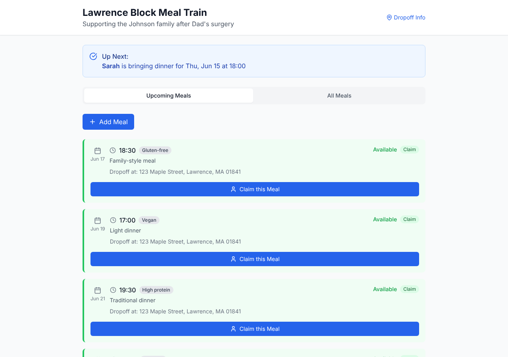

# Model bench — 2026-10-30T11-00-31a1e31

- **Tasks:** hs-meal-train, hs-community-fridge, hs-listening-wall (harness 1.2.0, commit `31a1e31`)
- **Date:** 2026-10-30T11:18:45.052Z
- **Trials per model per task:** 1
- **Human review:** _pending_

> Cost and token figures are **estimates** (chars ÷ 4 × list prices) — directional, not billing-grade.
> Mechanical columns are medians across trials. Total = plan + build wall time.
> **Bundle** = final compile success; **First try** = compiled without the auto-fix; **Renders** = opened in a browser after bundling, visible page and no uncaught errors (n/a before Oct 30, 2026); **Fail kind** = what the first-try bundle error was (missing-file, bad-import, unknown-package, syntax); **Lint/100** = eslint findings per 100 lines with the app's own config; **Largest file**, **any**, **Kit files** (files importing the RB kit over code files) and **tok/s** come from the files the model wrote (n/a before Oct 31, 2026); **Fix time** = the auto-fix pass's own wall time; **Fix** = of the builds that first failed, how many the single auto-fix pass solved. **~$** includes the fix pass when one ran.

### Task: hs-meal-train (exp-v1)

| Model | Bundle | First try | Renders | Fix | Fail kind | Files | Failed edits | Truncated | Checks | Sec flags | Lint/100 | Largest file | any | Kit files | tok/s | TTFT | Build time | Fix time | Total | ~$ | |
|---|---|---|---|---|---|---|---|---|---|---|---|---|---|---|---|---|---|---|---|---|---|
| qwen3-coder-30b | 1/1 ✓ | 0/1 | 1/1 clean | 1/1 solved | missing-file | 11 | 0 | no | 3/5 | 0 | 0.6 | 498 lines | 0 | 0/8 | 19.1 | 2s | 424s | 180s | 424s | 0.01 |

### Task: hs-community-fridge (exp-v1)

| Model | Bundle | First try | Renders | Fix | Fail kind | Files | Failed edits | Truncated | Checks | Sec flags | Lint/100 | Largest file | any | Kit files | tok/s | TTFT | Build time | Fix time | Total | ~$ | |
|---|---|---|---|---|---|---|---|---|---|---|---|---|---|---|---|---|---|---|---|---|---|
| qwen3-coder-30b | 1/1 ✓ | 0/1 | 0/1 clean | 1/1 solved | missing-file | 12 | 0 | no | 3/5 | 0 | 0.7 | 160 lines | 0 | 0/7 | 24.8 | 2s | 177s | 86s | 177s | 0.01 |

### Task: hs-listening-wall (?)

| Model | Bundle | First try | Renders | Fix | Fail kind | Files | Failed edits | Truncated | Checks | Sec flags | Lint/100 | Largest file | any | Kit files | tok/s | TTFT | Build time | Fix time | Total | ~$ | |
|---|---|---|---|---|---|---|---|---|---|---|---|---|---|---|---|---|---|---|---|---|---|

## Human review

_Not scored yet — open review/index.html, score, export, save as review/scores.json, re-run report._

## Which model for what

_Maintainer's call, informed by the tables above — the report feeds the decision, it doesn't make it._

## In the browser (bundled, but)

- **qwen3-coder-30b** · hs-community-fridge t1: renders with errors
  - pageerror: Cannot apply unknown utility class `fog-green`
  - pageerror: Cannot apply unknown utility class `fog-green`
  - pageerror: Cannot apply unknown utility class `fog-green`

## Fix passes (how solves went)

- **qwen3-coder-30b** · hs-meal-train t1: build failed to bundle → auto-fix solved in one pass (180s, ~$0.00)
  - triggered by: `vfs:/src/App.tsx:4: Could not find "./data/seedData" in the project (imported from /src/App.tsx)`
- **qwen3-coder-30b** · hs-community-fridge t1: build failed to bundle → auto-fix solved in one pass (86s, ~$0.00)
  - triggered by: `vfs:/src/App.tsx:7: Could not find "./pages/CleaningShifts" in the project (imported from /src/App.tsx)`

## Previews

### hs-meal-train — qwen3-coder-30b (trial 1)

### hs-community-fridge — qwen3-coder-30b (trial 1)

