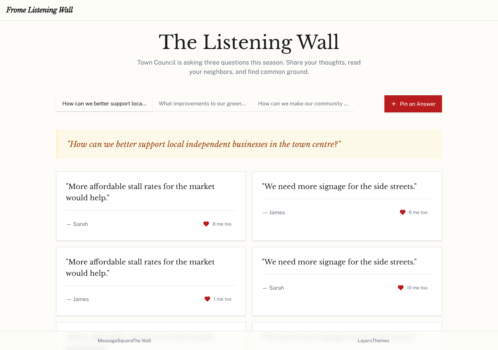

# Model bench — 2026-10-31T10-43-61b1f48

- **Tasks:** hs-listening-wall (harness 1.2.0, commit `61b1f48`)
- **Date:** 2026-10-31T10:45:06.630Z
- **Trials per model per task:** 1
- **Human review:** _pending_

> Cost and token figures are **estimates** (chars ÷ 4 × list prices) — directional, not billing-grade.
> Mechanical columns are medians across trials. Total = plan + build wall time.
> **Bundle** = final compile success; **First try** = compiled without the auto-fix; **Renders** = opened in a browser after bundling, visible page and no uncaught errors (n/a before Oct 30, 2026); **Fix** = of the builds that first failed, how many the single auto-fix pass solved. **~$** includes the fix pass when one ran.

### Task: hs-listening-wall (exp-v1)

| Model | Bundle | First try | Renders | Fix | Files | Failed edits | Truncated | Checks | Sec flags | TTFT | Build time | Total | ~$ | |
|---|---|---|---|---|---|---|---|---|---|---|---|---|---|---|
| gemma-4-26b | 1/1 ✓ | 1/1 | 1/1 clean | — | 9 | 0 | no | 4/5 | 0 | 1s | 72s | 72s | 0.00 |

## Human review

_Not scored yet — open review/index.html, score, export, save as review/scores.json, re-run report._

## Which model for what

_Maintainer's call, informed by the tables above — the report feeds the decision, it doesn't make it._

## Previews

### hs-listening-wall — gemma-4-26b (trial 1)

