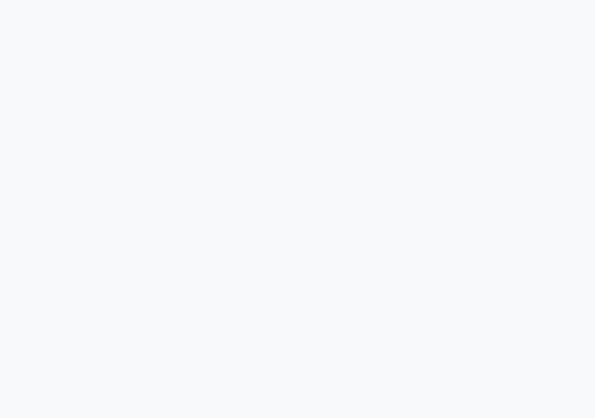

# Model bench — 2026-10-31T10-51-49-8ad3497-nl78

- **Tasks:** hs-community-fridge, hs-listening-wall (harness 1.2.0, commit `8ad3497`)
- **Date:** 2026-10-31T10:55:37.492Z
- **Trials per model per task:** 1
- **Human review:** _pending_

> Cost and token figures are **estimates** (chars ÷ 4 × list prices) — directional, not billing-grade.
> Mechanical columns are medians across trials. Total = plan + build wall time.
> **Bundle** = final compile success; **First try** = compiled without the auto-fix; **Renders** = opened in a browser after bundling, visible page and no uncaught errors (n/a before Oct 30, 2026); **Fail kind** = what the first-try bundle error was (missing-file, bad-import, unknown-package, syntax); **Lint/100** = eslint findings per 100 lines with the app's own config; **Largest file**, **any**, **Kit files** (files importing the RB kit over code files) and **tok/s** come from the files the model wrote (n/a before Oct 31, 2026); **Fix time** = the auto-fix pass's own wall time; **Fix** = of the builds that first failed, how many the single auto-fix pass solved. **~$** includes the fix pass when one ran.

### Task: hs-community-fridge (exp-v1)

| Model | Bundle | First try | Renders | Fix | Fail kind | Files | Failed edits | Truncated | Checks | Sec flags | Lint/100 | Largest file | any | Kit files | tok/s | TTFT | Build time | Fix time | Total | ~$ | |
|---|---|---|---|---|---|---|---|---|---|---|---|---|---|---|---|---|---|---|---|---|---|
| glm-4.5-air | 0/1 ✓ | 0/1 | n/a | 0/1 solved | bad-import | 22 | 0 | no | 5/5 | 0 | 2.6 | 111 lines | 10 | 11/19 | 86 | 11s | 75s | 29s | 75s | 0.01 |

### Task: hs-listening-wall (exp-v1)

| Model | Bundle | First try | Renders | Fix | Fail kind | Files | Failed edits | Truncated | Checks | Sec flags | Lint/100 | Largest file | any | Kit files | tok/s | TTFT | Build time | Fix time | Total | ~$ | |
|---|---|---|---|---|---|---|---|---|---|---|---|---|---|---|---|---|---|---|---|---|---|
| glm-4.5-air | 1/1 ✓ | 1/1 | 0/1 clean, 1 blank | — | — | 15 | 0 | no | 5/5 | 0 | 1 | 134 lines | 0 | 7/13 | 71.3 | 7s | 116s | — | 116s | 0.01 |

## Human review

_Not scored yet — open review/index.html, score, export, save as review/scores.json, re-run report._

## Which model for what

_Maintainer's call, informed by the tables above — the report feeds the decision, it doesn't make it._

## In the browser (bundled, but)

- **glm-4.5-air** · hs-listening-wall t1: BLANK PAGE
  - console: ReferenceError: Button is not defined at QuestionSection (file:///home/user/relational-builder/bench/results/2026-10-31T10-51-49-8ad3497-nl78/artifacts/hs-listening-wall/glm-4.5-air-t1/preview.html:560:11) at Hi (https:/
  - console: ReferenceError: Button is not defined at QuestionSection (file:///home/user/relational-builder/bench/results/2026-10-31T10-51-49-8ad3497-nl78/artifacts/hs-listening-wall/glm-4.5-air-t1/preview.html:560:11) at Hi (https:/
  - console: ReferenceError: Button is not defined at QuestionSection (file:///home/user/relational-builder/bench/results/2026-10-31T10-51-49-8ad3497-nl78/artifacts/hs-listening-wall/glm-4.5-air-t1/preview.html:560:11) at Hi (https:/
  - pageerror: Button is not defined

## Fix passes (how solves went)

- **glm-4.5-air** · hs-community-fridge t1: build failed to bundle → auto-fix not solved — still: vfs:/src/components/PostForm.tsx:3: No matching export in "vfs:/src/components/ui/button.tsx" for import "Button"
  - triggered by: `vfs:/src/App.tsx:3: No matching export in "vfs:/src/components/ui/app-bar.tsx" for import "default"`

## Previews

### hs-listening-wall — glm-4.5-air (trial 1)

