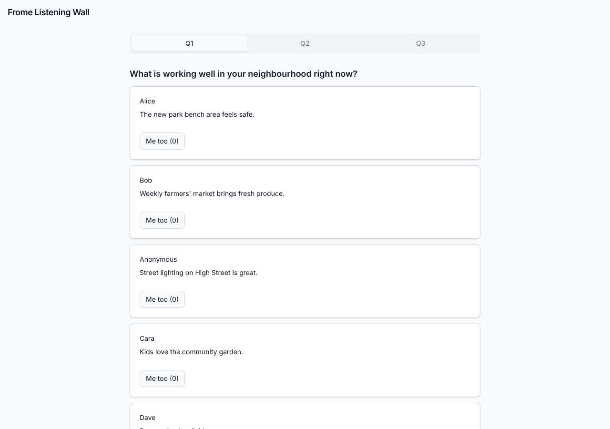

# Model bench — 2026-10-31T11-06-18-7b28bd5-ulfz

- **Tasks:** hs-community-fridge, hs-listening-wall (harness 1.2.0, commit `7b28bd5`)
- **Date:** 2026-10-31T11:13:28.288Z
- **Trials per model per task:** 1
- **Import guard:** on (static import check feeds the fix pass)
- **Human review:** _pending_

> Cost and token figures are **estimates** (chars ÷ 4 × list prices) — directional, not billing-grade.
> Mechanical columns are medians across trials. Total = plan + build wall time.
> **Bundle** = final compile success; **First try** = compiled without the auto-fix; **Renders** = opened in a browser after bundling, visible page and no uncaught errors (n/a before Oct 30, 2026); **Fail kind** = what the first-try bundle error was (missing-file, bad-import, unknown-package, syntax); **Lint/100** = eslint findings per 100 lines with the app's own config; **Largest file**, **any**, **Kit files** (files importing the RB kit over code files) and **tok/s** come from the files the model wrote (n/a before Oct 31, 2026); **Fix time** = the auto-fix pass's own wall time; **Fix** = of the builds that first failed, how many the single auto-fix pass solved. **~$** includes the fix pass when one ran.

### Task: hs-community-fridge (exp-v1)

| Model | Bundle | First try | Renders | Fix | Fail kind | Files | Failed edits | Truncated | Checks | Sec flags | Lint/100 | Largest file | any | Kit files | tok/s | TTFT | Build time | Fix time | Total | ~$ | |
|---|---|---|---|---|---|---|---|---|---|---|---|---|---|---|---|---|---|---|---|---|---|
| gpt-oss-120b | 1/1 ✓ | 1/1 | 0/1 clean, 1 blank | — | — | 9 | 0 | no | 4/5 | 0 | 2.1 | 108 lines | 0 | 5/7 | 9.7 | 59s | 370s | — | 370s | 0.00 |

### Task: hs-listening-wall (exp-v1)

| Model | Bundle | First try | Renders | Fix | Fail kind | Files | Failed edits | Truncated | Checks | Sec flags | Lint/100 | Largest file | any | Kit files | tok/s | TTFT | Build time | Fix time | Total | ~$ | |
|---|---|---|---|---|---|---|---|---|---|---|---|---|---|---|---|---|---|---|---|---|---|
| gpt-oss-120b | 1/1 ✓ | 1/1 | 1/1 clean | — | — | 8 | 0 | no | 5/5 | 0 | 0 | 111 lines | 0 | 2/5 | 85.2 | 10s | 46s | — | 46s | 0.00 |

## Human review

_Not scored yet — open review/index.html, score, export, save as review/scores.json, re-run report._

## Which model for what

_Maintainer's call, informed by the tables above — the report feeds the decision, it doesn't make it._

## In the browser (bundled, but)

- **gpt-oss-120b** · hs-community-fridge t1: BLANK PAGE
  - console: Error: Minified React error #31; visit https://reactjs.org/docs/error-decoder.html?invariant=31&args[]=object%20with%20keys%20%7B%24%24typeof%2C%20render%2C%20displayName%7D for the full message or use the non-minified d
  - console: Error: Minified React error #31; visit https://reactjs.org/docs/error-decoder.html?invariant=31&args[]=object%20with%20keys%20%7B%24%24typeof%2C%20render%2C%20displayName%7D for the full message or use the non-minified d
  - pageerror: Minified React error #31; visit https://reactjs.org/docs/error-decoder.html?invariant=31&args[]=object%20with%20keys%20%7B%24%24typeof%2C%20render%2C%20displayName%7D for the full message or use the non-minified dev envi

## Previews

### hs-community-fridge — gpt-oss-120b (trial 1)

### hs-listening-wall — gpt-oss-120b (trial 1)

