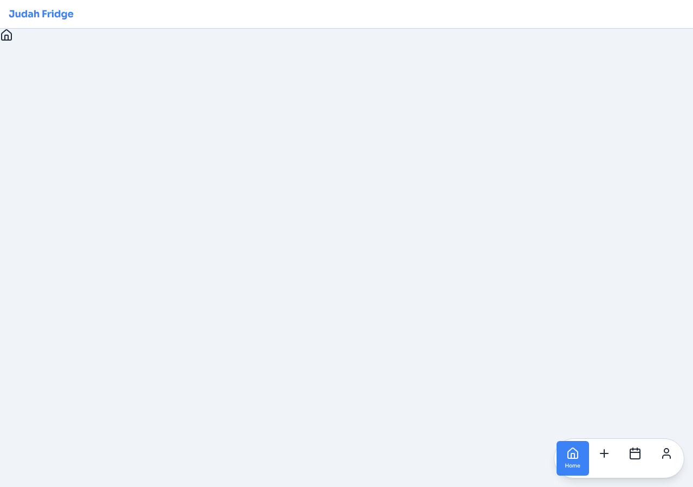
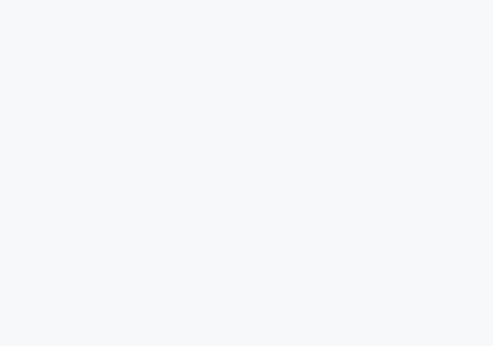
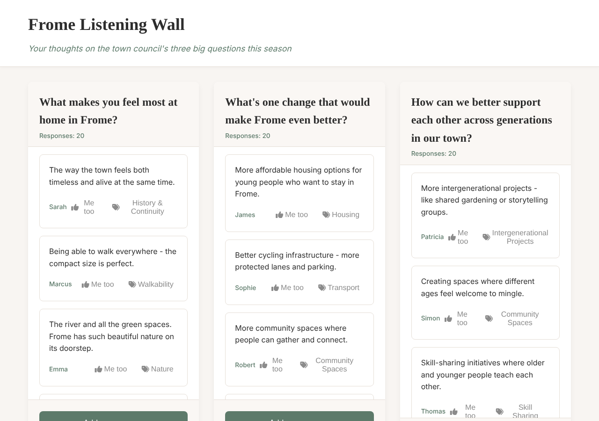
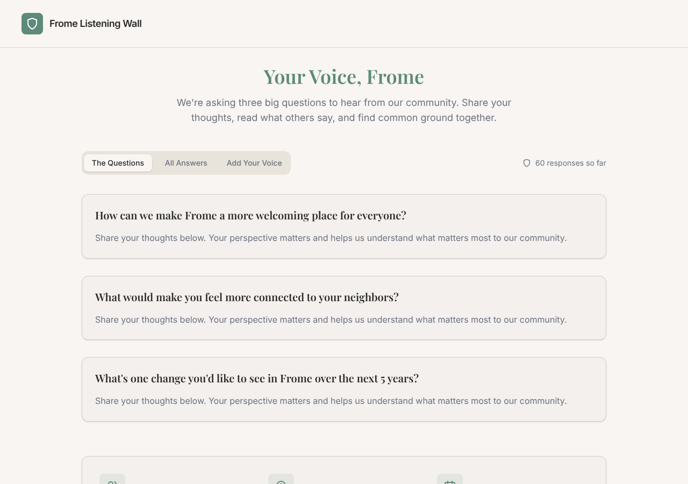
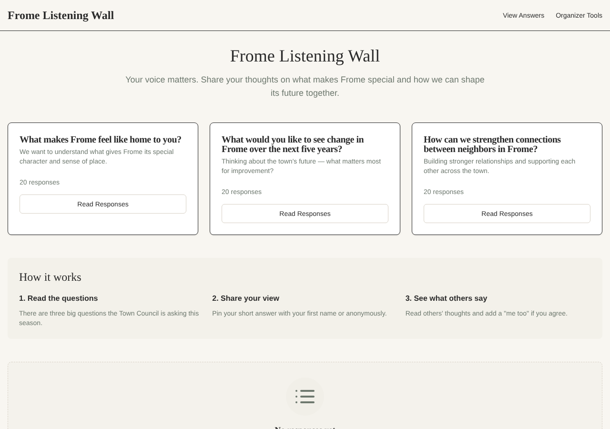

# Model bench — 2026-11-01T12-25-36-8072180-3dhy

- **Tasks:** hs-community-fridge, hs-listening-wall (harness 1.2.0, commit `8072180`)
- **Date:** 2026-11-01T12:44:01.779Z
- **Trials per model per task:** 3
- **Import guard:** on (static import check feeds the fix pass)
- **Human review:** _pending_

> Cost and token figures are **estimates** (chars ÷ 4 × list prices) — directional, not billing-grade.
> Mechanical columns are medians across trials. Total = plan + build wall time.
> **Bundle** = final compile success; **First try** = compiled without the auto-fix; **Renders** = opened in a browser after bundling, visible page and no uncaught errors (n/a before Oct 30, 2026); **Fail kind** = what the first-try bundle error was (missing-file, bad-import, unknown-package, syntax); **Lint/100** = eslint findings per 100 lines with the app's own config; **tsc errors** = type errors in the model's files with the kit merged and uninstalled packages untyped, counted only on builds that bundled, syntax errors kept apart (n/a before Nov 1, 2026); **Largest file**, **any**, **Kit files** (files importing the RB kit over code files) and **tok/s** come from the files the model wrote (n/a before Oct 31, 2026); **Fix time** = the auto-fix pass's own wall time; **Fix** = of the builds that first failed, how many the single auto-fix pass solved. **~$** includes the fix pass when one ran.

### Task: hs-community-fridge (exp-v1)

| Model | Bundle | First try | Renders | Fix | Fail kind | Files | Failed edits | Truncated | Checks | Sec flags | Lint/100 | tsc errors | Largest file | any | Kit files | tok/s | TTFT | Build time | Fix time | Total | ~$ | |
|---|---|---|---|---|---|---|---|---|---|---|---|---|---|---|---|---|---|---|---|---|---|---|
| qwen3-coder-next | 2/3 ✓ | 0/3 | 1/2 clean, 1 blank | 1/3 solved | bad-import, other | 41 | 0 | no | 5/5 | 0 | 1.7 | 30 | 204 lines | 0 | 5/20 | 76.1 | 1s | 155s | 14s | 155s | 0.02 |

### Task: hs-listening-wall (exp-v1)

| Model | Bundle | First try | Renders | Fix | Fail kind | Files | Failed edits | Truncated | Checks | Sec flags | Lint/100 | tsc errors | Largest file | any | Kit files | tok/s | TTFT | Build time | Fix time | Total | ~$ | |
|---|---|---|---|---|---|---|---|---|---|---|---|---|---|---|---|---|---|---|---|---|---|---|
| qwen3-coder-next | 2/3 ✓ | 1/3 | 3/3 clean | 0/1 solved | missing-file | 7 | 0 | no | 5/5 | 0 | 2.15 | 3 | 145 lines | 0 | 1/5 | 73.3 | 1s | 127s | 15s | 127s | 0.01 |

## Human review

_Not scored yet — open review/index.html, score, export, save as review/scores.json, re-run report._

## Which model for what

_Maintainer's call, informed by the tables above — the report feeds the decision, it doesn't make it._

## In the browser (bundled, but)

- **qwen3-coder-next** · hs-community-fridge t3: BLANK PAGE
  - console: Error at B (https://esm.sh/@remix-run/router@1.23.0/es2022/router.mjs:2:2356) at re (https://esm.sh/react-router@6.30.0/X-ZXJlYWN0/es2022/react-router.mjs:2:12854) at Hi (https://esm.sh/react-dom@18.3.1/X-ZXJlYWN0/es2022
  - pageerror: Error

## Fix passes (how solves went)

- **qwen3-coder-next** · hs-community-fridge t1: build failed to bundle → auto-fix solved in one pass (41s, ~$0.01)
  - triggered by: `vfs:/src/App.tsx:7: No matching export in "vfs:/src/components/ui/app-bar.tsx" for import "BottomNav"`
- **qwen3-coder-next** · hs-community-fridge t2: build failed to bundle → auto-fix not solved after one pass — still: vfs:/src/main.tsx:4: No matching export in "vfs:/src/App.tsx" for import "default"
  - triggered by: `vfs:/src/main.tsx:4: No matching export in "vfs:/src/App.tsx" for import "default"`
- **qwen3-coder-next** · hs-community-fridge t3: build failed to bundle → auto-fix not solved after one pass — still: vfs:/src/pages/Home.tsx: No matching export in "vfs:/src/components/ui/card.tsx" for import "Card"
  - triggered by: `vfs:/src/components/ui/button.tsx: ReferenceError: React is not defined (uses React.* with no `import React from 'react'` or `import * as React from 'react'`)`
- **qwen3-coder-next** · hs-listening-wall t3: build failed to bundle → auto-fix not solved after one pass — still: vfs:/"src/pages/Organizer.tsx: Could not find "../data/seeds" in the project (imported from /"src/pages/Organizer.tsx)
  - triggered by: `vfs:/src/App.tsx:5: Could not find "./pages/Organizer" in the project (imported from /src/App.tsx)`

## Previews

### hs-community-fridge — qwen3-coder-next (trial 1)

### hs-community-fridge — qwen3-coder-next (trial 3)

### hs-listening-wall — qwen3-coder-next (trial 1)

### hs-listening-wall — qwen3-coder-next (trial 2)

### hs-listening-wall — qwen3-coder-next (trial 3)

