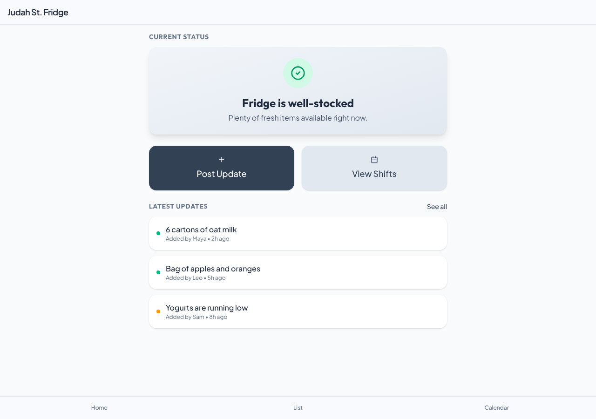
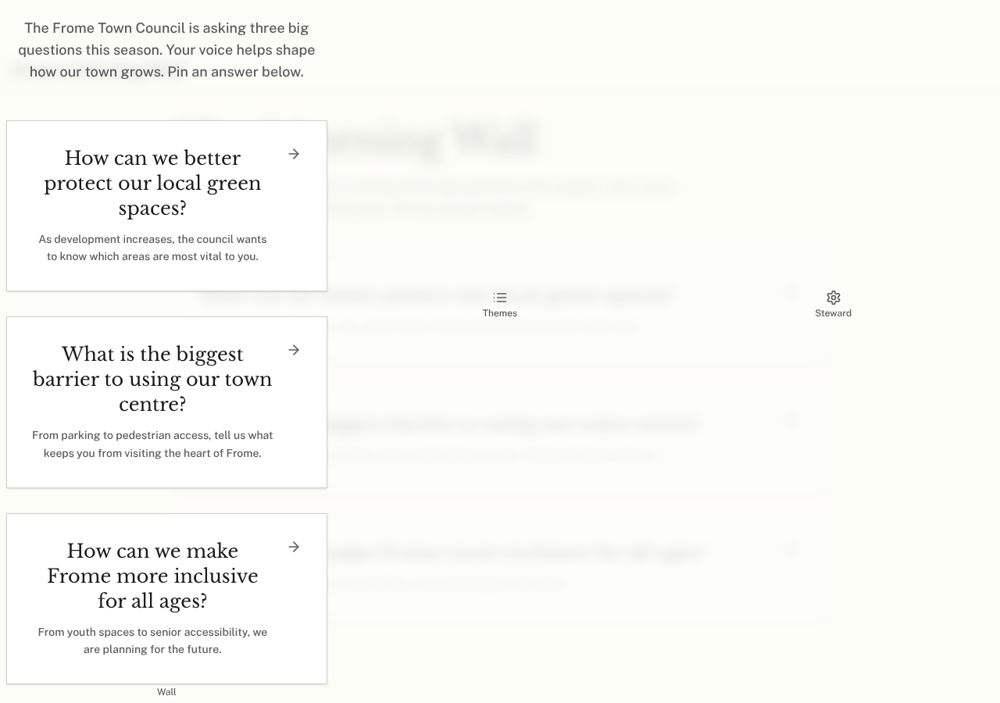

# Model bench — 2026-11-03T11-45-50-7b3c32a-jrvk

- **Tasks:** hs-community-fridge, hs-listening-wall (harness 1.2.0, commit `7b3c32a`)
- **Date:** 2026-11-03T11:54:50.143Z
- **Trials per model per task:** 3
- **Import guard:** on (static import check feeds the fix pass)
- **Human review:** _pending_

> Cost and token figures are **estimates** (chars ÷ 4 × list prices) — directional, not billing-grade.
> Mechanical columns are medians across trials. Total = plan + build wall time.
> **Bundle** = final compile success; **First try** = compiled without the auto-fix; **Renders** = opened in a browser after bundling, visible page and no uncaught errors (n/a before Oct 30, 2026); **Fail kind** = what the first-try bundle error was (missing-file, bad-import, unknown-package, syntax); **Lint/100** = eslint findings per 100 lines with the app's own config; **tsc errors** = type errors in the model's files with the kit merged and uninstalled packages untyped, counted only on builds that bundled, syntax errors kept apart (n/a before Nov 1, 2026); **Largest file**, **any**, **Kit files** (files importing the RB kit over code files) and **tok/s** come from the files the model wrote (n/a before Oct 31, 2026); **Fix time** = the auto-fix pass's own wall time; **Fix** = of the builds that first failed, how many the single auto-fix pass solved. **~$** includes the fix pass when one ran.

### Task: hs-community-fridge (exp-v1)

| Model | Bundle | First try | Renders | Fix | Fail kind | Files | Failed edits | Truncated | Checks | Sec flags | Lint/100 | tsc errors | Largest file | any | Kit files | tok/s | TTFT | Build time | Fix time | Total | ~$ | |
|---|---|---|---|---|---|---|---|---|---|---|---|---|---|---|---|---|---|---|---|---|---|---|
| gemma-4-26b | 1/3 ✓ | 0/3 | 1/1 clean | 1/3 solved | syntax, other | 9 | 0 | no | 4/5 | 0 | 2.9 | 3 | 67 lines | 0 | 4/6 | 58.4 | 3s | 60s | 11s | 60s | 0.00 |

### Task: hs-listening-wall (exp-v1)

| Model | Bundle | First try | Renders | Fix | Fail kind | Files | Failed edits | Truncated | Checks | Sec flags | Lint/100 | tsc errors | Largest file | any | Kit files | tok/s | TTFT | Build time | Fix time | Total | ~$ | |
|---|---|---|---|---|---|---|---|---|---|---|---|---|---|---|---|---|---|---|---|---|---|---|
| gemma-4-26b | 1/3 ✓ | 0/3 | 1/1 clean | 0/3 solved | other, syntax | 10 | 0 | no | 4/5 | 0 | 2 | 4 | 95 lines | 0 | 4/6 | 89.8 | 2s | 60s | 14s | 60s | 0.00 |

## Human review

_Not scored yet — open review/index.html, score, export, save as review/scores.json, re-run report._

## Which model for what

_Maintainer's call, informed by the tables above — the report feeds the decision, it doesn't make it._

## Served as (provider-reported)

- **gemma-4-26b**: google/gemma-4-26b-a4b-it, via DekaLLM / google/gemma-4-26b-a4b-it, via Darkbloom / google/gemma-4-26b-a4b-it, via Parasail

## Fix passes (how solves went)

- **gemma-4-26b** · hs-community-fridge t1: build failed to bundle → auto-fix solved in one pass (11s, ~$0.00)
  - triggered by: `vfs:/src/pages/ShiftsPage.tsx:3: Expected "from" but found "too"`
- **gemma-4-26b** · hs-community-fridge t2: build failed to bundle → auto-fix not solved after one pass — still: vfs:/src/main.tsx:1: Expected ";" but found "react"
  - triggered by: `No entry module found (no index.html module script or /src/main.tsx)`
- **gemma-4-26b** · hs-community-fridge t3: build failed to bundle → auto-fix not solved after one pass — still: vfs:/src/App.tsx:131: Expected ")" but found "}"
  - triggered by: `vfs:/src/main.tsx:1: Expected ";" but found "react"`
- **gemma-4-26b** · hs-listening-wall t1: build failed to bundle → auto-fix not solved after one pass — still: vfs:/src/pages/QuestionDetail.tsx: ReferenceError: React is not defined (uses React.* with no `import React from 'react'` or `import * as React from 'react'`)
  - triggered by: `vfs:/src/pages/QuestionDetail.tsx: ReferenceError: React is not defined (uses React.* with no `import React from 'react'` or `import * as React from 'react'`)`
- **gemma-4-26b** · hs-listening-wall t2: build failed to bundle → auto-fix not solved after one pass — still: vfs:/src/main.tsx:1: Expected ";" but found "react"
  - triggered by: `vfs:/src/main.tsx:1: Expected ";" but found "react"`
- **gemma-4-26b** · hs-listening-wall t3: build failed to bundle → auto-fix not solved after one pass — still: vfs:/src/main.tsx:1: Expected ";" but found "react"
  - triggered by: `vfs:/src/main.tsx:1: Expected ";" but found "react"`

## Previews

### hs-community-fridge — gemma-4-26b (trial 1)

### hs-listening-wall — gemma-4-26b (trial 1)

