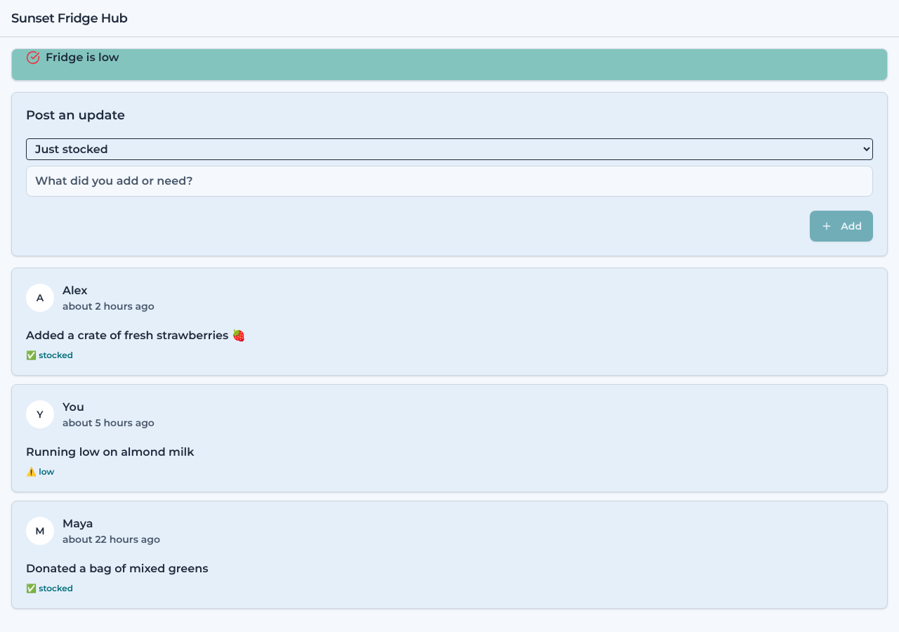

# Model bench — 2026-11-03T11-46-35-63c6227-vzrz

- **Tasks:** hs-community-fridge, hs-listening-wall (harness 1.2.0, commit `63c6227`)
- **Date:** 2026-11-03T11:57:00.743Z
- **Trials per model per task:** 3
- **Import guard:** on (static import check feeds the fix pass)
- **Human review:** _pending_

> Cost and token figures are **estimates** (chars ÷ 4 × list prices) — directional, not billing-grade.
> Mechanical columns are medians across trials. Total = plan + build wall time.
> **Bundle** = final compile success; **First try** = compiled without the auto-fix; **Renders** = opened in a browser after bundling, visible page and no uncaught errors (n/a before Oct 30, 2026); **Fail kind** = what the first-try bundle error was (missing-file, bad-import, unknown-package, syntax); **Lint/100** = eslint findings per 100 lines with the app's own config; **tsc errors** = type errors in the model's files with the kit merged and uninstalled packages untyped, counted only on builds that bundled, syntax errors kept apart (n/a before Nov 1, 2026); **Largest file**, **any**, **Kit files** (files importing the RB kit over code files) and **tok/s** come from the files the model wrote (n/a before Oct 31, 2026); **Fix time** = the auto-fix pass's own wall time; **Fix** = of the builds that first failed, how many the single auto-fix pass solved. **~$** includes the fix pass when one ran.

### Task: hs-community-fridge (exp-v1)

| Model | Bundle | First try | Renders | Fix | Fail kind | Files | Failed edits | Truncated | Checks | Sec flags | Lint/100 | tsc errors | Largest file | any | Kit files | tok/s | TTFT | Build time | Fix time | Total | ~$ | |
|---|---|---|---|---|---|---|---|---|---|---|---|---|---|---|---|---|---|---|---|---|---|---|
| gpt-oss-120b | 3/3 ✓ | 2/3 | 1/3 clean, 1 blank | 1/1 solved | other | 8 | 0 | no | 4/5 | 0 | 2.1 | 4 | 127 lines | 1 | 3/6 | 40.8 | 17s | 89s | 2s | 89s | 0.00 |

### Task: hs-listening-wall (exp-v1)

| Model | Bundle | First try | Renders | Fix | Fail kind | Files | Failed edits | Truncated | Checks | Sec flags | Lint/100 | tsc errors | Largest file | any | Kit files | tok/s | TTFT | Build time | Fix time | Total | ~$ | |
|---|---|---|---|---|---|---|---|---|---|---|---|---|---|---|---|---|---|---|---|---|---|---|
| gpt-oss-120b | 3/3 ✓ | 2/3 | 1/3 clean, 2 blank | 1/1 solved | other | 7 | 0 | no | 4/5 | 0 | 0.9 | 1 | 147 lines | 1 | 2/5 | 29.8 | 12s | 110s | 27s | 110s | 0.00 |

## Human review

_Not scored yet — open review/index.html, score, export, save as review/scores.json, re-run report._

## Which model for what

_Maintainer's call, informed by the tables above — the report feeds the decision, it doesn't make it._

## Served as (provider-reported)

- **gpt-oss-120b**: openai/gpt-oss-120b, via Mancer 2 / openai/gpt-oss-120b, via Venice / openai/gpt-oss-120b, via PrimeIntellect / openai/gpt-oss-120b, via DeepInfra

## In the browser (bundled, but)

- **gpt-oss-120b** · hs-community-fridge t1: BLANK PAGE
  - console: ReferenceError: currentUser is not defined at App (file:///home/user/relational-builder/bench/results/2026-11-03T11-46-35-63c6227-vzrz/artifacts/hs-community-fridge/gpt-oss-120b-t1/preview.html:604:47) at Hi (https://esm
  - pageerror: currentUser is not defined
- **gpt-oss-120b** · hs-community-fridge t3: renders with errors
  - console: Failed to load resource: net::ERR_FILE_NOT_FOUND
- **gpt-oss-120b** · hs-listening-wall t1: BLANK PAGE
  - console: SecurityError: Failed to execute 'replaceState' on 'History': A history state object with URL 'file:///' cannot be created in a document with origin 'null' and URL 'file:///home/user/relational-builder/bench/results/2026
  - pageerror: Failed to execute 'replaceState' on 'History': A history state object with URL 'file:///' cannot be created in a document with origin 'null' and URL 'file:///home/user/relational-builder/bench/results/2026-11-03T11-46-35
- **gpt-oss-120b** · hs-listening-wall t3: BLANK PAGE
  - console: SecurityError: Failed to execute 'replaceState' on 'History': A history state object with URL 'file:///' cannot be created in a document with origin 'null' and URL 'file:///home/user/relational-builder/bench/results/2026
  - pageerror: Failed to execute 'replaceState' on 'History': A history state object with URL 'file:///' cannot be created in a document with origin 'null' and URL 'file:///home/user/relational-builder/bench/results/2026-11-03T11-46-35

## Fix passes (how solves went)

- **gpt-oss-120b** · hs-community-fridge t2: build failed to bundle → auto-fix solved in one pass (2s, ~$0.00)
  - triggered by: `vfs:/src/pages/UpdateForm.tsx: ReferenceError: React is not defined (uses React.* with no `import React from 'react'` or `import * as React from 'react'`)`
- **gpt-oss-120b** · hs-listening-wall t2: build failed to bundle → auto-fix solved in one pass (27s, ~$0.00)
  - triggered by: `vfs:/src/pages/QuestionPage.tsx: ReferenceError: React is not defined (uses React.* with no `import React from 'react'` or `import * as React from 'react'`)`

## Previews

### hs-community-fridge — gpt-oss-120b (trial 1)

### hs-community-fridge — gpt-oss-120b (trial 2)

### hs-community-fridge — gpt-oss-120b (trial 3)

### hs-listening-wall — gpt-oss-120b (trial 1)

### hs-listening-wall — gpt-oss-120b (trial 2)

### hs-listening-wall — gpt-oss-120b (trial 3)

