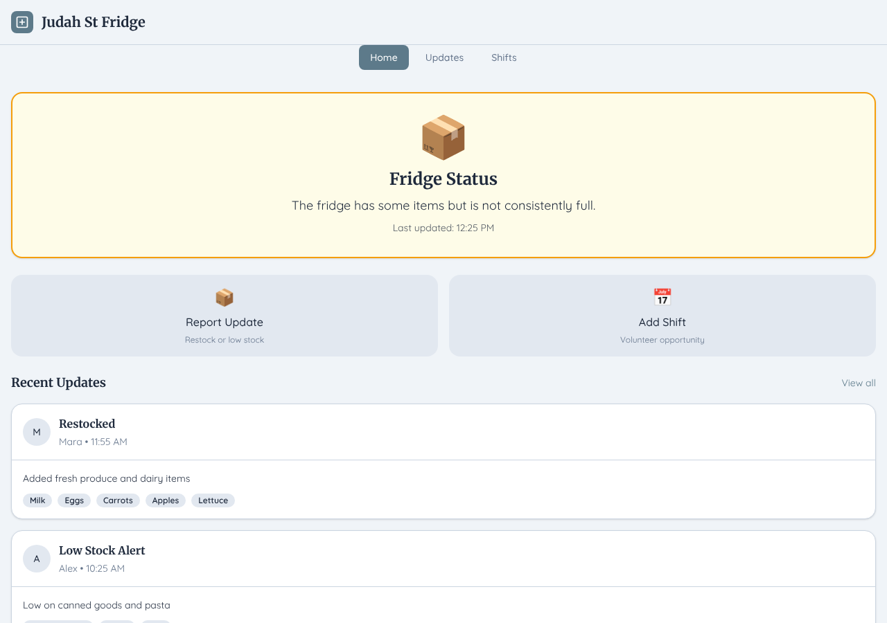
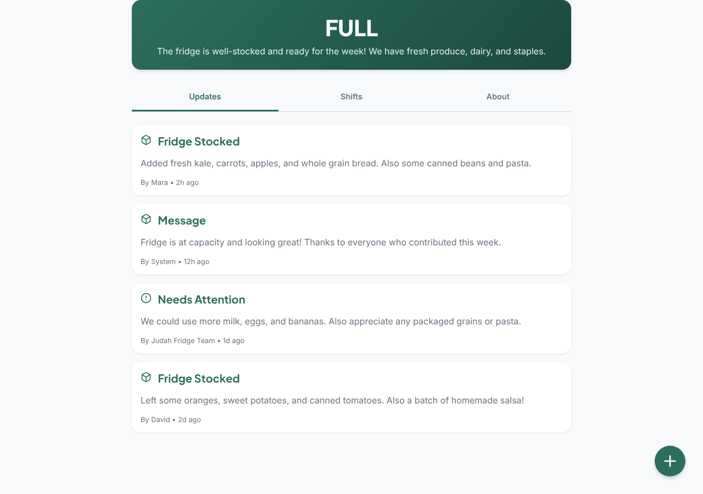
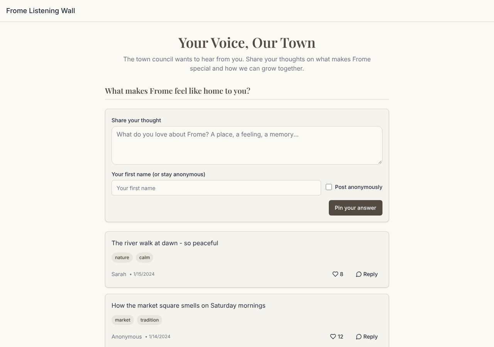

# Model bench — 2026-11-03T12-04-50-73f1312-9u3d

- **Tasks:** hs-community-fridge, hs-listening-wall (harness 1.2.0, commit `73f1312`)
- **Date:** 2026-11-03T12:23:16.298Z
- **Trials per model per task:** 3
- **Import guard:** on (static import check feeds the fix pass)
- **Human review:** _pending_

> Cost and token figures are **estimates** (chars ÷ 4 × list prices) — directional, not billing-grade.
> Mechanical columns are medians across trials. Total = plan + build wall time.
> **Bundle** = final compile success; **First try** = compiled without the auto-fix; **Renders** = opened in a browser after bundling, visible page and no uncaught errors (n/a before Oct 30, 2026); **Fail kind** = what the first-try bundle error was (missing-file, bad-import, unknown-package, syntax); **Lint/100** = eslint findings per 100 lines with the app's own config; **tsc errors** = type errors in the model's files with the kit merged and uninstalled packages untyped, counted only on builds that bundled, syntax errors kept apart (n/a before Nov 1, 2026); **Largest file**, **any**, **Kit files** (files importing the RB kit over code files) and **tok/s** come from the files the model wrote (n/a before Oct 31, 2026); **Fix time** = the auto-fix pass's own wall time; **Fix** = of the builds that first failed, how many the single auto-fix pass solved. **~$** includes the fix pass when one ran.

### Task: hs-community-fridge (exp-v1)

| Model | Bundle | First try | Renders | Fix | Fail kind | Files | Failed edits | Truncated | Checks | Sec flags | Lint/100 | tsc errors | Largest file | any | Kit files | tok/s | TTFT | Build time | Fix time | Total | ~$ | |
|---|---|---|---|---|---|---|---|---|---|---|---|---|---|---|---|---|---|---|---|---|---|---|
| qwen3-coder-next | 2/3 ✓ | 0/3 | 2/3 clean, 1 blank | 2/2 solved | other, bad-import | 17 | 0 | no | 5/5 | 0 | 1.05 | 8 | 208 lines | 0 | 5/15 | 54.8 | 1s | 216s | 32s | 216s | 0.01 |

### Task: hs-listening-wall (exp-v1)

| Model | Bundle | First try | Renders | Fix | Fail kind | Files | Failed edits | Truncated | Checks | Sec flags | Lint/100 | tsc errors | Largest file | any | Kit files | tok/s | TTFT | Build time | Fix time | Total | ~$ | |
|---|---|---|---|---|---|---|---|---|---|---|---|---|---|---|---|---|---|---|---|---|---|---|
| qwen3-coder-next | 2/2 ✓ | 1/2 | 1/2 clean, 1 blank | 1/1 solved | missing-file | 18.5 | 0 | no | 4.5/5 | 0 | 0.8500000000000001 | 8 | 132 lines | 1 | 3/16 | 52.650000000000006 | 1s | 193s | 3s | 193s | 0.01 |

## Human review

_Not scored yet — open review/index.html, score, export, save as review/scores.json, re-run report._

## Which model for what

_Maintainer's call, informed by the tables above — the report feeds the decision, it doesn't make it._

## Served as (provider-reported)

- **qwen3-coder-next**: qwen/qwen3-coder-next, via Parasail

## In the browser (bundled, but)

- **qwen3-coder-next** · hs-community-fridge t3: BLANK PAGE
  - pageerror: The requested module '@dicebear/avataaars' does not provide an export named 'createAvatar'
- **qwen3-coder-next** · hs-listening-wall t1: BLANK PAGE
  - console: Access to CSS stylesheet at 'file:///src/index.css' from origin 'null' has been blocked by CORS policy: Cross origin requests are only supported for protocol schemes: chrome, chrome-extension, chrome-untrusted, data, htt
  - console: ReferenceError: useState is not defined at Home (file:///home/user/relational-builder/bench/results/2026-11-03T12-04-50-73f1312-9u3d/artifacts/hs-listening-wall/qwen3-coder-next-t1/preview.html:681:37) at Hi (https://esm
  - pageerror: useState is not defined

## Fix passes (how solves went)

- **qwen3-coder-next** · hs-community-fridge t1: build failed to bundle → auto-fix solved in one pass (57s, ~$0.01)
  - triggered by: `vfs:/src/components/ui/button.tsx: ReferenceError: React is not defined (uses React.* with no `import React from 'react'` or `import * as React from 'react'`)`
- **qwen3-coder-next** · hs-community-fridge t3: build failed to bundle → auto-fix solved in one pass (7s, ~$0.00)
  - triggered by: `vfs:/src/pages/Home.tsx: The requested module 'lucide-react' does not provide an export named 'Fridge'`
- **qwen3-coder-next** · hs-listening-wall t2: build failed to bundle → auto-fix solved in one pass (3s, ~$0.00)
  - triggered by: `vfs:/src/pages/Home.tsx: Could not find "@/components/components/AnswerForm" in the project (imported from /src/pages/Home.tsx)`

## Previews

### hs-community-fridge — qwen3-coder-next (trial 1)

### hs-community-fridge — qwen3-coder-next (trial 2)

### hs-community-fridge — qwen3-coder-next (trial 3)

### hs-listening-wall — qwen3-coder-next (trial 1)

### hs-listening-wall — qwen3-coder-next (trial 2)

