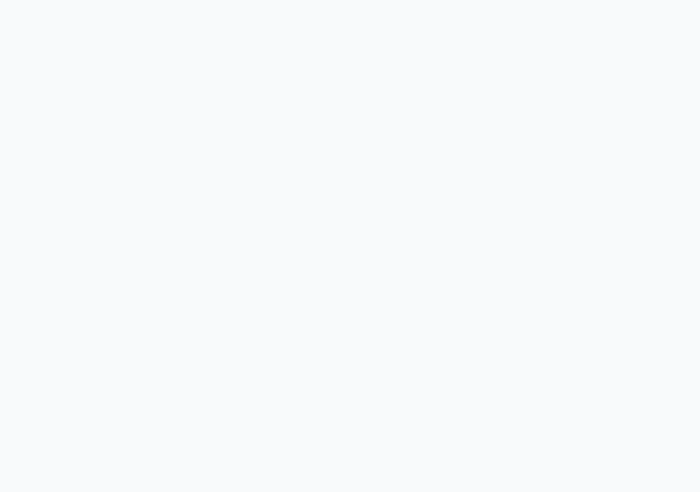
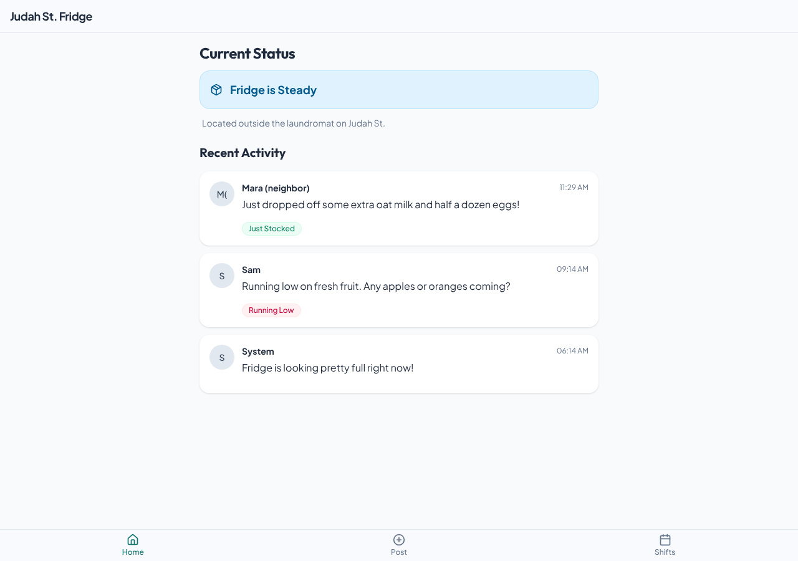
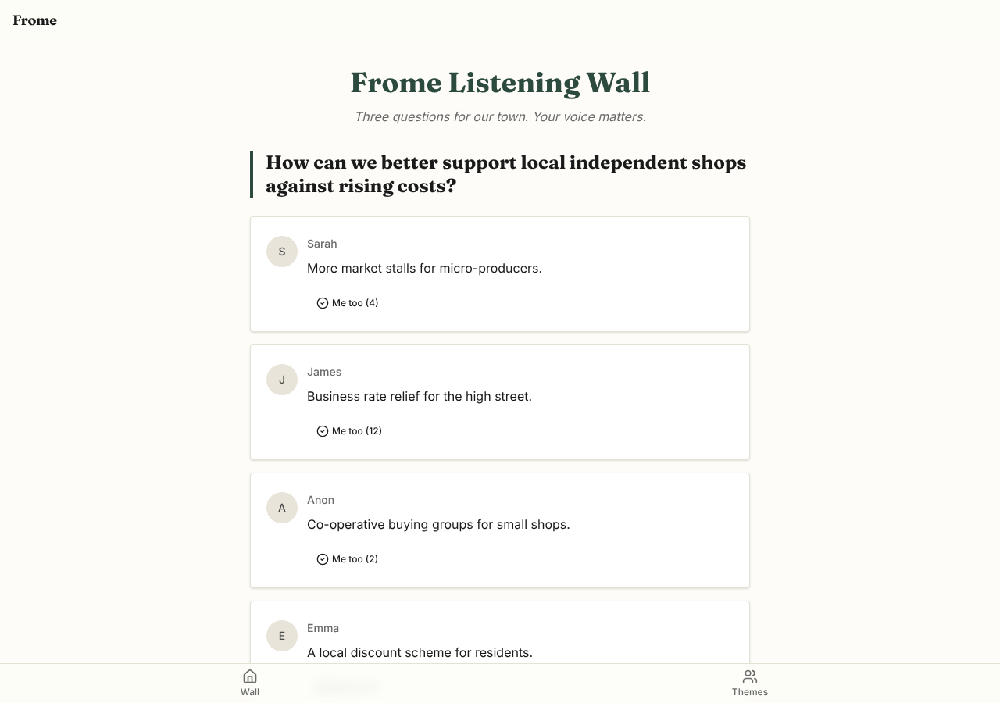
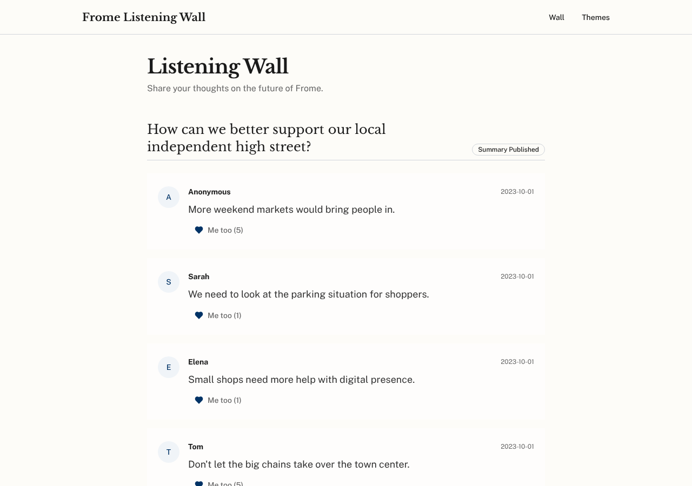
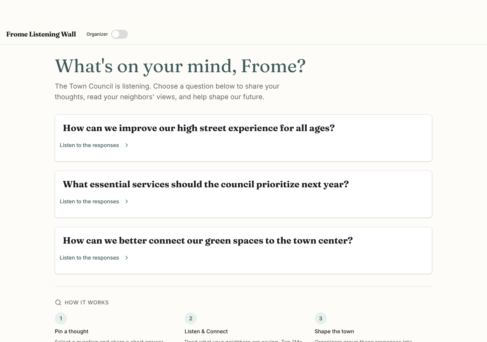

# Model bench — 2026-11-03T12-04-50-73f1312-tggx

- **Tasks:** hs-community-fridge, hs-listening-wall (harness 1.2.0, commit `73f1312`)
- **Date:** 2026-11-03T12:14:24.567Z
- **Trials per model per task:** 3
- **Import guard:** on (static import check feeds the fix pass)
- **Human review:** _pending_

> Cost and token figures are **estimates** (chars ÷ 4 × list prices) — directional, not billing-grade.
> Mechanical columns are medians across trials. Total = plan + build wall time.
> **Bundle** = final compile success; **First try** = compiled without the auto-fix; **Renders** = opened in a browser after bundling, visible page and no uncaught errors (n/a before Oct 30, 2026); **Fail kind** = what the first-try bundle error was (missing-file, bad-import, unknown-package, syntax); **Lint/100** = eslint findings per 100 lines with the app's own config; **tsc errors** = type errors in the model's files with the kit merged and uninstalled packages untyped, counted only on builds that bundled, syntax errors kept apart (n/a before Nov 1, 2026); **Largest file**, **any**, **Kit files** (files importing the RB kit over code files) and **tok/s** come from the files the model wrote (n/a before Oct 31, 2026); **Fix time** = the auto-fix pass's own wall time; **Fix** = of the builds that first failed, how many the single auto-fix pass solved. **~$** includes the fix pass when one ran.

### Task: hs-community-fridge (exp-v1)

| Model | Bundle | First try | Renders | Fix | Fail kind | Files | Failed edits | Truncated | Checks | Sec flags | Lint/100 | tsc errors | Largest file | any | Kit files | tok/s | TTFT | Build time | Fix time | Total | ~$ | |
|---|---|---|---|---|---|---|---|---|---|---|---|---|---|---|---|---|---|---|---|---|---|---|
| gemma-4-26b | 3/3 ✓ | 1/3 | 1/3 clean, 2 blank | 2/2 solved | bad-import, other | 9 | 0 | no | 4/5 | 0 | 2.2 | 3 | 118 lines | 0 | 4/6 | 55.3 | 1s | 70s | 20s | 70s | 0.00 |

### Task: hs-listening-wall (exp-v1)

| Model | Bundle | First try | Renders | Fix | Fail kind | Files | Failed edits | Truncated | Checks | Sec flags | Lint/100 | tsc errors | Largest file | any | Kit files | tok/s | TTFT | Build time | Fix time | Total | ~$ | |
|---|---|---|---|---|---|---|---|---|---|---|---|---|---|---|---|---|---|---|---|---|---|---|
| gemma-4-26b | 3/3 ✓ | 0/3 | 3/3 clean | 3/3 solved | syntax, other | 9 | 0 | no | 4/5 | 0 | 1.2 | 4 | 124 lines | 0 | 4/7 | 61.4 | 1s | 78s | 16s | 78s | 0.00 |

## Human review

_Not scored yet — open review/index.html, score, export, save as review/scores.json, re-run report._

## Which model for what

_Maintainer's call, informed by the tables above — the report feeds the decision, it doesn't make it._

## Served as (provider-reported)

- **gemma-4-26b**: google/gemma-4-26b-a4b-it, via CoreWeave / google/gemma-4-26b-a4b-it, via PrimeIntellect / google/gemma-4-26b-a4b-it, via NextBit

## In the browser (bundled, but)

- **gemma-4-26b** · hs-community-fridge t1: BLANK PAGE
  - console: Error: Minified React error #31; visit https://reactjs.org/docs/error-decoder.html?invariant=31&args[]=object%20with%20keys%20%7B%24%24typeof%2C%20render%2C%20displayName%7D for the full message or use the non-minified d
  - console: Error: Minified React error #31; visit https://reactjs.org/docs/error-decoder.html?invariant=31&args[]=object%20with%20keys%20%7B%24%24typeof%2C%20render%2C%20displayName%7D for the full message or use the non-minified d
  - console: Error: Minified React error #31; visit https://reactjs.org/docs/error-decoder.html?invariant=31&args[]=object%20with%20keys%20%7B%24%24typeof%2C%20render%2C%20displayName%7D for the full message or use the non-minified d
  - pageerror: Minified React error #31; visit https://reactjs.org/docs/error-decoder.html?invariant=31&args[]=object%20with%20keys%20%7B%24%24typeof%2C%20render%2C%20displayName%7D for the full message or use the non-minified dev envi
- **gemma-4-26b** · hs-community-fridge t2: BLANK PAGE
  - console: Error: Dynamic require of "lucide-react" is not supported at file:///home/user/relational-builder/bench/results/2026-11-03T12-04-50-73f1312-tggx/artifacts/hs-community-fridge/gemma-4-26b-t2/preview.html:93:9 at BottomNav
  - console: Error: Dynamic require of "lucide-react" is not supported at file:///home/user/relational-builder/bench/results/2026-11-03T12-04-50-73f1312-tggx/artifacts/hs-community-fridge/gemma-4-26b-t2/preview.html:93:9 at BottomNav
  - console: Error: Dynamic require of "lucide-react" is not supported at file:///home/user/relational-builder/bench/results/2026-11-03T12-04-50-73f1312-tggx/artifacts/hs-community-fridge/gemma-4-26b-t2/preview.html:93:9 at BottomNav
  - pageerror: Dynamic require of "lucide-react" is not supported

## Fix passes (how solves went)

- **gemma-4-26b** · hs-community-fridge t2: build failed to bundle → auto-fix solved in one pass (18s, ~$0.00)
  - triggered by: `vfs:/src/pages/Inventory.tsx: No matching export in "vfs:/src/components/ui/select.tsx" for import "select"`
- **gemma-4-26b** · hs-community-fridge t3: build failed to bundle → auto-fix solved in one pass (21s, ~$0.00)
  - triggered by: `vfs:/src/components/Layout.tsx: ReferenceError: React is not defined (uses React.* with no `import React from 'react'` or `import * as React from 'react'`)`
- **gemma-4-26b** · hs-listening-wall t1: build failed to bundle → auto-fix solved in one pass (24s, ~$0.00)
  - triggered by: `vfs:/src/App.tsx:11: Expected "from" but found "}"`
- **gemma-4-26b** · hs-listening-wall t2: build failed to bundle → auto-fix solved in one pass (5s, ~$0.00)
  - triggered by: `vfs:/src/pages/WallPage.tsx:6: Expected "from" but found "}"`
- **gemma-4-26b** · hs-listening-wall t3: build failed to bundle → auto-fix solved in one pass (16s, ~$0.00)
  - triggered by: `vfs:/src/pages/PostResponse.tsx: ReferenceError: React is not defined (uses React.* with no `import React from 'react'` or `import * as React from 'react'`)`

## Previews

### hs-community-fridge — gemma-4-26b (trial 1)

### hs-community-fridge — gemma-4-26b (trial 2)

### hs-community-fridge — gemma-4-26b (trial 3)

### hs-listening-wall — gemma-4-26b (trial 1)

### hs-listening-wall — gemma-4-26b (trial 2)

### hs-listening-wall — gemma-4-26b (trial 3)

