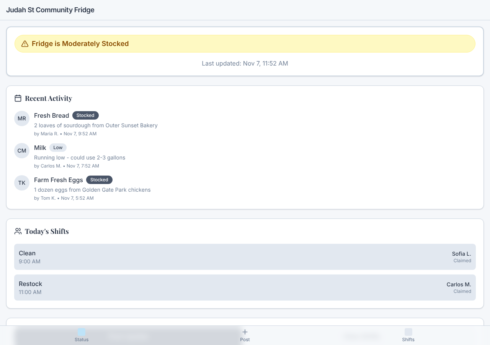
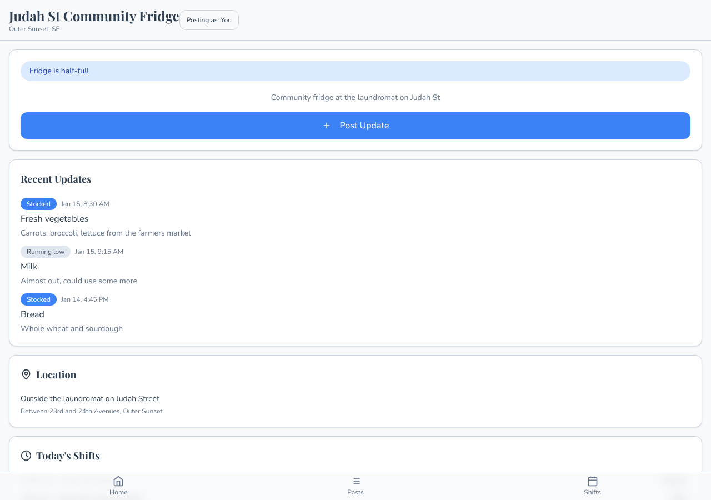
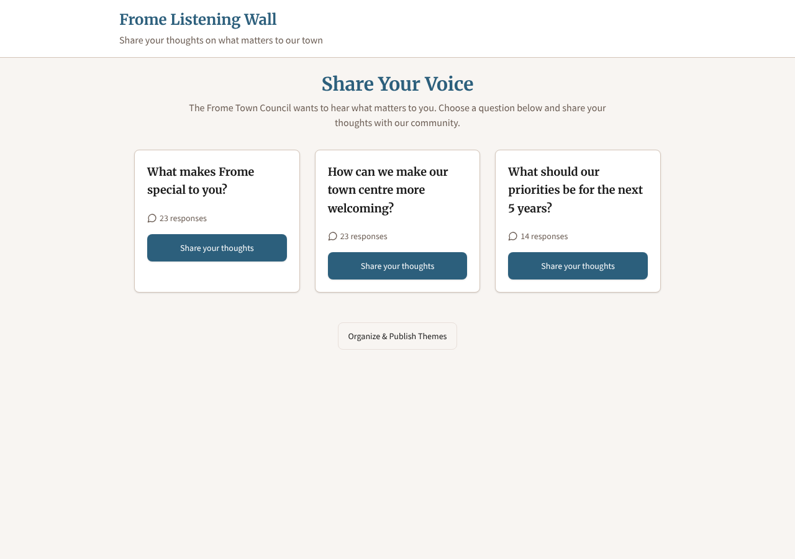
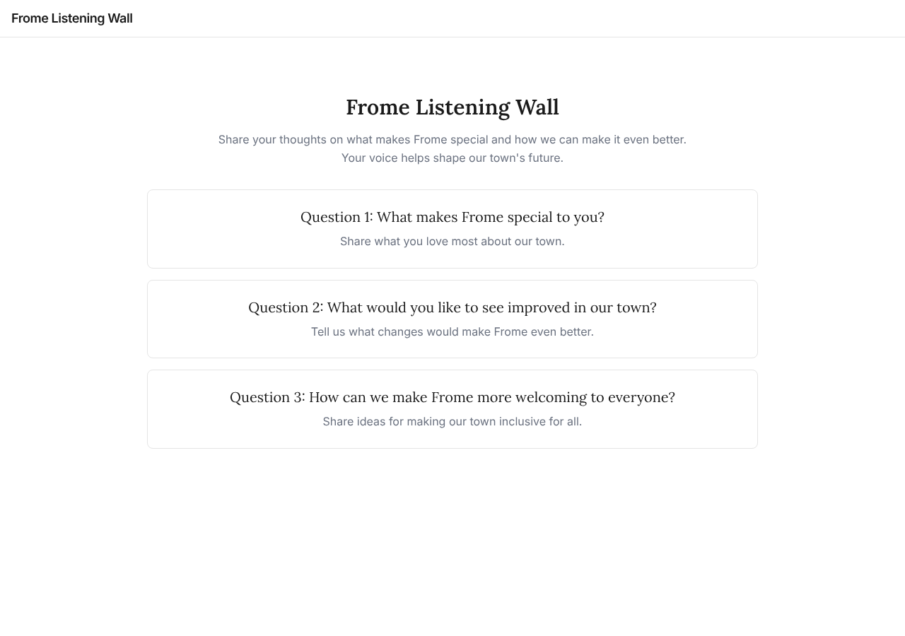
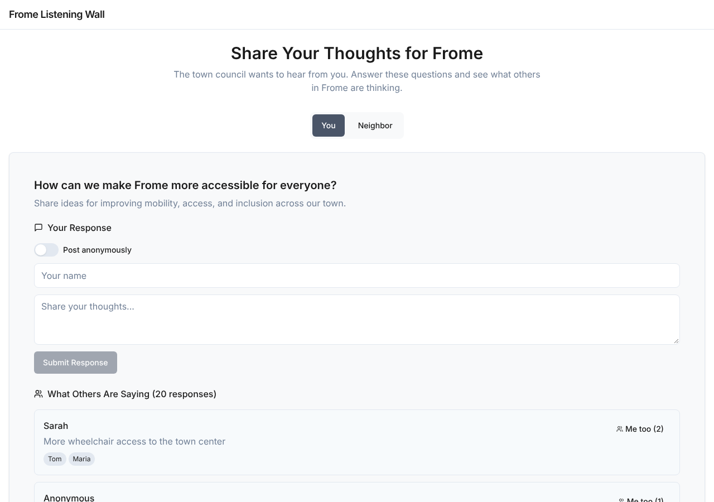

# Model bench — 2026-11-03T12-27-19-4e077eb-iyo3

- **Tasks:** hs-community-fridge, hs-listening-wall (harness 1.2.0, commit `4e077eb`)
- **Date:** 2026-11-03T12:35:53.731Z
- **Trials per model per task:** 3
- **Import guard:** on (static import check feeds the fix pass)
- **Human review:** _pending_

> Cost and token figures are **estimates** (chars ÷ 4 × list prices) — directional, not billing-grade.
> Mechanical columns are medians across trials. Total = plan + build wall time.
> **Bundle** = final compile success; **First try** = compiled without the auto-fix; **Renders** = opened in a browser after bundling, visible page and no uncaught errors (n/a before Oct 30, 2026); **Fail kind** = what the first-try bundle error was (missing-file, bad-import, unknown-package, syntax); **Lint/100** = eslint findings per 100 lines with the app's own config; **tsc errors** = type errors in the model's files with the kit merged and uninstalled packages untyped, counted only on builds that bundled, syntax errors kept apart (n/a before Nov 1, 2026); **Largest file**, **any**, **Kit files** (files importing the RB kit over code files) and **tok/s** come from the files the model wrote (n/a before Oct 31, 2026); **Fix time** = the auto-fix pass's own wall time; **Fix** = of the builds that first failed, how many the single auto-fix pass solved. **~$** includes the fix pass when one ran.

### Task: hs-community-fridge (exp-v1)

| Model | Bundle | First try | Renders | Fix | Fail kind | Files | Failed edits | Truncated | Checks | Sec flags | Lint/100 | tsc errors | Largest file | any | Kit files | tok/s | TTFT | Build time | Fix time | Total | ~$ | |
|---|---|---|---|---|---|---|---|---|---|---|---|---|---|---|---|---|---|---|---|---|---|---|
| glm-4.5-air | 2/3 ✓ | 2/3 | 2/2 clean | 0/1 solved | bad-import | 10 | 0 | no | 4/5 | 0 | 1.2 | 10.5 | 134 lines | 0 | 4/8 | 79.1 | 10s | 68s | 13s | 68s | 0.01 |

### Task: hs-listening-wall (exp-v1)

| Model | Bundle | First try | Renders | Fix | Fail kind | Files | Failed edits | Truncated | Checks | Sec flags | Lint/100 | tsc errors | Largest file | any | Kit files | tok/s | TTFT | Build time | Fix time | Total | ~$ | |
|---|---|---|---|---|---|---|---|---|---|---|---|---|---|---|---|---|---|---|---|---|---|---|
| glm-4.5-air | 3/3 ✓ | 3/3 | 3/3 clean | — | — | 10 | 0 | no | 5/5 | 0 | 0.5 | 1 | 178 lines | 0 | 3/8 | 82.7 | 6s | 89s | — | 89s | 0.01 |

## Human review

_Not scored yet — open review/index.html, score, export, save as review/scores.json, re-run report._

## Which model for what

_Maintainer's call, informed by the tables above — the report feeds the decision, it doesn't make it._

## Served as (provider-reported)

- **glm-4.5-air**: z-ai/glm-4.5-air, via Novita

## Fix passes (how solves went)

- **glm-4.5-air** · hs-community-fridge t3: build failed to bundle → auto-fix not solved after one pass — still: vfs:/src/main.tsx:4: No matching export in "vfs:/src/App.tsx" for import "default"
  - triggered by: `vfs:/src/components/PostForm.tsx:5: No matching export in "vfs:/src/components/ui/select.tsx" for import "SelectContent"`

## Previews

### hs-community-fridge — glm-4.5-air (trial 1)

### hs-community-fridge — glm-4.5-air (trial 2)

### hs-listening-wall — glm-4.5-air (trial 1)

### hs-listening-wall — glm-4.5-air (trial 2)

### hs-listening-wall — glm-4.5-air (trial 3)

