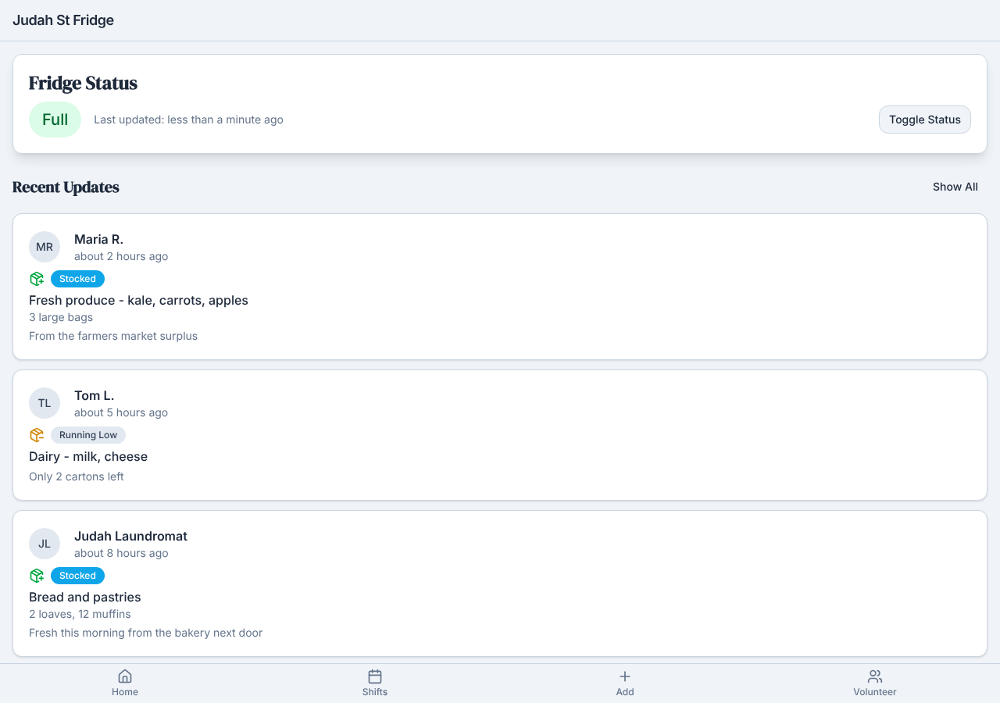
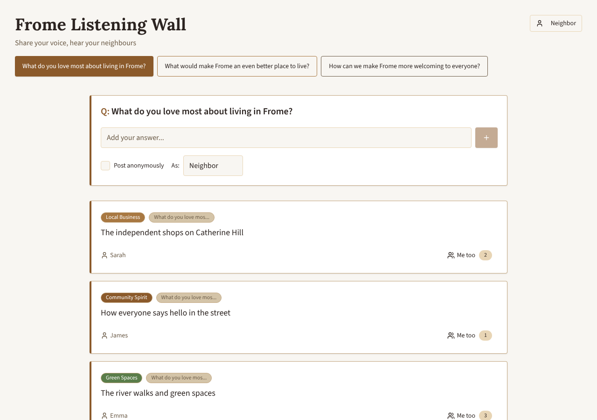
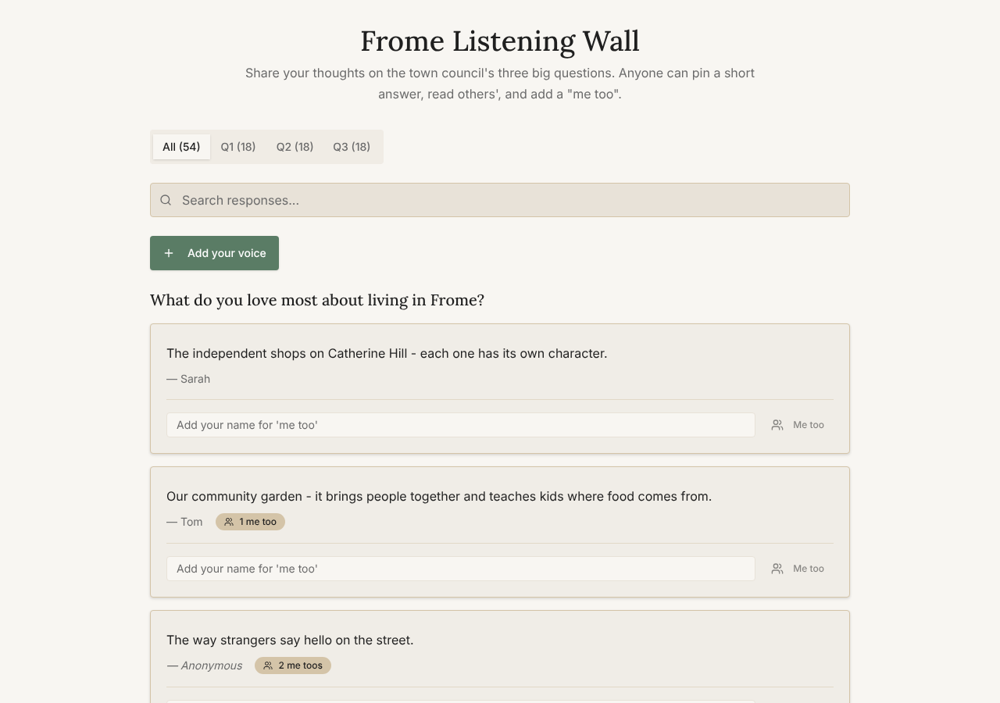
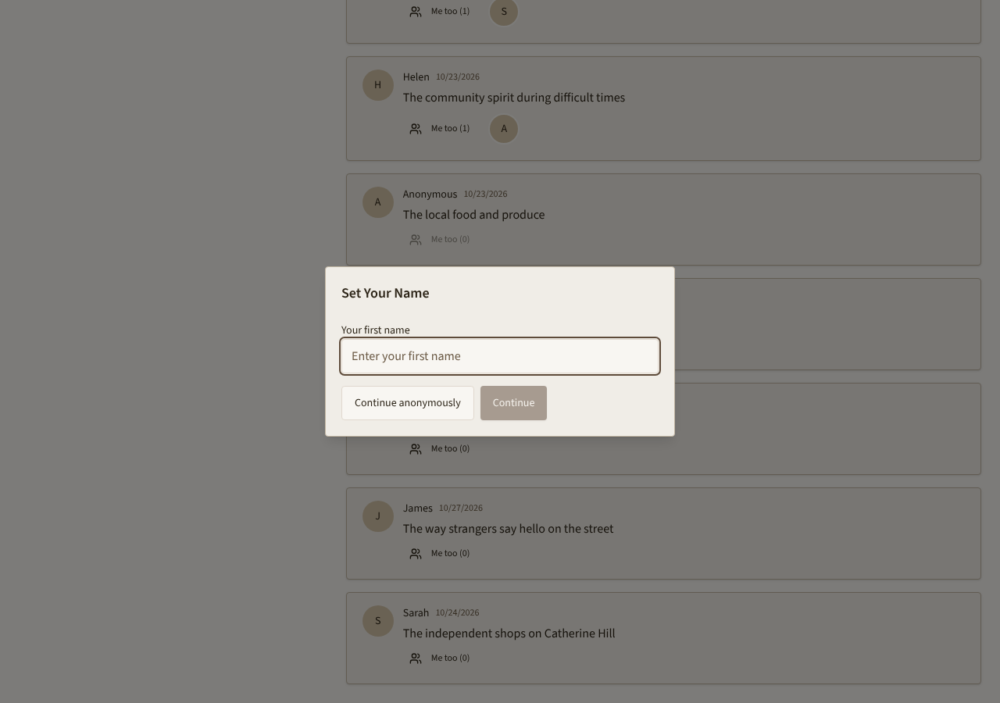

# Model bench — 2026-11-05T12-02-51-aaa92f3-4zqw

- **Tasks:** hs-community-fridge, hs-listening-wall (harness 1.2.0, commit `aaa92f3`)
- **Date:** 2026-11-05T12:08:38.295Z
- **Trials per model per task:** 3
- **Import guard:** on (static import check feeds the fix pass)
- **Human review:** _pending_

> Cost and token figures are **estimates** (chars ÷ 4 × list prices) — directional, not billing-grade.
> Mechanical columns are medians across trials. Total = plan + build wall time.
> **Bundle** = final compile success; **First try** = compiled without the auto-fix; **Renders** = opened in a browser after bundling, visible page and no uncaught errors (n/a before Oct 30, 2026); **Fail kind** = what the first-try bundle error was (missing-file, bad-import, unknown-package, syntax); **Lint/100** = eslint findings per 100 lines with the app's own config; **tsc errors** = type errors in the model's files with the kit merged and uninstalled packages untyped, counted only on builds that bundled, syntax errors kept apart (n/a before Nov 1, 2026); **Largest file**, **any**, **Kit files** (files importing the RB kit over code files) and **tok/s** come from the files the model wrote (n/a before Oct 31, 2026); **Fix time** = the auto-fix pass's own wall time; **Fix** = of the builds that first failed, how many the single auto-fix pass solved. **~$** includes the fix pass when one ran.

### Task: hs-community-fridge (exp-v1)

| Model | Bundle | First try | Renders | Fix | Fail kind | Files | Failed edits | Truncated | Checks | Sec flags | Lint/100 | tsc errors | Largest file | any | Kit files | tok/s | TTFT | Build time | Fix time | Total | ~$ | |
|---|---|---|---|---|---|---|---|---|---|---|---|---|---|---|---|---|---|---|---|---|---|---|
| devstral | 2/3 ✓ | 0/3 | 1/2 clean, 1 blank | 0/3 solved | syntax, other | 13 | 0 | no | 4/5 | 0 | 0.6 | 4.5 | 131 lines | 0 | 5/9 | 169.3 | 3s | 35s | 10s | 35s | 0.03 |

### Task: hs-listening-wall (exp-v1)

| Model | Bundle | First try | Renders | Fix | Fail kind | Files | Failed edits | Truncated | Checks | Sec flags | Lint/100 | tsc errors | Largest file | any | Kit files | tok/s | TTFT | Build time | Fix time | Total | ~$ | |
|---|---|---|---|---|---|---|---|---|---|---|---|---|---|---|---|---|---|---|---|---|---|---|
| devstral | 3/3 ✓ | 1/3 | 3/3 clean | 1/2 solved | missing-file, other | 9 | 0 | no | 5/5 | 0 | 0.5 | 2 | 322 lines | 0 | 2/7 | 180 | 1s | 49s | 10s | 49s | 0.03 |

## Human review

_Not scored yet — open review/index.html, score, export, save as review/scores.json, re-run report._

## Which model for what

_Maintainer's call, informed by the tables above — the report feeds the decision, it doesn't make it._

## Served as (provider-reported)

- **devstral**: mistralai/devstral-2512, via Mistral

## In the browser (bundled, but)

- **devstral** · hs-community-fridge t2: BLANK PAGE
  - console: Error: Minified React error #130; visit https://reactjs.org/docs/error-decoder.html?invariant=130&args[]=undefined&args[]= for the full message or use the non-minified dev environment for full errors and additional helpf
  - pageerror: Minified React error #130; visit https://reactjs.org/docs/error-decoder.html?invariant=130&args[]=undefined&args[]= for the full message or use the non-minified dev environment for full errors and additional helpful warn

## Fix passes (how solves went)

- **devstral** · hs-community-fridge t1: build failed to bundle → auto-fix not solved after one pass — still: vfs:/src/pages/Home.tsx:35: Expected ">" but found "["
  - triggered by: `vfs:/src/pages/Home.tsx:34: Expected ">" but found "["`
- **devstral** · hs-community-fridge t2: build failed to bundle → auto-fix not solved after one pass — still: vfs:/src/pages/AddUpdate.tsx: ReferenceError: React is not defined (uses React.* with no `import React from 'react'` or `import * as React from 'react'`)
  - triggered by: `vfs:/src/pages/AddUpdate.tsx: ReferenceError: React is not defined (uses React.* with no `import React from 'react'` or `import * as React from 'react'`)`
- **devstral** · hs-community-fridge t3: build failed to bundle → auto-fix not solved after one pass — still: vfs:/src/pages/AddUpdate.tsx: ReferenceError: React is not defined (uses React.* with no `import React from 'react'` or `import * as React from 'react'`)
  - triggered by: `vfs:/src/pages/AddShift.tsx:99: Unexpected closing "Card" tag does not match opening "CardContent" tag`
- **devstral** · hs-listening-wall t1: build failed to bundle → auto-fix solved in one pass (8s, ~$0.01)
  - triggered by: `vfs:/src/App.tsx:4: Could not find "./App.css" in the project (imported from /src/App.tsx)`
- **devstral** · hs-listening-wall t2: build failed to bundle → auto-fix not solved after one pass — still: vfs:/src/pages/WallPage.tsx: ReferenceError: React is not defined (uses React.* with no `import React from 'react'` or `import * as React from 'react'`)
  - triggered by: `vfs:/src/pages/WallPage.tsx: ReferenceError: React is not defined (uses React.* with no `import React from 'react'` or `import * as React from 'react'`)`

## Previews

### hs-community-fridge — devstral (trial 2)

### hs-community-fridge — devstral (trial 3)

### hs-listening-wall — devstral (trial 1)

### hs-listening-wall — devstral (trial 2)

### hs-listening-wall — devstral (trial 3)

