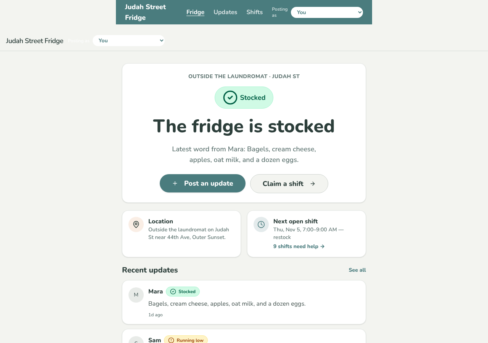
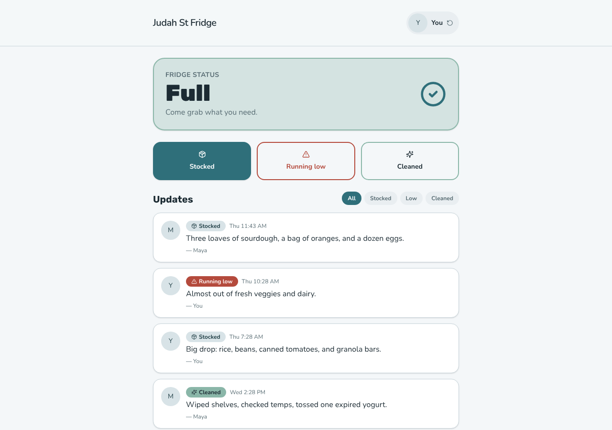
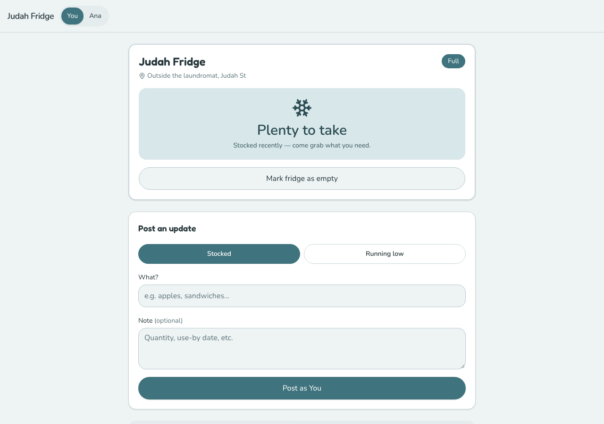
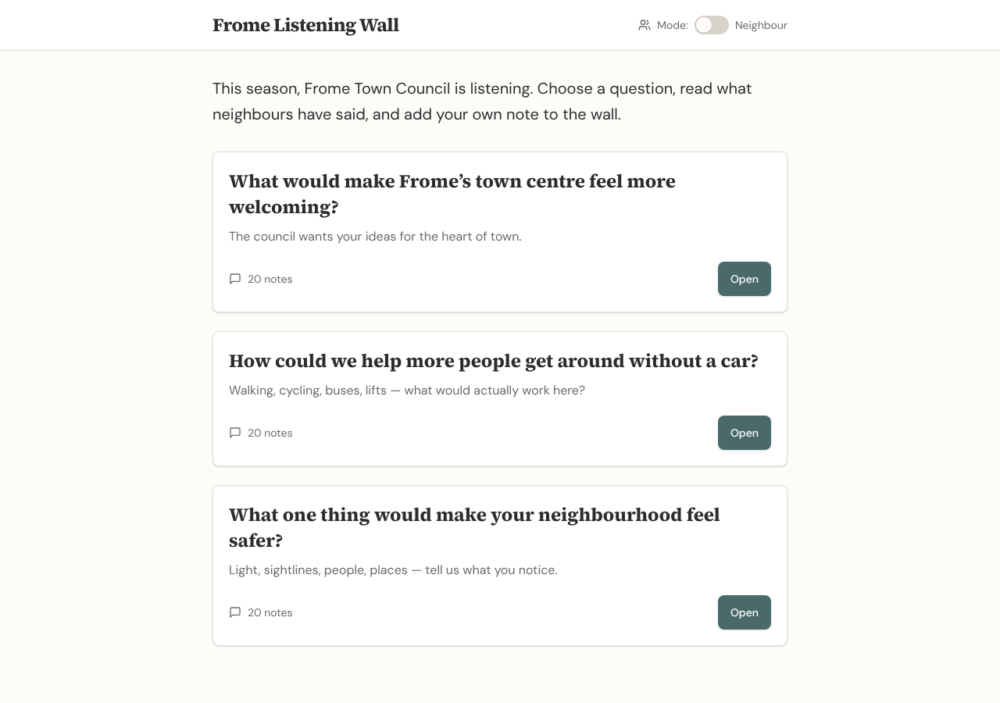
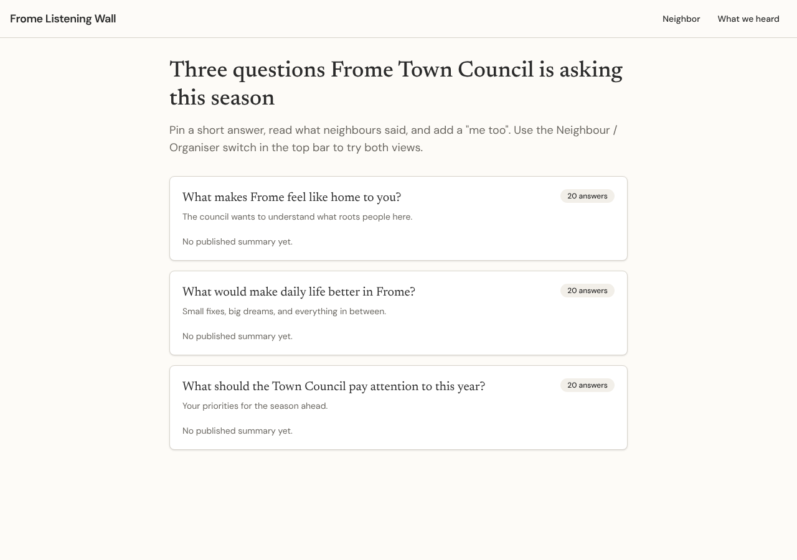

# Model bench — 2026-11-05T12-02-51-aaa92f3-e4a3

- **Tasks:** hs-community-fridge, hs-listening-wall (harness 1.2.0, commit `aaa92f3`)
- **Date:** 2026-11-05T12:23:19.556Z
- **Trials per model per task:** 3
- **Import guard:** on (static import check feeds the fix pass)
- **Human review:** _pending_

> Cost and token figures are **estimates** (chars ÷ 4 × list prices) — directional, not billing-grade.
> Mechanical columns are medians across trials. Total = plan + build wall time.
> **Bundle** = final compile success; **First try** = compiled without the auto-fix; **Renders** = opened in a browser after bundling, visible page and no uncaught errors (n/a before Oct 30, 2026); **Fail kind** = what the first-try bundle error was (missing-file, bad-import, unknown-package, syntax); **Lint/100** = eslint findings per 100 lines with the app's own config; **tsc errors** = type errors in the model's files with the kit merged and uninstalled packages untyped, counted only on builds that bundled, syntax errors kept apart (n/a before Nov 1, 2026); **Largest file**, **any**, **Kit files** (files importing the RB kit over code files) and **tok/s** come from the files the model wrote (n/a before Oct 31, 2026); **Fix time** = the auto-fix pass's own wall time; **Fix** = of the builds that first failed, how many the single auto-fix pass solved. **~$** includes the fix pass when one ran.

### Task: hs-community-fridge (exp-v1)

| Model | Bundle | First try | Renders | Fix | Fail kind | Files | Failed edits | Truncated | Checks | Sec flags | Lint/100 | tsc errors | Largest file | any | Kit files | tok/s | TTFT | Build time | Fix time | Total | ~$ | |
|---|---|---|---|---|---|---|---|---|---|---|---|---|---|---|---|---|---|---|---|---|---|---|
| kimi-k2.7-code | 3/3 ✓ | 1/3 | 3/3 clean | 2/2 solved | other | 12 | 0 | no | 4/5 | 0 | 0.4 | 0 | 155 lines | 0 | 6/9 | 53.2 | 22s | 98s | 30s | 98s | 0.04 |

### Task: hs-listening-wall (exp-v1)

| Model | Bundle | First try | Renders | Fix | Fail kind | Files | Failed edits | Truncated | Checks | Sec flags | Lint/100 | tsc errors | Largest file | any | Kit files | tok/s | TTFT | Build time | Fix time | Total | ~$ | |
|---|---|---|---|---|---|---|---|---|---|---|---|---|---|---|---|---|---|---|---|---|---|---|
| kimi-k2.7-code | 2/2 ✓ | 0/2 | 2/2 clean | 2/2 solved | other | 13 | 0 | no | 4.5/5 | 0 | 0.05 | 2 | 197 lines | 0 | 5.5/9.5 | 25.950000000000003 | 217s | 392s | 37s | 392s | 0.06 |

## Human review

_Not scored yet — open review/index.html, score, export, save as review/scores.json, re-run report._

## Which model for what

_Maintainer's call, informed by the tables above — the report feeds the decision, it doesn't make it._

## Served as (provider-reported)

- **kimi-k2.7-code**: moonshotai/kimi-k2.7-code, via StreamLake, fingerprint fpv0_8f8e1388 / moonshotai/kimi-k2.7-code, via Moonshot AI, fingerprint fpv0_2742776c / moonshotai/kimi-k2.7-code, via SiliconFlow / moonshotai/kimi-k2.7-code, via Inceptron

## Fix passes (how solves went)

- **kimi-k2.7-code** · hs-community-fridge t1: build failed to bundle → auto-fix solved in one pass (30s, ~$0.02)
  - triggered by: `vfs:/src/components/StatusBadge.tsx: ReferenceError: React is not defined (uses React.* with no `import React from 'react'` or `import * as React from 'react'`)`
- **kimi-k2.7-code** · hs-community-fridge t3: build failed to bundle → auto-fix solved in one pass (31s, ~$0.01)
  - triggered by: `vfs:/src/components/UpdateForm.tsx: ReferenceError: React is not defined (uses React.* with no `import React from 'react'` or `import * as React from 'react'`)`
- **kimi-k2.7-code** · hs-listening-wall t1: build failed to bundle → auto-fix solved in one pass (42s, ~$0.02)
  - triggered by: `vfs:/src/components/PostForm.tsx: ReferenceError: React is not defined (uses React.* with no `import React from 'react'` or `import * as React from 'react'`)`
- **kimi-k2.7-code** · hs-listening-wall t2: build failed to bundle → auto-fix solved in one pass (32s, ~$0.03)
  - triggered by: `vfs:/src/pages/Question.tsx: ReferenceError: React is not defined (uses React.* with no `import React from 'react'` or `import * as React from 'react'`)`

## Previews

### hs-community-fridge — kimi-k2.7-code (trial 1)

### hs-community-fridge — kimi-k2.7-code (trial 2)

### hs-community-fridge — kimi-k2.7-code (trial 3)

### hs-listening-wall — kimi-k2.7-code (trial 1)

### hs-listening-wall — kimi-k2.7-code (trial 2)

