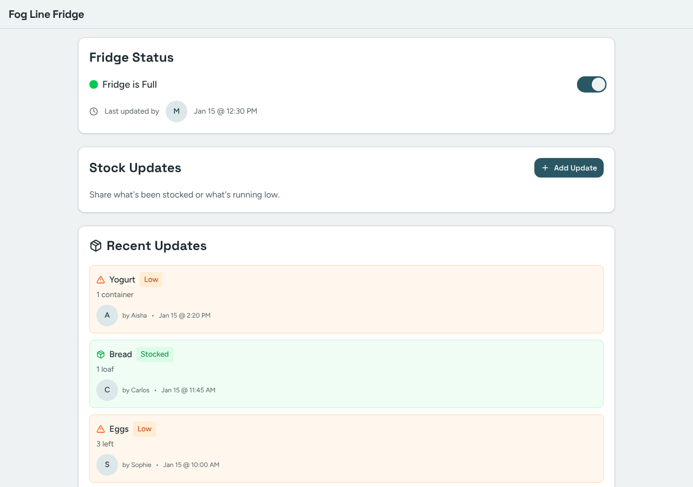
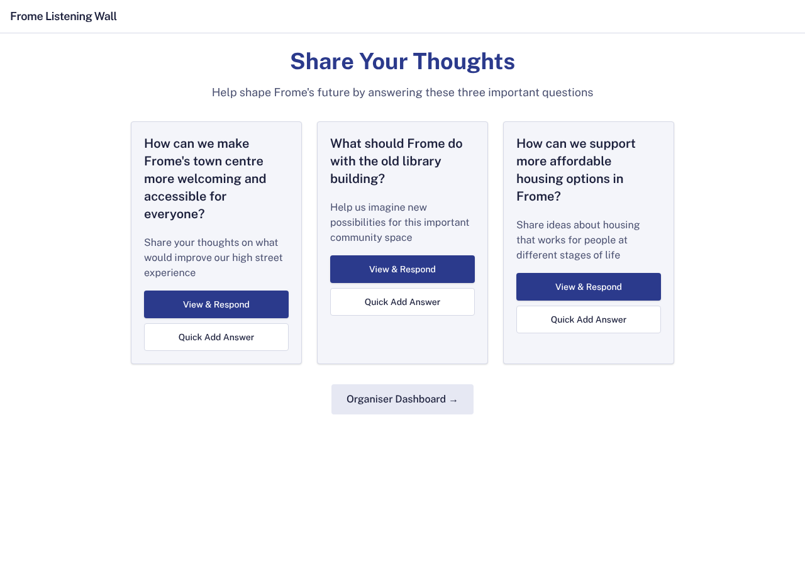

# Model bench — 2026-11-06T11-52-46-0305b30-ef64

- **Tasks:** hs-community-fridge, hs-listening-wall (harness 1.2.0, commit `0305b30`)
- **Date:** 2026-11-06T12:02:31.030Z
- **Trials per model per task:** 2
- **Import guard:** on (static import check feeds the fix pass)
- **Human review:** _pending_

> Cost and token figures are **estimates** (chars ÷ 4 × list prices) — directional, not billing-grade.
> Mechanical columns are medians across trials. Total = plan + build wall time.
> **Bundle** = final compile success; **First try** = compiled without the auto-fix; **Renders** = opened in a browser after bundling, visible page and no uncaught errors (n/a before Oct 30, 2026); **Fail kind** = what the first-try bundle error was (missing-file, bad-import, unknown-package, syntax); **Lint/100** = eslint findings per 100 lines with the app's own config; **tsc errors** = type errors in the model's files with the kit merged and uninstalled packages untyped, counted only on builds that bundled, syntax errors kept apart (n/a before Nov 1, 2026); **Largest file**, **any**, **Kit files** (files importing the RB kit over code files) and **tok/s** come from the files the model wrote (n/a before Oct 31, 2026); **Fix time** = the auto-fix pass's own wall time; **Fix** = of the builds that first failed, how many the single auto-fix pass solved. **~$** includes the fix pass when one ran.

### Task: hs-community-fridge (exp-v1)

| Model | Bundle | First try | Renders | Fix | Fail kind | Files | Failed edits | Truncated | Checks | Sec flags | Lint/100 | tsc errors | Largest file | any | Kit files | tok/s | TTFT | Build time | Fix time | Total | ~$ | |
|---|---|---|---|---|---|---|---|---|---|---|---|---|---|---|---|---|---|---|---|---|---|---|
| glm-4.5-air | 1/2 ✓ | 0/2 | 1/1 clean | 1/2 solved | bad-import | 19 | 0 | no | 5/5 | 0 | 0.7 | 9 | 137 lines | 0 | 7/13 | 75 | 7s | 103s | 30s | 103s | 0.02 |

### Task: hs-listening-wall (exp-v1)

| Model | Bundle | First try | Renders | Fix | Fail kind | Files | Failed edits | Truncated | Checks | Sec flags | Lint/100 | tsc errors | Largest file | any | Kit files | tok/s | TTFT | Build time | Fix time | Total | ~$ | |
|---|---|---|---|---|---|---|---|---|---|---|---|---|---|---|---|---|---|---|---|---|---|---|
| glm-4.5-air | 2/2 ✓ | 0/2 | 1/2 clean, 1 blank | 2/2 solved | bad-import | 11 | 0 | no | 5/5 | 0 | 1.1 | 3.5 | 358.5 lines | 1 | 5/8 | 80.6 | 9s | 119s | 28s | 119s | 0.02 |

## Human review

_Not scored yet — open review/index.html, score, export, save as review/scores.json, re-run report._

## Which model for what

_Maintainer's call, informed by the tables above — the report feeds the decision, it doesn't make it._

## Served as (provider-reported)

- **glm-4.5-air**: z-ai/glm-4.5-air, via Z.AI / z-ai/glm-4.5-air, via SiliconFlow / z-ai/glm-4.5-air, via Novita

## In the browser (bundled, but)

- **glm-4.5-air** · hs-listening-wall t2: BLANK PAGE
  - console: TypeError: answers is not iterable at file:///home/user/relational-builder/bench/results/2026-11-06T11-52-46-0305b30-ef64/artifacts/hs-listening-wall/glm-4.5-air-t2/preview.html:362:16 at Object.useMemo (https://esm.sh/r
  - pageerror: answers is not iterable

## Fix passes (how solves went)

- **glm-4.5-air** · hs-community-fridge t1: build failed to bundle → auto-fix not solved after 2 passes — still: vfs:/src/pages/Posts.tsx:8: No matching export in "vfs:/src/components/PostCard.tsx" for import "PostCard"
  - triggered by: `vfs:/src/pages/Posts.tsx:7: No matching export in "vfs:/src/components/ui/select.tsx" for import "SelectContent"`
- **glm-4.5-air** · hs-community-fridge t2: build failed to bundle → auto-fix solved in one pass (15s, ~$0.00)
  - triggered by: `vfs:/src/components/StockPost.tsx:6: No matching export in "vfs:/src/components/ui/select.tsx" for import "SelectContent"`
- **glm-4.5-air** · hs-listening-wall t1: build failed to bundle → auto-fix solved in one pass (37s, ~$0.01)
  - triggered by: `vfs:/src/pages/OrganizerDashboard.tsx:10: No matching export in "vfs:/src/components/ui/select.tsx" for import "SelectContent"`
- **glm-4.5-air** · hs-listening-wall t2: build failed to bundle → auto-fix solved in one pass (19s, ~$0.00)
  - triggered by: `vfs:/src/pages/AddAnswer.tsx: No matching export in "vfs:/src/data/seedData.ts" for import "questions"`

## Previews

### hs-community-fridge — glm-4.5-air (trial 2)

### hs-listening-wall — glm-4.5-air (trial 1)

### hs-listening-wall — glm-4.5-air (trial 2)

