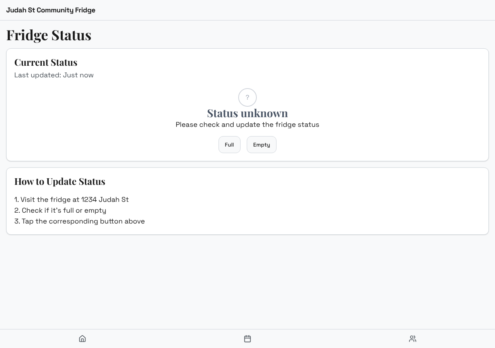
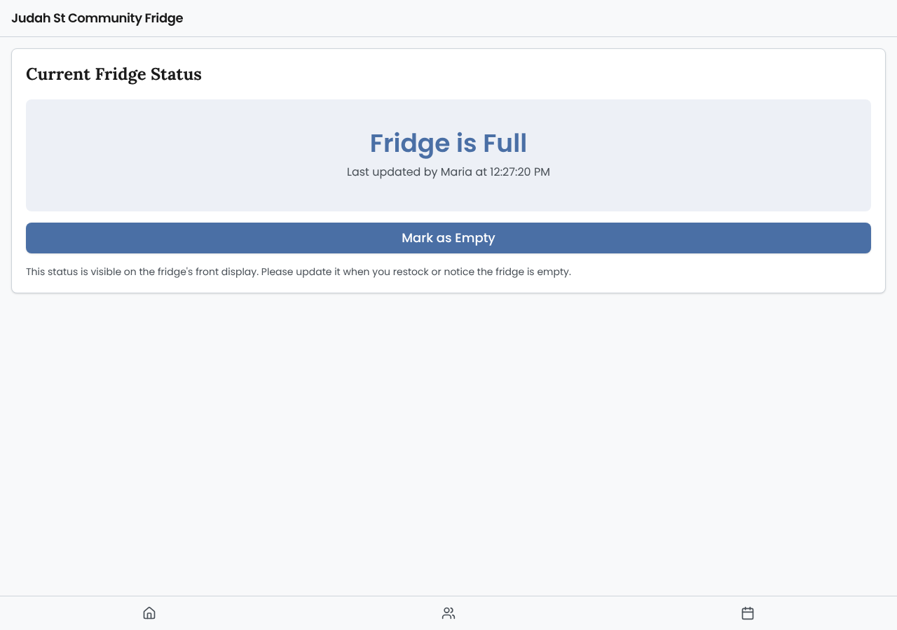
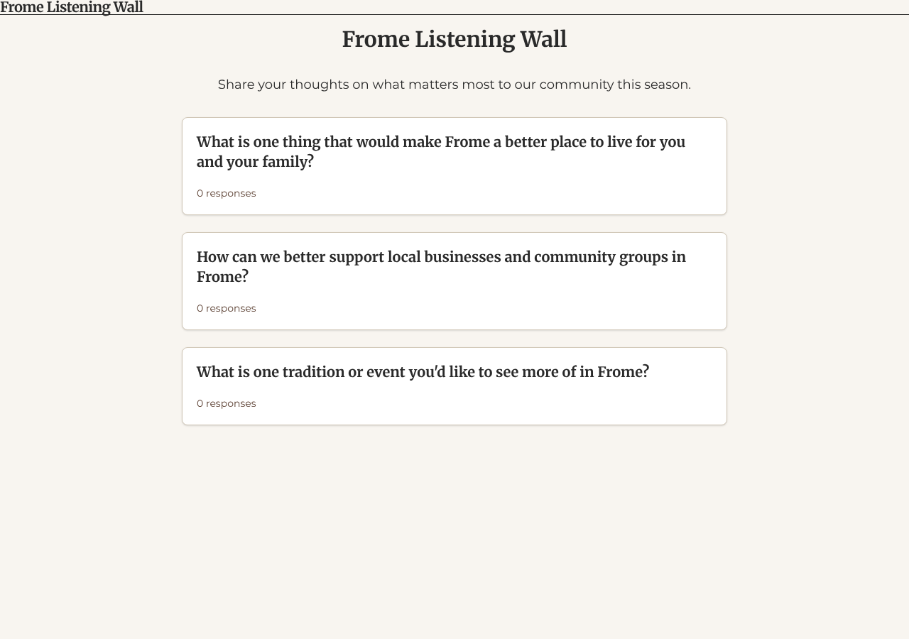

# Model bench — 2026-11-06T12-11-08-0305b30-97tp

- **Tasks:** hs-community-fridge, hs-listening-wall (harness 1.2.0, commit `0305b30`)
- **Date:** 2026-11-06T12:19:13.152Z
- **Trials per model per task:** 2
- **Import guard:** on (static import check feeds the fix pass)
- **Human review:** _pending_

> Cost and token figures are **estimates** (chars ÷ 4 × list prices) — directional, not billing-grade.
> Mechanical columns are medians across trials. Total = plan + build wall time.
> **Bundle** = final compile success; **First try** = compiled without the auto-fix; **Renders** = opened in a browser after bundling, visible page and no uncaught errors (n/a before Oct 30, 2026); **Fail kind** = what the first-try bundle error was (missing-file, bad-import, unknown-package, syntax); **Lint/100** = eslint findings per 100 lines with the app's own config; **tsc errors** = type errors in the model's files with the kit merged and uninstalled packages untyped, counted only on builds that bundled, syntax errors kept apart (n/a before Nov 1, 2026); **Largest file**, **any**, **Kit files** (files importing the RB kit over code files) and **tok/s** come from the files the model wrote (n/a before Oct 31, 2026); **Fix time** = the auto-fix pass's own wall time; **Fix** = of the builds that first failed, how many the single auto-fix pass solved. **~$** includes the fix pass when one ran.

### Task: hs-community-fridge (exp-v1)

| Model | Bundle | First try | Renders | Fix | Fail kind | Files | Failed edits | Truncated | Checks | Sec flags | Lint/100 | tsc errors | Largest file | any | Kit files | tok/s | TTFT | Build time | Fix time | Total | ~$ | |
|---|---|---|---|---|---|---|---|---|---|---|---|---|---|---|---|---|---|---|---|---|---|---|
| mistral-small-3.2 | 2/2 ✓ | 1/2 | 2/2 clean | 1/1 solved | bad-import | 9 | 0 | no | 4.5/5 | 0 | 0.1 | 3 | 122.5 lines | 0 | 4/6.5 | 68.44999999999999 | 1s | 62s | 17s | 62s | 0.00 |

### Task: hs-listening-wall (exp-v1)

| Model | Bundle | First try | Renders | Fix | Fail kind | Files | Failed edits | Truncated | Checks | Sec flags | Lint/100 | tsc errors | Largest file | any | Kit files | tok/s | TTFT | Build time | Fix time | Total | ~$ | |
|---|---|---|---|---|---|---|---|---|---|---|---|---|---|---|---|---|---|---|---|---|---|---|
| mistral-small-3.2 | 2/2 ✓ | 0/2 | 1/2 clean, 1 blank | 2/2 solved | missing-file, syntax | 17.5 | 0 | no | 4.5/5 | 0 | 1.1 | 6.5 | 304 lines | 0 | 2.5/13.5 | 61.25 | 1s | 133s | 22s | 133s | 0.01 |

## Human review

_Not scored yet — open review/index.html, score, export, save as review/scores.json, re-run report._

## Which model for what

_Maintainer's call, informed by the tables above — the report feeds the decision, it doesn't make it._

## Served as (provider-reported)

- **mistral-small-3.2**: mistralai/mistral-small-3.2-24b-instruct, via Parasail

## In the browser (bundled, but)

- **mistral-small-3.2** · hs-listening-wall t1: BLANK PAGE
  - pageerror: Cannot apply unknown utility class `hover:text-border-foreground`
  - pageerror: Cannot apply unknown utility class `hover:text-border-foreground`
  - pageerror: Cannot read properties of undefined (reading 'displayName')

## Fix passes (how solves went)

- **mistral-small-3.2** · hs-community-fridge t2: build failed to bundle → auto-fix solved in one pass (17s, ~$0.00)
  - triggered by: `vfs:/src/pages/Updates.tsx:3: No matching export in "vfs:/src/components/ui/select.tsx" for import "SelectTrigger"`
- **mistral-small-3.2** · hs-listening-wall t1: build failed to bundle → auto-fix solved in 2 passes (36s, ~$0.00)
  - triggered by: `vfs:/src/main.tsx:4: Could not find "./index.css" in the project (imported from /src/main.tsx)`
- **mistral-small-3.2** · hs-listening-wall t2: build failed to bundle → auto-fix solved in one pass (8s, ~$0.00)
  - triggered by: `vfs:/src/data/questions.ts:30: Expected "}" but found "d"`

## Previews

### hs-community-fridge — mistral-small-3.2 (trial 1)

### hs-community-fridge — mistral-small-3.2 (trial 2)

### hs-listening-wall — mistral-small-3.2 (trial 1)

### hs-listening-wall — mistral-small-3.2 (trial 2)

