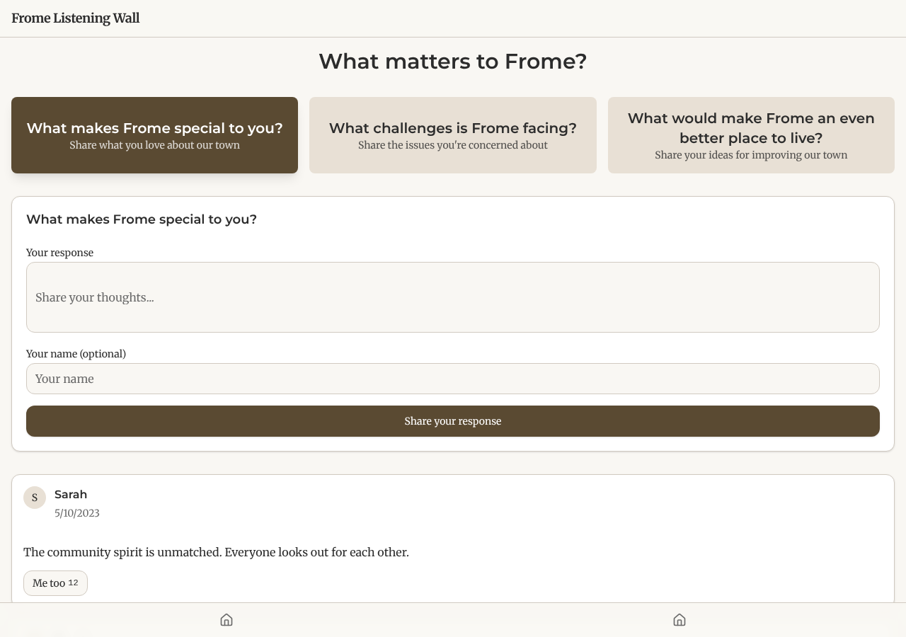
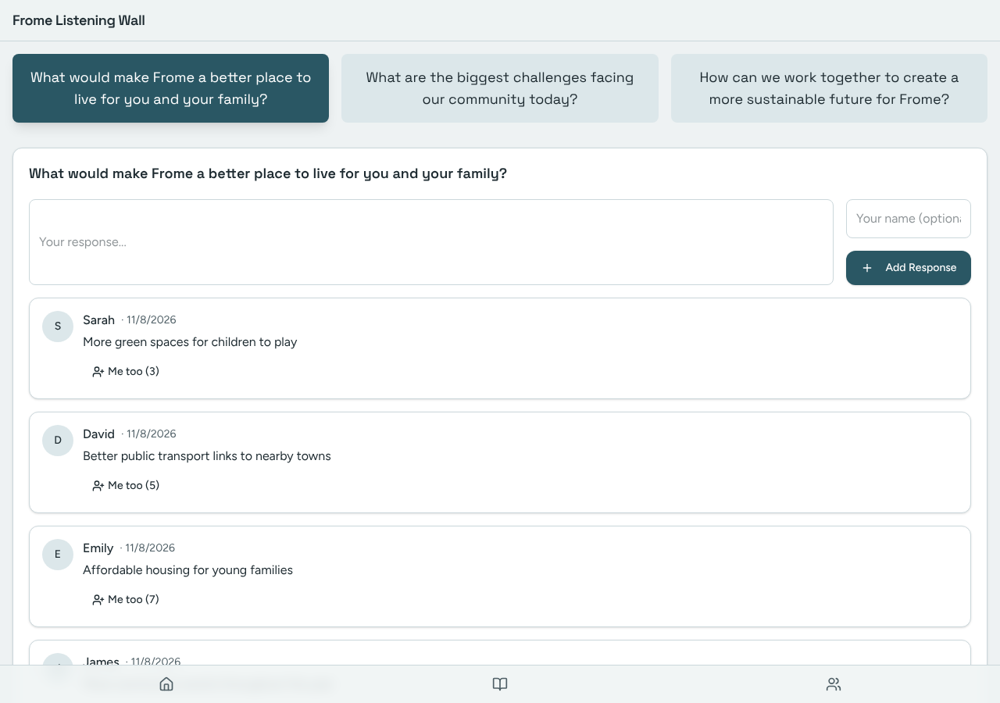
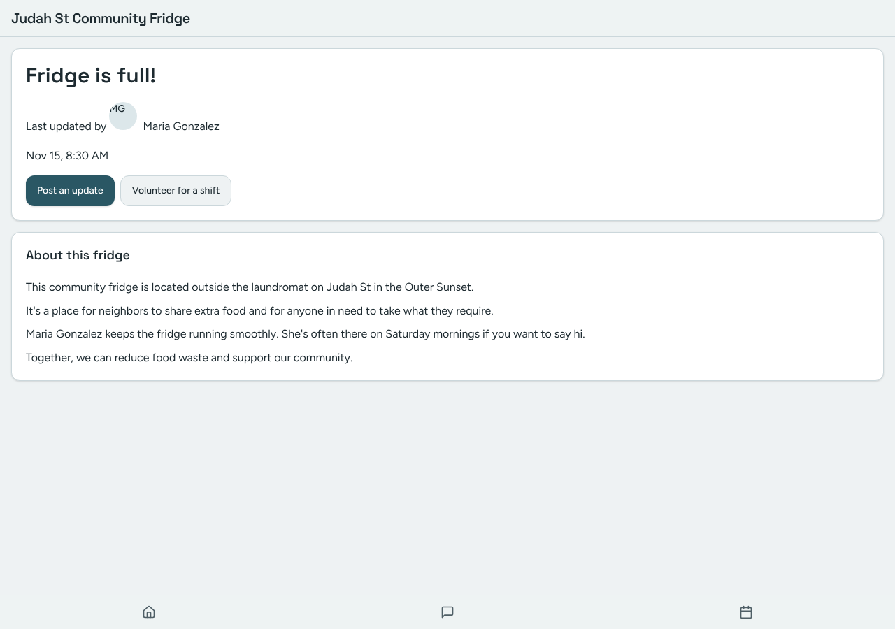
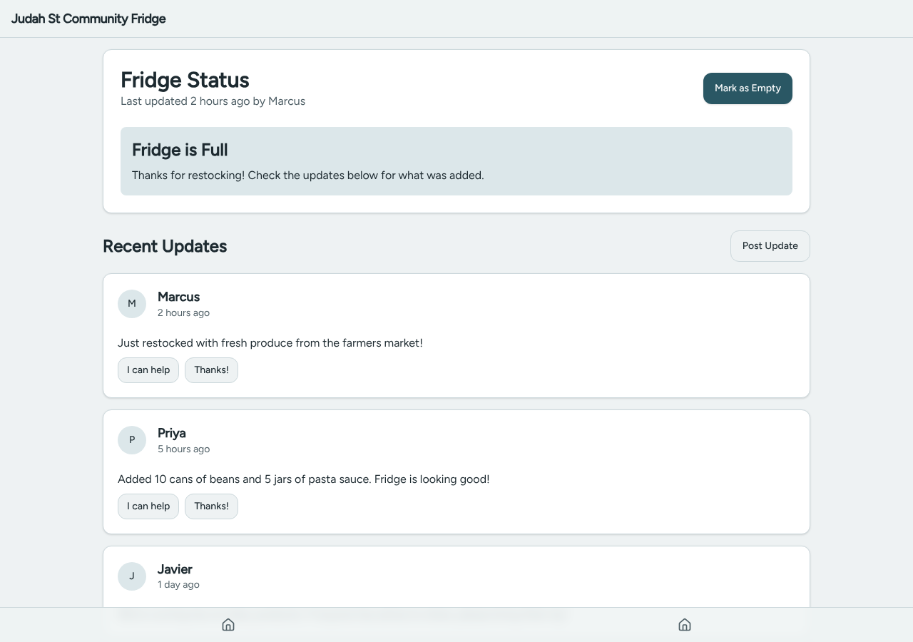

# Model bench — 2026-11-08T12-07-55-e02558e-8y2r

- **Tasks:** hs-listening-wall, hs-community-fridge (harness 1.2.0, commit `e02558e`)
- **Date:** 2026-11-08T12:22:30.014Z
- **Trials per model per task:** 2
- **Import guard:** on (static import check feeds the fix pass)
- **Human review:** _pending_

> Cost and token figures are **estimates** (chars ÷ 4 × list prices) — directional, not billing-grade.
> Mechanical columns are medians across trials. Total = plan + build wall time.
> **Bundle** = final compile success; **First try** = compiled without the auto-fix; **Renders** = opened in a browser after bundling, visible page and no uncaught errors (n/a before Oct 30, 2026); **Fail kind** = what the first-try bundle error was (missing-file, bad-import, unknown-package, syntax); **Lint/100** = eslint findings per 100 lines with the app's own config; **tsc errors** = type errors in the model's files with the kit merged and uninstalled packages untyped, counted only on builds that bundled, syntax errors kept apart (n/a before Nov 1, 2026); **Largest file**, **any**, **Kit files** (files importing the RB kit over code files) and **tok/s** come from the files the model wrote (n/a before Oct 31, 2026); **Fix time** = the auto-fix pass's own wall time; **Fix** = of the builds that first failed, how many the single auto-fix pass solved. **~$** includes the fix pass when one ran.

### Task: hs-listening-wall (exp-v1)

| Model | Bundle | First try | Renders | Fix | Fail kind | Files | Failed edits | Truncated | Checks | Sec flags | Lint/100 | tsc errors | Largest file | any | Kit files | tok/s | TTFT | Build time | Fix time | Total | ~$ | |
|---|---|---|---|---|---|---|---|---|---|---|---|---|---|---|---|---|---|---|---|---|---|---|
| mistral-small-3.2 | 2/2 ✓ | 0/2 | 2/2 clean | 2/2 solved | missing-file, bad-import | 10 | 0 | no | 5/5 | 0 | 0 | 4.5 | 113 lines | 0 | 4/6.5 | 62.349999999999994 | 2s | 78s | 13s | 78s | 0.00 |

### Task: hs-community-fridge (exp-v1)

| Model | Bundle | First try | Renders | Fix | Fail kind | Files | Failed edits | Truncated | Checks | Sec flags | Lint/100 | tsc errors | Largest file | any | Kit files | tok/s | TTFT | Build time | Fix time | Total | ~$ | |
|---|---|---|---|---|---|---|---|---|---|---|---|---|---|---|---|---|---|---|---|---|---|---|
| mistral-small-3.2 | 2/2 ✓ | 1/2 | 2/2 clean | 1/1 solved | missing-file | 9 | 0 | no | 5/5 | 0 | 0.1 | 4 | 122 lines | 0 | 3.5/7 | 65.35 | 1s | 59s | 21s | 59s | 0.00 |

## Human review

_Not scored yet — open review/index.html, score, export, save as review/scores.json, re-run report._

## Which model for what

_Maintainer's call, informed by the tables above — the report feeds the decision, it doesn't make it._

## Served as (provider-reported)

- **mistral-small-3.2**: mistralai/mistral-small-3.2-24b-instruct, via Parasail

## Fix passes (how solves went)

- **mistral-small-3.2** · hs-listening-wall t1: build failed to bundle → auto-fix solved in 2 passes (22s, ~$0.00)
  - triggered by: `vfs:/src/main.tsx:4: Could not find "./index.css" in the project (imported from /src/main.tsx)`
- **mistral-small-3.2** · hs-listening-wall t2: build failed to bundle → auto-fix solved in one pass (3s, ~$0.00)
  - triggered by: `vfs:/src/main.tsx:3: No matching export in "vfs:/src/App.tsx" for import "default"`
- **mistral-small-3.2** · hs-community-fridge t2: build failed to bundle → auto-fix solved in one pass (21s, ~$0.00)
  - triggered by: `vfs:/src/pages/ShiftsPage.tsx:8: Could not find "@/components/ui/calendar" in the project (imported from /src/pages/ShiftsPage.tsx)`

## Previews

### hs-listening-wall — mistral-small-3.2 (trial 1)

### hs-listening-wall — mistral-small-3.2 (trial 2)

### hs-community-fridge — mistral-small-3.2 (trial 1)

### hs-community-fridge — mistral-small-3.2 (trial 2)

