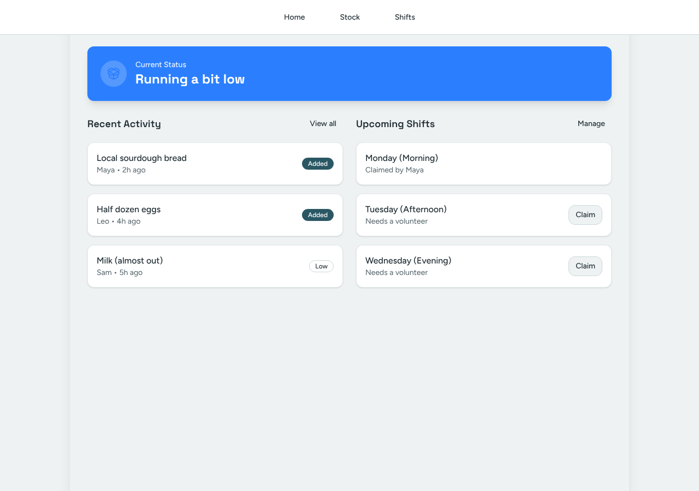
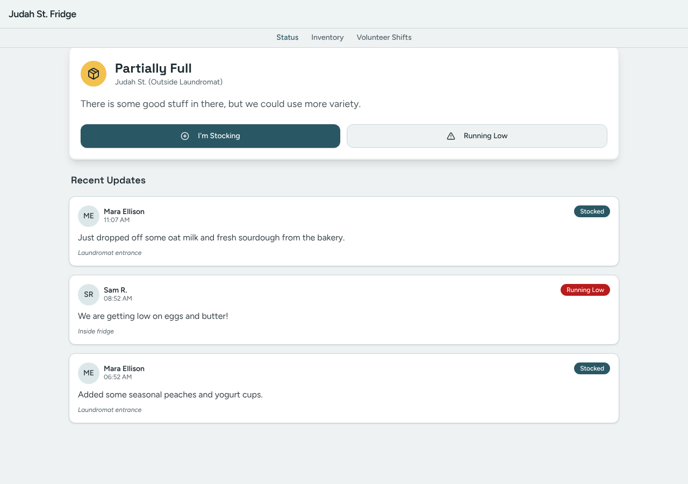
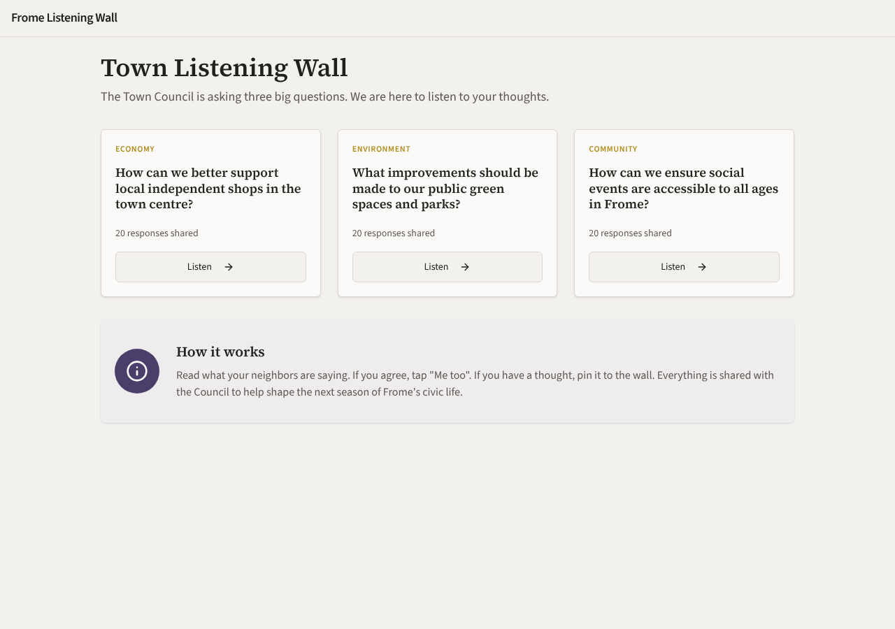
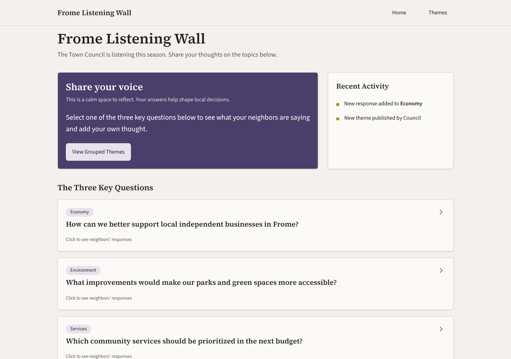

# Model bench — 2026-11-09T11-43-16-0fd5d89-0hsu

- **Tasks:** hs-community-fridge, hs-listening-wall (harness 1.2.0, commit `0fd5d89`)
- **Date:** 2026-11-09T11:52:52.229Z
- **Trials per model per task:** 4
- **Import guard:** on (static import check feeds the fix pass)
- **Human review:** _pending_

> Cost and token figures are **estimates** (chars ÷ 4 × list prices) — directional, not billing-grade.
> Mechanical columns are medians across trials. Total = plan + build wall time.
> **Bundle** = final compile success; **First try** = compiled without the auto-fix; **Renders** = opened in a browser after bundling, visible page and no uncaught errors (n/a before Oct 30, 2026); **Fail kind** = what the first-try bundle error was (missing-file, bad-import, unknown-package, syntax); **Lint/100** = eslint findings per 100 lines with the app's own config; **tsc errors** = type errors in the model's files with the kit merged and uninstalled packages untyped, counted only on builds that bundled, syntax errors kept apart (n/a before Nov 1, 2026); **Largest file**, **any**, **Kit files** (files importing the RB kit over code files) and **tok/s** come from the files the model wrote (n/a before Oct 31, 2026); **Fix time** = the auto-fix pass's own wall time; **Fix** = of the builds that first failed, how many the single auto-fix pass solved. **~$** includes the fix pass when one ran.

### Task: hs-community-fridge (exp-v1)

| Model | Bundle | First try | Renders | Fix | Fail kind | Files | Failed edits | Truncated | Checks | Sec flags | Lint/100 | tsc errors | Largest file | any | Kit files | tok/s | TTFT | Build time | Fix time | Total | ~$ | |
|---|---|---|---|---|---|---|---|---|---|---|---|---|---|---|---|---|---|---|---|---|---|---|
| gemma-4-26b | 3/4 ✓ | 1/4 | 2/3 clean, 1 blank | 2/3 solved | syntax, bad-import, other | 7.5 | 0 | no | 4/5 | 0 | 1.4 | 3 | 144 lines | 0 | 2.5/4.5 | 94.35 | 1s | 39s | 32s | 39s | 0.00 |

### Task: hs-listening-wall (exp-v1)

| Model | Bundle | First try | Renders | Fix | Fail kind | Files | Failed edits | Truncated | Checks | Sec flags | Lint/100 | tsc errors | Largest file | any | Kit files | tok/s | TTFT | Build time | Fix time | Total | ~$ | |
|---|---|---|---|---|---|---|---|---|---|---|---|---|---|---|---|---|---|---|---|---|---|---|
| gemma-4-26b | 4/4 ✓ | 0/4 | 2/4 clean, 2 blank | 3/4 solved | bad-import, other | 10 | 0 | no | 4.5/5 | 0 | 1.4 | 4 | 132.5 lines | 0 | 4/6.5 | 88 | 1s | 55s | 17s | 55s | 0.01 |

## Human review

_Not scored yet — open review/index.html, score, export, save as review/scores.json, re-run report._

## Which model for what

_Maintainer's call, informed by the tables above — the report feeds the decision, it doesn't make it._

## Served as (provider-reported)

- **gemma-4-26b**: google/gemma-4-26b-a4b-it, via AkashML / google/gemma-4-26b-a4b-it, via NextBit / google/gemma-4-26b-a4b-it, via Makora

## In the browser (bundled, but)

- **gemma-4-26b** · hs-community-fridge t4: BLANK PAGE
  - console: ReferenceError: BottomNav2 is not defined at App (file:///home/user/relational-builder/bench/results/2026-11-09T11-43-16-0fd5d89-0hsu/artifacts/hs-community-fridge/gemma-4-26b-t4/preview.html:397:26) at Hi (https://esm.s
  - pageerror: BottomNav2 is not defined
- **gemma-4-26b** · hs-listening-wall t1: BLANK PAGE
  - console: TypeError: Cannot read properties of undefined (reading 'filter') at QuestionCard (file:///home/user/relational-builder/bench/results/2026-11-09T11-43-16-0fd5d89-0hsu/artifacts/hs-listening-wall/gemma-4-26b-t1/preview.ht
  - console: TypeError: Cannot read properties of undefined (reading 'filter') at QuestionCard (file:///home/user/relational-builder/bench/results/2026-11-09T11-43-16-0fd5d89-0hsu/artifacts/hs-listening-wall/gemma-4-26b-t1/preview.ht
  - console: TypeError: Cannot read properties of undefined (reading 'filter') at QuestionCard (file:///home/user/relational-builder/bench/results/2026-11-09T11-43-16-0fd5d89-0hsu/artifacts/hs-listening-wall/gemma-4-26b-t1/preview.ht
  - pageerror: Cannot read properties of undefined (reading 'filter')
- **gemma-4-26b** · hs-listening-wall t3: BLANK PAGE
  - console: Error: Minified React error #185; visit https://reactjs.org/docs/error-decoder.html?invariant=185 for the full message or use the non-minified dev environment for full errors and additional helpful warnings. at Ce (https
  - pageerror: Minified React error #185; visit https://reactjs.org/docs/error-decoder.html?invariant=185 for the full message or use the non-minified dev environment for full errors and additional helpful warnings.

## Fix passes (how solves went)

- **gemma-4-26b** · hs-community-fridge t1: build failed to bundle → auto-fix not solved after 2 passes — still: vfs:/src/components/ui/app-bar.tsx:4: Unexpected end of file
  - triggered by: `vfs:/src/App.tsx:54: Expected "}" but found "'s3'"`
- **gemma-4-26b** · hs-community-fridge t3: build failed to bundle → auto-fix solved in one pass (2s, ~$0.00)
  - triggered by: `vfs:/src/App.tsx: The requested module 'lucide-react' does not provide an export named 'icon'`
- **gemma-4-26b** · hs-community-fridge t4: build failed to bundle → auto-fix solved in one pass (32s, ~$0.00)
  - triggered by: `vfs:/src/App.tsx:185: Unexpected closing "Card립" tag does not match opening "CardDescription" tag`
- **gemma-4-26b** · hs-listening-wall t1: build failed to bundle → auto-fix solved in one pass (27s, ~$0.00)
  - triggered by: `vfs:/src/App.tsx: No matching export in "vfs:/src/store.ts" for import "useStore"`
- **gemma-4-26b** · hs-listening-wall t2: build failed to bundle → auto-fix solved in one pass (7s, ~$0.00)
  - triggered by: `vfs:/src/App.tsx:15: Unexpected closing "AppBarTitle" tag does not match opening "AppBar" tag`
- **gemma-4-26b** · hs-listening-wall t3: build failed to bundle → auto-fix not solved after 2 passes — still: vfs:/src/pages/QuestionDetail.tsx: <Label> is used but never imported or declared in this file
  - triggered by: `vfs:/src/pages/QuestionDetail.tsx: <EmptyState> is used but never imported or declared in this file`
- **gemma-4-26b** · hs-listening-wall t4: build failed to bundle → auto-fix solved in one pass (8s, ~$0.00)
  - triggered by: `vfs:/src/pages/HomePage.tsx: <Badge> is used but never imported or declared in this file`

## Previews

### hs-community-fridge — gemma-4-26b (trial 2)

### hs-community-fridge — gemma-4-26b (trial 3)

### hs-community-fridge — gemma-4-26b (trial 4)

### hs-listening-wall — gemma-4-26b (trial 1)

### hs-listening-wall — gemma-4-26b (trial 2)

### hs-listening-wall — gemma-4-26b (trial 3)

### hs-listening-wall — gemma-4-26b (trial 4)

