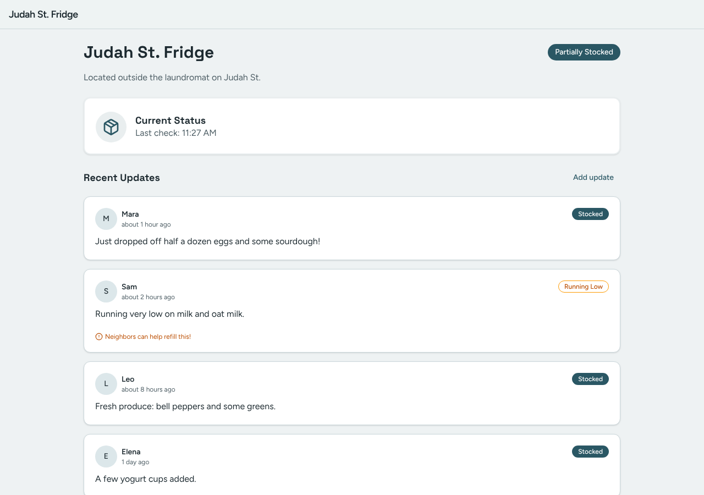
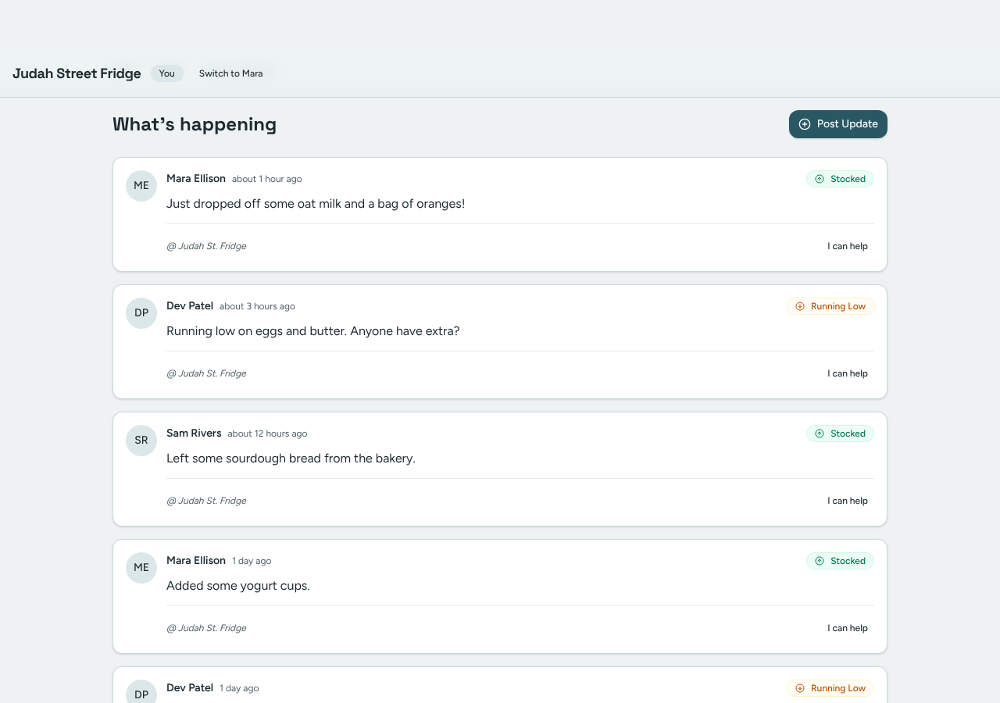
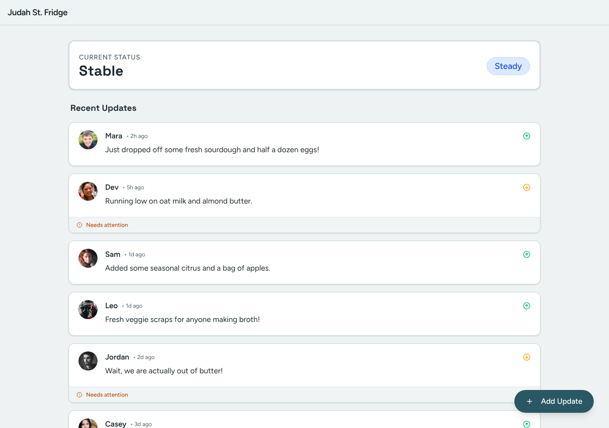
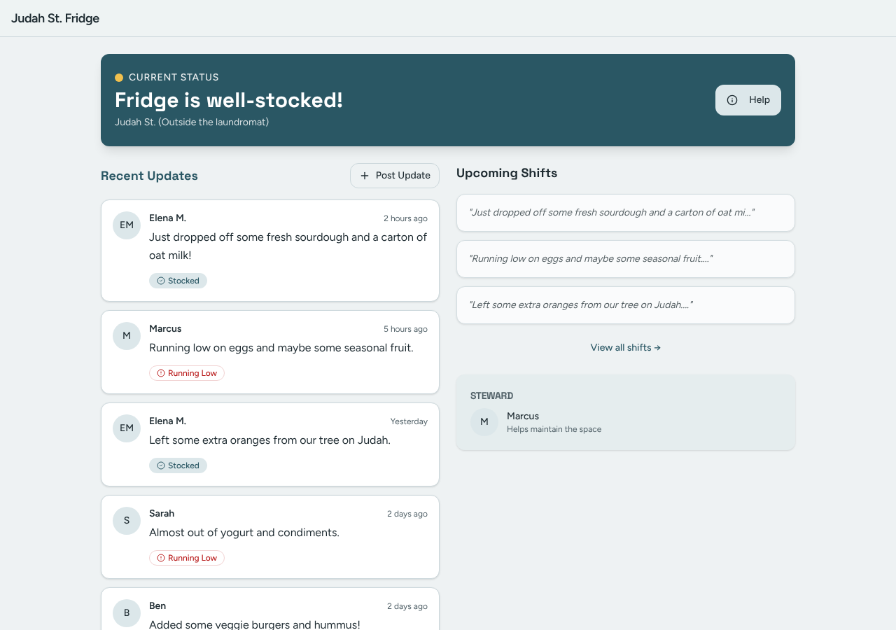
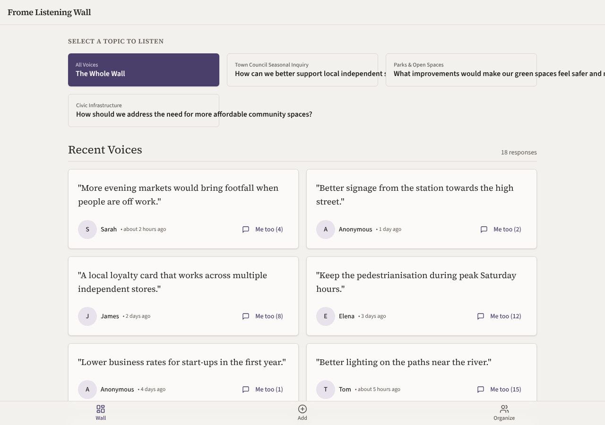
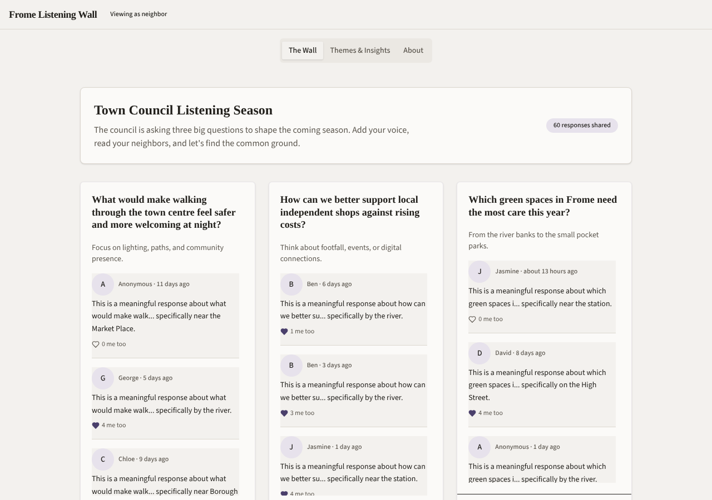

# Model bench — 2026-11-10T11-55-26-8b382fa-0ryu

- **Tasks:** hs-community-fridge, hs-listening-wall (harness 1.2.0, commit `8b382fa`)
- **Date:** 2026-11-10T12:08:08.366Z
- **Trials per model per task:** 4
- **Import guard:** on (static import check feeds the fix pass)
- **Human review:** _pending_

> Cost and token figures are **estimates** (chars ÷ 4 × list prices) — directional, not billing-grade.
> Mechanical columns are medians across trials. Total = plan + build wall time.
> **Bundle** = final compile success; **First try** = compiled without the auto-fix; **Renders** = opened in a browser after bundling, visible page and no uncaught errors (n/a before Oct 30, 2026); **Fail kind** = what the first-try bundle error was (missing-file, bad-import, unknown-package, syntax); **Lint/100** = eslint findings per 100 lines with the app's own config; **tsc errors** = type errors in the model's files with the kit merged and uninstalled packages untyped, counted only on builds that bundled, syntax errors kept apart (n/a before Nov 1, 2026); **Largest file**, **any**, **Kit files** (files importing the RB kit over code files) and **tok/s** come from the files the model wrote (n/a before Oct 31, 2026); **Fix time** = the auto-fix pass's own wall time; **Fix** = of the builds that first failed, how many the single auto-fix pass solved. **~$** includes the fix pass when one ran.

### Task: hs-community-fridge (exp-v1)

| Model | Bundle | First try | Renders | Fix | Fail kind | Files | Failed edits | Truncated | Checks | Sec flags | Lint/100 | tsc errors | Largest file | any | Kit files | tok/s | TTFT | Build time | Fix time | Total | ~$ | |
|---|---|---|---|---|---|---|---|---|---|---|---|---|---|---|---|---|---|---|---|---|---|---|
| gemma-4-26b | 4/4 ✓ | 2/4 | 4/4 clean | 2/2 solved | other, bad-import | 8.5 | 0 | no | 4.5/5 | 0 | 0.15 | 1 | 102.5 lines | 0 | 4/6 | 96.55 | 1s | 48s | 10s | 48s | 0.00 |

### Task: hs-listening-wall (exp-v1)

| Model | Bundle | First try | Renders | Fix | Fail kind | Files | Failed edits | Truncated | Checks | Sec flags | Lint/100 | tsc errors | Largest file | any | Kit files | tok/s | TTFT | Build time | Fix time | Total | ~$ | |
|---|---|---|---|---|---|---|---|---|---|---|---|---|---|---|---|---|---|---|---|---|---|---|
| gemma-4-26b | 4/4 ✓ | 2/4 | 2/4 clean, 2 blank | 1/2 solved | other, bad-import | 5.5 | 0 | no | 5/5 | 0 | 0.8 | 1 | 301 lines | 0 | 1/3.5 | 51.1 | 2s | 92s | 61s | 92s | 0.00 |

## Human review

_Not scored yet — open review/index.html, score, export, save as review/scores.json, re-run report._

## Which model for what

_Maintainer's call, informed by the tables above — the report feeds the decision, it doesn't make it._

## Served as (provider-reported)

- **gemma-4-26b**: google/gemma-4-26b-a4b-it, via NextBit / google/gemma-4-26b-a4b-it, via Io Net / google/gemma-4-26b-a4b-it, via Parasail / google/gemma-4-26b-a4b-it, via PrimeIntellect

## In the browser (bundled, but)

- **gemma-4-26b** · hs-listening-wall t1: BLANK PAGE
  - pageerror: Minified React error #130; visit https://reactjs.org/docs/error-decoder.html?invariant=130&args[]=object&args[]= for the full message or use the non-minified dev environment for full errors and additional helpful warning
- **gemma-4-26b** · hs-listening-wall t3: BLANK PAGE
  - console: Error: Minified React error #130; visit https://reactjs.org/docs/error-decoder.html?invariant=130&args[]=undefined&args[]= for the full message or use the non-minified dev environment for full errors and additional helpf
  - pageerror: Minified React error #130; visit https://reactjs.org/docs/error-decoder.html?invariant=130&args[]=undefined&args[]= for the full message or use the non-minified dev environment for full errors and additional helpful warn

## Fix passes (how solves went)

- **gemma-4-26b** · hs-community-fridge t3: build failed to bundle → auto-fix solved in one pass (15s, ~$0.00)
  - triggered by: `vfs:/src/App.tsx: a router is rendered in 2 files (/src/main.tsx, /src/App.tsx); render one HashRouter only, in one of them`
- **gemma-4-26b** · hs-community-fridge t4: build failed to bundle → auto-fix solved in one pass (6s, ~$0.00)
  - triggered by: `vfs:/src/pages/PostPage.tsx: No matching export in "vfs:/src/components/ui/textarea.tsx" for import "textarea"`
- **gemma-4-26b** · hs-listening-wall t1: build failed to bundle → auto-fix solved in one pass (56s, ~$0.00)
  - triggered by: `vfs:/src/App.tsx: ReferenceError: React is not defined (uses React.* with no `import React from 'react'` or `import * as React from 'react'`)`
- **gemma-4-26b** · hs-listening-wall t3: build failed to bundle → auto-fix not solved after 2 passes — still: vfs:/src/App.tsx: No matching export in "vfs:/src/components/ui/app-bar.tsx" for import "AppBar"
  - triggered by: `vfs:/src/App.tsx: No matching export in "vfs:/src/components/ui/app-bar.tsx" for import "AppBar"`

## Previews

### hs-community-fridge — gemma-4-26b (trial 1)

### hs-community-fridge — gemma-4-26b (trial 2)

### hs-community-fridge — gemma-4-26b (trial 3)

### hs-community-fridge — gemma-4-26b (trial 4)

### hs-listening-wall — gemma-4-26b (trial 1)

### hs-listening-wall — gemma-4-26b (trial 2)

### hs-listening-wall — gemma-4-26b (trial 3)

### hs-listening-wall — gemma-4-26b (trial 4)

