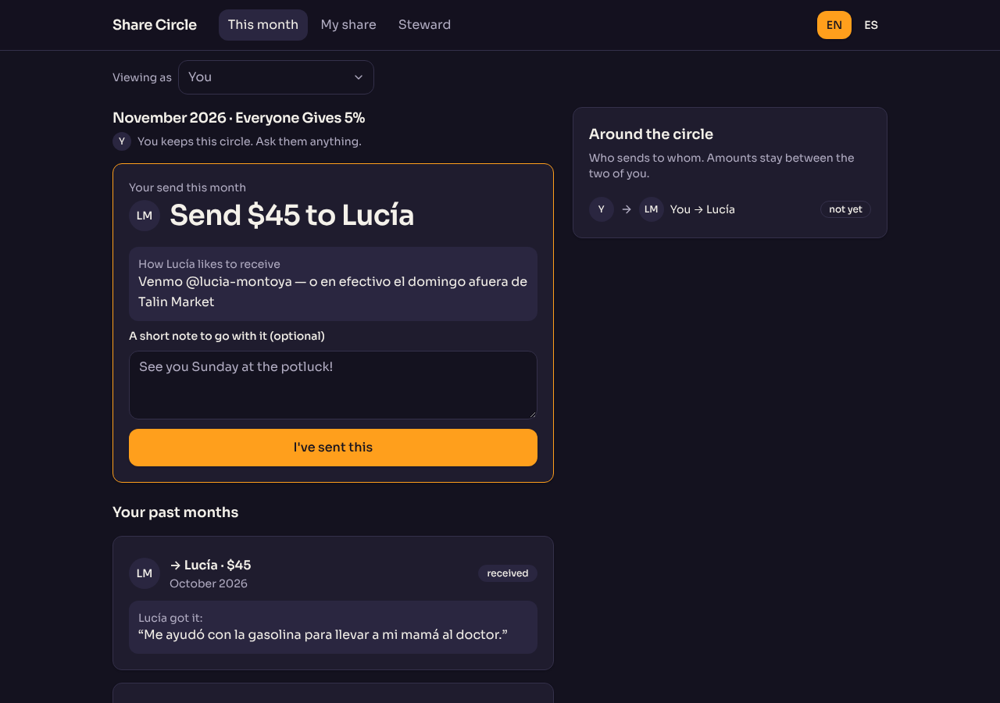
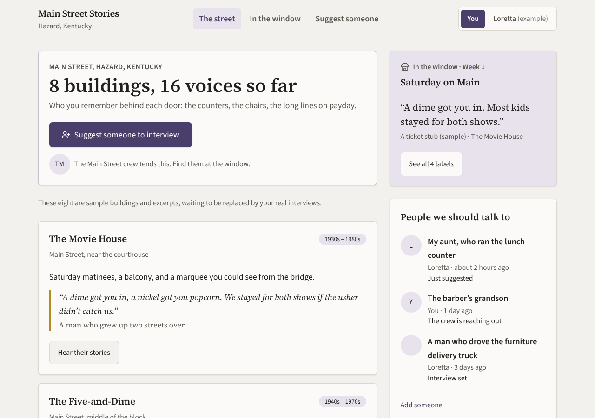
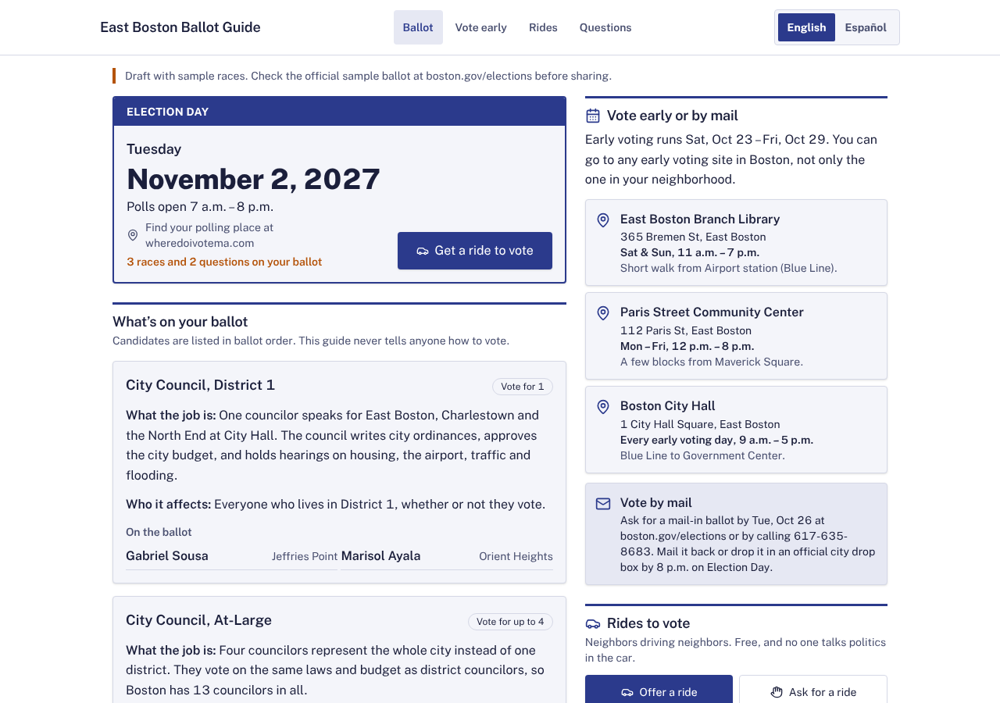
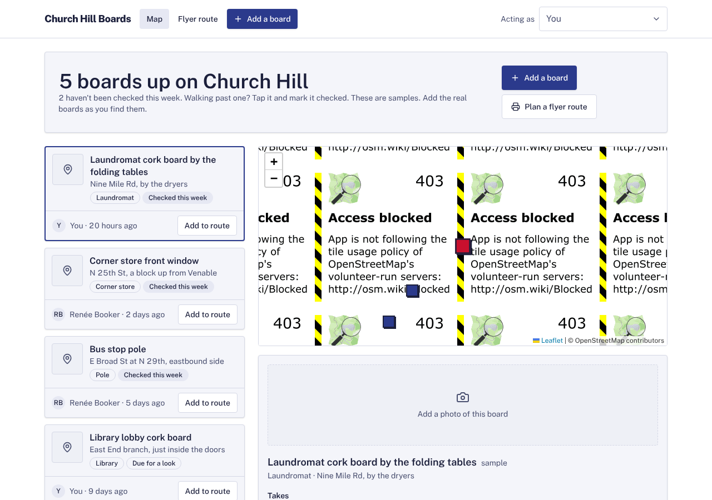

# Model bench — 2026-11-10T17-05-10-af7e4ce-e78g

- **Tasks:** remix-income-sharing, remix-gathering-fund, remix-street-stories, remix-tool-lending-seed, hs-story-circle, hs-ballot-guide, hs-skill-swap, hs-bulletin-boards (harness 1.2.0, commit `af7e4ce`)
- **Date:** 2026-11-10T17:36:38.608Z
- **Trials per model per task:** 1
- **Import guard:** on (static import check feeds the fix pass)
- **Human review:** _pending_

> Cost and token figures are **estimates** (chars ÷ 4 × list prices) — directional, not billing-grade.
> Mechanical columns are medians across trials. Total = plan + build wall time.
> **Bundle** = final compile success; **First try** = compiled without the auto-fix; **Renders** = opened in a browser after bundling, visible page and no uncaught errors (n/a before Oct 30, 2026); **Fail kind** = what the first-try bundle error was (missing-file, bad-import, unknown-package, syntax); **Lint/100** = eslint findings per 100 lines with the app's own config; **tsc errors** = type errors in the model's files with the kit merged and uninstalled packages untyped, counted only on builds that bundled, syntax errors kept apart (n/a before Nov 1, 2026); **Largest file**, **any**, **Kit files** (files importing the RB kit over code files) and **tok/s** come from the files the model wrote (n/a before Oct 31, 2026); **Fix time** = the auto-fix pass's own wall time; **Fix** = of the builds that first failed, how many the single auto-fix pass solved. **~$** includes the fix pass when one ran.

### Task: remix-income-sharing (exp-v1)

| Model | Bundle | First try | Renders | Fix | Fail kind | Files | Failed edits | Truncated | Checks | Sec flags | Lint/100 | tsc errors | Largest file | any | Kit files | tok/s | TTFT | Build time | Fix time | Total | ~$ | |
|---|---|---|---|---|---|---|---|---|---|---|---|---|---|---|---|---|---|---|---|---|---|---|
| opus-5-5 | 1/1 ✓ | 1/1 | 1/1 clean | — | — | 10 | 0 | no | 5/5 | 0 | 0 | 0 | 215 lines | 0 | 4/8 | 41.3 | 135s | 277s | — | 277s | 0.38 |

### Task: remix-gathering-fund (exp-v1)

| Model | Bundle | First try | Renders | Fix | Fail kind | Files | Failed edits | Truncated | Checks | Sec flags | Lint/100 | tsc errors | Largest file | any | Kit files | tok/s | TTFT | Build time | Fix time | Total | ~$ | |
|---|---|---|---|---|---|---|---|---|---|---|---|---|---|---|---|---|---|---|---|---|---|---|
| opus-5-5 | 0/1 ✓ | 0/1 | 1/1 clean | — | — | 4 | 0 | no | 3/5 | 0 | 0 | n/a | 137 lines | 0 | 0/1 | 51.5 | 43s | 121s | — | 121s | 0.19 |

### Task: remix-street-stories (exp-v1)

| Model | Bundle | First try | Renders | Fix | Fail kind | Files | Failed edits | Truncated | Checks | Sec flags | Lint/100 | tsc errors | Largest file | any | Kit files | tok/s | TTFT | Build time | Fix time | Total | ~$ | |
|---|---|---|---|---|---|---|---|---|---|---|---|---|---|---|---|---|---|---|---|---|---|---|
| opus-5-5 | 1/1 ✓ | 1/1 | 1/1 clean | — | — | 12 | 0 | no | 5/5 | 0 | 0 | 0 | 202 lines | 0 | 5/10 | 51.9 | 65s | 198s | — | 198s | 0.36 |

### Task: remix-tool-lending-seed (exp-v1)

| Model | Bundle | First try | Renders | Fix | Fail kind | Files | Failed edits | Truncated | Checks | Sec flags | Lint/100 | tsc errors | Largest file | any | Kit files | tok/s | TTFT | Build time | Fix time | Total | ~$ | |
|---|---|---|---|---|---|---|---|---|---|---|---|---|---|---|---|---|---|---|---|---|---|---|
| opus-5-5 | 1/1 ✓ | 1/1 | 0/1 clean, 1 blank | — | — | 11 | 0 | no | 5/5 | 0 | 0 | 1 | 89 lines | 0 | 6/9 | 37 | 104s | 175s | — | 175s | 0.19 |

### Task: hs-story-circle (exp-v1)

| Model | Bundle | First try | Renders | Fix | Fail kind | Files | Failed edits | Truncated | Checks | Sec flags | Lint/100 | tsc errors | Largest file | any | Kit files | tok/s | TTFT | Build time | Fix time | Total | ~$ | |
|---|---|---|---|---|---|---|---|---|---|---|---|---|---|---|---|---|---|---|---|---|---|---|
| opus-5-5 | 1/1 ✓ | 1/1 | 1/1 clean | — | — | 11 | 0 | no | 5/5 | 0 | 0.5 | 0 | 188 lines | 0 | 5/9 | 47.5 | 109s | 223s | — | 223s | 0.38 |

### Task: hs-ballot-guide (exp-v1)

| Model | Bundle | First try | Renders | Fix | Fail kind | Files | Failed edits | Truncated | Checks | Sec flags | Lint/100 | tsc errors | Largest file | any | Kit files | tok/s | TTFT | Build time | Fix time | Total | ~$ | |
|---|---|---|---|---|---|---|---|---|---|---|---|---|---|---|---|---|---|---|---|---|---|---|
| opus-5-5 | 1/1 ✓ | 1/1 | 1/1 clean | — | — | 15 | 0 | no | 4/5 | 0 | 0 | 1 | 246 lines | 0 | 6/13 | 38.8 | 110s | 350s | — | 350s | 0.52 |

### Task: hs-skill-swap (exp-v1)

| Model | Bundle | First try | Renders | Fix | Fail kind | Files | Failed edits | Truncated | Checks | Sec flags | Lint/100 | tsc errors | Largest file | any | Kit files | tok/s | TTFT | Build time | Fix time | Total | ~$ | |
|---|---|---|---|---|---|---|---|---|---|---|---|---|---|---|---|---|---|---|---|---|---|---|
| opus-5-5 | 1/1 ✓ | 1/1 | 1/1 clean | — | — | 9 | 0 | no | 5/5 | 0 | 0 | 0 | 206 lines | 0 | 4/7 | 41.8 | 121s | 226s | — | 226s | 0.35 |

### Task: hs-bulletin-boards (exp-v1)

| Model | Bundle | First try | Renders | Fix | Fail kind | Files | Failed edits | Truncated | Checks | Sec flags | Lint/100 | tsc errors | Largest file | any | Kit files | tok/s | TTFT | Build time | Fix time | Total | ~$ | |
|---|---|---|---|---|---|---|---|---|---|---|---|---|---|---|---|---|---|---|---|---|---|---|
| opus-5-5 | 1/1 ✓ | 1/1 | 0/1 clean | — | — | 13 | 0 | no | 4/5 | 0 | 0.2 | 3 | 139 lines | 2 | 6/11 | 44.8 | 81s | 274s | — | 274s | 0.39 |

## Human review

_Not scored yet — open review/index.html, score, export, save as review/scores.json, re-run report._

## Which model for what

_Maintainer's call, informed by the tables above — the report feeds the decision, it doesn't make it._

## Served as (provider-reported)

- **opus-5-5**: anthropic/claude-opus-5.5, via Claude Platform on AWS

## In the browser (bundled, but)

- **opus-5-5** · remix-tool-lending-seed t1: BLANK PAGE
  - console: ReferenceError: categories is not defined at Shelf (file:///home/user/relational-builder/bench/results/2026-11-10T17-05-10-af7e4ce-e78g/artifacts/remix-tool-lending-seed/opus-5-5-t1/preview.html:791:94) at Hi (https://es
  - pageerror: categories is not defined
- **opus-5-5** · hs-bulletin-boards t1: renders with errors
  - console: Access to fetch at 'file:///home/user/relational-builder/bench/results/2026-11-10T17-05-10-af7e4ce-e78g/artifacts/hs-bulletin-boards/opus-5-5-t1/data/boards.json' from origin 'null' has been blocked by CORS policy: Cross

## Previews

### remix-income-sharing — opus-5-5 (trial 1)

### remix-gathering-fund — opus-5-5 (trial 1)

### remix-street-stories — opus-5-5 (trial 1)

### remix-tool-lending-seed — opus-5-5 (trial 1)

### hs-story-circle — opus-5-5 (trial 1)

### hs-ballot-guide — opus-5-5 (trial 1)

### hs-skill-swap — opus-5-5 (trial 1)

### hs-bulletin-boards — opus-5-5 (trial 1)

