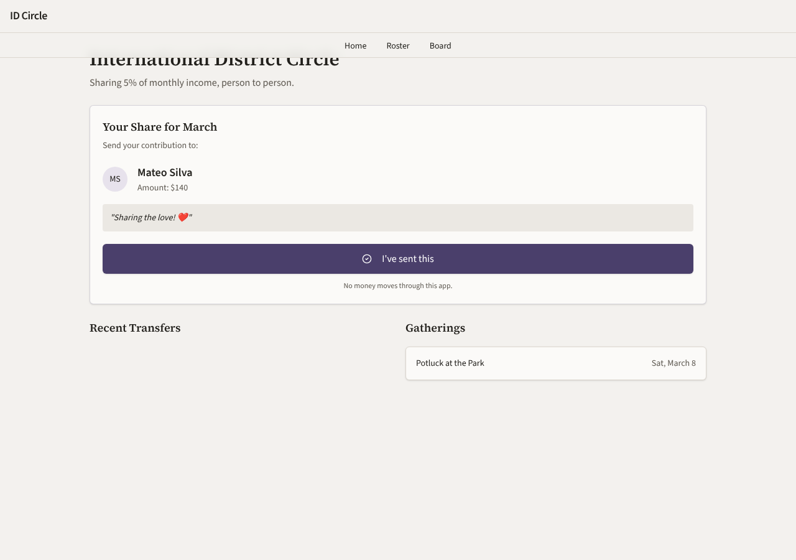
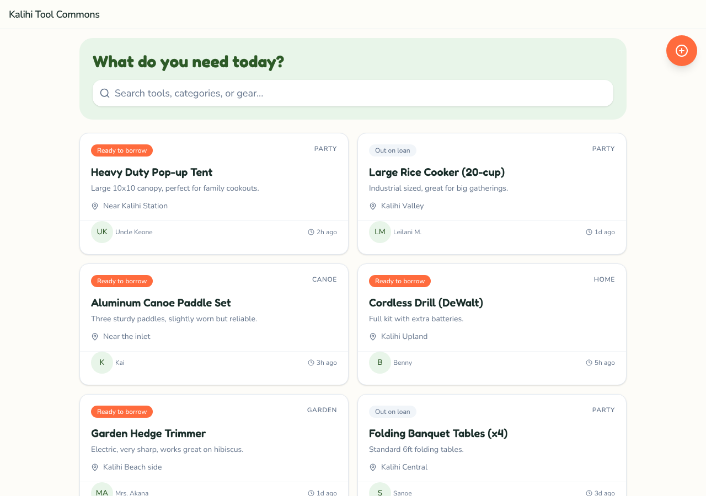
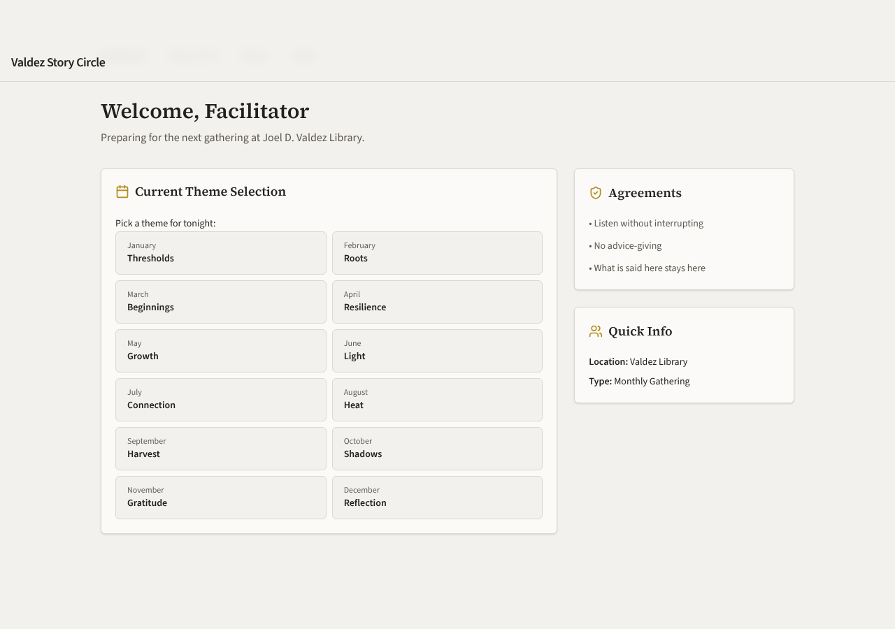
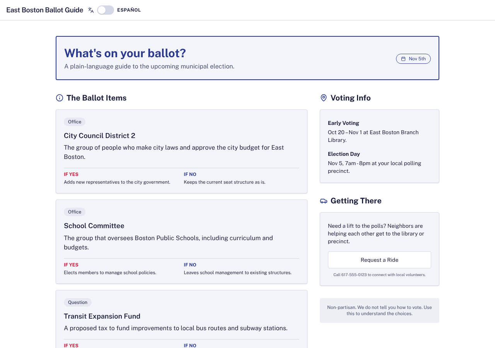
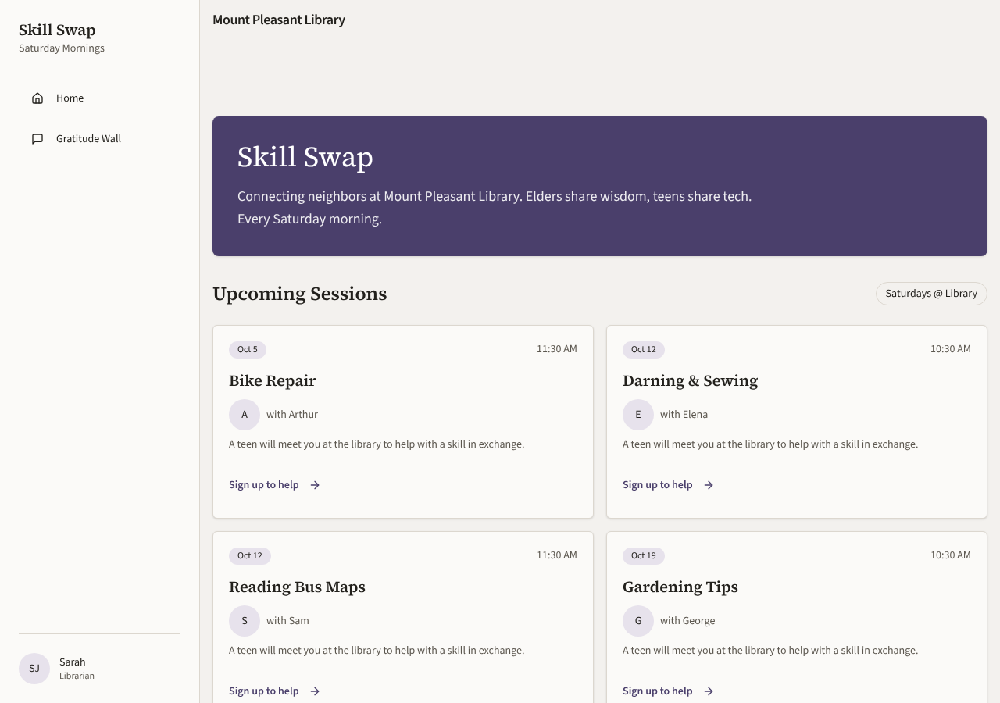

# Model bench — 2026-11-10T17-05-10-af7e4ce-v6l9

- **Tasks:** remix-income-sharing, remix-gathering-fund, remix-street-stories, remix-tool-lending-seed, hs-story-circle, hs-ballot-guide, hs-skill-swap, hs-bulletin-boards (harness 1.2.0, commit `af7e4ce`)
- **Date:** 2026-11-10T17:21:58.802Z
- **Trials per model per task:** 1
- **Import guard:** on (static import check feeds the fix pass)
- **Human review:** _pending_

> Cost and token figures are **estimates** (chars ÷ 4 × list prices) — directional, not billing-grade.
> Mechanical columns are medians across trials. Total = plan + build wall time.
> **Bundle** = final compile success; **First try** = compiled without the auto-fix; **Renders** = opened in a browser after bundling, visible page and no uncaught errors (n/a before Oct 30, 2026); **Fail kind** = what the first-try bundle error was (missing-file, bad-import, unknown-package, syntax); **Lint/100** = eslint findings per 100 lines with the app's own config; **tsc errors** = type errors in the model's files with the kit merged and uninstalled packages untyped, counted only on builds that bundled, syntax errors kept apart (n/a before Nov 1, 2026); **Largest file**, **any**, **Kit files** (files importing the RB kit over code files) and **tok/s** come from the files the model wrote (n/a before Oct 31, 2026); **Fix time** = the auto-fix pass's own wall time; **Fix** = of the builds that first failed, how many the single auto-fix pass solved. **~$** includes the fix pass when one ran.

### Task: remix-income-sharing (exp-v1)

| Model | Bundle | First try | Renders | Fix | Fail kind | Files | Failed edits | Truncated | Checks | Sec flags | Lint/100 | tsc errors | Largest file | any | Kit files | tok/s | TTFT | Build time | Fix time | Total | ~$ | |
|---|---|---|---|---|---|---|---|---|---|---|---|---|---|---|---|---|---|---|---|---|---|---|
| gemma-4-26b | 1/1 ✓ | 1/1 | 1/1 clean | — | — | 9 | 0 | no | 4/5 | 0 | 0.6 | 0 | 96 lines | 0 | 4/7 | 60.2 | 3s | 66s | — | 66s | 0.00 |

### Task: remix-gathering-fund (exp-v1)

| Model | Bundle | First try | Renders | Fix | Fail kind | Files | Failed edits | Truncated | Checks | Sec flags | Lint/100 | tsc errors | Largest file | any | Kit files | tok/s | TTFT | Build time | Fix time | Total | ~$ | |
|---|---|---|---|---|---|---|---|---|---|---|---|---|---|---|---|---|---|---|---|---|---|---|
| gemma-4-26b | 1/1 ✓ | 1/1 | 0/1 clean, 1 blank | — | — | 6 | 0 | no | 5/5 | 0 | 0.7 | 2 | 226 lines | 0 | 1/4 | 70.4 | 1s | 57s | — | 57s | 0.00 |

### Task: remix-street-stories (exp-v1)

| Model | Bundle | First try | Renders | Fix | Fail kind | Files | Failed edits | Truncated | Checks | Sec flags | Lint/100 | tsc errors | Largest file | any | Kit files | tok/s | TTFT | Build time | Fix time | Total | ~$ | |
|---|---|---|---|---|---|---|---|---|---|---|---|---|---|---|---|---|---|---|---|---|---|---|
| gemma-4-26b | 1/1 ✓ | 0/1 | 1/1 clean | 1/1 solved | other | 6 | 0 | no | 4/5 | 0 | 0.5 | 1 | 260 lines | 0 | 1/3 | 95.6 | 1s | 52s | 52s | 52s | 0.01 |

### Task: remix-tool-lending-seed (exp-v1)

| Model | Bundle | First try | Renders | Fix | Fail kind | Files | Failed edits | Truncated | Checks | Sec flags | Lint/100 | tsc errors | Largest file | any | Kit files | tok/s | TTFT | Build time | Fix time | Total | ~$ | |
|---|---|---|---|---|---|---|---|---|---|---|---|---|---|---|---|---|---|---|---|---|---|---|
| gemma-4-26b | 1/1 ✓ | 0/1 | 1/1 clean | 1/1 solved | other | 10 | 1 | no | 4/5 | 0 | 0 | 0 | 104 lines | 0 | 4/6 | 56.3 | 3s | 99s | 35s | 99s | 0.01 |

### Task: hs-story-circle (exp-v1)

| Model | Bundle | First try | Renders | Fix | Fail kind | Files | Failed edits | Truncated | Checks | Sec flags | Lint/100 | tsc errors | Largest file | any | Kit files | tok/s | TTFT | Build time | Fix time | Total | ~$ | |
|---|---|---|---|---|---|---|---|---|---|---|---|---|---|---|---|---|---|---|---|---|---|---|
| gemma-4-26b | 1/1 ✓ | 0/1 | 1/1 clean | 1/1 solved | syntax | 10 | 0 | no | 4/5 | 0 | 1.7 | 0 | 179 lines | 1 | 5/7 | 21.7 | 1s | 282s | 19s | 282s | 0.01 |

### Task: hs-ballot-guide (exp-v1)

| Model | Bundle | First try | Renders | Fix | Fail kind | Files | Failed edits | Truncated | Checks | Sec flags | Lint/100 | tsc errors | Largest file | any | Kit files | tok/s | TTFT | Build time | Fix time | Total | ~$ | |
|---|---|---|---|---|---|---|---|---|---|---|---|---|---|---|---|---|---|---|---|---|---|---|
| gemma-4-26b | 1/1 ✓ | 1/1 | 1/1 clean | — | — | 5 | 0 | no | 5/5 | 0 | 0.3 | 0 | 189 lines | 0 | 1/3 | 53.8 | 13s | 81s | — | 81s | 0.00 |

### Task: hs-skill-swap (exp-v1)

| Model | Bundle | First try | Renders | Fix | Fail kind | Files | Failed edits | Truncated | Checks | Sec flags | Lint/100 | tsc errors | Largest file | any | Kit files | tok/s | TTFT | Build time | Fix time | Total | ~$ | |
|---|---|---|---|---|---|---|---|---|---|---|---|---|---|---|---|---|---|---|---|---|---|---|
| gemma-4-26b | 1/1 ✓ | 0/1 | 1/1 clean | 1/1 solved | bad-import | 10 | 0 | no | 4/5 | 0 | 0 | 0 | 109 lines | 0 | 4/6 | 55.3 | 1s | 83s | 10s | 83s | 0.01 |

### Task: hs-bulletin-boards (exp-v1)

| Model | Bundle | First try | Renders | Fix | Fail kind | Files | Failed edits | Truncated | Checks | Sec flags | Lint/100 | tsc errors | Largest file | any | Kit files | tok/s | TTFT | Build time | Fix time | Total | ~$ | |
|---|---|---|---|---|---|---|---|---|---|---|---|---|---|---|---|---|---|---|---|---|---|---|
| gemma-4-26b | 1/1 ✓ | 0/1 | 0/1 clean, 1 blank | 1/1 solved | syntax | 14 | 0 | no | 4/5 | 0 | 0.5 | 1 | 75 lines | 1 | 5/10 | 87.5 | 4s | 68s | 57s | 68s | 0.01 |

## Human review

_Not scored yet — open review/index.html, score, export, save as review/scores.json, re-run report._

## Which model for what

_Maintainer's call, informed by the tables above — the report feeds the decision, it doesn't make it._

## Served as (provider-reported)

- **gemma-4-26b**: google/gemma-4-26b-a4b-it, via NextBit / google/gemma-4-26b-a4b-it, via Parasail / google/gemma-4-26b-a4b-it, via PrimeIntellect

## In the browser (bundled, but)

- **gemma-4-26b** · remix-gathering-fund t1: BLANK PAGE
  - pageerror: Soup is not defined
- **gemma-4-26b** · hs-bulletin-boards t1: BLANK PAGE
  - console: Error: Minified React error #185; visit https://reactjs.org/docs/error-decoder.html?invariant=185 for the full message or use the non-minified dev environment for full errors and additional helpful warnings. at Ce (https
  - pageerror: Minified React error #185; visit https://reactjs.org/docs/error-decoder.html?invariant=185 for the full message or use the non-minified dev environment for full errors and additional helpful warnings.

## Fix passes (how solves went)

- **gemma-4-26b** · remix-street-stories t1: build failed to bundle → auto-fix solved in one pass (52s, ~$0.00)
  - triggered by: `vfs:/src/App.tsx:169: Unexpected closing "label" tag does not match opening "Label" tag`
- **gemma-4-26b** · remix-tool-lending-seed t1: build failed to bundle → auto-fix solved in 2 passes (35s, ~$0.00)
  - triggered by: `vfs:/src/pages/AddToolPage.tsx:51: Unexpected closing "label" tag does not match opening "Label" tag`
- **gemma-4-26b** · hs-story-circle t1: build failed to bundle → auto-fix solved in one pass (19s, ~$0.00)
  - triggered by: `vfs:/src/pages/CircleView.tsx:48: Expected ";" but found ":"`
- **gemma-4-26b** · hs-skill-swap t1: build failed to bundle → auto-fix solved in 2 passes (10s, ~$0.00)
  - triggered by: `vfs:/src/main.tsx:3: No matching export in "vfs:/src/App.tsx" for import "App"`
- **gemma-4-26b** · hs-bulletin-boards t1: build failed to bundle → auto-fix solved in one pass (57s, ~$0.00)
  - triggered by: `vfs:/src/pages/RoutePlan.tsx:31: Expected identifier but found "<"`

## Previews

### remix-income-sharing — gemma-4-26b (trial 1)

### remix-gathering-fund — gemma-4-26b (trial 1)

### remix-street-stories — gemma-4-26b (trial 1)

### remix-tool-lending-seed — gemma-4-26b (trial 1)

### hs-story-circle — gemma-4-26b (trial 1)

### hs-ballot-guide — gemma-4-26b (trial 1)

### hs-skill-swap — gemma-4-26b (trial 1)

### hs-bulletin-boards — gemma-4-26b (trial 1)

