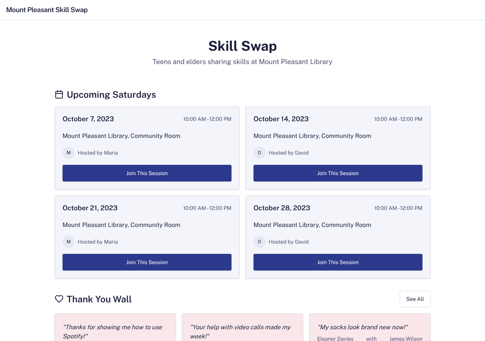
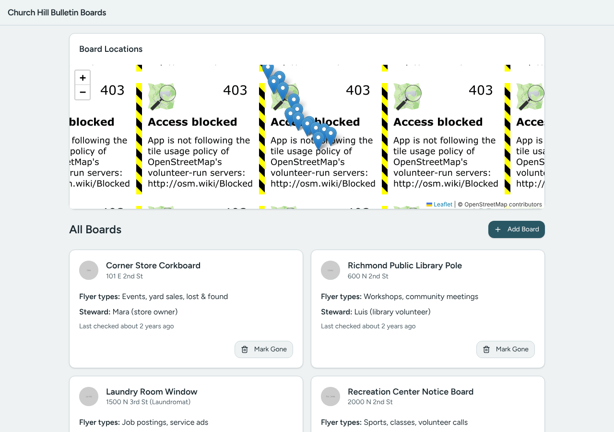

# Model bench — 2026-11-10T17-22-01-af7e4ce-41jb

- **Tasks:** remix-income-sharing, remix-gathering-fund, remix-street-stories, remix-tool-lending-seed, hs-story-circle, hs-ballot-guide, hs-skill-swap, hs-bulletin-boards (harness 1.2.0, commit `af7e4ce`)
- **Date:** 2026-11-10T17:44:27.559Z
- **Trials per model per task:** 1
- **Import guard:** on (static import check feeds the fix pass)
- **Human review:** _pending_

> Cost and token figures are **estimates** (chars ÷ 4 × list prices) — directional, not billing-grade.
> Mechanical columns are medians across trials. Total = plan + build wall time.
> **Bundle** = final compile success; **First try** = compiled without the auto-fix; **Renders** = opened in a browser after bundling, visible page and no uncaught errors (n/a before Oct 30, 2026); **Fail kind** = what the first-try bundle error was (missing-file, bad-import, unknown-package, syntax); **Lint/100** = eslint findings per 100 lines with the app's own config; **tsc errors** = type errors in the model's files with the kit merged and uninstalled packages untyped, counted only on builds that bundled, syntax errors kept apart (n/a before Nov 1, 2026); **Largest file**, **any**, **Kit files** (files importing the RB kit over code files) and **tok/s** come from the files the model wrote (n/a before Oct 31, 2026); **Fix time** = the auto-fix pass's own wall time; **Fix** = of the builds that first failed, how many the single auto-fix pass solved. **~$** includes the fix pass when one ran.

### Task: remix-income-sharing (exp-v1)

| Model | Bundle | First try | Renders | Fix | Fail kind | Files | Failed edits | Truncated | Checks | Sec flags | Lint/100 | tsc errors | Largest file | any | Kit files | tok/s | TTFT | Build time | Fix time | Total | ~$ | |
|---|---|---|---|---|---|---|---|---|---|---|---|---|---|---|---|---|---|---|---|---|---|---|
| glm-4.5-air | 0/1 ✓ | 0/1 | n/a | 0/1 solved | missing-file | 24 | 0 | no | 5/5 | 0 | 1.4 | n/a | 110 lines | 0 | 2/15 | 82.3 | 12s | 147s | 27s | 147s | 0.02 |
| gpt-oss-120b | 1/1 ✓ | 0/1 | 0/1 clean, 1 blank | 1/1 solved | other | 16 | 0 | no | 4/5 | 0 | 0.7 | 6 | 132 lines | 0 | 5/11 | 20.8 | 30s | 215s | 29s | 215s | 0.01 |

### Task: remix-gathering-fund (exp-v1)

| Model | Bundle | First try | Renders | Fix | Fail kind | Files | Failed edits | Truncated | Checks | Sec flags | Lint/100 | tsc errors | Largest file | any | Kit files | tok/s | TTFT | Build time | Fix time | Total | ~$ | |
|---|---|---|---|---|---|---|---|---|---|---|---|---|---|---|---|---|---|---|---|---|---|---|
| glm-4.5-air | 0/1 ✓ | 0/1 | 1/1 clean | — | — | 1 | 0 | no | 2/5 | 0 | n/a | n/a | 0 lines | 0 | 0/0 | 81.3 | 6s | 61s | — | 61s | 0.01 |
| gpt-oss-120b | 0/1 ✓ | 0/1 | 1/1 clean | — | — | 3 | 0 | no | 2/5 | 0 | 0 | n/a | 45 lines | 0 | 0/1 | 60.1 | 7s | 40s | — | 40s | 0.00 |

### Task: remix-street-stories (exp-v1)

| Model | Bundle | First try | Renders | Fix | Fail kind | Files | Failed edits | Truncated | Checks | Sec flags | Lint/100 | tsc errors | Largest file | any | Kit files | tok/s | TTFT | Build time | Fix time | Total | ~$ | |
|---|---|---|---|---|---|---|---|---|---|---|---|---|---|---|---|---|---|---|---|---|---|---|
| glm-4.5-air | 0/1 ✓ | 0/1 | 1/1 clean | — | — | 1 | 0 | no | 2/5 | 0 | n/a | n/a | 0 lines | 0 | 0/0 | 68.3 | 13s | 67s | — | 67s | 0.01 |
| gpt-oss-120b | 1/1 ✓ | 0/1 | 0/1 clean | 1/1 solved | other | 13 | 0 | no | 4/5 | 0 | 0.4 | 1 | 130 lines | 1 | 6/10 | 180.1 | 5s | 27s | 4s | 27s | 0.01 |

### Task: remix-tool-lending-seed (exp-v1)

| Model | Bundle | First try | Renders | Fix | Fail kind | Files | Failed edits | Truncated | Checks | Sec flags | Lint/100 | tsc errors | Largest file | any | Kit files | tok/s | TTFT | Build time | Fix time | Total | ~$ | |
|---|---|---|---|---|---|---|---|---|---|---|---|---|---|---|---|---|---|---|---|---|---|---|
| glm-4.5-air | 1/1 ✓ | 1/1 | 1/1 clean | — | — | 11 | 0 | no | 5/5 | 0 | 0.3 | 2 | 241 lines | 0 | 6/9 | 75.7 | 10s | 78s | — | 78s | 0.01 |
| gpt-oss-120b | 1/1 ✓ | 0/1 | 1/1 clean | 1/1 solved | other | 9 | 0 | no | 5/5 | 0 | 1 | 3 | 176 lines | 0 | 3/6 | 65.8 | 6s | 67s | 4s | 67s | 0.01 |

### Task: hs-story-circle (exp-v1)

| Model | Bundle | First try | Renders | Fix | Fail kind | Files | Failed edits | Truncated | Checks | Sec flags | Lint/100 | tsc errors | Largest file | any | Kit files | tok/s | TTFT | Build time | Fix time | Total | ~$ | |
|---|---|---|---|---|---|---|---|---|---|---|---|---|---|---|---|---|---|---|---|---|---|---|
| glm-4.5-air | 1/1 ✓ | 1/1 | 1/1 clean | — | — | 8 | 0 | no | 5/5 | 0 | 1.1 | 1 | 242 lines | 0 | 3/6 | 70.5 | 11s | 75s | — | 75s | 0.01 |
| gpt-oss-120b | 1/1 ✓ | 0/1 | 0/1 clean, 1 blank | 1/1 solved | other | 13 | 0 | no | 4/5 | 0 | 0.7 | 5 | 153 lines | 1 | 5/9 | 148.6 | 5s | 30s | 22s | 30s | 0.01 |

### Task: hs-ballot-guide (exp-v1)

| Model | Bundle | First try | Renders | Fix | Fail kind | Files | Failed edits | Truncated | Checks | Sec flags | Lint/100 | tsc errors | Largest file | any | Kit files | tok/s | TTFT | Build time | Fix time | Total | ~$ | |
|---|---|---|---|---|---|---|---|---|---|---|---|---|---|---|---|---|---|---|---|---|---|---|
| glm-4.5-air | 0/1 ✓ | 0/1 | 1/1 clean | — | — | 1 | 0 | no | 2/5 | 0 | n/a | n/a | 0 lines | 0 | 0/0 | 80.1 | 6s | 46s | — | 46s | 0.01 |
| gpt-oss-120b | 0/1 ✓ | 0/1 | 1/1 clean | — | — | 3 | 0 | no | 2/5 | 0 | 0 | n/a | 13 lines | 0 | 0/1 | 182.6 | 4s | 18s | — | 18s | 0.00 |

### Task: hs-skill-swap (exp-v1)

| Model | Bundle | First try | Renders | Fix | Fail kind | Files | Failed edits | Truncated | Checks | Sec flags | Lint/100 | tsc errors | Largest file | any | Kit files | tok/s | TTFT | Build time | Fix time | Total | ~$ | |
|---|---|---|---|---|---|---|---|---|---|---|---|---|---|---|---|---|---|---|---|---|---|---|
| glm-4.5-air | 1/1 ✓ | 0/1 | 1/1 clean | 1/1 solved | bad-import | 16 | 0 | no | 4/5 | 0 | 0 | 1 | 217 lines | 0 | 4/9 | 58.1 | 30s | 96s | 30s | 96s | 0.01 |
| gpt-oss-120b | 1/1 ✓ | 1/1 | 1/1 clean | — | — | 11 | 0 | no | 4/5 | 0 | 0.4 | 2 | 112 lines | 0 | 4/9 | 56.7 | 19s | 86s | — | 86s | 0.01 |

### Task: hs-bulletin-boards (exp-v1)

| Model | Bundle | First try | Renders | Fix | Fail kind | Files | Failed edits | Truncated | Checks | Sec flags | Lint/100 | tsc errors | Largest file | any | Kit files | tok/s | TTFT | Build time | Fix time | Total | ~$ | |
|---|---|---|---|---|---|---|---|---|---|---|---|---|---|---|---|---|---|---|---|---|---|---|
| glm-4.5-air | 1/1 ✓ | 0/1 | 1/1 clean | 1/1 solved | bad-import | 12 | 0 | no | 4/5 | 0 | 0.1 | 3 | 196 lines | 0 | 5/9 | 79.2 | 8s | 84s | 8s | 84s | 0.01 |
| gpt-oss-120b | 1/1 ✓ | 1/1 | 1/1 clean | — | — | 11 | 0 | no | 4/5 | 0 | 0.2 | 2 | 196 lines | 0 | 5/9 | 328.3 | 3s | 15s | — | 15s | 0.01 |

## Human review

_Not scored yet — open review/index.html, score, export, save as review/scores.json, re-run report._

## Which model for what

_Maintainer's call, informed by the tables above — the report feeds the decision, it doesn't make it._

## Served as (provider-reported)

- **glm-4.5-air**: z-ai/glm-4.5-air, via Novita / z-ai/glm-4.5-air, via Z.AI
- **gpt-oss-120b**: openai/gpt-oss-120b, via DeepInfra / openai/gpt-oss-120b, via AkashML / openai/gpt-oss-120b, via Crusoe / openai/gpt-oss-120b, via PrimeIntellect / openai/gpt-oss-120b, via Sail Research / openai/gpt-oss-120b, via Groq, fingerprint fp_4b2f03d631

## In the browser (bundled, but)

- **gpt-oss-120b** · remix-income-sharing t1: BLANK PAGE
  - console: TypeError: setMembers is not a function at file:///home/user/relational-builder/bench/results/2026-11-10T17-22-01-af7e4ce-41jb/artifacts/remix-income-sharing/gpt-oss-120b-t1/preview.html:652:5 at Kr (https://esm.sh/react
  - pageerror: setMembers is not a function
- **gpt-oss-120b** · remix-street-stories t1: renders with errors
  - pageerror: Cannot apply unknown utility class `font-display`
  - pageerror: Cannot apply unknown utility class `font-display`
  - pageerror: Cannot apply unknown utility class `font-display`
  - style: the page rendered without its styles (Tailwind classes had no effect)
- **gpt-oss-120b** · hs-story-circle t1: BLANK PAGE
  - console: Error: Minified React error #185; visit https://reactjs.org/docs/error-decoder.html?invariant=185 for the full message or use the non-minified dev environment for full errors and additional helpful warnings. at Ce (https
  - pageerror: Minified React error #185; visit https://reactjs.org/docs/error-decoder.html?invariant=185 for the full message or use the non-minified dev environment for full errors and additional helpful warnings.

## Fix passes (how solves went)

- **glm-4.5-air** · remix-income-sharing t1: build failed to bundle → auto-fix not solved after 2 passes — still: vfs:/src/pages/Gatherings.tsx:1: Unexpected "<<"
  - triggered by: `vfs:/src/pages/Gatherings.tsx:1: Could not find "@/stores" in the project (imported from /src/pages/Gatherings.tsx)`
- **glm-4.5-air** · hs-skill-swap t1: build failed to bundle → auto-fix solved in 2 passes (30s, ~$0.01)
  - triggered by: `vfs:/src/pages/SessionPage.tsx:4: No matching export in "vfs:/src/components/ui/input.tsx" for import "Label"`
- **glm-4.5-air** · hs-bulletin-boards t1: build failed to bundle → auto-fix solved in one pass (8s, ~$0.00)
  - triggered by: `vfs:/src/App.tsx:4: No matching export in "vfs:/src/components/ui/app-bar.tsx" for import "default"`
- **gpt-oss-120b** · remix-income-sharing t1: build failed to bundle → auto-fix solved in one pass (29s, ~$0.00)
  - triggered by: `vfs:/src/main.tsx: BrowserRouter from 'react-router-dom' opens on "Page not found" in the preview and on static hosts; use HashRouter`
- **gpt-oss-120b** · remix-street-stories t1: build failed to bundle → auto-fix solved in one pass (4s, ~$0.00)
  - triggered by: `vfs:/src/pages/Buildings.tsx: Dynamic require of "@/data/buildings" is not supported (this is an ES module; use import)`
- **gpt-oss-120b** · remix-tool-lending-seed t1: build failed to bundle → auto-fix solved in one pass (4s, ~$0.00)
  - triggered by: `vfs:/src/main.tsx: BrowserRouter from 'react-router-dom' opens on "Page not found" in the preview and on static hosts; use HashRouter`
- **gpt-oss-120b** · hs-story-circle t1: build failed to bundle → auto-fix solved in one pass (22s, ~$0.00)
  - triggered by: `vfs:/src/data/themes.ts:15: Unexpected "“"`

## Previews

### remix-gathering-fund — glm-4.5-air (trial 1)

### remix-street-stories — glm-4.5-air (trial 1)

### remix-tool-lending-seed — glm-4.5-air (trial 1)

### hs-story-circle — glm-4.5-air (trial 1)

### hs-ballot-guide — glm-4.5-air (trial 1)

### hs-skill-swap — glm-4.5-air (trial 1)

### hs-bulletin-boards — glm-4.5-air (trial 1)

### remix-income-sharing — gpt-oss-120b (trial 1)

### remix-gathering-fund — gpt-oss-120b (trial 1)

### remix-street-stories — gpt-oss-120b (trial 1)

### remix-tool-lending-seed — gpt-oss-120b (trial 1)

### hs-story-circle — gpt-oss-120b (trial 1)

### hs-ballot-guide — gpt-oss-120b (trial 1)

### hs-skill-swap — gpt-oss-120b (trial 1)

### hs-bulletin-boards — gpt-oss-120b (trial 1)

