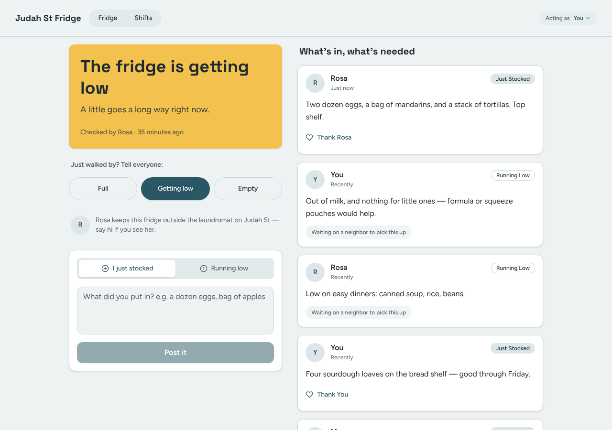
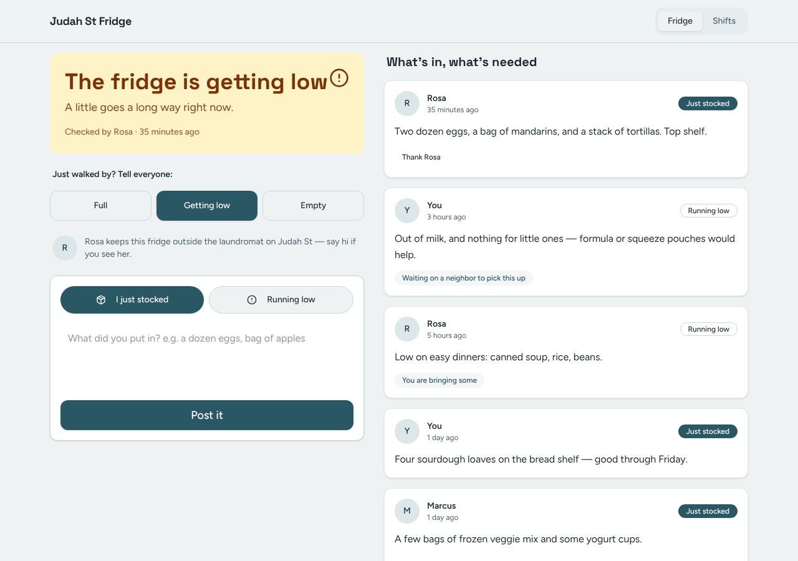
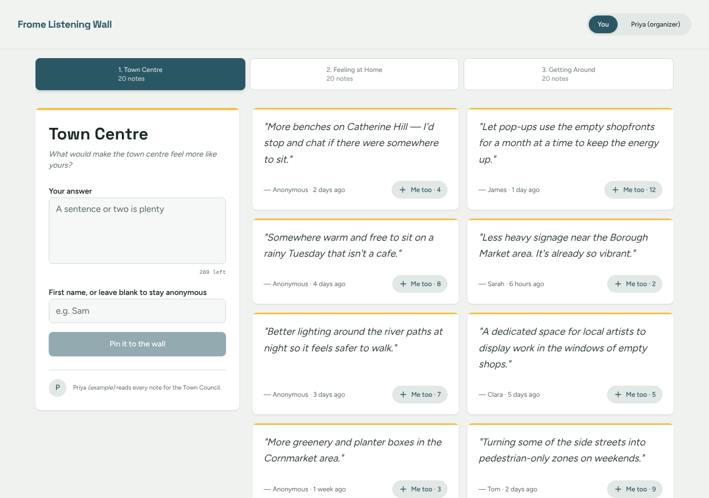
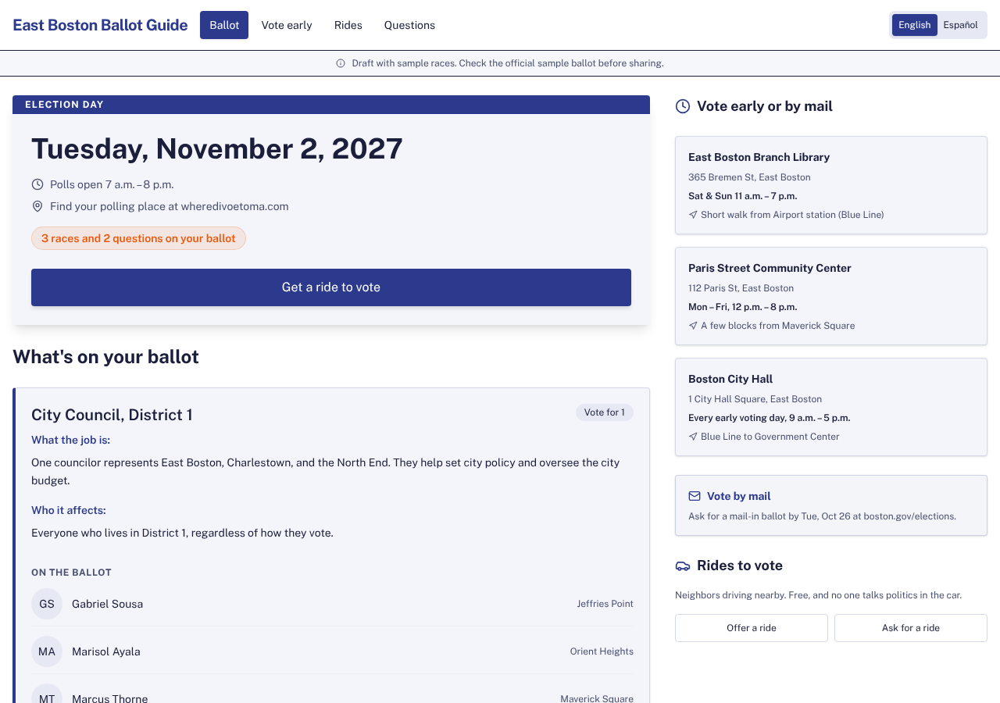
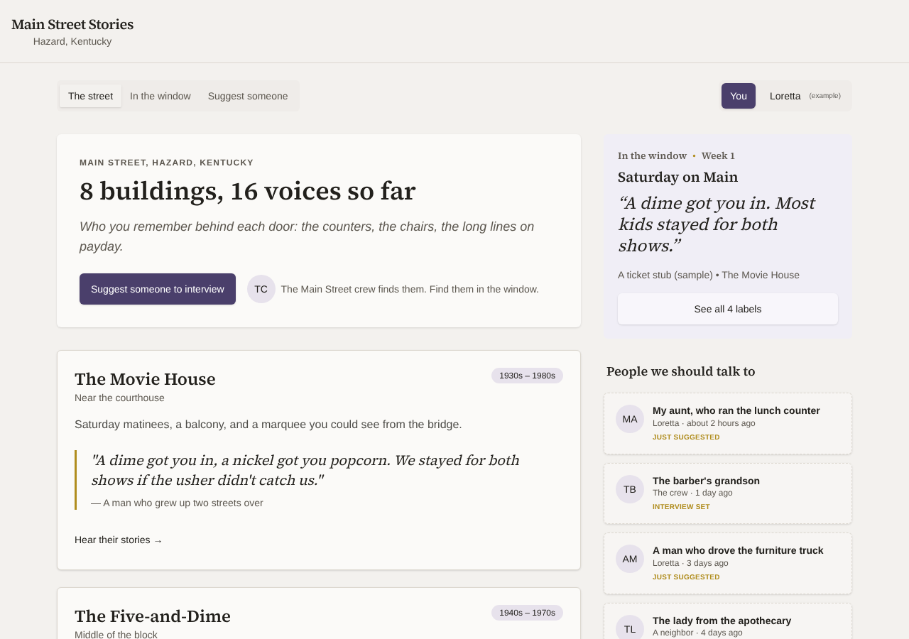
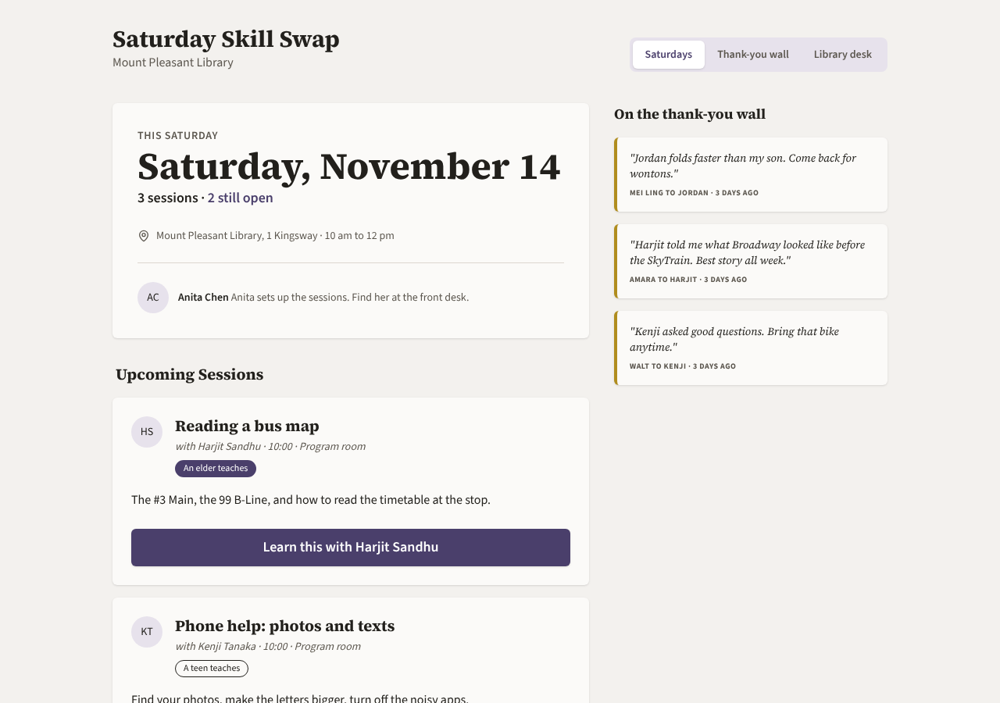

# Model bench — 2026-11-11T11-45-57-35bd405-jyf3

- **Tasks:** hs-community-fridge, hs-listening-wall, remix-income-sharing, hs-ballot-guide, remix-street-stories, hs-skill-swap (harness 1.2.0, commit `35bd405`)
- **Date:** 2026-11-11T12:05:20.216Z
- **Trials per model per task:** 2
- **Import guard:** on (static import check feeds the fix pass)
- **Human review:** _pending_

> Cost and token figures are **estimates** (chars ÷ 4 × list prices) — directional, not billing-grade.
> Mechanical columns are medians across trials. Total = plan + build wall time.
> **Bundle** = final compile success; **First try** = compiled without the auto-fix; **Renders** = opened in a browser after bundling, visible page and no uncaught errors (n/a before Oct 30, 2026); **Fail kind** = what the first-try bundle error was (missing-file, bad-import, unknown-package, syntax); **Lint/100** = eslint findings per 100 lines with the app's own config; **tsc errors** = type errors in the model's files with the kit merged and uninstalled packages untyped, counted only on builds that bundled, syntax errors kept apart (n/a before Nov 1, 2026); **Largest file**, **any**, **Kit files** (files importing the RB kit over code files) and **tok/s** come from the files the model wrote (n/a before Oct 31, 2026); **Fix time** = the auto-fix pass's own wall time; **Fix** = of the builds that first failed, how many the single auto-fix pass solved. **~$** includes the fix pass when one ran.

### Task: hs-community-fridge (exp-v1)

| Model | Bundle | First try | Renders | Fix | Fail kind | Files | Failed edits | Truncated | Checks | Sec flags | Lint/100 | tsc errors | Largest file | any | Kit files | tok/s | TTFT | Build time | Fix time | Total | ~$ | |
|---|---|---|---|---|---|---|---|---|---|---|---|---|---|---|---|---|---|---|---|---|---|---|
| gemma-4-26b | 2/2 ✓ | 1/2 | 2/2 clean | 1/1 solved | syntax | 7 | 0 | no | 5/5 | 0 | 0.8 | 0 | 208 lines | 0.5 | 2/4 | 68.05000000000001 | 3s | 64s | 51s | 64s | 0.01 |

### Task: hs-listening-wall (exp-v1)

| Model | Bundle | First try | Renders | Fix | Fail kind | Files | Failed edits | Truncated | Checks | Sec flags | Lint/100 | tsc errors | Largest file | any | Kit files | tok/s | TTFT | Build time | Fix time | Total | ~$ | |
|---|---|---|---|---|---|---|---|---|---|---|---|---|---|---|---|---|---|---|---|---|---|---|
| gemma-4-26b | 2/2 ✓ | 1/2 | 1/2 clean, 1 blank | 1/1 solved | bad-import | 7 | 0 | no | 3.5/5 | 0 | 0.6 | 0 | 212 lines | 0 | 2/4.5 | 68.4 | 2s | 105s | 70s | 105s | 0.01 |

### Task: remix-income-sharing (exp-v1)

| Model | Bundle | First try | Renders | Fix | Fail kind | Files | Failed edits | Truncated | Checks | Sec flags | Lint/100 | tsc errors | Largest file | any | Kit files | tok/s | TTFT | Build time | Fix time | Total | ~$ | |
|---|---|---|---|---|---|---|---|---|---|---|---|---|---|---|---|---|---|---|---|---|---|---|
| gemma-4-26b | 2/2 ✓ | 2/2 | 0/2 clean, 2 blank | — | — | 5.5 | 0 | no | 4/5 | 0 | 1.7 | 2 | 314.5 lines | 2 | 1/3.5 | 81.3 | 1s | 58s | — | 58s | 0.00 |

### Task: hs-ballot-guide (exp-v1)

| Model | Bundle | First try | Renders | Fix | Fail kind | Files | Failed edits | Truncated | Checks | Sec flags | Lint/100 | tsc errors | Largest file | any | Kit files | tok/s | TTFT | Build time | Fix time | Total | ~$ | |
|---|---|---|---|---|---|---|---|---|---|---|---|---|---|---|---|---|---|---|---|---|---|---|
| gemma-4-26b | 2/2 ✓ | 1/2 | 1/2 clean, 1 blank | 1/1 solved | syntax | 7.5 | 0 | no | 5/5 | 0 | 0.85 | 0.5 | 294.5 lines | 1.5 | 3/5 | 75.1 | 1s | 90s | 18s | 90s | 0.00 |

### Task: remix-street-stories (exp-v1)

| Model | Bundle | First try | Renders | Fix | Fail kind | Files | Failed edits | Truncated | Checks | Sec flags | Lint/100 | tsc errors | Largest file | any | Kit files | tok/s | TTFT | Build time | Fix time | Total | ~$ | |
|---|---|---|---|---|---|---|---|---|---|---|---|---|---|---|---|---|---|---|---|---|---|---|
| gemma-4-26b | 2/2 ✓ | 1/2 | 1/2 clean, 1 blank | 1/1 solved | bad-import | 6.5 | 0.5 | no | 4.5/5 | 0 | 0.25 | 1 | 235 lines | 0 | 3/4.5 | 52.85 | 4s | 91s | 8s | 91s | 0.00 |

### Task: hs-skill-swap (exp-v1)

| Model | Bundle | First try | Renders | Fix | Fail kind | Files | Failed edits | Truncated | Checks | Sec flags | Lint/100 | tsc errors | Largest file | any | Kit files | tok/s | TTFT | Build time | Fix time | Total | ~$ | |
|---|---|---|---|---|---|---|---|---|---|---|---|---|---|---|---|---|---|---|---|---|---|---|
| gemma-4-26b | 2/2 ✓ | 2/2 | 2/2 clean | — | — | 7.5 | 0 | no | 5/5 | 0 | 0.25 | 0.5 | 169.5 lines | 0.5 | 2.5/5.5 | 71.55000000000001 | 3s | 67s | — | 67s | 0.00 |

## Human review

_Not scored yet — open review/index.html, score, export, save as review/scores.json, re-run report._

## Which model for what

_Maintainer's call, informed by the tables above — the report feeds the decision, it doesn't make it._

## Served as (provider-reported)

- **gemma-4-26b**: google/gemma-4-26b-a4b-it, via DekaLLM / google/gemma-4-26b-a4b-it, via NextBit / google/gemma-4-26b-a4b-it, via CoreWeave / google/gemma-4-26b-a4b-it, via PrimeIntellect

## In the browser (bundled, but)

- **gemma-4-26b** · hs-listening-wall t2: BLANK PAGE
  - console: Error at B (https://esm.sh/@remix-run/router@1.23.0/es2022/router.mjs:2:2356) at S (https://esm.sh/react-router@6.30.0/X-ZXJlYWN0/es2022/react-router.mjs:2:1470) at App (file:///home/user/relational-builder/bench/results
  - pageerror: Error
- **gemma-4-26b** · remix-income-sharing t1: BLANK PAGE
  - console: Error at B (https://esm.sh/@remix-run/router@1.23.0/es2022/router.mjs:2:2356) at Z (https://esm.sh/react-router@6.30.0/X-ZXJlYWN0/es2022/react-router.mjs:2:2803) at he (https://esm.sh/react-router@6.30.0/X-ZXJlYWN0/es202
  - pageerror: Error
- **gemma-4-26b** · remix-income-sharing t2: BLANK PAGE
  - console: TypeError: Cannot read properties of undefined (reading 'name') at Dashboard (file:///home/user/relational-builder/bench/results/2026-11-11T11-45-57-35bd405-jyf3/artifacts/remix-income-sharing/gemma-4-26b-t2/preview.html
  - pageerror: Cannot read properties of undefined (reading 'name')
- **gemma-4-26b** · hs-ballot-guide t1: BLANK PAGE
  - console: Error at B (https://esm.sh/@remix-run/router@1.23.0/es2022/router.mjs:2:2356) at S (https://esm.sh/react-router@6.30.0/X-ZXJlYWN0/es2022/react-router.mjs:2:1470) at App (file:///home/user/relational-builder/bench/results
  - pageerror: Error
- **gemma-4-26b** · remix-street-stories t1: BLANK PAGE
  - console: TypeError: Illegal constructor at Hi (https://esm.sh/react-dom@18.3.1/X-ZXJlYWN0/es2022/react-dom.mjs:8:16968) at ua (https://esm.sh/react-dom@18.3.1/X-ZXJlYWN0/es2022/react-dom.mjs:10:44009) at ra (https://esm.sh/react-
  - pageerror: Illegal constructor

## Fix passes (how solves went)

- **gemma-4-26b** · hs-community-fridge t2: build failed to bundle → auto-fix solved in 2 passes (51s, ~$0.00)
  - triggered by: `vfs:/src/pages/FridgePage.tsx:26: Expected "}" but found "s"`
- **gemma-4-26b** · hs-listening-wall t1: build failed to bundle → auto-fix solved in one pass (70s, ~$0.00)
  - triggered by: `vfs:/src/pages/WhatWeHeardPage.tsx: No matching export in "vfs:/src/data/seed.ts" for import "themes"`
- **gemma-4-26b** · hs-ballot-guide t2: build failed to bundle → auto-fix solved in one pass (18s, ~$0.00)
  - triggered by: `vfs:/src/pages/BallotPage.tsx:47: Expected "}" but found ":"`
- **gemma-4-26b** · remix-street-stories t1: build failed to bundle → auto-fix solved in one pass (8s, ~$0.00)
  - triggered by: `vfs:/src/App.tsx: The requested module 'lucide-react' does not provide an export named 'Window'`

## Previews

### hs-community-fridge — gemma-4-26b (trial 1)

### hs-community-fridge — gemma-4-26b (trial 2)

### hs-listening-wall — gemma-4-26b (trial 1)

### hs-listening-wall — gemma-4-26b (trial 2)

### remix-income-sharing — gemma-4-26b (trial 1)

### remix-income-sharing — gemma-4-26b (trial 2)

### hs-ballot-guide — gemma-4-26b (trial 1)

### hs-ballot-guide — gemma-4-26b (trial 2)

### remix-street-stories — gemma-4-26b (trial 1)

### remix-street-stories — gemma-4-26b (trial 2)

### hs-skill-swap — gemma-4-26b (trial 1)

### hs-skill-swap — gemma-4-26b (trial 2)

