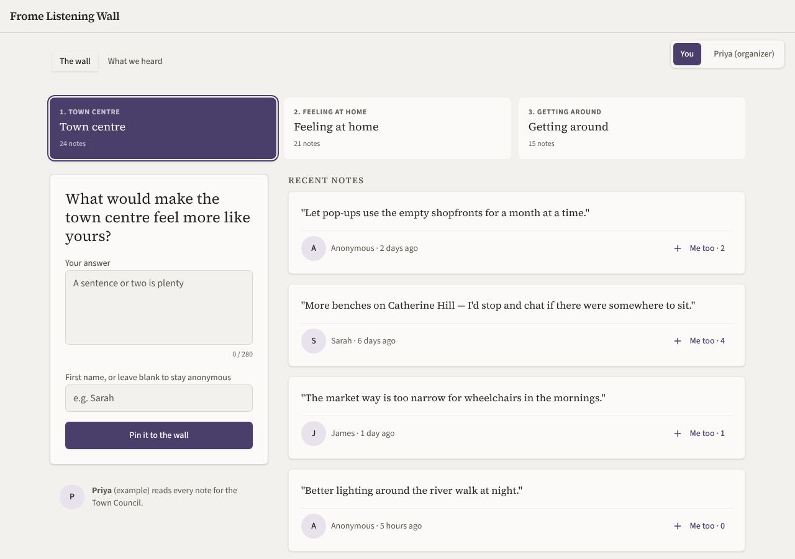
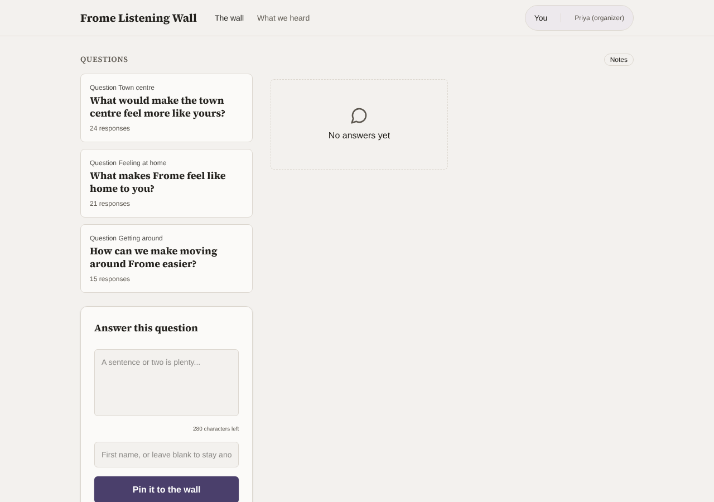
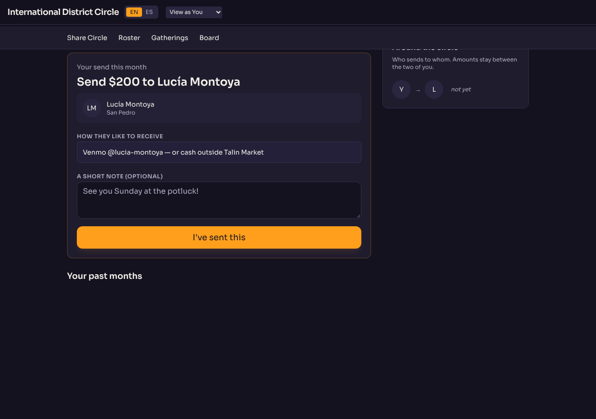
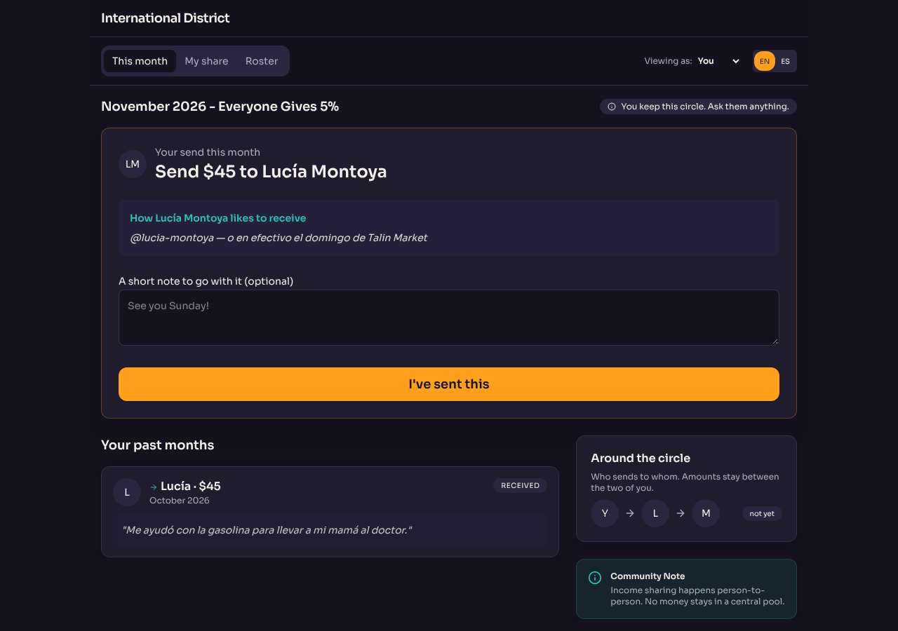
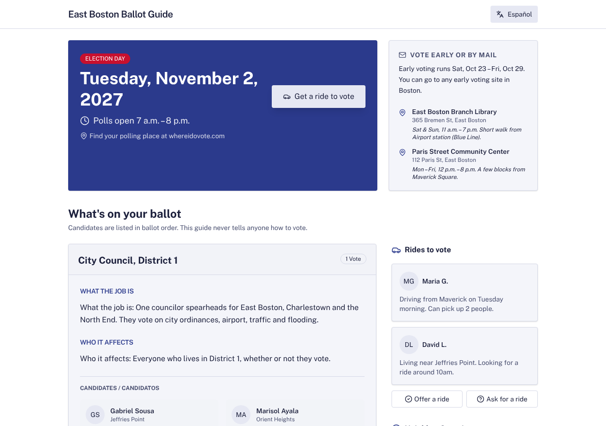
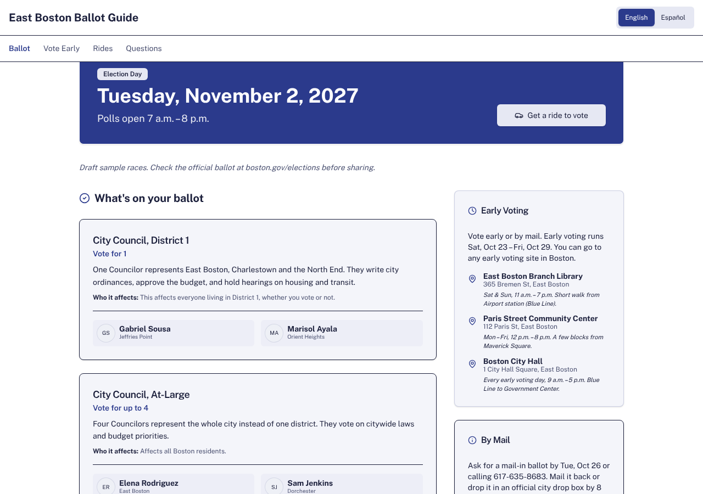
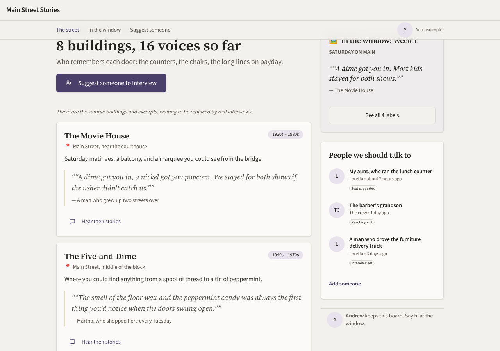
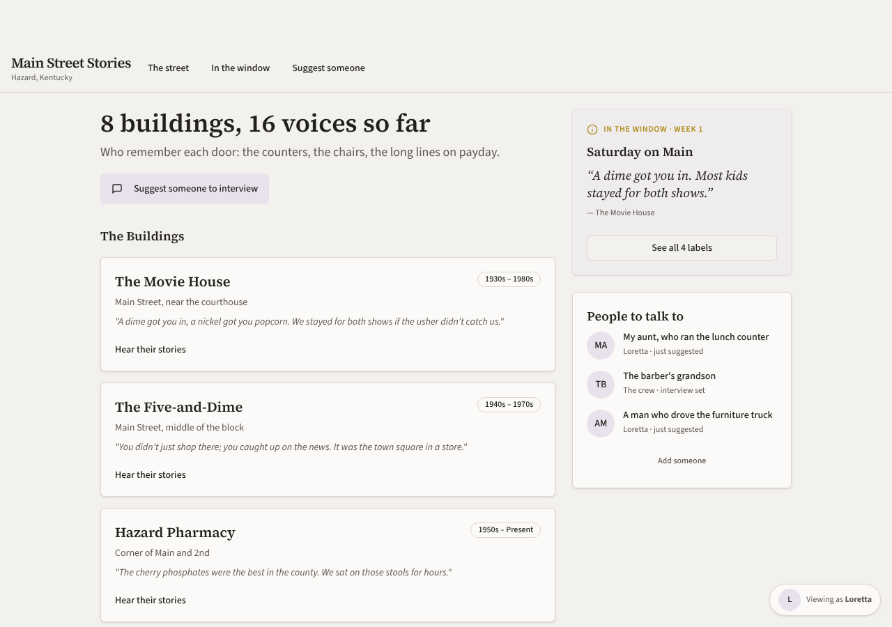
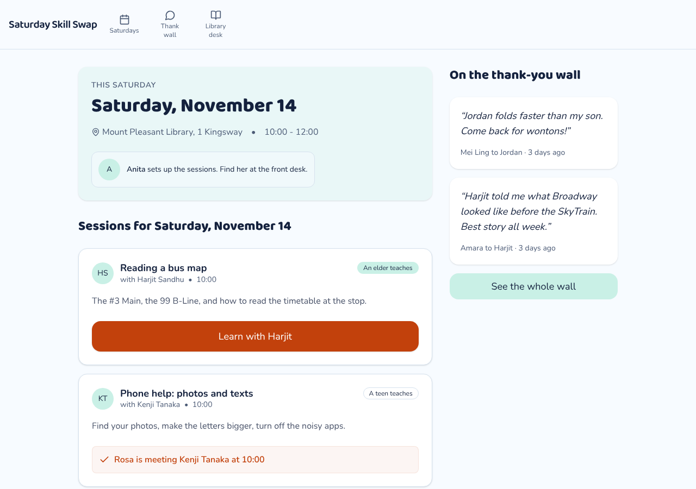
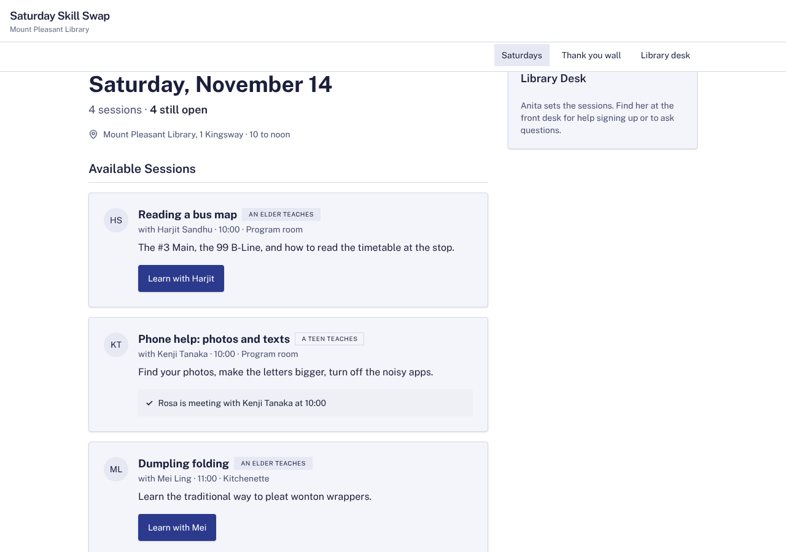

# Model bench — 2026-11-11T12-09-20-35bd405-8qsv

- **Tasks:** hs-community-fridge, hs-listening-wall, remix-income-sharing, hs-ballot-guide, remix-street-stories, hs-skill-swap (harness 1.2.0, commit `35bd405`)
- **Date:** 2026-11-11T12:34:15.466Z
- **Trials per model per task:** 2
- **Import guard:** on (static import check feeds the fix pass)
- **Human review:** _pending_

> Cost and token figures are **estimates** (chars ÷ 4 × list prices) — directional, not billing-grade.
> Mechanical columns are medians across trials. Total = plan + build wall time.
> **Bundle** = final compile success; **First try** = compiled without the auto-fix; **Renders** = opened in a browser after bundling, visible page and no uncaught errors (n/a before Oct 30, 2026); **Fail kind** = what the first-try bundle error was (missing-file, bad-import, unknown-package, syntax); **Lint/100** = eslint findings per 100 lines with the app's own config; **tsc errors** = type errors in the model's files with the kit merged and uninstalled packages untyped, counted only on builds that bundled, syntax errors kept apart (n/a before Nov 1, 2026); **Largest file**, **any**, **Kit files** (files importing the RB kit over code files) and **tok/s** come from the files the model wrote (n/a before Oct 31, 2026); **Fix time** = the auto-fix pass's own wall time; **Fix** = of the builds that first failed, how many the single auto-fix pass solved. **~$** includes the fix pass when one ran.

### Task: hs-community-fridge (exp-v1)

| Model | Bundle | First try | Renders | Fix | Fail kind | Files | Failed edits | Truncated | Checks | Sec flags | Lint/100 | tsc errors | Largest file | any | Kit files | tok/s | TTFT | Build time | Fix time | Total | ~$ | |
|---|---|---|---|---|---|---|---|---|---|---|---|---|---|---|---|---|---|---|---|---|---|---|
| gemma-4-26b | 1/2 ✓ | 0/2 | 0/1 clean, 1 blank | 1/2 solved | bad-import, syntax | 7 | 0 | no | 4.5/5 | 0 | 1.0499999999999998 | 3 | 231 lines | 0 | 2/4 | 89.44999999999999 | 2s | 51s | 11s | 51s | 0.01 |

### Task: hs-listening-wall (exp-v1)

| Model | Bundle | First try | Renders | Fix | Fail kind | Files | Failed edits | Truncated | Checks | Sec flags | Lint/100 | tsc errors | Largest file | any | Kit files | tok/s | TTFT | Build time | Fix time | Total | ~$ | |
|---|---|---|---|---|---|---|---|---|---|---|---|---|---|---|---|---|---|---|---|---|---|---|
| gemma-4-26b | 2/2 ✓ | 2/2 | 2/2 clean | — | — | 5 | 0 | no | 4.5/5 | 0 | 0.75 | 1 | 318.5 lines | 1 | 1/3 | 66.8 | 2s | 93s | — | 93s | 0.00 |

### Task: remix-income-sharing (exp-v1)

| Model | Bundle | First try | Renders | Fix | Fail kind | Files | Failed edits | Truncated | Checks | Sec flags | Lint/100 | tsc errors | Largest file | any | Kit files | tok/s | TTFT | Build time | Fix time | Total | ~$ | |
|---|---|---|---|---|---|---|---|---|---|---|---|---|---|---|---|---|---|---|---|---|---|---|
| gemma-4-26b | 2/2 ✓ | 1/2 | 2/2 clean | 1/1 solved | other | 7 | 0 | no | 4/5 | 0 | 1.4 | 0 | 301.5 lines | 2.5 | 3/4.5 | 74.65 | 2s | 99s | 29s | 99s | 0.00 |

### Task: hs-ballot-guide (exp-v1)

| Model | Bundle | First try | Renders | Fix | Fail kind | Files | Failed edits | Truncated | Checks | Sec flags | Lint/100 | tsc errors | Largest file | any | Kit files | tok/s | TTFT | Build time | Fix time | Total | ~$ | |
|---|---|---|---|---|---|---|---|---|---|---|---|---|---|---|---|---|---|---|---|---|---|---|
| gemma-4-26b | 2/2 ✓ | 1/2 | 2/2 clean | 1/1 solved | bad-import | 10 | 0 | no | 4.5/5 | 0 | 1.4 | 0 | 271 lines | 3 | 1/6 | 68.4 | 3s | 114s | 103s | 114s | 0.01 |

### Task: remix-street-stories (exp-v1)

| Model | Bundle | First try | Renders | Fix | Fail kind | Files | Failed edits | Truncated | Checks | Sec flags | Lint/100 | tsc errors | Largest file | any | Kit files | tok/s | TTFT | Build time | Fix time | Total | ~$ | |
|---|---|---|---|---|---|---|---|---|---|---|---|---|---|---|---|---|---|---|---|---|---|---|
| gemma-4-26b | 2/2 ✓ | 1/2 | 2/2 clean | 1/1 solved | bad-import | 10 | 0.5 | no | 4.5/5 | 0 | 0 | 0 | 134 lines | 0 | 4.5/6.5 | 35.6 | 1s | 187s | 55s | 187s | 0.01 |

### Task: hs-skill-swap (exp-v1)

| Model | Bundle | First try | Renders | Fix | Fail kind | Files | Failed edits | Truncated | Checks | Sec flags | Lint/100 | tsc errors | Largest file | any | Kit files | tok/s | TTFT | Build time | Fix time | Total | ~$ | |
|---|---|---|---|---|---|---|---|---|---|---|---|---|---|---|---|---|---|---|---|---|---|---|
| gemma-4-26b | 2/2 ✓ | 0/2 | 2/2 clean | 2/2 solved | other | 9 | 0 | no | 4.5/5 | 0 | 0 | 0 | 111 lines | 0 | 4/6 | 58.15 | 2s | 74s | 6s | 74s | 0.00 |

## Human review

_Not scored yet — open review/index.html, score, export, save as review/scores.json, re-run report._

## Which model for what

_Maintainer's call, informed by the tables above — the report feeds the decision, it doesn't make it._

## Served as (provider-reported)

- **gemma-4-26b**: google/gemma-4-26b-a4b-it, via Parasail / google/gemma-4-26b-a4b-it, via NextBit / google/gemma-4-26b-a4b-it, via DekaLLM / google/gemma-4-26b-a4b-it, via Io Net / google/gemma-4-26b-a4b-it, via PrimeIntellect

## In the browser (bundled, but)

- **gemma-4-26b** · hs-community-fridge t1: BLANK PAGE
  - console: TypeError: Cannot read properties of undefined (reading 'u-rosa') at file:///home/user/relational-builder/bench/results/2026-11-11T12-09-20-35bd405-8qsv/artifacts/hs-community-fridge/gemma-4-26b-t1/preview.html:521:28 at
  - pageerror: Cannot read properties of undefined (reading 'u-rosa')

## Fix passes (how solves went)

- **gemma-4-26b** · hs-community-fridge t1: build failed to bundle → auto-fix solved in one pass (6s, ~$0.00)
  - triggered by: `vfs:/src/App.tsx: The requested module 'lucide-react' does not provide an export named 'Fridge'`
- **gemma-4-26b** · hs-community-fridge t2: build failed to bundle → auto-fix not solved after 2 passes — still: vfs:/src/App.tsx:37: Expected ")" but found "}"
  - triggered by: `vfs:/src/App.tsx:37: Expected ")" but found "}"`
- **gemma-4-26b** · remix-income-sharing t2: build failed to bundle → auto-fix solved in one pass (29s, ~$0.00)
  - triggered by: `vfs:/src/App.tsx:191: Unexpected "}"`
- **gemma-4-26b** · hs-ballot-guide t2: build failed to bundle → auto-fix solved in 2 passes (103s, ~$0.01)
  - triggered by: `vfs:/src/main.tsx:4: No matching export in "vfs:/src/App.tsx" for import "default"`
- **gemma-4-26b** · remix-street-stories t2: build failed to bundle → auto-fix solved in 2 passes (55s, ~$0.00)
  - triggered by: `vfs:/src/App.tsx: The requested module 'lucide-react' does not provide an export named 'Window'`
- **gemma-4-26b** · hs-skill-swap t1: build failed to bundle → auto-fix solved in one pass (9s, ~$0.00)
  - triggered by: `vfs:/src/pages/SessionsPage.tsx: <ThankYouCard> is used but never imported or declared in this file`
- **gemma-4-26b** · hs-skill-swap t2: build failed to bundle → auto-fix solved in one pass (2s, ~$0.00)
  - triggered by: `vfs:/src/main.tsx:9: Unexpected closing fragment tag does not match opening "React" tag`

## Previews

### hs-community-fridge — gemma-4-26b (trial 1)

### hs-listening-wall — gemma-4-26b (trial 1)

### hs-listening-wall — gemma-4-26b (trial 2)

### remix-income-sharing — gemma-4-26b (trial 1)

### remix-income-sharing — gemma-4-26b (trial 2)

### hs-ballot-guide — gemma-4-26b (trial 1)

### hs-ballot-guide — gemma-4-26b (trial 2)

### remix-street-stories — gemma-4-26b (trial 1)

### remix-street-stories — gemma-4-26b (trial 2)

### hs-skill-swap — gemma-4-26b (trial 1)

### hs-skill-swap — gemma-4-26b (trial 2)

