# Model bench — 2026-11-12T11-46-34-93ff6b8-x47j

- **Tasks:** remix-income-sharing, remix-gathering-fund, remix-street-stories, remix-tool-lending-seed, hs-story-circle, hs-ballot-guide, hs-skill-swap, hs-bulletin-boards (harness 1.2.0, commit `93ff6b8`)
- **Date:** 2026-11-12T12:00:40.978Z
- **Trials per model per task:** 2
- **Import guard:** on (static import check feeds the fix pass)
- **Human review:** _pending_

> Cost and token figures are **estimates** (chars ÷ 4 × list prices) — directional, not billing-grade.
> Mechanical columns are medians across trials. Total = plan + build wall time.
> **Bundle** = final compile success; **First try** = compiled without the auto-fix; **Renders** = opened in a browser after bundling, visible page and no uncaught errors (n/a before Oct 30, 2026); **Fail kind** = what the first-try bundle error was (missing-file, bad-import, unknown-package, syntax); **Lint/100** = eslint findings per 100 lines with the app's own config; **tsc errors** = type errors in the model's files with the kit merged and uninstalled packages untyped, counted only on builds that bundled, syntax errors kept apart (n/a before Nov 1, 2026); **Largest file**, **any**, **Kit files** (files importing the RB kit over code files) and **tok/s** come from the files the model wrote (n/a before Oct 31, 2026); **Fix time** = the auto-fix pass's own wall time; **Fix** = of the builds that first failed, how many the single auto-fix pass solved. **~$** includes the fix pass when one ran.

### Task: remix-income-sharing (exp-v1)

| Model | Bundle | First try | Renders | Fix | Fail kind | Files | Failed edits | Truncated | Checks | Sec flags | Lint/100 | tsc errors | Largest file | any | Kit files | tok/s | TTFT | Build time | Fix time | Total | ~$ | |
|---|---|---|---|---|---|---|---|---|---|---|---|---|---|---|---|---|---|---|---|---|---|---|
| gemma-4-26b | 2/2 ✓ | 2/2 | 2/2 clean | — | — | 8.5 | 0 | no | 4/5 | 0 | 0.2 | 3 | 127.5 lines | 0 | 4.5/6.5 | 83.80000000000001 | 2s | 58s | — | 58s | 0.00 |

### Task: remix-gathering-fund (exp-v1)

| Model | Bundle | First try | Renders | Fix | Fail kind | Files | Failed edits | Truncated | Checks | Sec flags | Lint/100 | tsc errors | Largest file | any | Kit files | tok/s | TTFT | Build time | Fix time | Total | ~$ | |
|---|---|---|---|---|---|---|---|---|---|---|---|---|---|---|---|---|---|---|---|---|---|---|
| gemma-4-26b | 2/2 ✓ | 1/2 | 2/2 clean | 1/1 solved | other | 4.5 | 0 | no | 5/5 | 0 | 0.15 | 0 | 235 lines | 0 | 1/2 | 98.9 | 2s | 34s | 14s | 34s | 0.00 |

### Task: remix-street-stories (exp-v1)

| Model | Bundle | First try | Renders | Fix | Fail kind | Files | Failed edits | Truncated | Checks | Sec flags | Lint/100 | tsc errors | Largest file | any | Kit files | tok/s | TTFT | Build time | Fix time | Total | ~$ | |
|---|---|---|---|---|---|---|---|---|---|---|---|---|---|---|---|---|---|---|---|---|---|---|
| gemma-4-26b | 2/2 ✓ | 1/2 | 1/2 clean, 1 blank | 0/1 solved | bad-import | 10 | 1 | no | 4.5/5 | 0 | 0.1 | 0.5 | 115 lines | 0 | 5/7 | 127.05000000000001 | 2s | 41s | 15s | 41s | 0.01 |

### Task: remix-tool-lending-seed (exp-v1)

| Model | Bundle | First try | Renders | Fix | Fail kind | Files | Failed edits | Truncated | Checks | Sec flags | Lint/100 | tsc errors | Largest file | any | Kit files | tok/s | TTFT | Build time | Fix time | Total | ~$ | |
|---|---|---|---|---|---|---|---|---|---|---|---|---|---|---|---|---|---|---|---|---|---|---|
| gemma-4-26b | 2/2 ✓ | 1/2 | 2/2 clean | 1/1 solved | syntax | 8.5 | 0 | no | 4/5 | 0 | 0.45 | 0.5 | 205.5 lines | 1 | 3/6 | 122.05 | 2s | 46s | 9s | 46s | 0.00 |

### Task: hs-story-circle (exp-v1)

| Model | Bundle | First try | Renders | Fix | Fail kind | Files | Failed edits | Truncated | Checks | Sec flags | Lint/100 | tsc errors | Largest file | any | Kit files | tok/s | TTFT | Build time | Fix time | Total | ~$ | |
|---|---|---|---|---|---|---|---|---|---|---|---|---|---|---|---|---|---|---|---|---|---|---|
| gemma-4-26b | 2/2 ✓ | 2/2 | 1/2 clean | — | — | 8.5 | 0 | no | 4.5/5 | 0 | 0.8999999999999999 | 0.5 | 139 lines | 0.5 | 4/6.5 | 109.75 | 2s | 41s | — | 41s | 0.00 |

### Task: hs-ballot-guide (exp-v1)

| Model | Bundle | First try | Renders | Fix | Fail kind | Files | Failed edits | Truncated | Checks | Sec flags | Lint/100 | tsc errors | Largest file | any | Kit files | tok/s | TTFT | Build time | Fix time | Total | ~$ | |
|---|---|---|---|---|---|---|---|---|---|---|---|---|---|---|---|---|---|---|---|---|---|---|
| gemma-4-26b | 2/2 ✓ | 2/2 | 2/2 clean | — | — | 5 | 0 | no | 4.5/5 | 0 | 1.3 | 0.5 | 224.5 lines | 1.5 | 1/3 | 124.95 | 1s | 34s | — | 34s | 0.00 |

### Task: hs-skill-swap (exp-v1)

| Model | Bundle | First try | Renders | Fix | Fail kind | Files | Failed edits | Truncated | Checks | Sec flags | Lint/100 | tsc errors | Largest file | any | Kit files | tok/s | TTFT | Build time | Fix time | Total | ~$ | |
|---|---|---|---|---|---|---|---|---|---|---|---|---|---|---|---|---|---|---|---|---|---|---|
| gemma-4-26b | 2/2 ✓ | 2/2 | 2/2 clean | — | — | 8.5 | 0 | no | 4/5 | 0 | 0.5 | 0.5 | 116.5 lines | 0 | 3.5/6.5 | 113.05 | 1s | 37s | — | 37s | 0.00 |

### Task: hs-bulletin-boards (exp-v1)

| Model | Bundle | First try | Renders | Fix | Fail kind | Files | Failed edits | Truncated | Checks | Sec flags | Lint/100 | tsc errors | Largest file | any | Kit files | tok/s | TTFT | Build time | Fix time | Total | ~$ | |
|---|---|---|---|---|---|---|---|---|---|---|---|---|---|---|---|---|---|---|---|---|---|---|
| gemma-4-26b | 2/2 ✓ | 1/2 | 2/2 clean | 1/1 solved | bad-import | 7 | 1 | no | 4/5 | 0 | 0.2 | 0.5 | 180 lines | 0 | 2.5/4.5 | 127.3 | 1s | 39s | 20s | 39s | 0.01 |

## Human review

_Not scored yet — open review/index.html, score, export, save as review/scores.json, re-run report._

## Which model for what

_Maintainer's call, informed by the tables above — the report feeds the decision, it doesn't make it._

## Served as (provider-reported)

- **gemma-4-26b**: google/gemma-4-26b-a4b-it, via Parasail / google/gemma-4-26b-a4b-it, via NextBit / google/gemma-4-26b-a4b-it, via PrimeIntellect / google/gemma-4-26b-a4b-it, via DekaLLM

## In the browser (bundled, but)

- **gemma-4-26b** · remix-street-stories t1: BLANK PAGE
  - console: Error at B (https://esm.sh/@remix-run/router@1.23.0/es2022/router.mjs:2:2356) at re (https://esm.sh/react-router@6.30.0/X-ZXJlYWN0/es2022/react-router.mjs:2:12854) at Hi (https://esm.sh/react-dom@18.3.1/X-ZXJlYWN0/es2022
  - pageerror: Error
- **gemma-4-26b** · hs-story-circle t1: renders with errors
  - style: the page rendered without its styles (Tailwind classes had no effect)

## Fix passes (how solves went)

- **gemma-4-26b** · remix-gathering-fund t1: build failed to bundle → auto-fix solved in one pass (14s, ~$0.00)
  - triggered by: `vfs:/src/App.tsx:183: Unexpected closing "label" tag does not match opening "Label" tag`
- **gemma-4-26b** · remix-street-stories t1: build failed to bundle → auto-fix not solved after 2 passes — still: vfs:/src/App.tsx: a router is rendered in 2 files (/src/main.tsx, /src/App.tsx); render one HashRouter only, in one of them
  - triggered by: `vfs:/src/App.tsx: The requested module 'lucide-react' does not provide an export named 'Window'`
- **gemma-4-26b** · remix-tool-lending-seed t2: build failed to bundle → auto-fix solved in one pass (9s, ~$0.00)
  - triggered by: `vfs:/src/store/useStore.ts:48: Expected "}" but found "t"`
- **gemma-4-26b** · hs-bulletin-boards t1: build failed to bundle → auto-fix solved in 2 passes (20s, ~$0.00)
  - triggered by: `vfs:/src/pages/AddBoardPage.tsx: No matching export in "vfs:/src/components/ui/select.tsx" for import "option"`

## Previews

### remix-income-sharing — gemma-4-26b (trial 1)

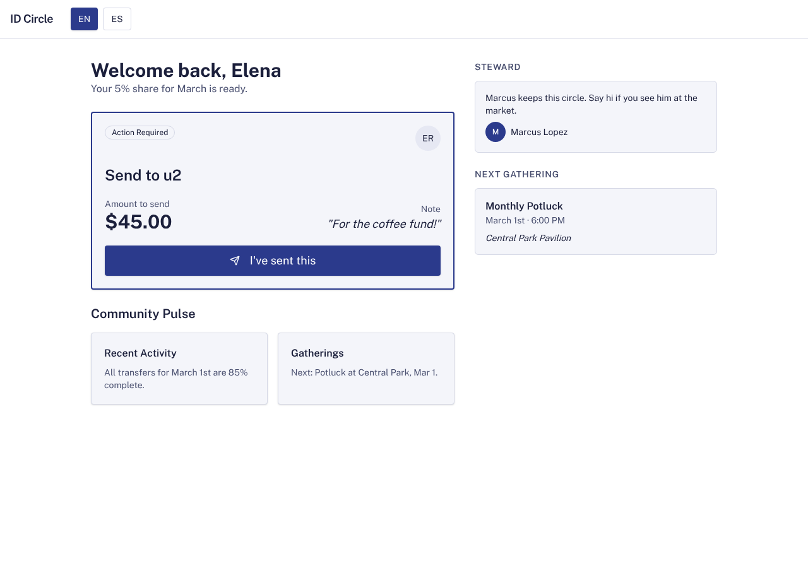

### remix-income-sharing — gemma-4-26b (trial 2)

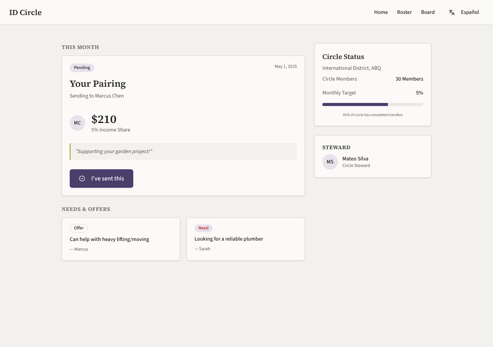

### remix-gathering-fund — gemma-4-26b (trial 1)

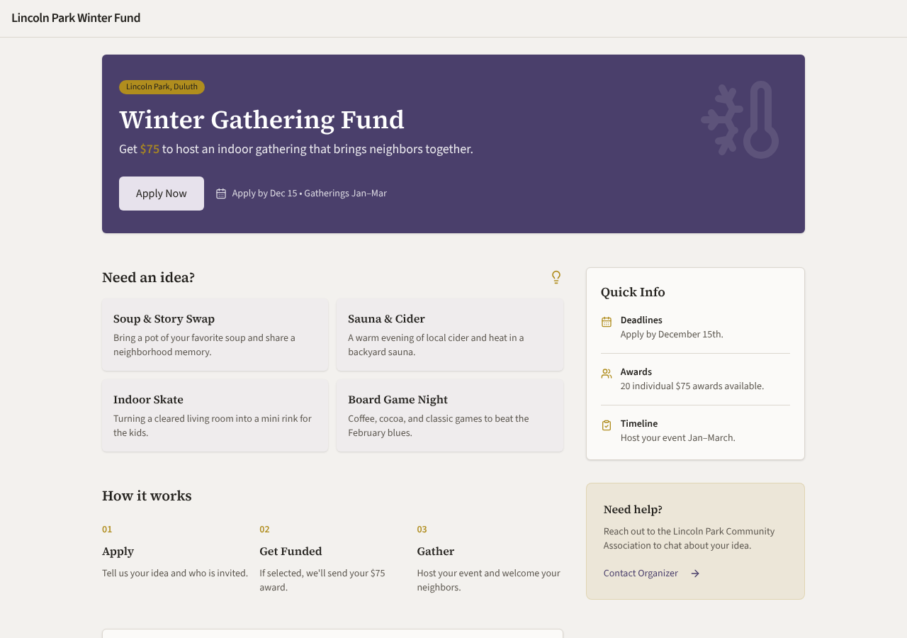

### remix-gathering-fund — gemma-4-26b (trial 2)

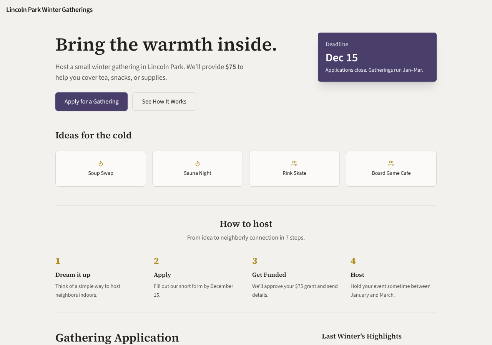

### remix-street-stories — gemma-4-26b (trial 1)

### remix-street-stories — gemma-4-26b (trial 2)

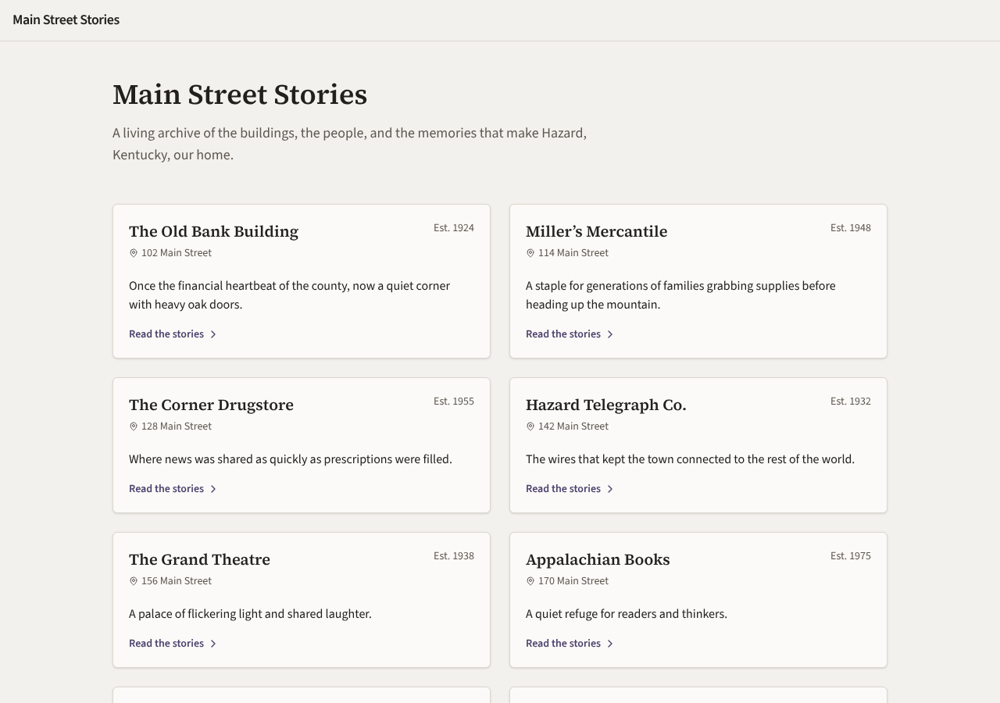

### remix-tool-lending-seed — gemma-4-26b (trial 1)

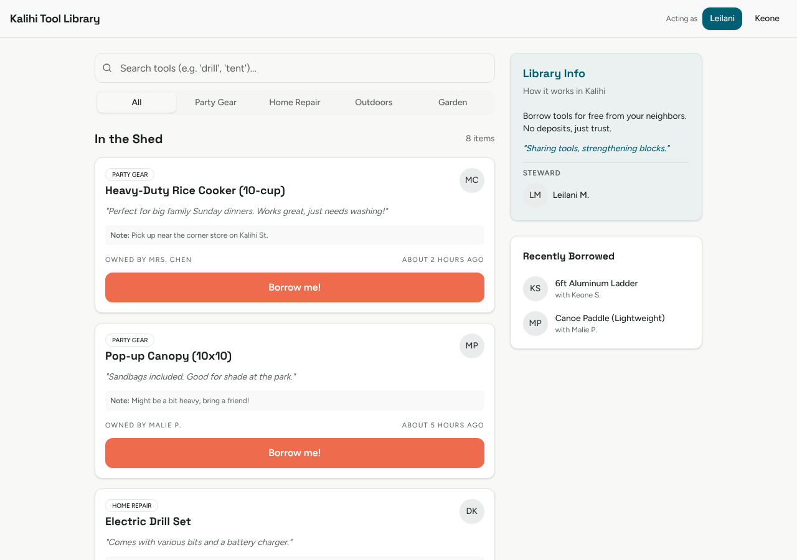

### remix-tool-lending-seed — gemma-4-26b (trial 2)

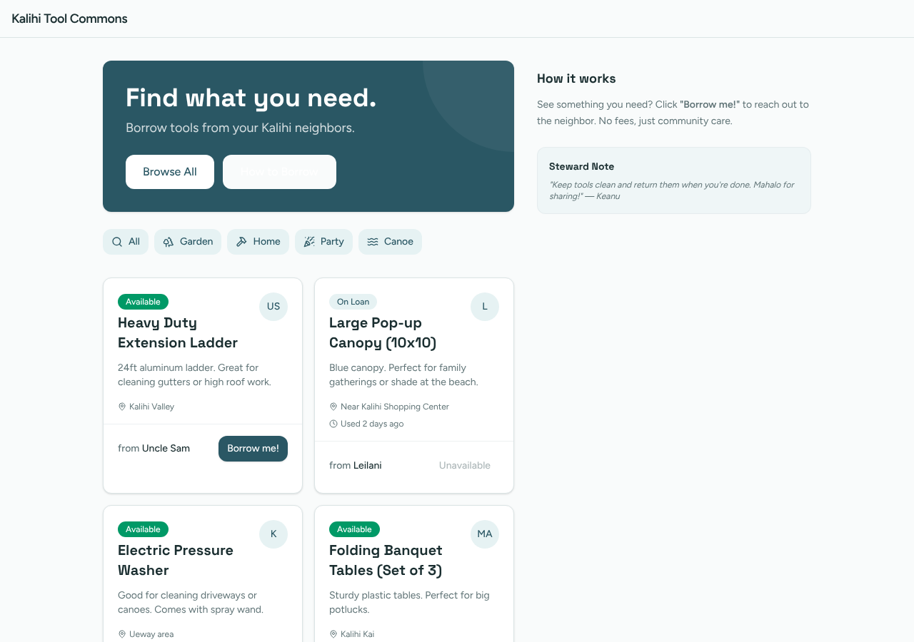

### hs-story-circle — gemma-4-26b (trial 1)

### hs-story-circle — gemma-4-26b (trial 2)

### hs-ballot-guide — gemma-4-26b (trial 1)

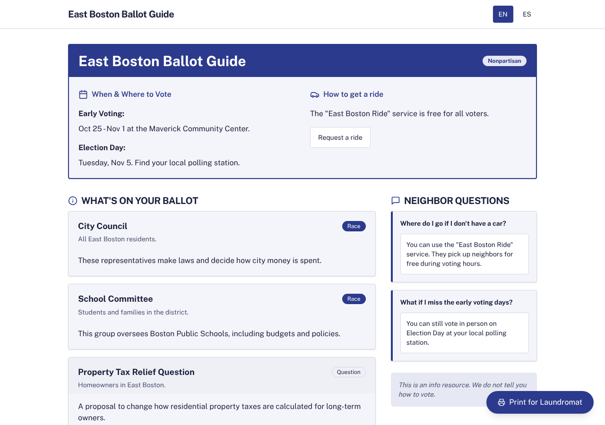

### hs-ballot-guide — gemma-4-26b (trial 2)

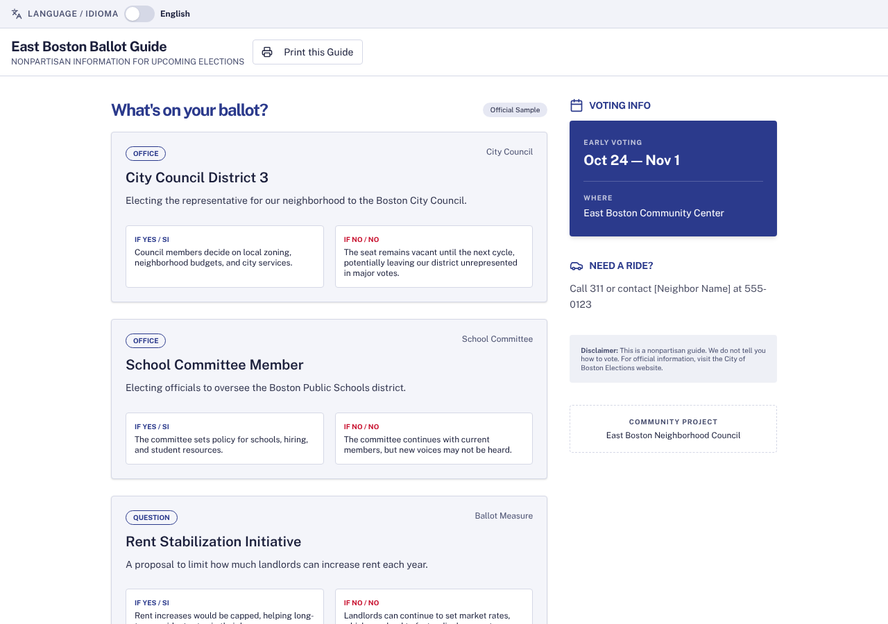

### hs-skill-swap — gemma-4-26b (trial 1)

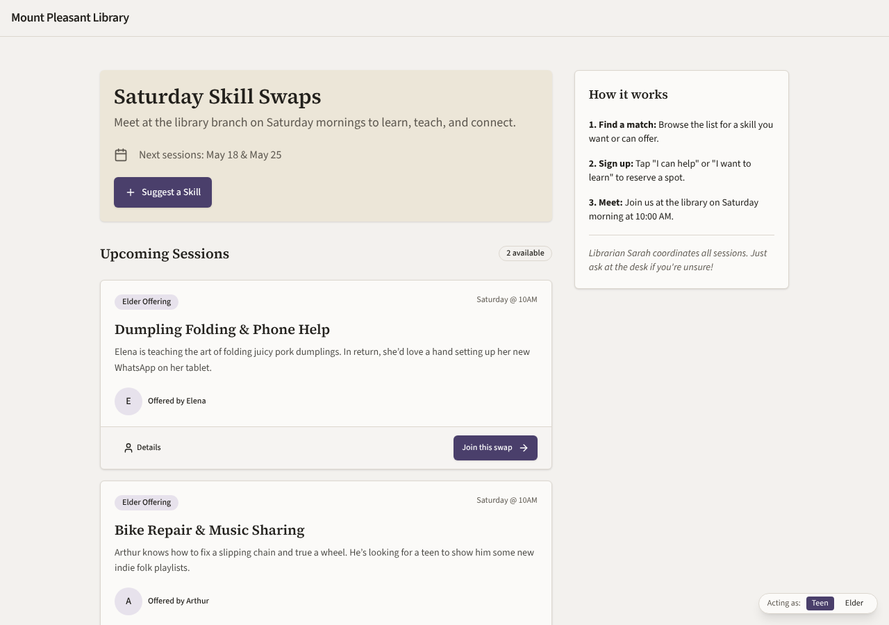

### hs-skill-swap — gemma-4-26b (trial 2)

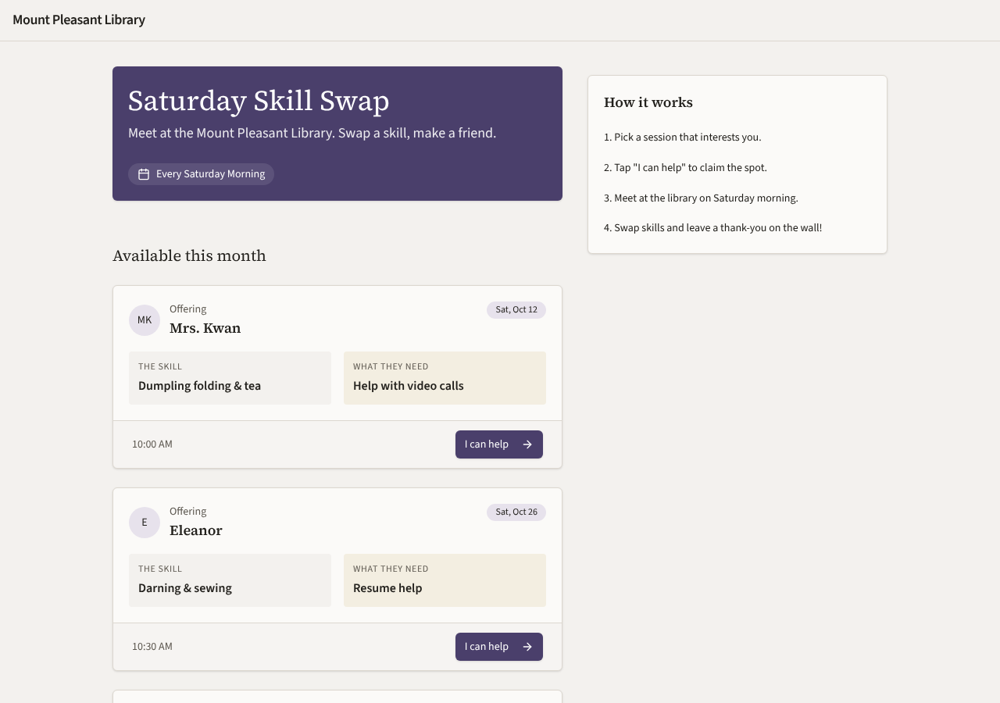

### hs-bulletin-boards — gemma-4-26b (trial 1)

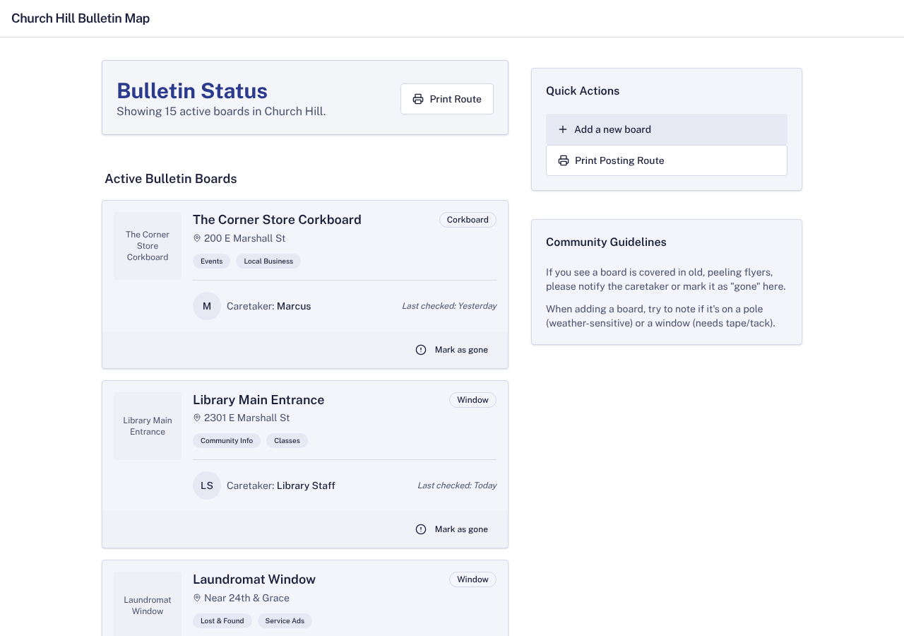

### hs-bulletin-boards — gemma-4-26b (trial 2)

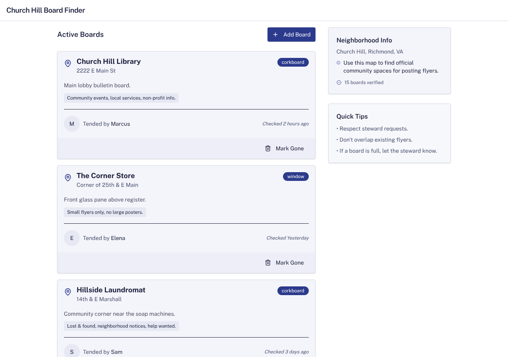
