# Model bench — 2026-11-12T11-52-50-93ff6b8-v7td

- **Tasks:** remix-income-sharing, remix-gathering-fund, remix-street-stories, remix-tool-lending-seed, hs-story-circle, hs-ballot-guide, hs-skill-swap, hs-bulletin-boards (harness 1.2.0, commit `93ff6b8`)
- **Date:** 2026-11-12T12:16:23.156Z
- **Trials per model per task:** 2
- **Import guard:** on (static import check feeds the fix pass)
- **Human review:** _pending_

> Cost and token figures are **estimates** (chars ÷ 4 × list prices) — directional, not billing-grade.
> Mechanical columns are medians across trials. Total = plan + build wall time.
> **Bundle** = final compile success; **First try** = compiled without the auto-fix; **Renders** = opened in a browser after bundling, visible page and no uncaught errors (n/a before Oct 30, 2026); **Fail kind** = what the first-try bundle error was (missing-file, bad-import, unknown-package, syntax); **Lint/100** = eslint findings per 100 lines with the app's own config; **tsc errors** = type errors in the model's files with the kit merged and uninstalled packages untyped, counted only on builds that bundled, syntax errors kept apart (n/a before Nov 1, 2026); **Largest file**, **any**, **Kit files** (files importing the RB kit over code files) and **tok/s** come from the files the model wrote (n/a before Oct 31, 2026); **Fix time** = the auto-fix pass's own wall time; **Fix** = of the builds that first failed, how many the single auto-fix pass solved. **~$** includes the fix pass when one ran.

### Task: remix-income-sharing (exp-v1)

| Model | Bundle | First try | Renders | Fix | Fail kind | Files | Failed edits | Truncated | Checks | Sec flags | Lint/100 | tsc errors | Largest file | any | Kit files | tok/s | TTFT | Build time | Fix time | Total | ~$ | |
|---|---|---|---|---|---|---|---|---|---|---|---|---|---|---|---|---|---|---|---|---|---|---|
| gemma-4-26b | 2/2 ✓ | 2/2 | 2/2 clean | — | — | 8 | 0 | no | 4/5 | 0 | 0.2 | 0.5 | 88 lines | 0 | 4/6 | 119 | 1s | 33s | — | 33s | 0.00 |

### Task: remix-gathering-fund (exp-v1)

| Model | Bundle | First try | Renders | Fix | Fail kind | Files | Failed edits | Truncated | Checks | Sec flags | Lint/100 | tsc errors | Largest file | any | Kit files | tok/s | TTFT | Build time | Fix time | Total | ~$ | |
|---|---|---|---|---|---|---|---|---|---|---|---|---|---|---|---|---|---|---|---|---|---|---|
| gemma-4-26b | 1/2 ✓ | 0/2 | 2/2 clean | 1/1 solved | bad-import | 3 | 0 | no | 3.5/5 | 0 | 0.7 | 0 | 137.5 lines | 0 | 0.5/1 | 55.3 | 15s | 79s | 18s | 79s | 0.00 |

### Task: remix-street-stories (exp-v1)

| Model | Bundle | First try | Renders | Fix | Fail kind | Files | Failed edits | Truncated | Checks | Sec flags | Lint/100 | tsc errors | Largest file | any | Kit files | tok/s | TTFT | Build time | Fix time | Total | ~$ | |
|---|---|---|---|---|---|---|---|---|---|---|---|---|---|---|---|---|---|---|---|---|---|---|
| gemma-4-26b | 2/2 ✓ | 2/2 | 2/2 clean | — | — | 7 | 0 | no | 4.5/5 | 0 | 0.3 | 0 | 185.5 lines | 0 | 3/5 | 134.1 | 1s | 36s | — | 36s | 0.00 |

### Task: remix-tool-lending-seed (exp-v1)

| Model | Bundle | First try | Renders | Fix | Fail kind | Files | Failed edits | Truncated | Checks | Sec flags | Lint/100 | tsc errors | Largest file | any | Kit files | tok/s | TTFT | Build time | Fix time | Total | ~$ | |
|---|---|---|---|---|---|---|---|---|---|---|---|---|---|---|---|---|---|---|---|---|---|---|
| gemma-4-26b | 2/2 ✓ | 2/2 | 2/2 clean | — | — | 7.5 | 0 | no | 4.5/5 | 0 | 0.25 | 0 | 158 lines | 0.5 | 3.5/5.5 | 109.35 | 1s | 51s | — | 51s | 0.00 |

### Task: hs-story-circle (exp-v1)

| Model | Bundle | First try | Renders | Fix | Fail kind | Files | Failed edits | Truncated | Checks | Sec flags | Lint/100 | tsc errors | Largest file | any | Kit files | tok/s | TTFT | Build time | Fix time | Total | ~$ | |
|---|---|---|---|---|---|---|---|---|---|---|---|---|---|---|---|---|---|---|---|---|---|---|
| gemma-4-26b | 2/2 ✓ | 1/2 | 1/2 clean, 1 blank | 1/1 solved | other | 7.5 | 0 | no | 4/5 | 0 | 1.2999999999999998 | 1.5 | 214 lines | 0.5 | 3/5 | 83.05000000000001 | 1s | 77s | 13s | 77s | 0.00 |

### Task: hs-ballot-guide (exp-v1)

| Model | Bundle | First try | Renders | Fix | Fail kind | Files | Failed edits | Truncated | Checks | Sec flags | Lint/100 | tsc errors | Largest file | any | Kit files | tok/s | TTFT | Build time | Fix time | Total | ~$ | |
|---|---|---|---|---|---|---|---|---|---|---|---|---|---|---|---|---|---|---|---|---|---|---|
| gemma-4-26b | 1/2 ✓ | 1/2 | 2/2 clean | — | — | 3 | 0 | no | 3.5/5 | 0 | 0.7 | 0 | 91 lines | 0 | 0.5/1.5 | 94.85 | 1s | 48s | — | 48s | 0.00 |

### Task: hs-skill-swap (exp-v1)

| Model | Bundle | First try | Renders | Fix | Fail kind | Files | Failed edits | Truncated | Checks | Sec flags | Lint/100 | tsc errors | Largest file | any | Kit files | tok/s | TTFT | Build time | Fix time | Total | ~$ | |
|---|---|---|---|---|---|---|---|---|---|---|---|---|---|---|---|---|---|---|---|---|---|---|
| gemma-4-26b | 2/2 ✓ | 2/2 | 2/2 clean | — | — | 8 | 0 | no | 4.5/5 | 0 | 0.25 | 0.5 | 107 lines | 0 | 4/6 | 67.64999999999999 | 3s | 210s | — | 210s | 0.00 |

### Task: hs-bulletin-boards (exp-v1)

| Model | Bundle | First try | Renders | Fix | Fail kind | Files | Failed edits | Truncated | Checks | Sec flags | Lint/100 | tsc errors | Largest file | any | Kit files | tok/s | TTFT | Build time | Fix time | Total | ~$ | |
|---|---|---|---|---|---|---|---|---|---|---|---|---|---|---|---|---|---|---|---|---|---|---|
| gemma-4-26b | 2/2 ✓ | 0/2 | 1/2 clean, 1 blank | 2/2 solved | bad-import | 10 | 0.5 | no | 4/5 | 0 | 1 | 0.5 | 118.5 lines | 1.5 | 5/7.5 | 80.35 | 1s | 95s | 22s | 95s | 0.01 |

## Human review

_Not scored yet — open review/index.html, score, export, save as review/scores.json, re-run report._

## Which model for what

_Maintainer's call, informed by the tables above — the report feeds the decision, it doesn't make it._

## Served as (provider-reported)

- **gemma-4-26b**: google/gemma-4-26b-a4b-it, via NextBit / google/gemma-4-26b-a4b-it, via DekaLLM / google/gemma-4-26b-a4b-it, via Parasail / google/gemma-4-26b-a4b-it, via CoreWeave / google/gemma-4-26b-a4b-it, via PrimeIntellect

## In the browser (bundled, but)

- **gemma-4-26b** · hs-story-circle t2: BLANK PAGE
  - pageerror: The requested module 'store' does not provide an export named 'useStore'
- **gemma-4-26b** · hs-bulletin-boards t1: BLANK PAGE
  - console: TypeError: Cannot read properties of undefined (reading 'map') at file:///home/user/relational-builder/bench/results/2026-11-12T11-52-50-93ff6b8-v7td/artifacts/hs-bulletin-boards/gemma-4-26b-t1/preview.html:533:19 at Kr 
  - pageerror: Cannot read properties of undefined (reading 'map')

## Fix passes (how solves went)

- **gemma-4-26b** · remix-gathering-fund t2: build failed to bundle → auto-fix solved in one pass (18s, ~$0.00)
  - triggered by: `vfs:/src/main.tsx:3: No matching export in "vfs:/src/App.tsx" for import "App"`
- **gemma-4-26b** · hs-story-circle t2: build failed to bundle → auto-fix solved in one pass (13s, ~$0.00)
  - triggered by: `vfs:/src/pages/CircleView.tsx:123: The character "}" is not valid inside a JSX element`
- **gemma-4-26b** · hs-bulletin-boards t1: build failed to bundle → auto-fix solved in one pass (38s, ~$0.00)
  - triggered by: `vfs:/src/pages/MapPage.tsx: No matching export in "vfs:/src/components/ui/select.tsx" for import "select"`
- **gemma-4-26b** · hs-bulletin-boards t2: build failed to bundle → auto-fix solved in one pass (5s, ~$0.00)
  - triggered by: `vfs:/src/pages/AddBoardPage.tsx: No matching export in "vfs:/src/components/ui/select.tsx" for import "select"`

## Previews

### remix-income-sharing — gemma-4-26b (trial 1)

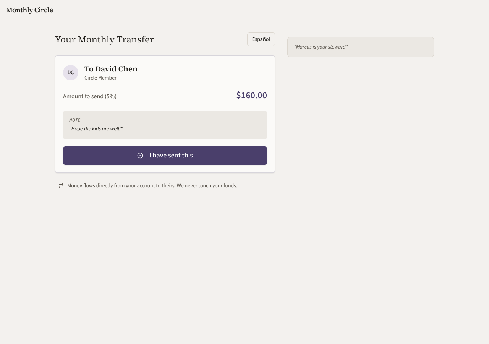

### remix-income-sharing — gemma-4-26b (trial 2)

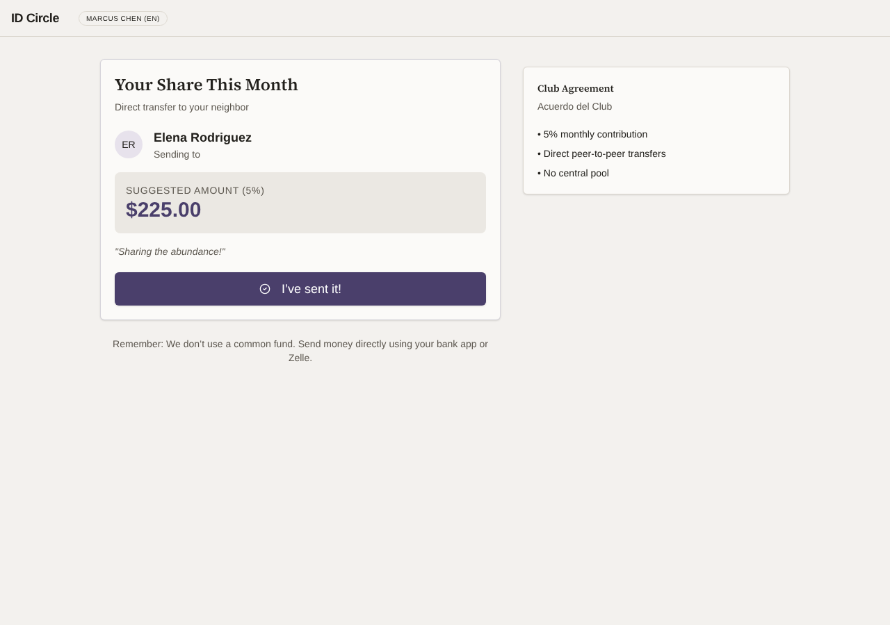

### remix-gathering-fund — gemma-4-26b (trial 1)

### remix-gathering-fund — gemma-4-26b (trial 2)

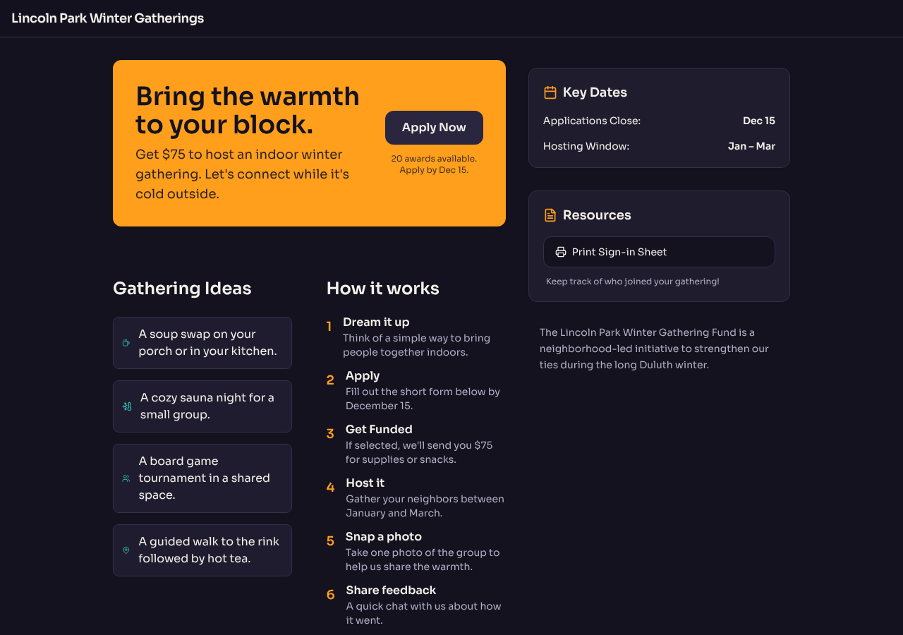

### remix-street-stories — gemma-4-26b (trial 1)

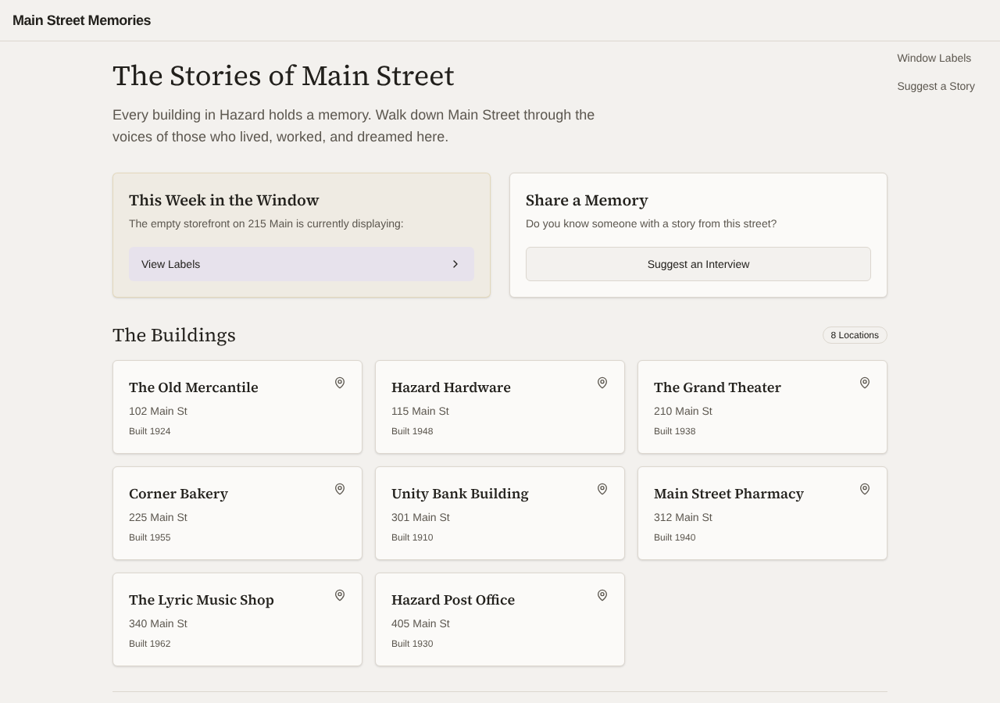

### remix-street-stories — gemma-4-26b (trial 2)

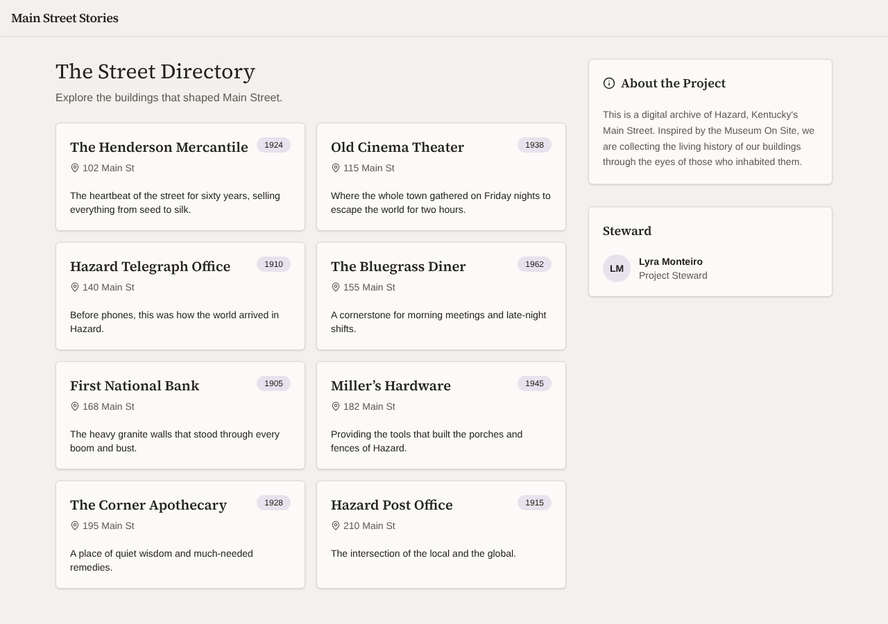

### remix-tool-lending-seed — gemma-4-26b (trial 1)

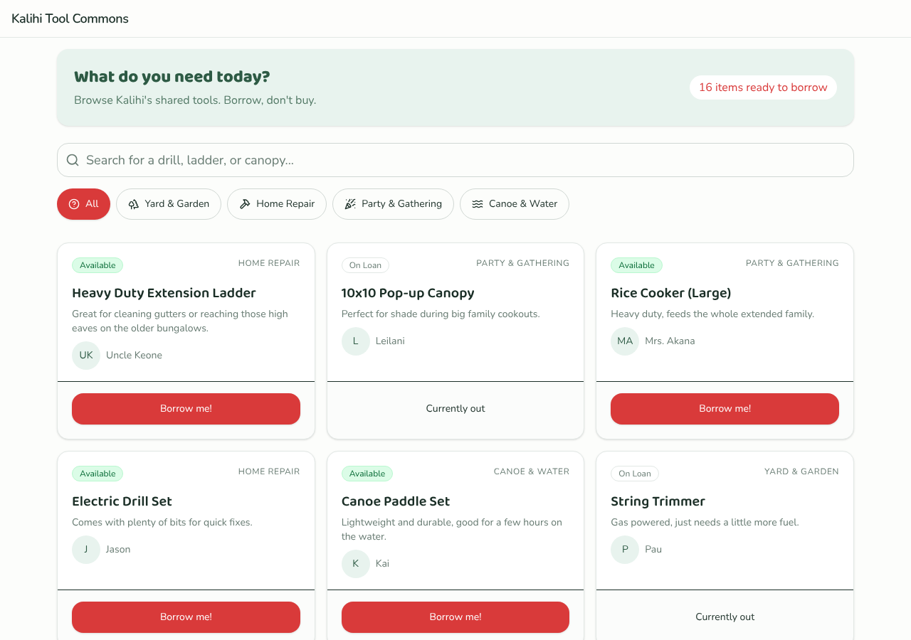

### remix-tool-lending-seed — gemma-4-26b (trial 2)

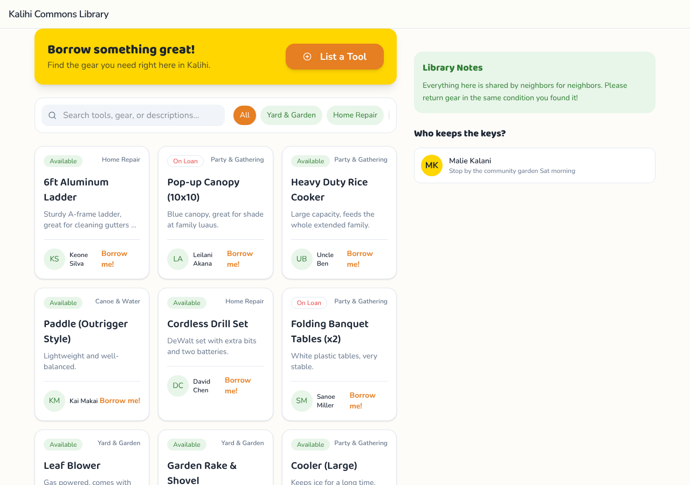

### hs-story-circle — gemma-4-26b (trial 1)

### hs-story-circle — gemma-4-26b (trial 2)

### hs-ballot-guide — gemma-4-26b (trial 1)

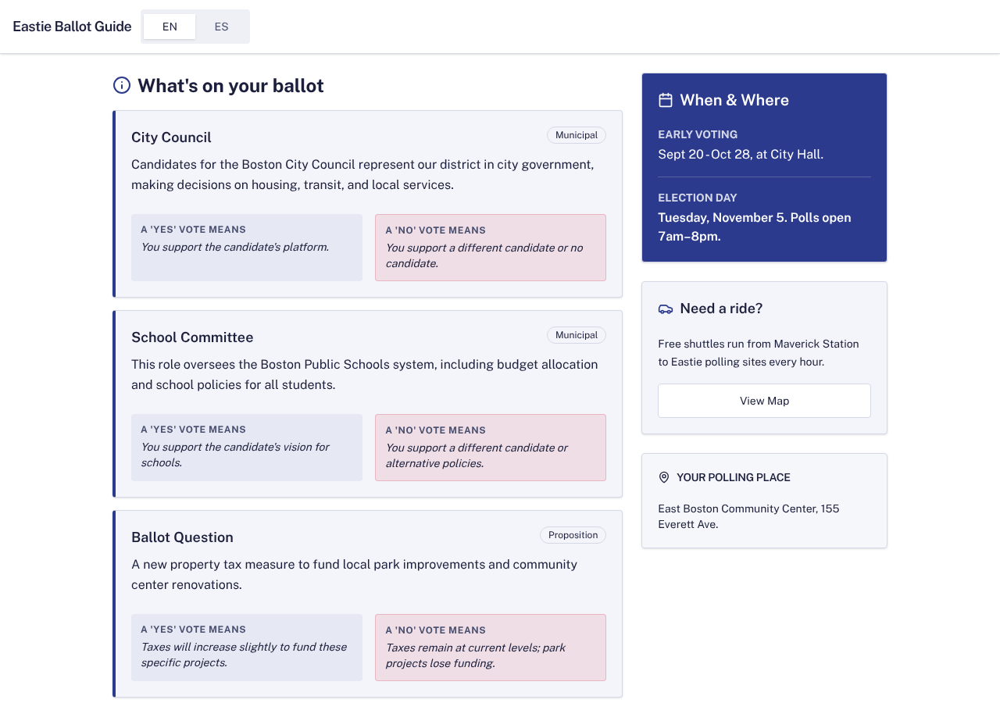

### hs-ballot-guide — gemma-4-26b (trial 2)

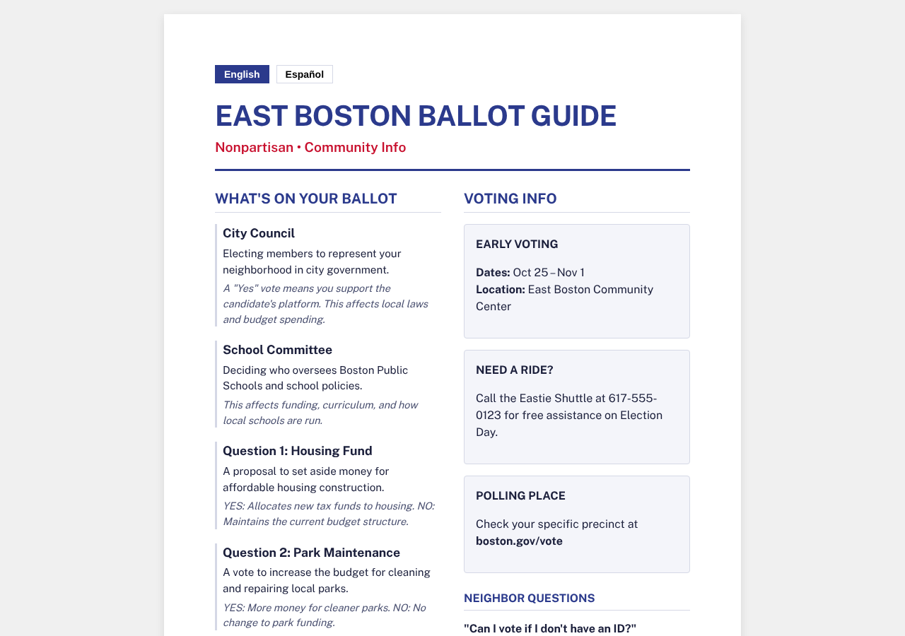

### hs-skill-swap — gemma-4-26b (trial 1)

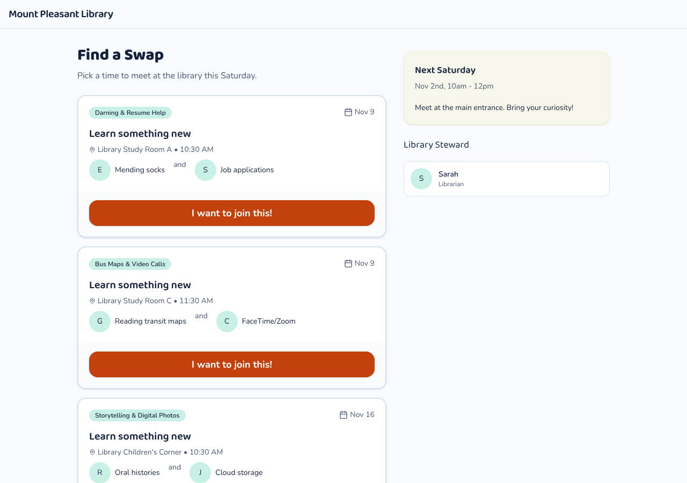

### hs-skill-swap — gemma-4-26b (trial 2)

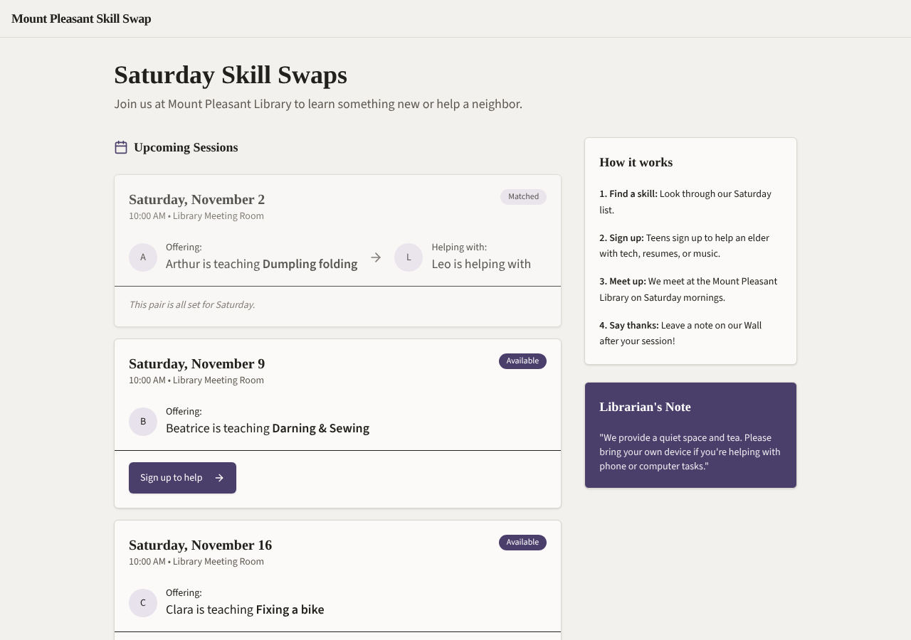

### hs-bulletin-boards — gemma-4-26b (trial 1)

### hs-bulletin-boards — gemma-4-26b (trial 2)

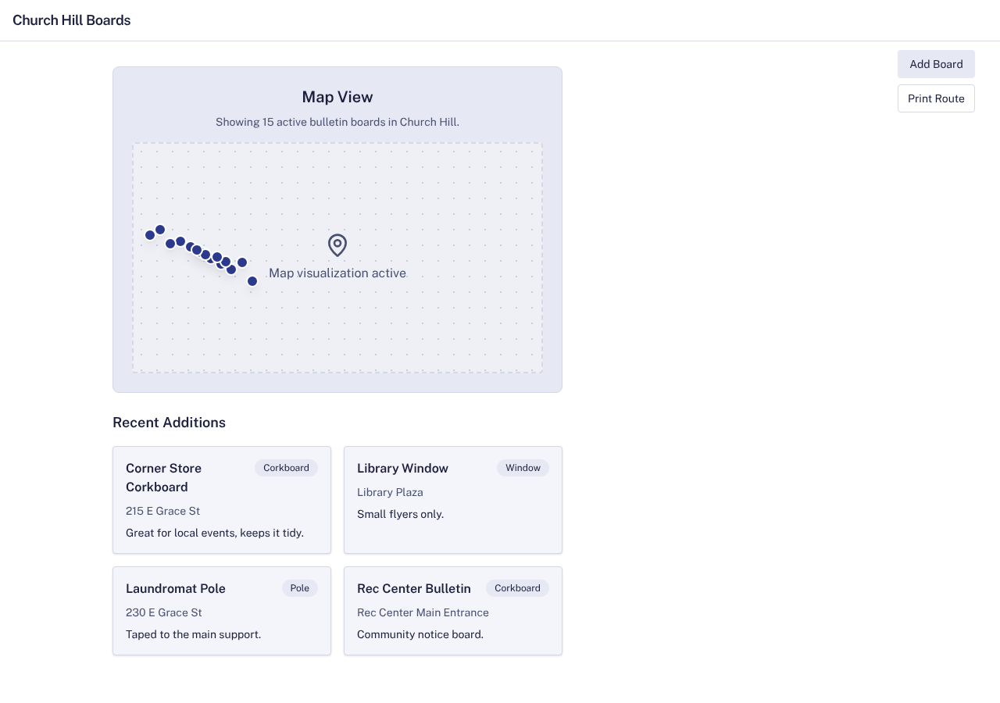
