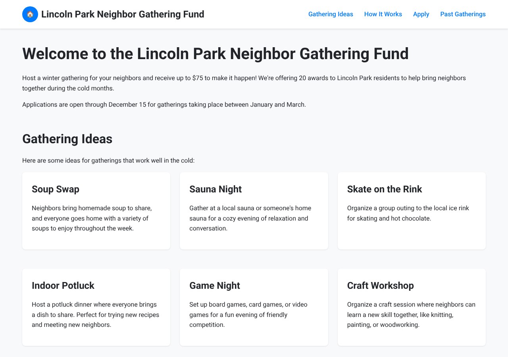
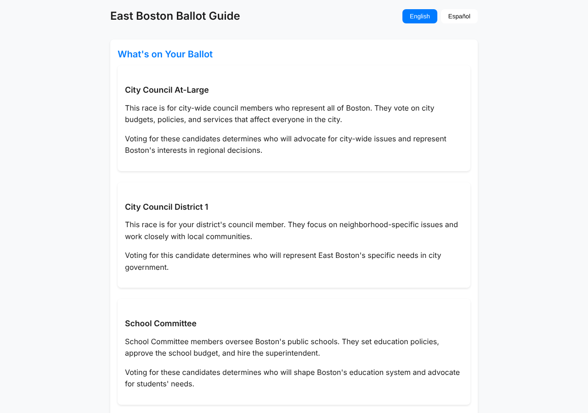
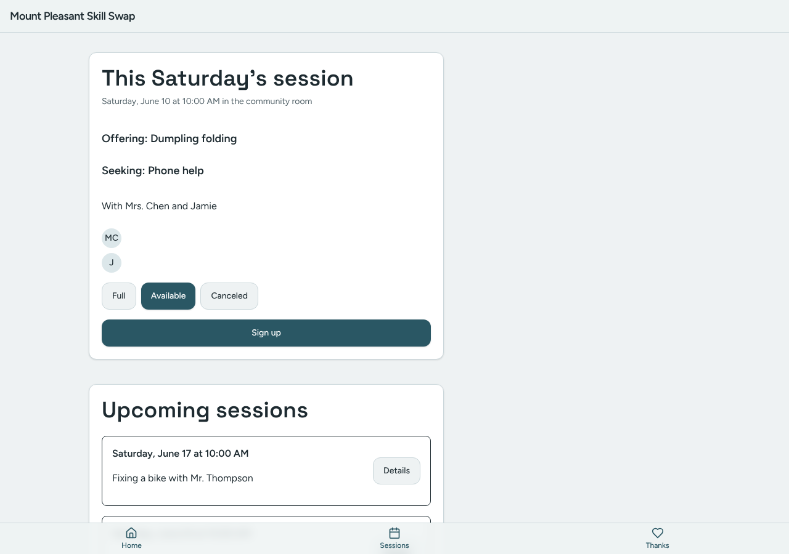

# Model bench — 2026-11-13T11-43-08-28cf548-9nb9

- **Tasks:** remix-income-sharing, remix-gathering-fund, remix-street-stories, remix-tool-lending-seed, hs-story-circle, hs-ballot-guide, hs-skill-swap, hs-bulletin-boards (harness 1.2.0, commit `28cf548`)
- **Date:** 2026-11-13T12:21:11.945Z
- **Trials per model per task:** 1
- **Import guard:** on (static import check feeds the fix pass)
- **Human review:** _pending_

> Cost and token figures are **estimates** (chars ÷ 4 × list prices) — directional, not billing-grade.
> Mechanical columns are medians across trials. Total = plan + build wall time.
> **Bundle** = final compile success; **First try** = compiled without the auto-fix; **Renders** = opened in a browser after bundling, visible page and no uncaught errors (n/a before Oct 30, 2026); **Fail kind** = what the first-try bundle error was (missing-file, bad-import, unknown-package, syntax); **Lint/100** = eslint findings per 100 lines with the app's own config; **tsc errors** = type errors in the model's files with the kit merged and uninstalled packages untyped, counted only on builds that bundled, syntax errors kept apart (n/a before Nov 1, 2026); **Largest file**, **any**, **Kit files** (files importing the RB kit over code files) and **tok/s** come from the files the model wrote (n/a before Oct 31, 2026); **Fix time** = the auto-fix pass's own wall time; **Fix** = of the builds that first failed, how many the single auto-fix pass solved. **~$** includes the fix pass when one ran.

### Task: remix-income-sharing (exp-v1)

| Model | Bundle | First try | Renders | Fix | Fail kind | Files | Failed edits | Truncated | Checks | Sec flags | Lint/100 | tsc errors | Largest file | any | Kit files | tok/s | TTFT | Build time | Fix time | Total | ~$ | |
|---|---|---|---|---|---|---|---|---|---|---|---|---|---|---|---|---|---|---|---|---|---|---|
| glm-4.5-air | ✗ all errored | 0/0 | n/a | — | n/a | — | — | no | —/0 | — | n/a | n/a | n/a | n/a | n/a | n/a | — | — | — | — | — | 1 errored
| mistral-small-3.2 | 1/1 ✓ | 1/1 | 0/1 clean, 1 blank | — | — | 175 | 0 | yes | 5/5 | 0 | 0.2 | 9 | 215 lines | 0 | 4/48 | 36.1 | 3s | 1221s | — | 1221s | 0.02 |

### Task: remix-gathering-fund (exp-v1)

| Model | Bundle | First try | Renders | Fix | Fail kind | Files | Failed edits | Truncated | Checks | Sec flags | Lint/100 | tsc errors | Largest file | any | Kit files | tok/s | TTFT | Build time | Fix time | Total | ~$ | |
|---|---|---|---|---|---|---|---|---|---|---|---|---|---|---|---|---|---|---|---|---|---|---|
| glm-4.5-air | ✗ all errored | 0/0 | n/a | — | n/a | — | — | no | —/0 | — | n/a | n/a | n/a | n/a | n/a | n/a | — | — | — | — | — | 1 errored
| mistral-small-3.2 | 0/1 ✓ | 0/1 | 1/1 clean | — | — | 1 | 0 | no | 2/5 | 0 | n/a | n/a | 0 lines | 0 | 0/0 | 32.6 | 2s | 111s | — | 111s | 0.00 |

### Task: remix-street-stories (exp-v1)

| Model | Bundle | First try | Renders | Fix | Fail kind | Files | Failed edits | Truncated | Checks | Sec flags | Lint/100 | tsc errors | Largest file | any | Kit files | tok/s | TTFT | Build time | Fix time | Total | ~$ | |
|---|---|---|---|---|---|---|---|---|---|---|---|---|---|---|---|---|---|---|---|---|---|---|
| glm-4.5-air | ✗ all errored | 0/0 | n/a | — | n/a | — | — | no | —/0 | — | n/a | n/a | n/a | n/a | n/a | n/a | — | — | — | — | — | 1 errored
| mistral-small-3.2 | 1/1 ✓ | 1/1 | 1/1 clean | — | — | 10 | 0 | no | 5/5 | 0 | 0 | 1 | 100 lines | 0 | 5/8 | 34.8 | 2s | 142s | — | 142s | 0.00 |

### Task: remix-tool-lending-seed (exp-v1)

| Model | Bundle | First try | Renders | Fix | Fail kind | Files | Failed edits | Truncated | Checks | Sec flags | Lint/100 | tsc errors | Largest file | any | Kit files | tok/s | TTFT | Build time | Fix time | Total | ~$ | |
|---|---|---|---|---|---|---|---|---|---|---|---|---|---|---|---|---|---|---|---|---|---|---|
| glm-4.5-air | ✗ all errored | 0/0 | n/a | — | n/a | — | — | no | —/0 | — | n/a | n/a | n/a | n/a | n/a | n/a | — | — | — | — | — | 1 errored
| mistral-small-3.2 | 1/1 ✓ | 1/1 | 0/1 clean, 1 blank | — | — | 8 | 0 | no | 5/5 | 0 | 0.2 | 3 | 188 lines | 0 | 4/6 | 37.2 | 2s | 153s | — | 153s | 0.00 |

### Task: hs-story-circle (exp-v1)

| Model | Bundle | First try | Renders | Fix | Fail kind | Files | Failed edits | Truncated | Checks | Sec flags | Lint/100 | tsc errors | Largest file | any | Kit files | tok/s | TTFT | Build time | Fix time | Total | ~$ | |
|---|---|---|---|---|---|---|---|---|---|---|---|---|---|---|---|---|---|---|---|---|---|---|
| glm-4.5-air | ✗ all errored | 0/0 | n/a | — | n/a | — | — | no | —/0 | — | n/a | n/a | n/a | n/a | n/a | n/a | — | — | — | — | — | 1 errored
| mistral-small-3.2 | 0/1 ✓ | 0/1 | n/a | 0/1 solved | other | 6 | 0 | no | 4/5 | 0 | 0.3 | n/a | 312 lines | 0 | 1/2 | 58.9 | 2s | 81s | 166s | 81s | 0.01 |

### Task: hs-ballot-guide (exp-v1)

| Model | Bundle | First try | Renders | Fix | Fail kind | Files | Failed edits | Truncated | Checks | Sec flags | Lint/100 | tsc errors | Largest file | any | Kit files | tok/s | TTFT | Build time | Fix time | Total | ~$ | |
|---|---|---|---|---|---|---|---|---|---|---|---|---|---|---|---|---|---|---|---|---|---|---|
| glm-4.5-air | ✗ all errored | 0/0 | n/a | — | n/a | — | — | no | —/0 | — | n/a | n/a | n/a | n/a | n/a | n/a | — | — | — | — | — | 1 errored
| mistral-small-3.2 | 0/1 ✓ | 0/1 | 1/1 clean | — | — | 1 | 0 | no | 2/5 | 0 | n/a | n/a | 0 lines | 0 | 0/0 | 38.4 | 9s | 120s | — | 120s | 0.00 |

### Task: hs-skill-swap (exp-v1)

| Model | Bundle | First try | Renders | Fix | Fail kind | Files | Failed edits | Truncated | Checks | Sec flags | Lint/100 | tsc errors | Largest file | any | Kit files | tok/s | TTFT | Build time | Fix time | Total | ~$ | |
|---|---|---|---|---|---|---|---|---|---|---|---|---|---|---|---|---|---|---|---|---|---|---|
| glm-4.5-air | ✗ all errored | 0/0 | n/a | — | n/a | — | — | no | —/0 | — | n/a | n/a | n/a | n/a | n/a | n/a | — | — | — | — | — | 1 errored
| mistral-small-3.2 | 1/1 ✓ | 1/1 | 1/1 clean | — | — | 9 | 0 | no | 5/5 | 0 | 0 | 0 | 90 lines | 0 | 4/7 | 33.5 | 7s | 131s | — | 131s | 0.00 |

### Task: hs-bulletin-boards (exp-v1)

| Model | Bundle | First try | Renders | Fix | Fail kind | Files | Failed edits | Truncated | Checks | Sec flags | Lint/100 | tsc errors | Largest file | any | Kit files | tok/s | TTFT | Build time | Fix time | Total | ~$ | |
|---|---|---|---|---|---|---|---|---|---|---|---|---|---|---|---|---|---|---|---|---|---|---|
| glm-4.5-air | ✗ all errored | 0/0 | n/a | — | n/a | — | — | no | —/0 | — | n/a | n/a | n/a | n/a | n/a | n/a | — | — | — | — | — | 1 errored
| mistral-small-3.2 | 0/1 ✓ | 0/1 | 0/1 clean, 1 blank | — | — | 4 | 0 | no | 3/5 | 0 | 0 | n/a | 233 lines | 0 | 0/2 | 34.3 | 2s | 115s | — | 115s | 0.00 |

## Human review

_Not scored yet — open review/index.html, score, export, save as review/scores.json, re-run report._

## Which model for what

_Maintainer's call, informed by the tables above — the report feeds the decision, it doesn't make it._

## Served as (provider-reported)

- **mistral-small-3.2**: mistralai/mistral-small-3.2-24b-instruct, via Parasail

## In the browser (bundled, but)

- **mistral-small-3.2** · remix-income-sharing t1: BLANK PAGE
- **mistral-small-3.2** · remix-tool-lending-seed t1: BLANK PAGE
  - console: TypeError: tools.filter is not a function at Home (file:///home/user/relational-builder/bench/results/2026-11-13T11-43-08-28cf548-9nb9/artifacts/remix-tool-lending-seed/mistral-small-3.2-t1/preview.html:512:32) at Hi (ht
  - pageerror: tools.filter is not a function
- **mistral-small-3.2** · hs-bulletin-boards t1: BLANK PAGE

## Fix passes (how solves went)

- **mistral-small-3.2** · hs-story-circle t1: build failed to bundle → auto-fix not solved after 2 passes — still: vfs:/app.js:86: The JSX syntax extension is not currently enabled
  - triggered by: `vfs:/app.js:86: The JSX syntax extension is not currently enabled`

## Errors

- **glm-4.5-air** · remix-income-sharing t1: OpenRouter API error (404): {"error":{"message":"No endpoints found that support image input","code":404,"metadata":{"routing_funnel":[{"step":"Initial Endpoints","endpoint_count":3}],"failed_routing_step":"Filter by Image Support"}}}
- **glm-4.5-air** · remix-gathering-fund t1: OpenRouter API error (404): {"error":{"message":"No endpoints found that support image input","code":404,"metadata":{"routing_funnel":[{"step":"Initial Endpoints","endpoint_count":3}],"failed_routing_step":"Filter by Image Support"}}}
- **glm-4.5-air** · remix-street-stories t1: OpenRouter API error (404): {"error":{"message":"No endpoints found that support image input","code":404,"metadata":{"routing_funnel":[{"step":"Initial Endpoints","endpoint_count":3}],"failed_routing_step":"Filter by Image Support"}}}
- **glm-4.5-air** · remix-tool-lending-seed t1: OpenRouter API error (404): {"error":{"message":"No endpoints found that support image input","code":404,"metadata":{"routing_funnel":[{"step":"Initial Endpoints","endpoint_count":3}],"failed_routing_step":"Filter by Image Support"}}}
- **glm-4.5-air** · hs-story-circle t1: OpenRouter API error (404): {"error":{"message":"No endpoints found that support image input","code":404,"metadata":{"routing_funnel":[{"step":"Initial Endpoints","endpoint_count":3}],"failed_routing_step":"Filter by Image Support"}}}
- **glm-4.5-air** · hs-ballot-guide t1: OpenRouter API error (404): {"error":{"message":"No endpoints found that support image input","code":404,"metadata":{"routing_funnel":[{"step":"Initial Endpoints","endpoint_count":3}],"failed_routing_step":"Filter by Image Support"}}}
- **glm-4.5-air** · hs-skill-swap t1: OpenRouter API error (404): {"error":{"message":"No endpoints found that support image input","code":404,"metadata":{"routing_funnel":[{"step":"Initial Endpoints","endpoint_count":3}],"failed_routing_step":"Filter by Image Support"}}}
- **glm-4.5-air** · hs-bulletin-boards t1: OpenRouter API error (404): {"error":{"message":"No endpoints found that support image input","code":404,"metadata":{"routing_funnel":[{"step":"Initial Endpoints","endpoint_count":3}],"failed_routing_step":"Filter by Image Support"}}}

## Previews

### remix-income-sharing — mistral-small-3.2 (trial 1)

### remix-gathering-fund — mistral-small-3.2 (trial 1)

### remix-street-stories — mistral-small-3.2 (trial 1)

### remix-tool-lending-seed — mistral-small-3.2 (trial 1)

### hs-ballot-guide — mistral-small-3.2 (trial 1)

### hs-skill-swap — mistral-small-3.2 (trial 1)

### hs-bulletin-boards — mistral-small-3.2 (trial 1)

