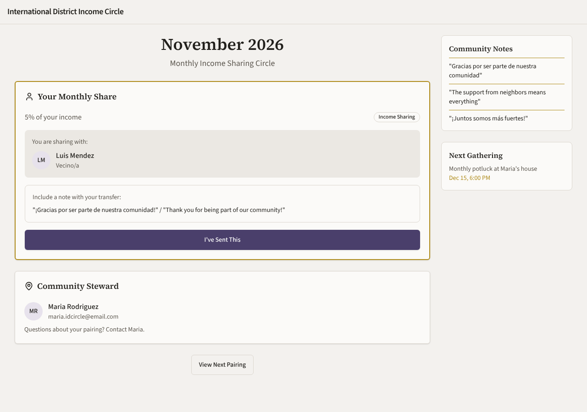
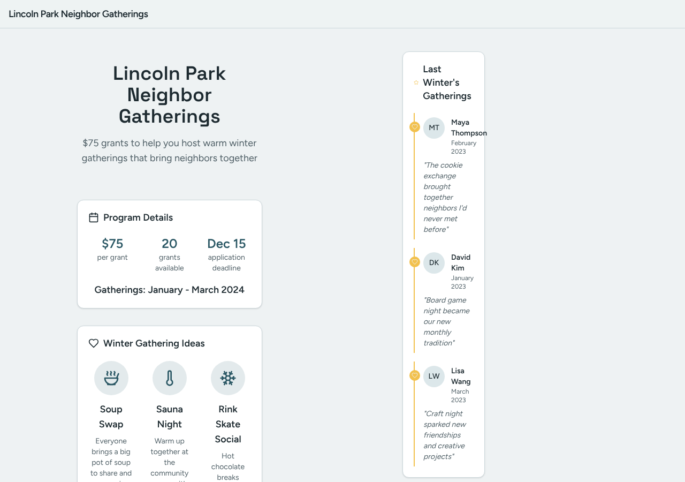
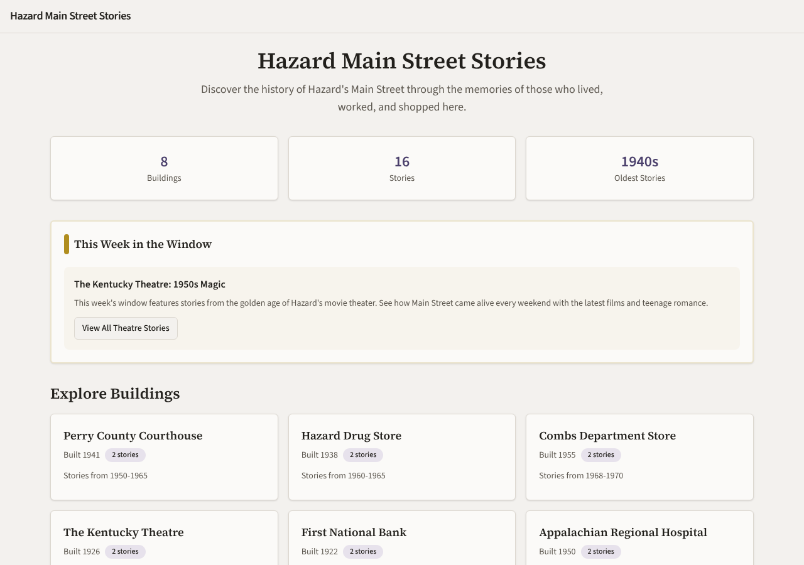
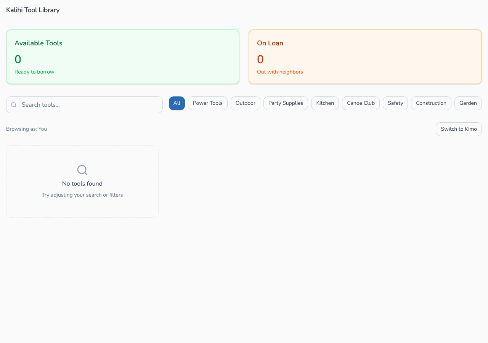
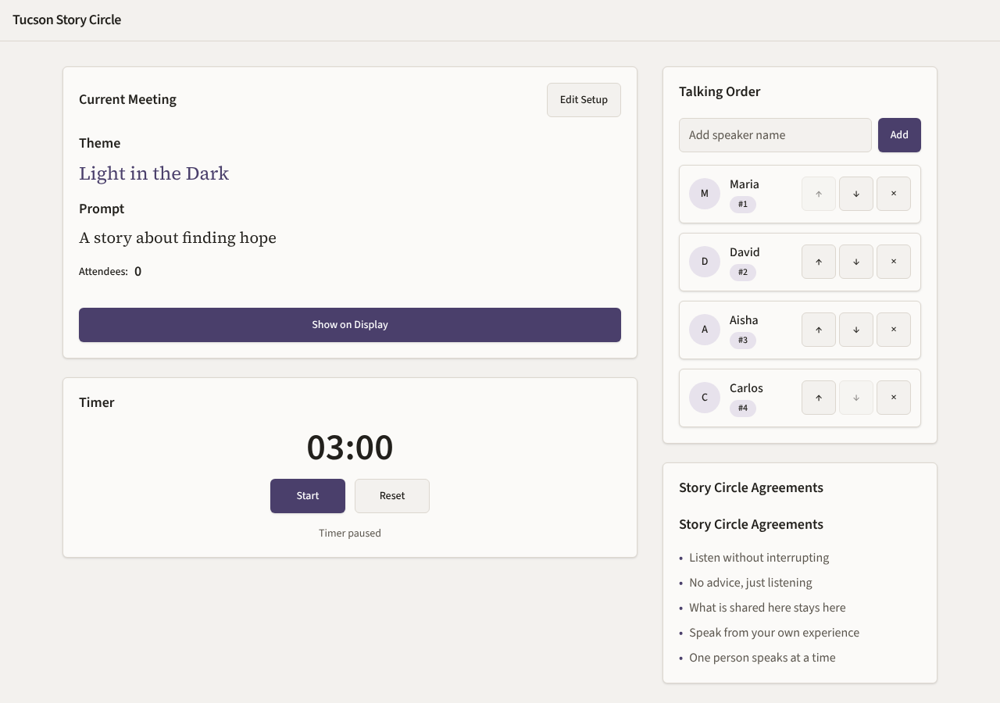
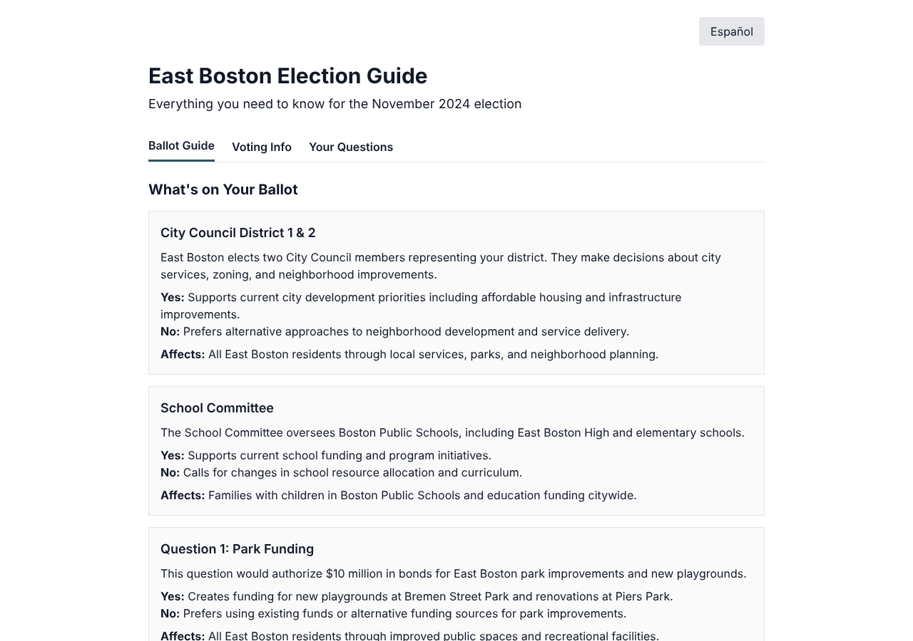
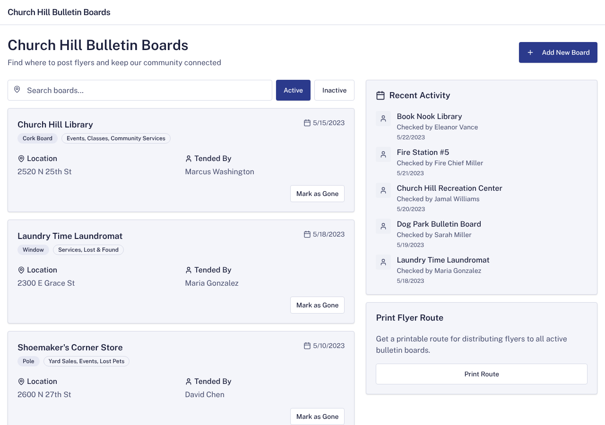

# Model bench — 2026-11-13T12-10-14-a702e2a-04j3

- **Tasks:** remix-income-sharing, remix-gathering-fund, remix-street-stories, remix-tool-lending-seed, hs-story-circle, hs-ballot-guide, hs-skill-swap, hs-bulletin-boards (harness 1.2.0, commit `a702e2a`)
- **Date:** 2026-11-13T12:24:45.406Z
- **Trials per model per task:** 1
- **Import guard:** on (static import check feeds the fix pass)
- **Human review:** _pending_

> Cost and token figures are **estimates** (chars ÷ 4 × list prices) — directional, not billing-grade.
> Mechanical columns are medians across trials. Total = plan + build wall time.
> **Bundle** = final compile success; **First try** = compiled without the auto-fix; **Renders** = opened in a browser after bundling, visible page and no uncaught errors (n/a before Oct 30, 2026); **Fail kind** = what the first-try bundle error was (missing-file, bad-import, unknown-package, syntax); **Lint/100** = eslint findings per 100 lines with the app's own config; **tsc errors** = type errors in the model's files with the kit merged and uninstalled packages untyped, counted only on builds that bundled, syntax errors kept apart (n/a before Nov 1, 2026); **Largest file**, **any**, **Kit files** (files importing the RB kit over code files) and **tok/s** come from the files the model wrote (n/a before Oct 31, 2026); **Fix time** = the auto-fix pass's own wall time; **Fix** = of the builds that first failed, how many the single auto-fix pass solved. **~$** includes the fix pass when one ran.

### Task: remix-income-sharing (exp-v1)

| Model | Bundle | First try | Renders | Fix | Fail kind | Files | Failed edits | Truncated | Checks | Sec flags | Lint/100 | tsc errors | Largest file | any | Kit files | tok/s | TTFT | Build time | Fix time | Total | ~$ | |
|---|---|---|---|---|---|---|---|---|---|---|---|---|---|---|---|---|---|---|---|---|---|---|
| glm-4.5-air | 1/1 ✓ | 1/1 | 1/1 clean | — | — | 12 | 0 | no | 4/5 | 0 | 0.2 | 1 | 173 lines | 0 | 6/9 | 58.6 | 9s | 168s | — | 168s | 0.01 |

### Task: remix-gathering-fund (exp-v1)

| Model | Bundle | First try | Renders | Fix | Fail kind | Files | Failed edits | Truncated | Checks | Sec flags | Lint/100 | tsc errors | Largest file | any | Kit files | tok/s | TTFT | Build time | Fix time | Total | ~$ | |
|---|---|---|---|---|---|---|---|---|---|---|---|---|---|---|---|---|---|---|---|---|---|---|
| glm-4.5-air | 1/1 ✓ | 0/1 | 1/1 clean | 1/1 solved | other | 9 | 0 | no | 5/5 | 0 | 0 | 0 | 245 lines | 0 | 4/5 | 83.3 | 8s | 52s | 28s | 52s | 0.01 |

### Task: remix-street-stories (exp-v1)

| Model | Bundle | First try | Renders | Fix | Fail kind | Files | Failed edits | Truncated | Checks | Sec flags | Lint/100 | tsc errors | Largest file | any | Kit files | tok/s | TTFT | Build time | Fix time | Total | ~$ | |
|---|---|---|---|---|---|---|---|---|---|---|---|---|---|---|---|---|---|---|---|---|---|---|
| glm-4.5-air | 1/1 ✓ | 0/1 | 1/1 clean | 1/1 solved | bad-import | 15 | 0 | no | 5/5 | 0 | 2.8 | 1 | 232 lines | 0 | 7/9 | 91.5 | 8s | 103s | 42s | 103s | 0.02 |

### Task: remix-tool-lending-seed (exp-v1)

| Model | Bundle | First try | Renders | Fix | Fail kind | Files | Failed edits | Truncated | Checks | Sec flags | Lint/100 | tsc errors | Largest file | any | Kit files | tok/s | TTFT | Build time | Fix time | Total | ~$ | |
|---|---|---|---|---|---|---|---|---|---|---|---|---|---|---|---|---|---|---|---|---|---|---|
| glm-4.5-air | 1/1 ✓ | 1/1 | 1/1 clean | — | — | 10 | 0 | no | 4/5 | 0 | 1 | 7 | 224 lines | 0 | 3/8 | 84.9 | 7s | 73s | — | 73s | 0.01 |

### Task: hs-story-circle (exp-v1)

| Model | Bundle | First try | Renders | Fix | Fail kind | Files | Failed edits | Truncated | Checks | Sec flags | Lint/100 | tsc errors | Largest file | any | Kit files | tok/s | TTFT | Build time | Fix time | Total | ~$ | |
|---|---|---|---|---|---|---|---|---|---|---|---|---|---|---|---|---|---|---|---|---|---|---|
| glm-4.5-air | 1/1 ✓ | 0/1 | 1/1 clean | 1/1 solved | bad-import | 14 | 0 | no | 5/5 | 0 | 0.2 | 0 | 197 lines | 0 | 5/8 | 80.3 | 17s | 74s | 29s | 74s | 0.02 |

### Task: hs-ballot-guide (exp-v1)

| Model | Bundle | First try | Renders | Fix | Fail kind | Files | Failed edits | Truncated | Checks | Sec flags | Lint/100 | tsc errors | Largest file | any | Kit files | tok/s | TTFT | Build time | Fix time | Total | ~$ | |
|---|---|---|---|---|---|---|---|---|---|---|---|---|---|---|---|---|---|---|---|---|---|---|
| glm-4.5-air | 0/1 ✓ | 0/1 | 1/1 clean | — | — | 1 | 0 | no | 2/5 | 0 | n/a | n/a | 0 lines | 0 | 0/0 | 84.6 | 21s | 83s | — | 83s | 0.01 |

### Task: hs-skill-swap (exp-v1)

| Model | Bundle | First try | Renders | Fix | Fail kind | Files | Failed edits | Truncated | Checks | Sec flags | Lint/100 | tsc errors | Largest file | any | Kit files | tok/s | TTFT | Build time | Fix time | Total | ~$ | |
|---|---|---|---|---|---|---|---|---|---|---|---|---|---|---|---|---|---|---|---|---|---|---|
| glm-4.5-air | 0/1 ✓ | 0/1 | n/a | 0/1 solved | bad-import | 18 | 0 | no | 4/5 | 0 | 2.2 | n/a | 86 lines | 0 | 4/11 | 82.4 | 8s | 59s | 27s | 59s | 0.01 |

### Task: hs-bulletin-boards (exp-v1)

| Model | Bundle | First try | Renders | Fix | Fail kind | Files | Failed edits | Truncated | Checks | Sec flags | Lint/100 | tsc errors | Largest file | any | Kit files | tok/s | TTFT | Build time | Fix time | Total | ~$ | |
|---|---|---|---|---|---|---|---|---|---|---|---|---|---|---|---|---|---|---|---|---|---|---|
| glm-4.5-air | 1/1 ✓ | 0/1 | 1/1 clean | 1/1 solved | bad-import | 12 | 0 | no | 4/5 | 0 | 0 | 2 | 186 lines | 0 | 5/8 | 84.8 | 13s | 75s | 16s | 75s | 0.01 |

## Human review

_Not scored yet — open review/index.html, score, export, save as review/scores.json, re-run report._

## Which model for what

_Maintainer's call, informed by the tables above — the report feeds the decision, it doesn't make it._

## Served as (provider-reported)

- **glm-4.5-air**: z-ai/glm-4.5-air, via Novita / z-ai/glm-4.5-air, via Z.AI

## Fix passes (how solves went)

- **glm-4.5-air** · remix-gathering-fund t1: build failed to bundle → auto-fix solved in one pass (28s, ~$0.00)
  - triggered by: `vfs:/src/App.tsx: <LastYearGatherings> is used but never imported or declared in this file`
- **glm-4.5-air** · remix-street-stories t1: build failed to bundle → auto-fix solved in 2 passes (42s, ~$0.01)
  - triggered by: `vfs:/src/pages/BuildingPage.tsx:5: No matching export in "vfs:/src/components/StoryCard.tsx" for import "StoryCard"`
- **glm-4.5-air** · hs-story-circle t1: build failed to bundle → auto-fix solved in 2 passes (29s, ~$0.01)
  - triggered by: `vfs:/src/pages/DisplayPage.tsx:5: No matching export in "vfs:/src/components/Agreements.tsx" for import "Agreements"`
- **glm-4.5-air** · hs-skill-swap t1: build failed to bundle → auto-fix not solved after 2 passes — still: vfs:/src/App.tsx:6: No matching export in "vfs:/src/components/UserSwitch.tsx" for import "UserSwitch"
  - triggered by: `vfs:/src/App.tsx:4: No matching export in "vfs:/src/pages/Home.tsx" for import "Home"`
- **glm-4.5-air** · hs-bulletin-boards t1: build failed to bundle → auto-fix solved in 2 passes (16s, ~$0.01)
  - triggered by: `vfs:/src/App.tsx:5: No matching export in "vfs:/src/components/ui/app-bar.tsx" for import "default"`

## Previews

### remix-income-sharing — glm-4.5-air (trial 1)

### remix-gathering-fund — glm-4.5-air (trial 1)

### remix-street-stories — glm-4.5-air (trial 1)

### remix-tool-lending-seed — glm-4.5-air (trial 1)

### hs-story-circle — glm-4.5-air (trial 1)

### hs-ballot-guide — glm-4.5-air (trial 1)

### hs-bulletin-boards — glm-4.5-air (trial 1)

