# Model bench — 2026-11-13T17-33-16-6a87f3e-47g2

- **Tasks:** remix-income-sharing, remix-gathering-fund, remix-street-stories, remix-tool-lending-seed, hs-story-circle, hs-ballot-guide, hs-skill-swap, hs-bulletin-boards (harness 1.2.0, commit `6a87f3e`)
- **Date:** 2026-11-13T17:56:53.085Z
- **Trials per model per task:** 2
- **Import guard:** on (static import check feeds the fix pass)
- **Human review:** _pending_

> Cost and token figures are **estimates** (chars ÷ 4 × list prices) — directional, not billing-grade.
> Mechanical columns are medians across trials. Total = plan + build wall time.
> **Bundle** = final compile success; **First try** = compiled without the auto-fix; **Renders** = opened in a browser after bundling, visible page and no uncaught errors (n/a before Oct 30, 2026); **Fail kind** = what the first-try bundle error was (missing-file, bad-import, unknown-package, syntax); **Lint/100** = eslint findings per 100 lines with the app's own config; **tsc errors** = type errors in the model's files with the kit merged and uninstalled packages untyped, counted only on builds that bundled, syntax errors kept apart (n/a before Nov 1, 2026); **Largest file**, **any**, **Kit files** (files importing the RB kit over code files) and **tok/s** come from the files the model wrote (n/a before Oct 31, 2026); **Fix time** = the auto-fix pass's own wall time; **Fix** = of the builds that first failed, how many the single auto-fix pass solved. **~$** includes the fix pass when one ran.

### Task: remix-income-sharing (exp-v1)

| Model | Bundle | First try | Renders | Fix | Fail kind | Files | Failed edits | Truncated | Checks | Sec flags | Lint/100 | tsc errors | Largest file | any | Kit files | tok/s | TTFT | Build time | Fix time | Total | ~$ | |
|---|---|---|---|---|---|---|---|---|---|---|---|---|---|---|---|---|---|---|---|---|---|---|
| gemma-4-26b | 2/2 ✓ | 2/2 | 2/2 clean | — | — | 8 | 0 | no | 4.5/5 | 0 | 0.7 | 1.5 | 135 lines | 0.5 | 4/6 | 128.55 | 2s | 33s | — | 33s | 0.00 |

### Task: remix-gathering-fund (exp-v1)

| Model | Bundle | First try | Renders | Fix | Fail kind | Files | Failed edits | Truncated | Checks | Sec flags | Lint/100 | tsc errors | Largest file | any | Kit files | tok/s | TTFT | Build time | Fix time | Total | ~$ | |
|---|---|---|---|---|---|---|---|---|---|---|---|---|---|---|---|---|---|---|---|---|---|---|
| gemma-4-26b | 2/2 ✓ | 2/2 | 2/2 clean | — | — | 4 | 0 | no | 5/5 | 0 | 0.6 | 0 | 290.5 lines | 0 | 1/2 | 123.4 | 2s | 34s | — | 34s | 0.00 |

### Task: remix-street-stories (exp-v1)

| Model | Bundle | First try | Renders | Fix | Fail kind | Files | Failed edits | Truncated | Checks | Sec flags | Lint/100 | tsc errors | Largest file | any | Kit files | tok/s | TTFT | Build time | Fix time | Total | ~$ | |
|---|---|---|---|---|---|---|---|---|---|---|---|---|---|---|---|---|---|---|---|---|---|---|
| gemma-4-26b | 2/2 ✓ | 1/2 | 2/2 clean | 1/1 solved | syntax | 9 | 0 | no | 4.5/5 | 0 | 0.1 | 0.5 | 136 lines | 0 | 4.5/6.5 | 79.35 | 1s | 113s | 8s | 113s | 0.00 |

### Task: remix-tool-lending-seed (exp-v1)

| Model | Bundle | First try | Renders | Fix | Fail kind | Files | Failed edits | Truncated | Checks | Sec flags | Lint/100 | tsc errors | Largest file | any | Kit files | tok/s | TTFT | Build time | Fix time | Total | ~$ | |
|---|---|---|---|---|---|---|---|---|---|---|---|---|---|---|---|---|---|---|---|---|---|---|
| gemma-4-26b | 2/2 ✓ | 2/2 | 2/2 clean | — | — | 6 | 0 | no | 4.5/5 | 0 | 0.5 | 0.5 | 212 lines | 0.5 | 2/4 | 119 | 2s | 43s | — | 43s | 0.00 |

### Task: hs-story-circle (exp-v1)

| Model | Bundle | First try | Renders | Fix | Fail kind | Files | Failed edits | Truncated | Checks | Sec flags | Lint/100 | tsc errors | Largest file | any | Kit files | tok/s | TTFT | Build time | Fix time | Total | ~$ | |
|---|---|---|---|---|---|---|---|---|---|---|---|---|---|---|---|---|---|---|---|---|---|---|
| gemma-4-26b | 2/2 ✓ | 1/2 | 2/2 clean | 1/1 solved | bad-import | 8.5 | 0 | no | 5/5 | 0 | 1.75 | 0.5 | 201 lines | 0.5 | 4/5.5 | 80.5 | 2s | 92s | 59s | 92s | 0.00 |

### Task: hs-ballot-guide (exp-v1)

| Model | Bundle | First try | Renders | Fix | Fail kind | Files | Failed edits | Truncated | Checks | Sec flags | Lint/100 | tsc errors | Largest file | any | Kit files | tok/s | TTFT | Build time | Fix time | Total | ~$ | |
|---|---|---|---|---|---|---|---|---|---|---|---|---|---|---|---|---|---|---|---|---|---|---|
| gemma-4-26b | 2/2 ✓ | 2/2 | 2/2 clean | — | — | 5 | 0 | no | 4.5/5 | 0 | 0.35 | 0 | 215 lines | 0 | 1/3 | 39.95 | 1s | 152s | — | 152s | 0.00 |

### Task: hs-skill-swap (exp-v1)

| Model | Bundle | First try | Renders | Fix | Fail kind | Files | Failed edits | Truncated | Checks | Sec flags | Lint/100 | tsc errors | Largest file | any | Kit files | tok/s | TTFT | Build time | Fix time | Total | ~$ | |
|---|---|---|---|---|---|---|---|---|---|---|---|---|---|---|---|---|---|---|---|---|---|---|
| gemma-4-26b | 2/2 ✓ | 2/2 | 1/2 clean, 1 blank | — | — | 8 | 0 | no | 4/5 | 0 | 0.45 | 1 | 95 lines | 0 | 4/6 | 88.44999999999999 | 2s | 57s | — | 57s | 0.00 |

### Task: hs-bulletin-boards (exp-v1)

| Model | Bundle | First try | Renders | Fix | Fail kind | Files | Failed edits | Truncated | Checks | Sec flags | Lint/100 | tsc errors | Largest file | any | Kit files | tok/s | TTFT | Build time | Fix time | Total | ~$ | |
|---|---|---|---|---|---|---|---|---|---|---|---|---|---|---|---|---|---|---|---|---|---|---|
| gemma-4-26b | 2/2 ✓ | 1/2 | 2/2 clean | 1/1 solved | syntax | 8 | 1 | no | 4/5 | 0 | 0.4 | 0 | 98.5 lines | 1.5 | 3.5/5.5 | 84.3 | 2s | 77s | 10s | 77s | 0.00 |

## Human review

_Not scored yet — open review/index.html, score, export, save as review/scores.json, re-run report._

## Which model for what

_Maintainer's call, informed by the tables above — the report feeds the decision, it doesn't make it._

## Served as (provider-reported)

- **gemma-4-26b**: google/gemma-4-26b-a4b-it, via PrimeIntellect / google/gemma-4-26b-a4b-it, via NextBit / google/gemma-4-26b-a4b-it, via Parasail / google/gemma-4-26b-a4b-it, via CoreWeave

## In the browser (bundled, but)

- **gemma-4-26b** · hs-skill-swap t2: BLANK PAGE
  - pageerror: Minified React error #130; visit https://reactjs.org/docs/error-decoder.html?invariant=130&args[]=object&args[]= for the full message or use the non-minified dev environment for full errors and additional helpful warning

## Fix passes (how solves went)

- **gemma-4-26b** · remix-street-stories t2: build failed to bundle → auto-fix solved in one pass (8s, ~$0.00)
  - triggered by: `vfs:/src/pages/BuildingPage.tsx:6: Expected "from" but found "extra"`
- **gemma-4-26b** · hs-story-circle t2: build failed to bundle → auto-fix solved in one pass (59s, ~$0.00)
  - triggered by: `vfs:/src/pages/SessionPage.tsx: No matching export in "vfs:/src/App.tsx" for import "useStore"`
- **gemma-4-26b** · hs-bulletin-boards t1: build failed to bundle → auto-fix solved in one pass (10s, ~$0.00)
  - triggered by: `vfs:/src/store.ts:46: Expected ")" but found ";"`

## Previews

### remix-income-sharing — gemma-4-26b (trial 1)

### remix-income-sharing — gemma-4-26b (trial 2)

### remix-gathering-fund — gemma-4-26b (trial 1)

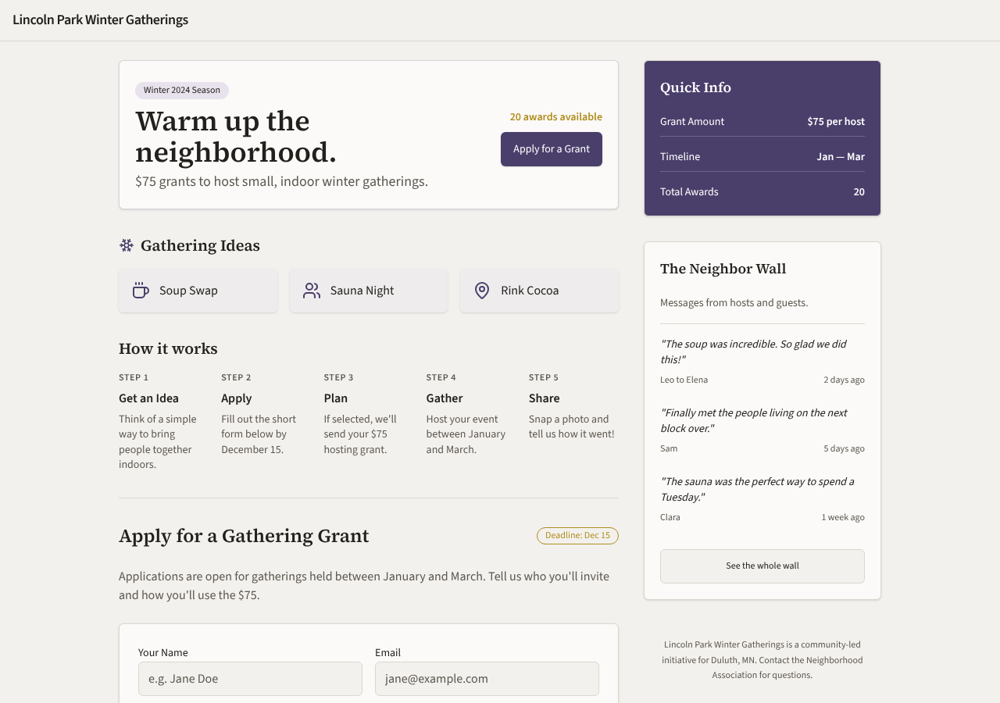

### remix-gathering-fund — gemma-4-26b (trial 2)

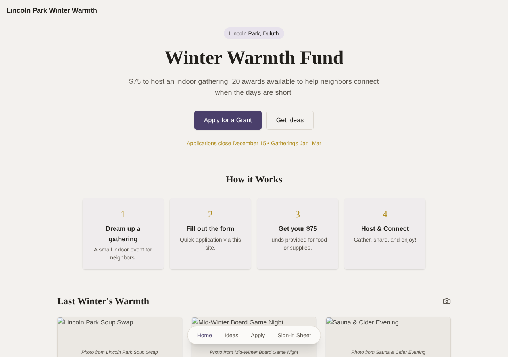

### remix-street-stories — gemma-4-26b (trial 1)

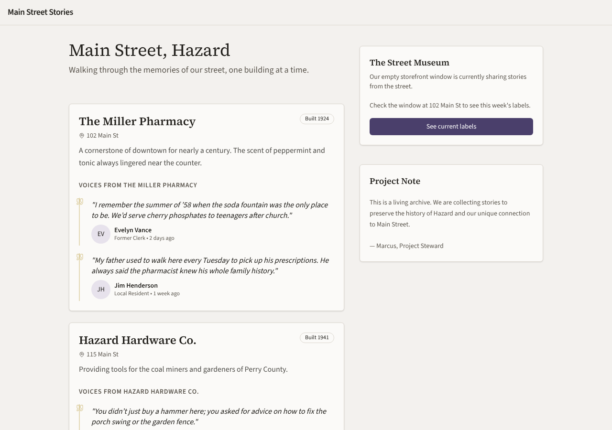

### remix-street-stories — gemma-4-26b (trial 2)

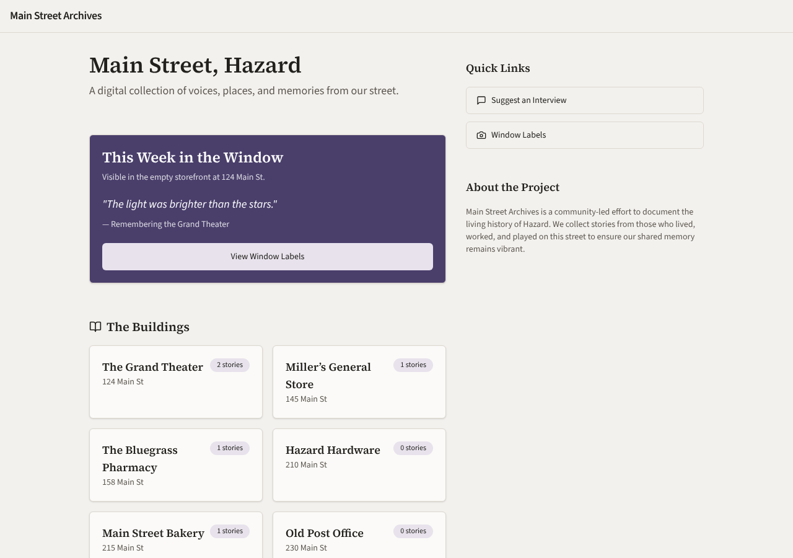

### remix-tool-lending-seed — gemma-4-26b (trial 1)

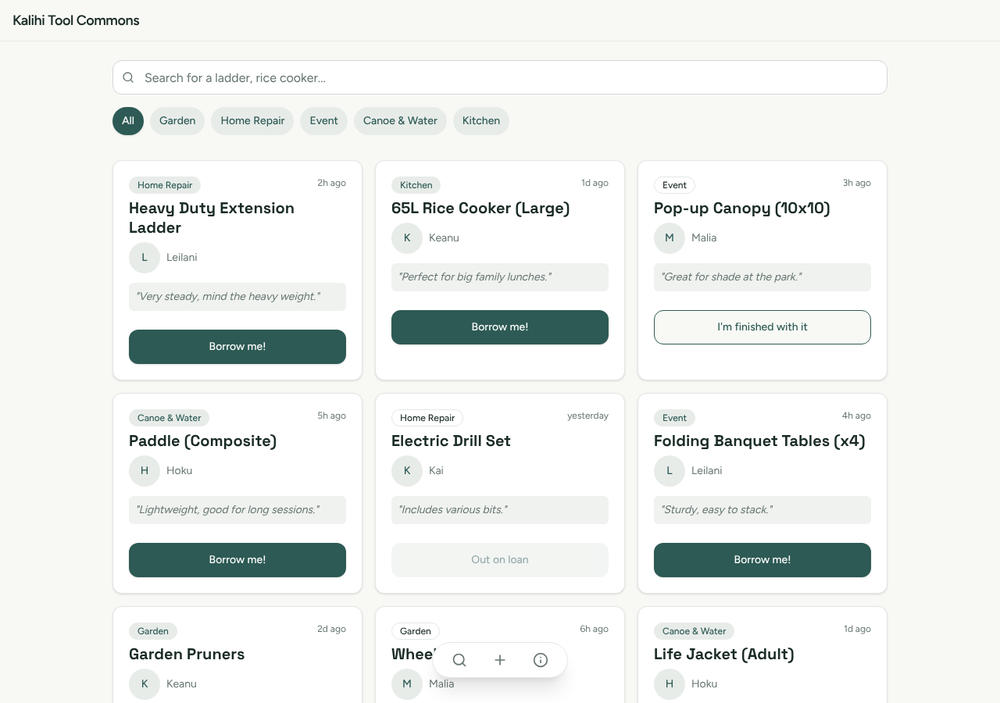

### remix-tool-lending-seed — gemma-4-26b (trial 2)

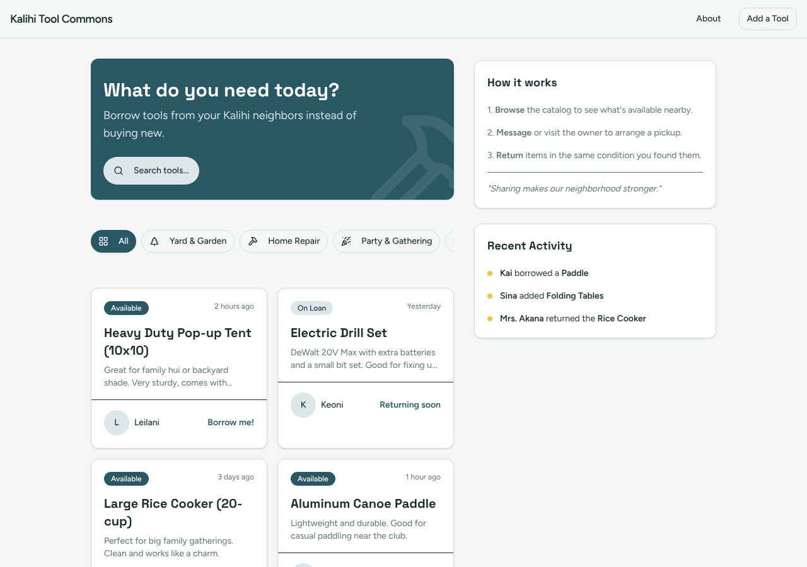

### hs-story-circle — gemma-4-26b (trial 1)

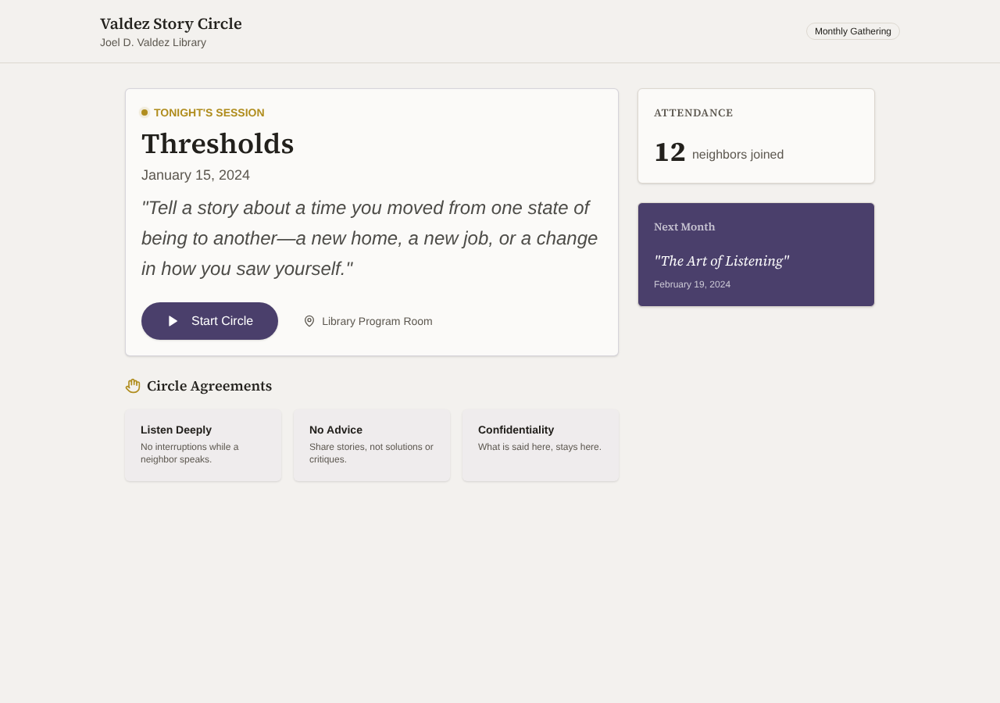

### hs-story-circle — gemma-4-26b (trial 2)

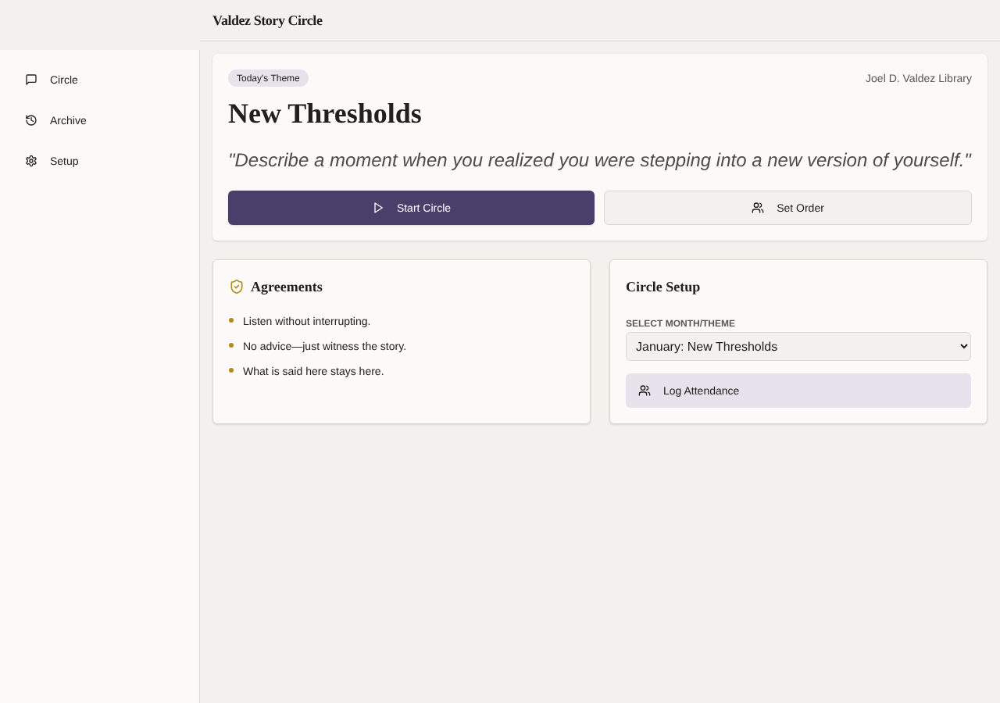

### hs-ballot-guide — gemma-4-26b (trial 1)

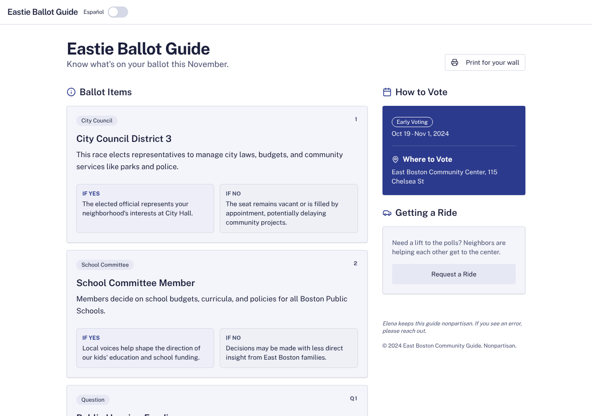

### hs-ballot-guide — gemma-4-26b (trial 2)

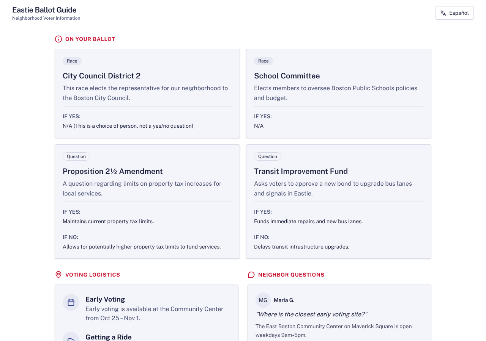

### hs-skill-swap — gemma-4-26b (trial 1)

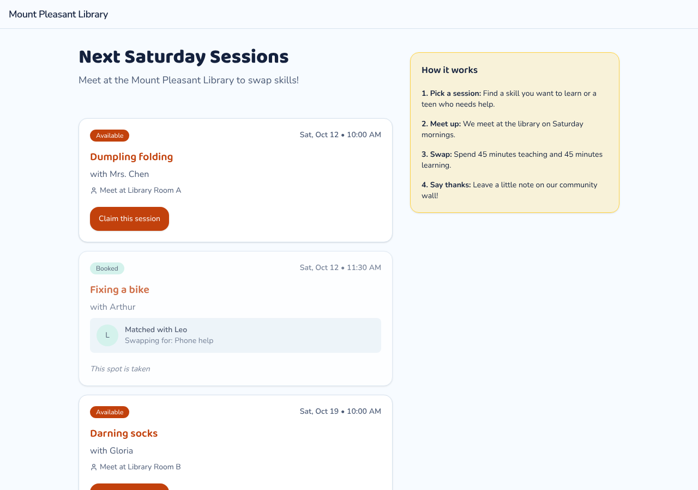

### hs-skill-swap — gemma-4-26b (trial 2)

### hs-bulletin-boards — gemma-4-26b (trial 1)

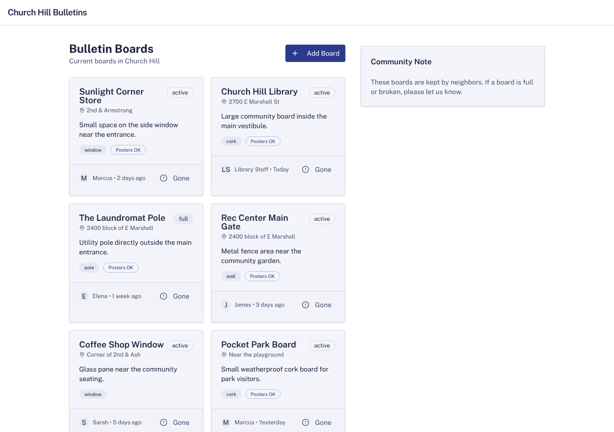

### hs-bulletin-boards — gemma-4-26b (trial 2)

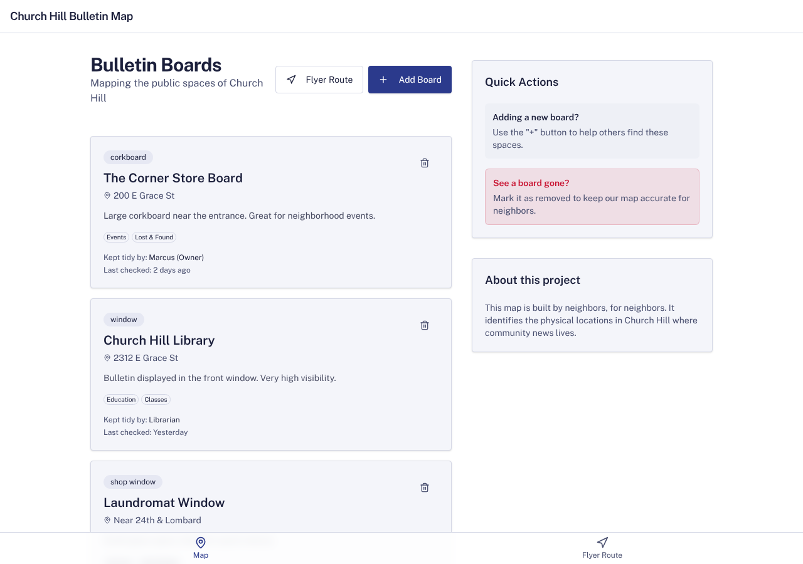
