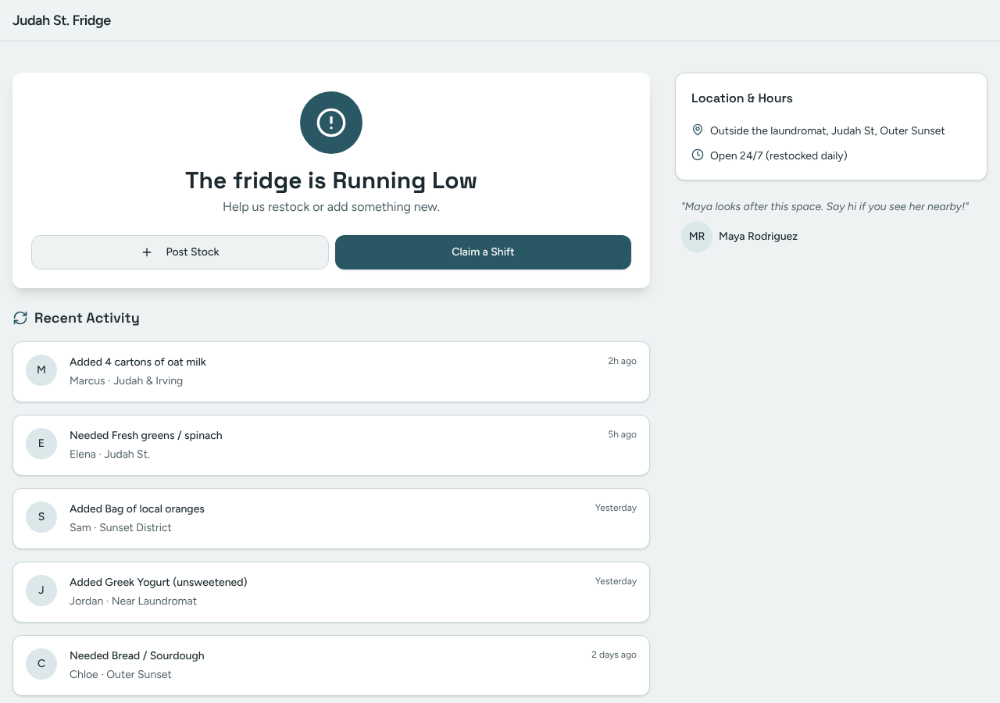
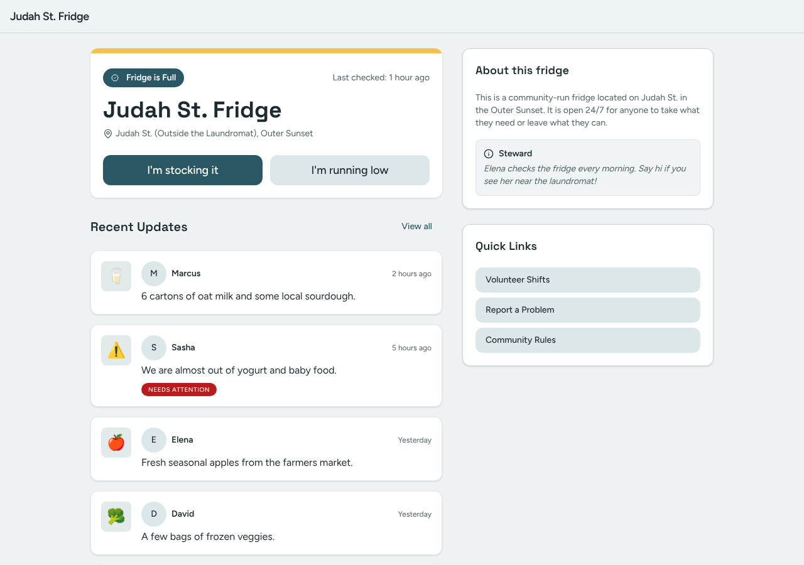
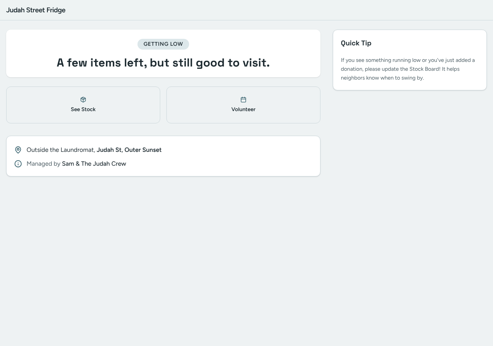
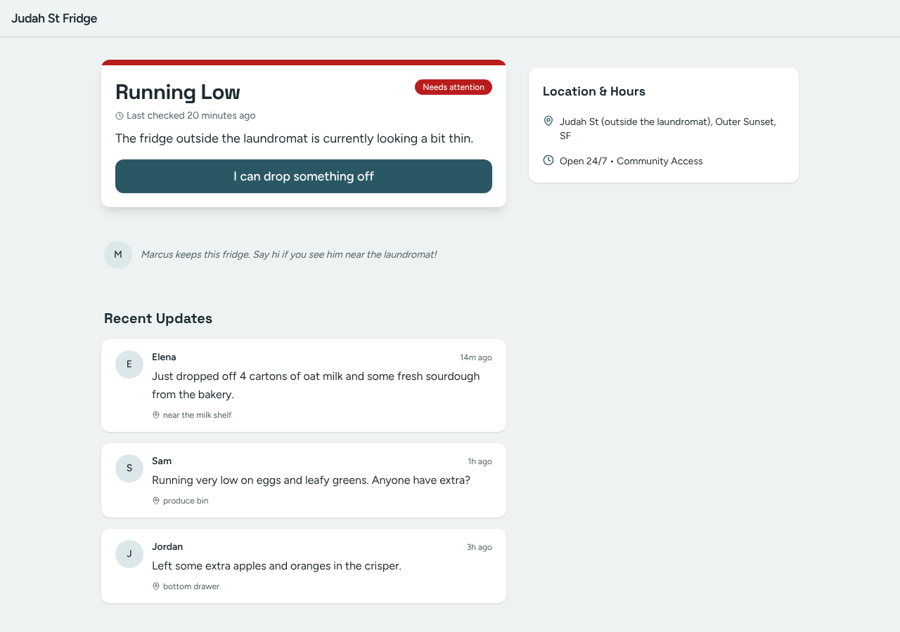
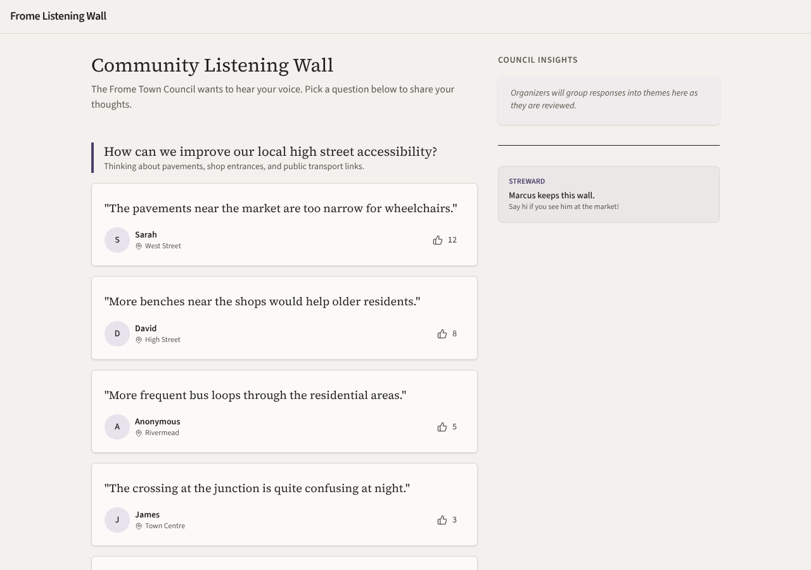
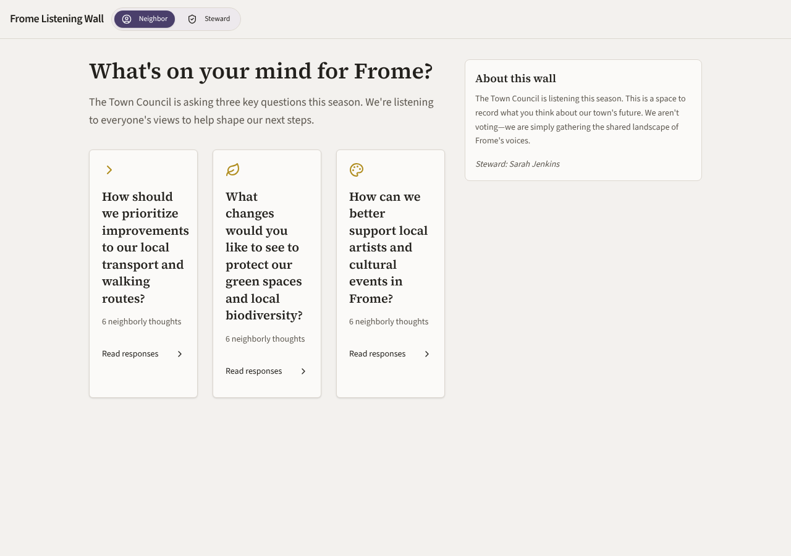
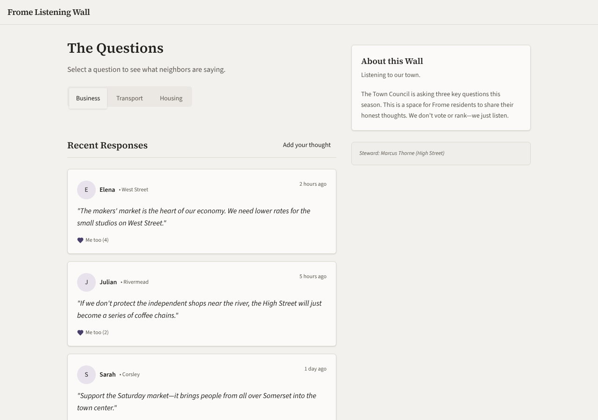
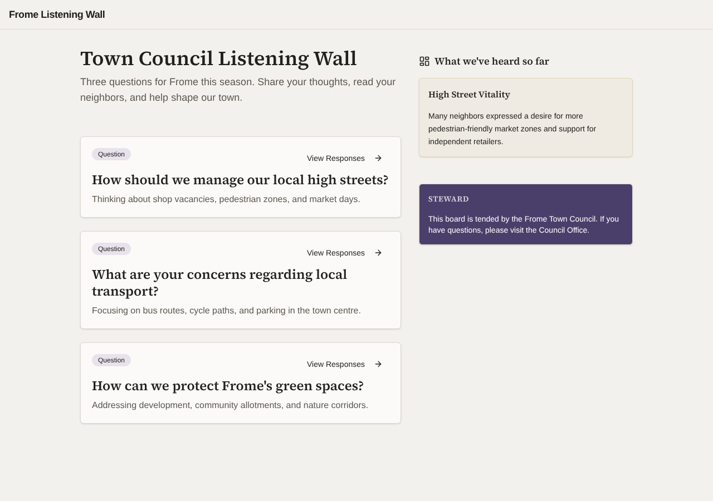

# Model bench — 2026-11-14T11-43-45-16c6ae6-8cr9

- **Tasks:** hs-community-fridge, hs-listening-wall (harness 1.2.0, commit `16c6ae6`)
- **Date:** 2026-11-14T11:57:58.397Z
- **Trials per model per task:** 4
- **Import guard:** on (static import check feeds the fix pass)
- **Human review:** _pending_

> Cost and token figures are **estimates** (chars ÷ 4 × list prices) — directional, not billing-grade.
> Mechanical columns are medians across trials. Total = plan + build wall time.
> **Bundle** = final compile success; **First try** = compiled without the auto-fix; **Renders** = opened in a browser after bundling, visible page and no uncaught errors (n/a before Oct 30, 2026); **Fail kind** = what the first-try bundle error was (missing-file, bad-import, unknown-package, syntax); **Lint/100** = eslint findings per 100 lines with the app's own config; **tsc errors** = type errors in the model's files with the kit merged and uninstalled packages untyped, counted only on builds that bundled, syntax errors kept apart (n/a before Nov 1, 2026); **Largest file**, **any**, **Kit files** (files importing the RB kit over code files) and **tok/s** come from the files the model wrote (n/a before Oct 31, 2026); **Fix time** = the auto-fix pass's own wall time; **Fix** = of the builds that first failed, how many the single auto-fix pass solved. **~$** includes the fix pass when one ran.

### Task: hs-community-fridge (exp-v1)

| Model | Bundle | First try | Renders | Fix | Fail kind | Files | Failed edits | Truncated | Checks | Sec flags | Lint/100 | tsc errors | Largest file | any | Kit files | tok/s | TTFT | Build time | Fix time | Total | ~$ | |
|---|---|---|---|---|---|---|---|---|---|---|---|---|---|---|---|---|---|---|---|---|---|---|
| gemma-4-26b | 4/4 ✓ | 4/4 | 4/4 clean | — | — | 9 | 0 | no | 4.5/5 | 0 | 0.15 | 0 | 100.5 lines | 0 | 4/7 | 91.35 | 1s | 49s | — | 49s | 0.00 |

### Task: hs-listening-wall (exp-v1)

| Model | Bundle | First try | Renders | Fix | Fail kind | Files | Failed edits | Truncated | Checks | Sec flags | Lint/100 | tsc errors | Largest file | any | Kit files | tok/s | TTFT | Build time | Fix time | Total | ~$ | |
|---|---|---|---|---|---|---|---|---|---|---|---|---|---|---|---|---|---|---|---|---|---|---|
| gemma-4-26b | 4/4 ✓ | 1/4 | 4/4 clean | 3/3 solved | missing-file, other | 8.5 | 0 | no | 4/5 | 0 | 0.1 | 0.5 | 131.5 lines | 0 | 3.5/6 | 98.5 | 2s | 57s | 13s | 57s | 0.00 |

## Human review

_Not scored yet — open review/index.html, score, export, save as review/scores.json, re-run report._

## Which model for what

_Maintainer's call, informed by the tables above — the report feeds the decision, it doesn't make it._

## Served as (provider-reported)

- **gemma-4-26b**: google/gemma-4-26b-a4b-it, via NextBit / google/gemma-4-26b-a4b-it, via PrimeIntellect / google/gemma-4-26b-a4b-it, via Parasail / google/gemma-4-26b-a4b-it, via DekaLLM

## Fix passes (how solves went)

- **gemma-4-26b** · hs-listening-wall t1: build failed to bundle → auto-fix solved in one pass (7s, ~$0.00)
  - triggered by: `vfs:/src/App.tsx: Could not find "@/components/layout" in the project (imported from /src/App.tsx)`
- **gemma-4-26b** · hs-listening-wall t3: build failed to bundle → auto-fix solved in one pass (13s, ~$0.00)
  - triggered by: `vfs:/src/store.ts:46: seed text is built in a loop from the index (`text: i % 2 === 0 ? "We need more affordable rents for small makers." : "The Sat`), so it re`
- **gemma-4-26b** · hs-listening-wall t4: build failed to bundle → auto-fix solved in 2 passes (30s, ~$0.00)
  - triggered by: `vfs:/src/store.ts:46: seed text is built in a loop from the index (`text: i % 2 === 0 ? 'More space for the Saturday market would help.' : 'We need `), so it re`

## Previews

### hs-community-fridge — gemma-4-26b (trial 1)

### hs-community-fridge — gemma-4-26b (trial 2)

### hs-community-fridge — gemma-4-26b (trial 3)

### hs-community-fridge — gemma-4-26b (trial 4)

### hs-listening-wall — gemma-4-26b (trial 1)

### hs-listening-wall — gemma-4-26b (trial 2)

### hs-listening-wall — gemma-4-26b (trial 3)

### hs-listening-wall — gemma-4-26b (trial 4)

