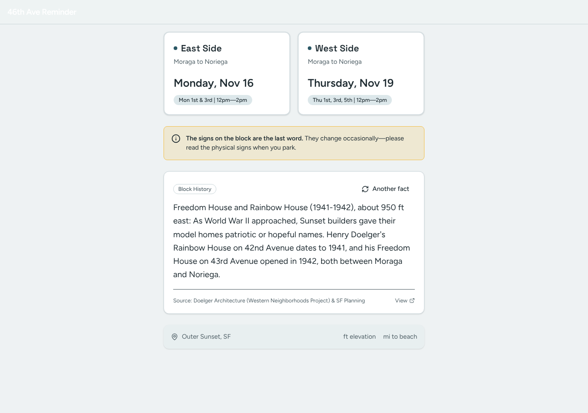
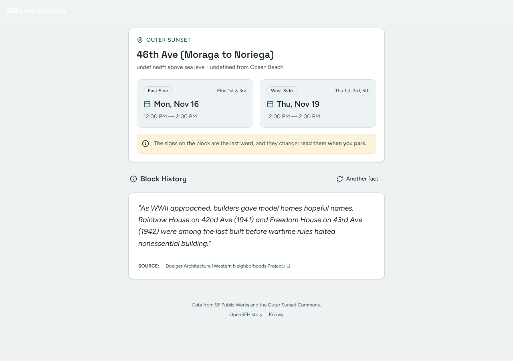

# Model bench — 2026-11-15T05-34-33-c24ef82-1nlo

- **Tasks:** hs-block-sweep (harness 1.2.0, commit `c24ef82`)
- **Date:** 2026-11-15T05:35:44.789Z
- **Trials per model per task:** 3
- **Import guard:** on (static import check feeds the fix pass)
- **Human review:** _pending_

> Cost and token figures are **estimates** (chars ÷ 4 × list prices) — directional, not billing-grade.
> Mechanical columns are medians across trials. Total = plan + build wall time.
> **Bundle** = final compile success; **First try** = compiled without the auto-fix; **Renders** = opened in a browser after bundling, visible page and no uncaught errors (n/a before Oct 30, 2026); **Fail kind** = what the first-try bundle error was (missing-file, bad-import, unknown-package, syntax); **Lint/100** = eslint findings per 100 lines with the app's own config; **tsc errors** = type errors in the model's files with the kit merged and uninstalled packages untyped, counted only on builds that bundled, syntax errors kept apart (n/a before Nov 1, 2026); **Largest file**, **any**, **Kit files** (files importing the RB kit over code files) and **tok/s** come from the files the model wrote (n/a before Oct 31, 2026); **Fix time** = the auto-fix pass's own wall time; **Fix** = of the builds that first failed, how many the single auto-fix pass solved. **~$** includes the fix pass when one ran.

### Task: hs-block-sweep (exp-v1)

| Model | Bundle | First try | Renders | Fix | Fail kind | Files | Failed edits | Truncated | Checks | Sec flags | Lint/100 | tsc errors | Largest file | any | Kit files | tok/s | TTFT | Build time | Fix time | Total | ~$ | |
|---|---|---|---|---|---|---|---|---|---|---|---|---|---|---|---|---|---|---|---|---|---|---|
| gemma-4-31b | 3/3 ✓ | 3/3 | 2/3 clean, 1 blank | — | — | 5 | 0 | no | 4/5 | 0 | 2.1 | 0 | 170 lines | 1 | 1/3 | 272.2 | 2s | 11s | — | 11s | 0.00 |

## Human review

_Not scored yet — open review/index.html, score, export, save as review/scores.json, re-run report._

## Which model for what

_Maintainer's call, informed by the tables above — the report feeds the decision, it doesn't make it._

## Served as (provider-reported)

- **gemma-4-31b**: google/gemma-4-31b-it, via NextBit / google/gemma-4-31b-it, via KT

## In the browser (bundled, but)

- **gemma-4-31b** · hs-block-sweep t1: BLANK PAGE
  - pageerror: Minified React error #299; visit https://reactjs.org/docs/error-decoder.html?invariant=299 for the full message or use the non-minified dev environment for full errors and additional helpful warnings.

## Previews

### hs-block-sweep — gemma-4-31b (trial 1)

### hs-block-sweep — gemma-4-31b (trial 2)

### hs-block-sweep — gemma-4-31b (trial 3)

