# Model bench — 2026-11-15T12-08-39-c0a3123-sm0g

- **Tasks:** remix-income-sharing, remix-gathering-fund, remix-street-stories, remix-tool-lending-seed, hs-story-circle, hs-ballot-guide, hs-skill-swap, hs-bulletin-boards (harness 1.2.0, commit `c0a3123`)
- **Date:** 2026-11-15T12:24:26.073Z
- **Trials per model per task:** 2
- **Import guard:** on (static import check feeds the fix pass)
- **Human review:** _pending_

> Cost and token figures are **estimates** (chars ÷ 4 × list prices) — directional, not billing-grade.
> Mechanical columns are medians across trials. Total = plan + build wall time.
> **Bundle** = final compile success; **First try** = compiled without the auto-fix; **Renders** = opened in a browser after bundling, visible page and no uncaught errors (n/a before Oct 30, 2026); **Fail kind** = what the first-try bundle error was (missing-file, bad-import, unknown-package, syntax); **Lint/100** = eslint findings per 100 lines with the app's own config; **tsc errors** = type errors in the model's files with the kit merged and uninstalled packages untyped, counted only on builds that bundled, syntax errors kept apart (n/a before Nov 1, 2026); **Largest file**, **any**, **Kit files** (files importing the RB kit over code files) and **tok/s** come from the files the model wrote (n/a before Oct 31, 2026); **Fix time** = the auto-fix pass's own wall time; **Fix** = of the builds that first failed, how many the single auto-fix pass solved. **~$** includes the fix pass when one ran.

### Task: remix-income-sharing (exp-v1)

| Model | Bundle | First try | Renders | Fix | Fail kind | Files | Failed edits | Truncated | Checks | Sec flags | Lint/100 | tsc errors | Largest file | any | Kit files | tok/s | TTFT | Build time | Fix time | Total | ~$ | |
|---|---|---|---|---|---|---|---|---|---|---|---|---|---|---|---|---|---|---|---|---|---|---|
| gemma-4-31b | 2/2 ✓ | 2/2 | 2/2 clean | — | — | 7.5 | 0 | no | 4.5/5 | 0 | 0.6 | 0.5 | 201 lines | 2 | 2.5/5.5 | 172.5 | 4s | 39s | — | 39s | 0.01 |

### Task: remix-gathering-fund (exp-v1)

| Model | Bundle | First try | Renders | Fix | Fail kind | Files | Failed edits | Truncated | Checks | Sec flags | Lint/100 | tsc errors | Largest file | any | Kit files | tok/s | TTFT | Build time | Fix time | Total | ~$ | |
|---|---|---|---|---|---|---|---|---|---|---|---|---|---|---|---|---|---|---|---|---|---|---|
| gemma-4-31b | 2/2 ✓ | 1/2 | 2/2 clean | 1/1 solved | syntax | 8.5 | 0 | no | 5/5 | 0 | 0 | 0 | 108 lines | 0 | 3.5/6 | 51.55 | 3s | 91s | 5s | 91s | 0.01 |

### Task: remix-street-stories (exp-v1)

| Model | Bundle | First try | Renders | Fix | Fail kind | Files | Failed edits | Truncated | Checks | Sec flags | Lint/100 | tsc errors | Largest file | any | Kit files | tok/s | TTFT | Build time | Fix time | Total | ~$ | |
|---|---|---|---|---|---|---|---|---|---|---|---|---|---|---|---|---|---|---|---|---|---|---|
| gemma-4-31b | 2/2 ✓ | 2/2 | 2/2 clean | — | — | 8 | 0 | no | 5/5 | 0 | 0 | 0 | 110 lines | 0 | 4/6 | 326.1 | 2s | 15s | — | 15s | 0.01 |

### Task: remix-tool-lending-seed (exp-v1)

| Model | Bundle | First try | Renders | Fix | Fail kind | Files | Failed edits | Truncated | Checks | Sec flags | Lint/100 | tsc errors | Largest file | any | Kit files | tok/s | TTFT | Build time | Fix time | Total | ~$ | |
|---|---|---|---|---|---|---|---|---|---|---|---|---|---|---|---|---|---|---|---|---|---|---|
| gemma-4-31b | 2/2 ✓ | 2/2 | 2/2 clean | — | — | 7.5 | 0 | no | 4.5/5 | 0 | 1.65 | 0.5 | 177 lines | 0 | 2/5.5 | 53 | 2s | 98s | — | 98s | 0.01 |

### Task: hs-story-circle (exp-v1)

| Model | Bundle | First try | Renders | Fix | Fail kind | Files | Failed edits | Truncated | Checks | Sec flags | Lint/100 | tsc errors | Largest file | any | Kit files | tok/s | TTFT | Build time | Fix time | Total | ~$ | |
|---|---|---|---|---|---|---|---|---|---|---|---|---|---|---|---|---|---|---|---|---|---|---|
| gemma-4-31b | 2/2 ✓ | 1/2 | 2/2 clean | 1/1 solved | other | 7.5 | 0 | no | 4/5 | 0 | 1.1 | 1.5 | 230 lines | 3 | 2.5/5 | 63.15 | 2s | 82s | 12s | 82s | 0.01 |

### Task: hs-ballot-guide (exp-v1)

| Model | Bundle | First try | Renders | Fix | Fail kind | Files | Failed edits | Truncated | Checks | Sec flags | Lint/100 | tsc errors | Largest file | any | Kit files | tok/s | TTFT | Build time | Fix time | Total | ~$ | |
|---|---|---|---|---|---|---|---|---|---|---|---|---|---|---|---|---|---|---|---|---|---|---|
| gemma-4-31b | 2/2 ✓ | 1/2 | 2/2 clean | 1/1 solved | missing-file | 9 | 0 | no | 4.5/5 | 0 | 0.1 | 0 | 130 lines | 0 | 2/7 | 188.10000000000002 | 3s | 42s | 5s | 42s | 0.01 |

### Task: hs-skill-swap (exp-v1)

| Model | Bundle | First try | Renders | Fix | Fail kind | Files | Failed edits | Truncated | Checks | Sec flags | Lint/100 | tsc errors | Largest file | any | Kit files | tok/s | TTFT | Build time | Fix time | Total | ~$ | |
|---|---|---|---|---|---|---|---|---|---|---|---|---|---|---|---|---|---|---|---|---|---|---|
| gemma-4-31b | 2/2 ✓ | 2/2 | 1/2 clean, 1 blank | — | — | 6.5 | 0 | no | 4/5 | 0 | 0.3 | 6 | 178.5 lines | 0 | 2/4.5 | 150.85 | 4s | 50s | — | 50s | 0.00 |

### Task: hs-bulletin-boards (exp-v1)

| Model | Bundle | First try | Renders | Fix | Fail kind | Files | Failed edits | Truncated | Checks | Sec flags | Lint/100 | tsc errors | Largest file | any | Kit files | tok/s | TTFT | Build time | Fix time | Total | ~$ | |
|---|---|---|---|---|---|---|---|---|---|---|---|---|---|---|---|---|---|---|---|---|---|---|
| gemma-4-31b | 2/2 ✓ | 2/2 | 2/2 clean | — | — | 10 | 0 | no | 4/5 | 0 | 0.2 | 4 | 184 lines | 1 | 4/8 | 286.95 | 4s | 21s | — | 21s | 0.01 |

## Human review

_Not scored yet — open review/index.html, score, export, save as review/scores.json, re-run report._

## Which model for what

_Maintainer's call, informed by the tables above — the report feeds the decision, it doesn't make it._

## Served as (provider-reported)

- **gemma-4-31b**: google/gemma-4-31b-it, via KT / google/gemma-4-31b-it, via CoreWeave / google/gemma-4-31b-it, via NextBit

## In the browser (bundled, but)

- **gemma-4-31b** · hs-skill-swap t2: BLANK PAGE
  - pageerror: (intermediate value) is not a constructor

## Fix passes (how solves went)

- **gemma-4-31b** · remix-gathering-fund t2: build failed to bundle → auto-fix solved in one pass (5s, ~$0.00)
  - triggered by: `vfs:/src/data/seed.ts:19: Expected "}" but found "\"Start the spring early. Share seeds, soil, and tips for the coming garden season in a cozy living room.\""`
- **gemma-4-31b** · hs-story-circle t1: build failed to bundle → auto-fix solved in one pass (12s, ~$0.01)
  - triggered by: `vfs:/src/App.tsx:141: Unexpected closing "BH" tag does not match opening "Badge" tag`
- **gemma-4-31b** · hs-ballot-guide t2: build failed to bundle → auto-fix solved in one pass (5s, ~$0.00)
  - triggered by: `vfs:/src/App.tsx:20: Could not find "@/components/ui" in the project (imported from /src/App.tsx)`

## Previews

### remix-income-sharing — gemma-4-31b (trial 1)

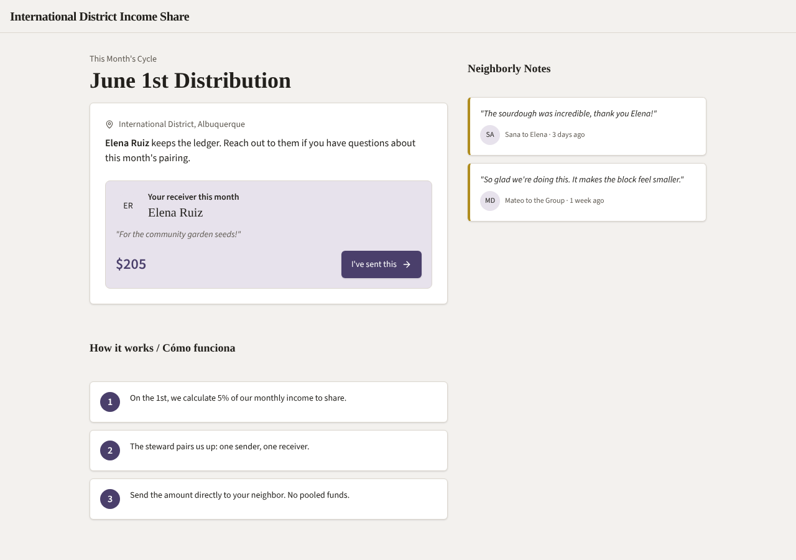

### remix-income-sharing — gemma-4-31b (trial 2)

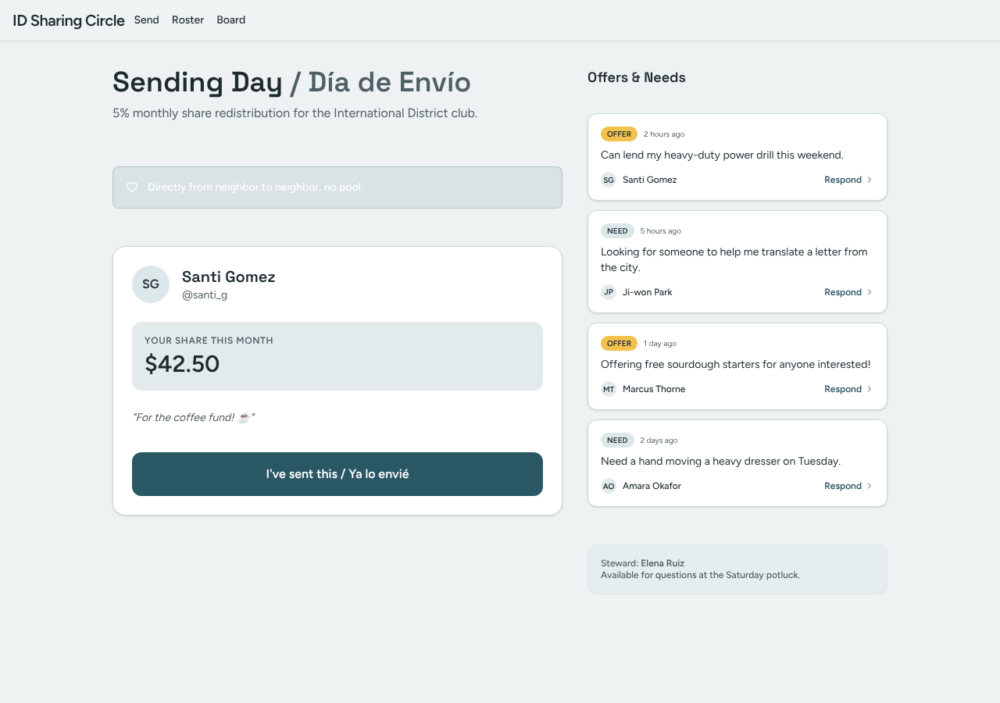

### remix-gathering-fund — gemma-4-31b (trial 1)

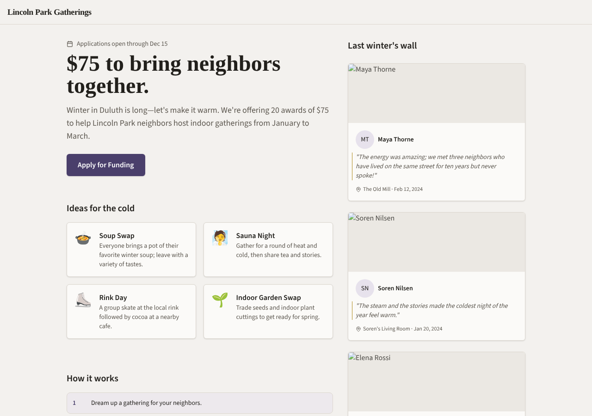

### remix-gathering-fund — gemma-4-31b (trial 2)

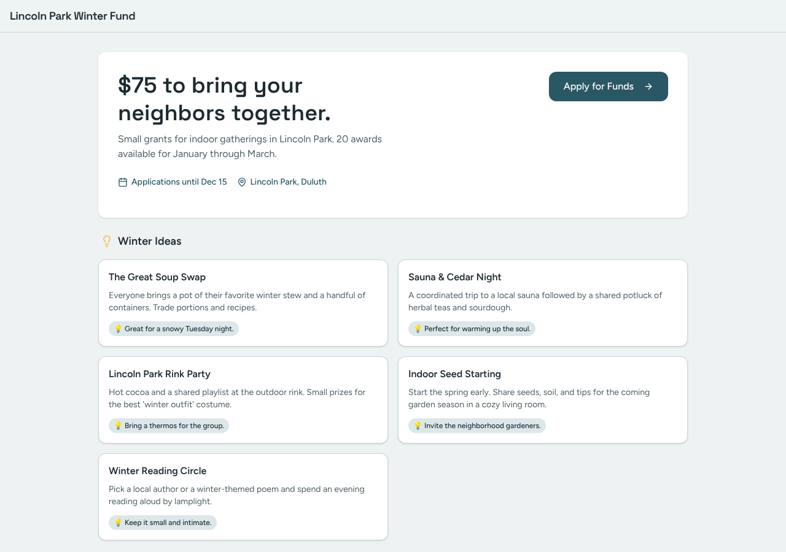

### remix-street-stories — gemma-4-31b (trial 1)

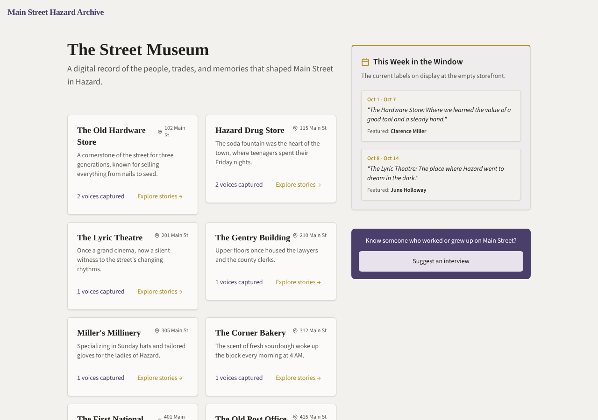

### remix-street-stories — gemma-4-31b (trial 2)

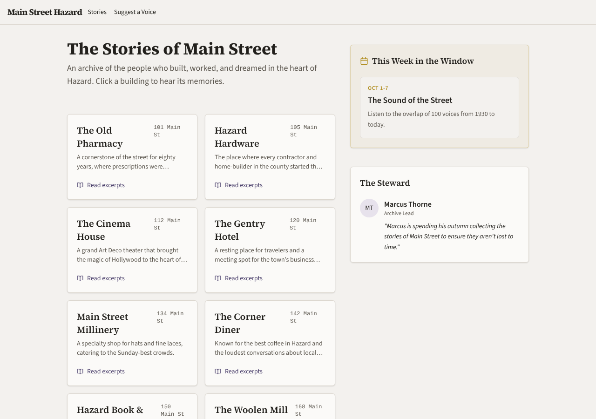

### remix-tool-lending-seed — gemma-4-31b (trial 1)

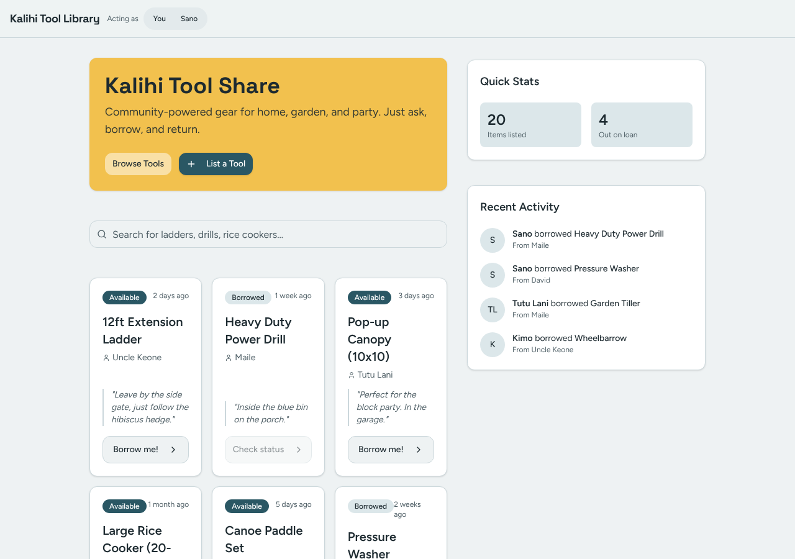

### remix-tool-lending-seed — gemma-4-31b (trial 2)

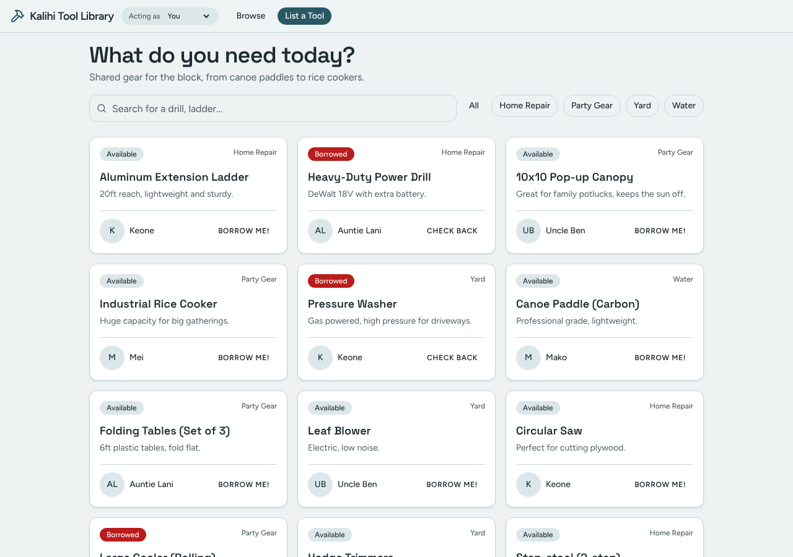

### hs-story-circle — gemma-4-31b (trial 1)

### hs-story-circle — gemma-4-31b (trial 2)

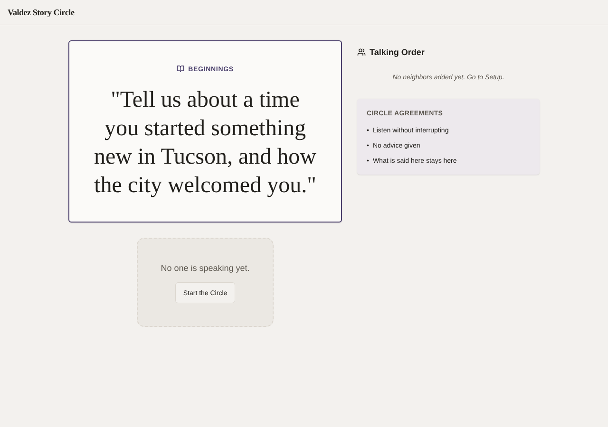

### hs-ballot-guide — gemma-4-31b (trial 1)

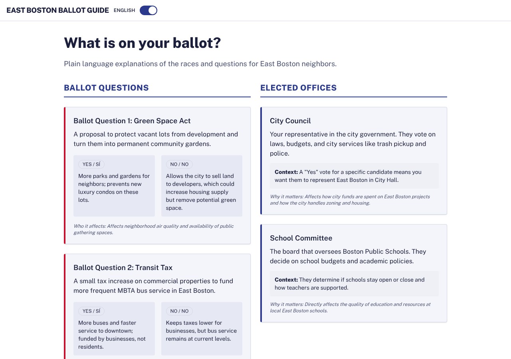

### hs-ballot-guide — gemma-4-31b (trial 2)

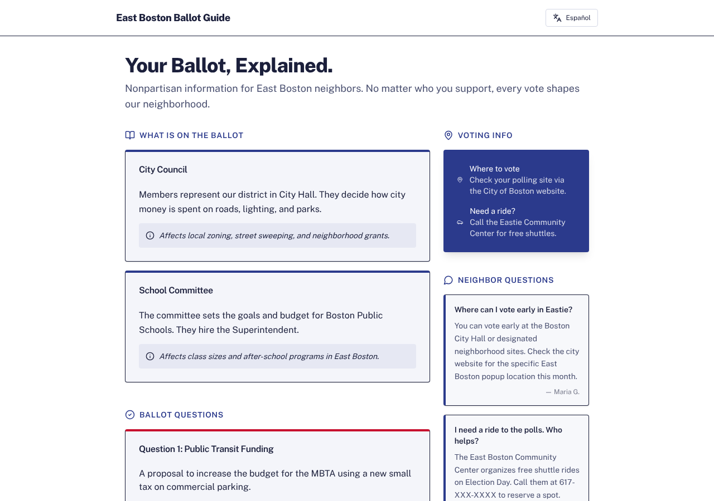

### hs-skill-swap — gemma-4-31b (trial 1)

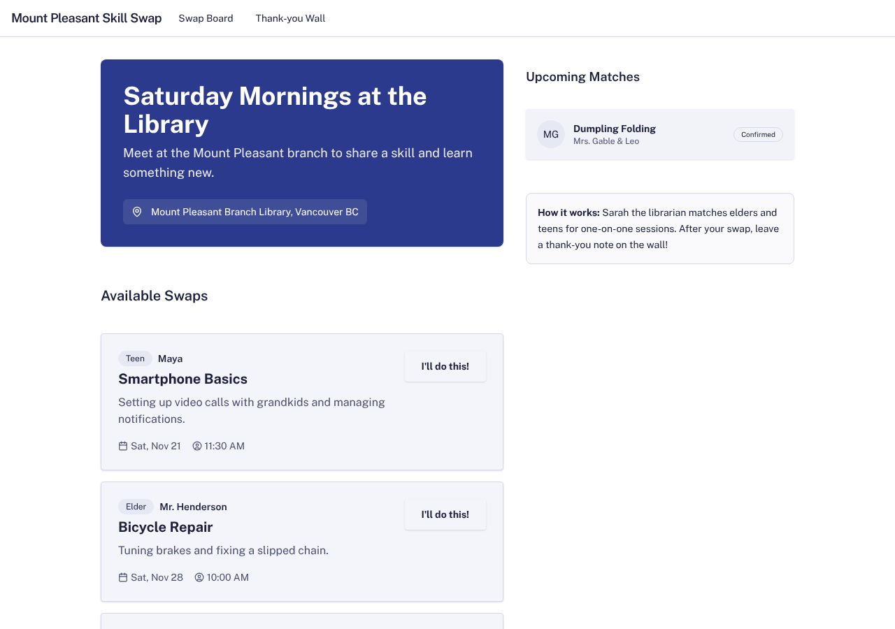

### hs-skill-swap — gemma-4-31b (trial 2)

### hs-bulletin-boards — gemma-4-31b (trial 1)

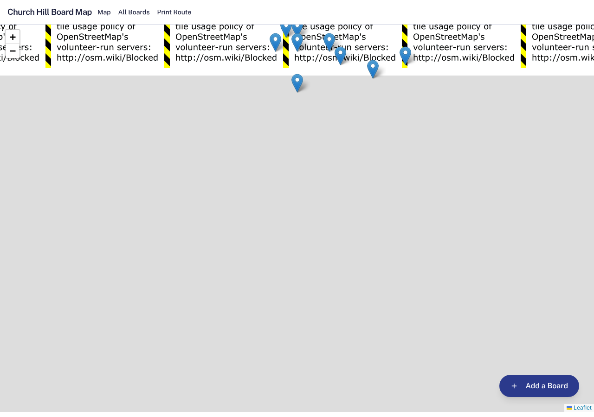

### hs-bulletin-boards — gemma-4-31b (trial 2)

