# Model bench — 2026-11-15T22-09-57-bbce2fd-55bl

- **Tasks:** hs-community-fridge, hs-listening-wall, remix-income-sharing, hs-ballot-guide, remix-street-stories, hs-skill-swap (harness 1.2.0, commit `bbce2fd`)
- **Date:** 2026-11-15T22:20:13.783Z
- **Trials per model per task:** 2
- **Import guard:** on (static import check feeds the fix pass)
- **Human review:** _pending_

> Cost and token figures are **estimates** (chars ÷ 4 × list prices) — directional, not billing-grade.
> Mechanical columns are medians across trials. Total = plan + build wall time.
> **Bundle** = final compile success; **First try** = compiled without the auto-fix; **Renders** = opened in a browser after bundling, visible page and no uncaught errors (n/a before Oct 30, 2026); **Fail kind** = what the first-try bundle error was (missing-file, bad-import, unknown-package, syntax); **Lint/100** = eslint findings per 100 lines with the app's own config; **tsc errors** = type errors in the model's files with the kit merged and uninstalled packages untyped, counted only on builds that bundled, syntax errors kept apart (n/a before Nov 1, 2026); **Largest file**, **any**, **Kit files** (files importing the RB kit over code files) and **tok/s** come from the files the model wrote (n/a before Oct 31, 2026); **Fix time** = the auto-fix pass's own wall time; **Fix** = of the builds that first failed, how many the single auto-fix pass solved. **~$** includes the fix pass when one ran.

### Task: hs-community-fridge (exp-v1)

| Model | Bundle | First try | Renders | Fix | Fail kind | Files | Failed edits | Truncated | Checks | Sec flags | Lint/100 | tsc errors | Largest file | any | Kit files | tok/s | TTFT | Build time | Fix time | Total | ~$ | |
|---|---|---|---|---|---|---|---|---|---|---|---|---|---|---|---|---|---|---|---|---|---|---|
| gemma-4-31b | 2/2 ✓ | 2/2 | 2/2 clean | — | — | 7 | 0 | no | 5/5 | 0 | 0.4 | 2 | 227.5 lines | 0 | 2.5/5 | 74.75 | 2s | 63s | — | 63s | 0.01 |

### Task: hs-listening-wall (exp-v1)

| Model | Bundle | First try | Renders | Fix | Fail kind | Files | Failed edits | Truncated | Checks | Sec flags | Lint/100 | tsc errors | Largest file | any | Kit files | tok/s | TTFT | Build time | Fix time | Total | ~$ | |
|---|---|---|---|---|---|---|---|---|---|---|---|---|---|---|---|---|---|---|---|---|---|---|
| gemma-4-31b | 2/2 ✓ | 1/2 | 2/2 clean | 1/1 solved | other | 7.5 | 0 | no | 4/5 | 0 | 0.85 | 1 | 228 lines | 2.5 | 2/5 | 145.2 | 4s | 67s | 23s | 67s | 0.01 |

### Task: remix-income-sharing (exp-v1)

| Model | Bundle | First try | Renders | Fix | Fail kind | Files | Failed edits | Truncated | Checks | Sec flags | Lint/100 | tsc errors | Largest file | any | Kit files | tok/s | TTFT | Build time | Fix time | Total | ~$ | |
|---|---|---|---|---|---|---|---|---|---|---|---|---|---|---|---|---|---|---|---|---|---|---|
| gemma-4-31b | 2/2 ✓ | 2/2 | 2/2 clean | — | — | 9.5 | 0 | no | 4.5/5 | 0 | 0.44999999999999996 | 4 | 119.5 lines | 0 | 4/7.5 | 180.9 | 3s | 47s | — | 47s | 0.01 |

### Task: hs-ballot-guide (exp-v1)

| Model | Bundle | First try | Renders | Fix | Fail kind | Files | Failed edits | Truncated | Checks | Sec flags | Lint/100 | tsc errors | Largest file | any | Kit files | tok/s | TTFT | Build time | Fix time | Total | ~$ | |
|---|---|---|---|---|---|---|---|---|---|---|---|---|---|---|---|---|---|---|---|---|---|---|
| gemma-4-31b | 2/2 ✓ | 1/2 | 2/2 clean | 1/1 solved | missing-file | 8.5 | 0 | no | 4.5/5 | 0 | 0.3 | 4 | 195.5 lines | 0 | 0.5/6 | 195.05 | 3s | 48s | 11s | 48s | 0.01 |

### Task: remix-street-stories (exp-v1)

| Model | Bundle | First try | Renders | Fix | Fail kind | Files | Failed edits | Truncated | Checks | Sec flags | Lint/100 | tsc errors | Largest file | any | Kit files | tok/s | TTFT | Build time | Fix time | Total | ~$ | |
|---|---|---|---|---|---|---|---|---|---|---|---|---|---|---|---|---|---|---|---|---|---|---|
| gemma-4-31b | 2/2 ✓ | 1/2 | 2/2 clean | 1/1 solved | other | 9.5 | 0 | no | 5/5 | 0 | 0 | 1 | 145 lines | 0 | 4.5/6.5 | 308.9 | 2s | 17s | 5s | 17s | 0.01 |

### Task: hs-skill-swap (exp-v1)

| Model | Bundle | First try | Renders | Fix | Fail kind | Files | Failed edits | Truncated | Checks | Sec flags | Lint/100 | tsc errors | Largest file | any | Kit files | tok/s | TTFT | Build time | Fix time | Total | ~$ | |
|---|---|---|---|---|---|---|---|---|---|---|---|---|---|---|---|---|---|---|---|---|---|---|
| gemma-4-31b | 2/2 ✓ | 2/2 | 2/2 clean | — | — | 6 | 0 | no | 4/5 | 0 | 0.3 | 2 | 185 lines | 0 | 2/4 | 315.7 | 3s | 13s | — | 13s | 0.01 |

## Human review

_Not scored yet — open review/index.html, score, export, save as review/scores.json, re-run report._

## Which model for what

_Maintainer's call, informed by the tables above — the report feeds the decision, it doesn't make it._

## Served as (provider-reported)

- **gemma-4-31b**: google/gemma-4-31b-it, via CoreWeave / google/gemma-4-31b-it, via KT

## Fix passes (how solves went)

- **gemma-4-31b** · hs-listening-wall t1: build failed to bundle → auto-fix solved in one pass (23s, ~$0.00)
  - triggered by: `vfs:/src/data/seed.ts:92: seed text is built in a loop from the index (`text: texts[i % 10],`), so it reads as filler; write each item's words by hand`
- **gemma-4-31b** · hs-ballot-guide t1: build failed to bundle → auto-fix solved in one pass (11s, ~$0.01)
  - triggered by: `vfs:/src/App.tsx:22: Could not find "@/components/ui" in the project (imported from /src/App.tsx)`
- **gemma-4-31b** · remix-street-stories t2: build failed to bundle → auto-fix solved in one pass (5s, ~$0.00)
  - triggered by: `vfs:/src/App.tsx: a router is rendered in 2 files (/src/main.tsx, /src/App.tsx); render one HashRouter only, in one of them`

## Previews

### hs-community-fridge — gemma-4-31b (trial 1)

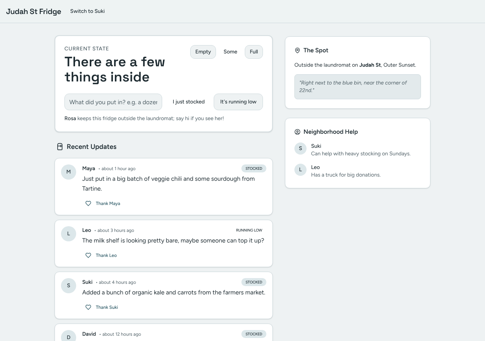

### hs-community-fridge — gemma-4-31b (trial 2)

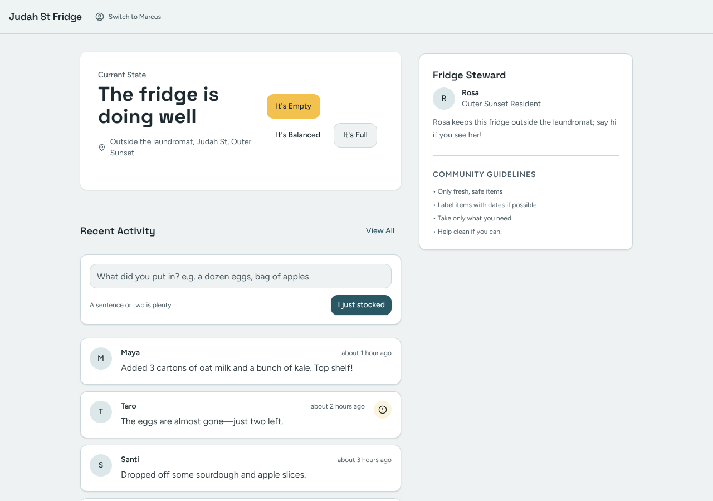

### hs-listening-wall — gemma-4-31b (trial 1)

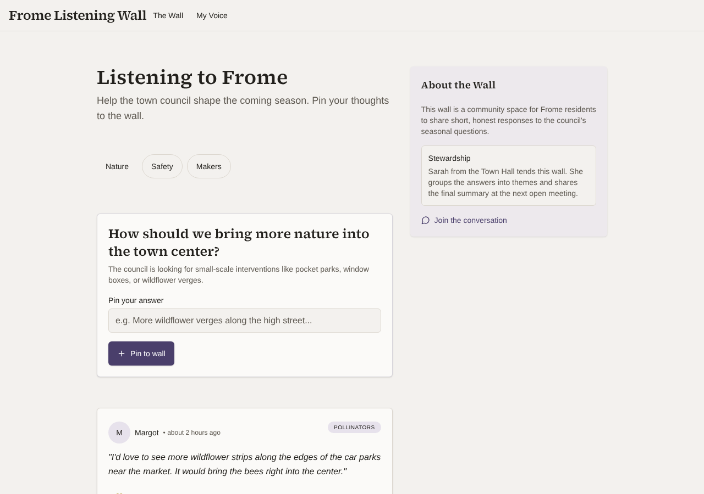

### hs-listening-wall — gemma-4-31b (trial 2)

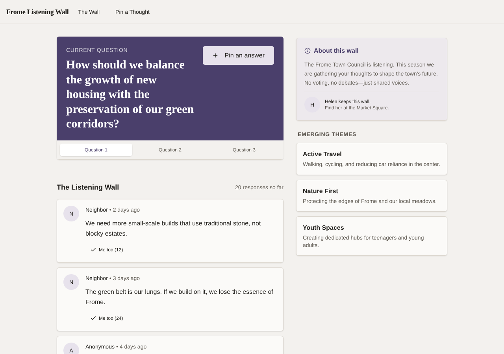

### remix-income-sharing — gemma-4-31b (trial 1)

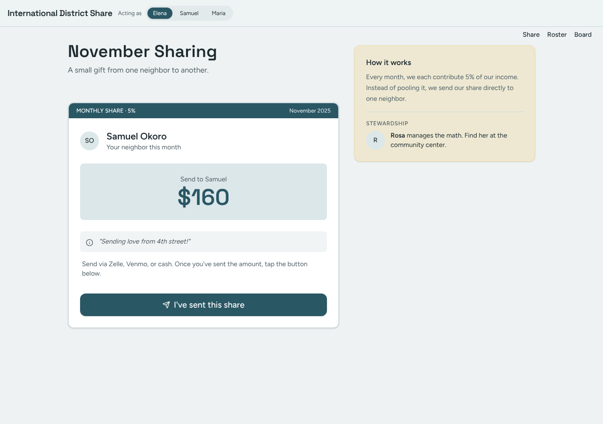

### remix-income-sharing — gemma-4-31b (trial 2)

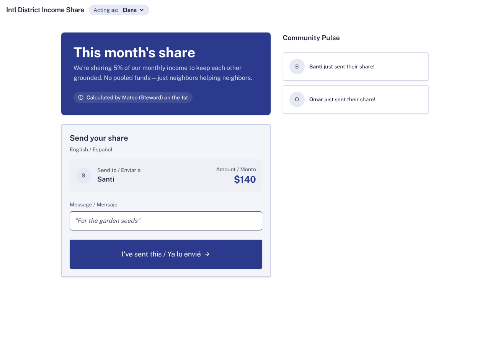

### hs-ballot-guide — gemma-4-31b (trial 1)

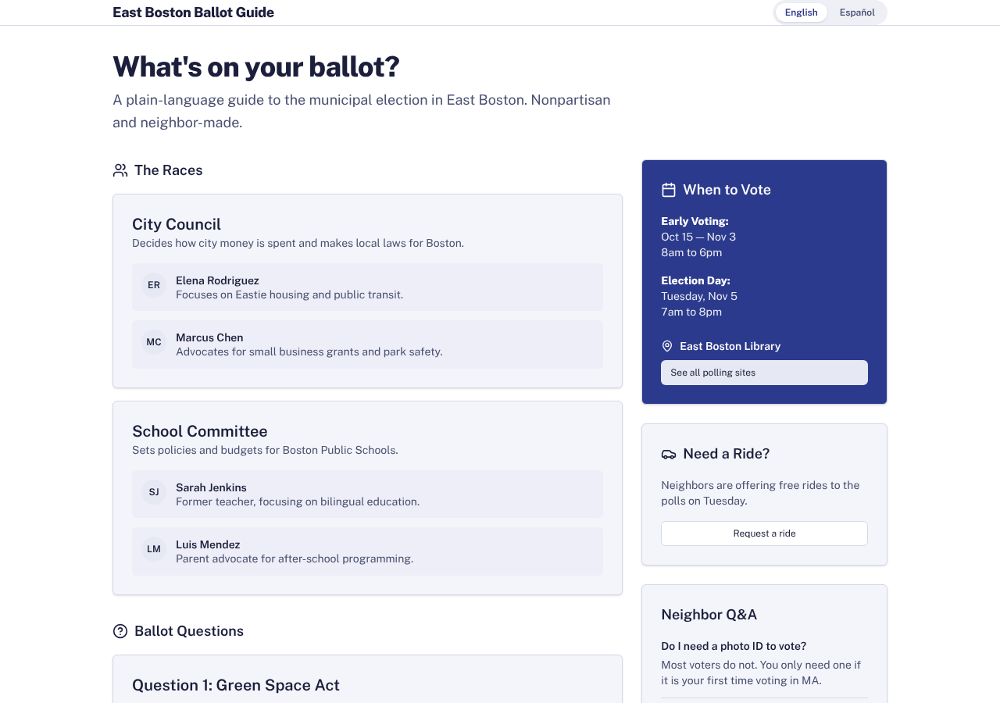

### hs-ballot-guide — gemma-4-31b (trial 2)

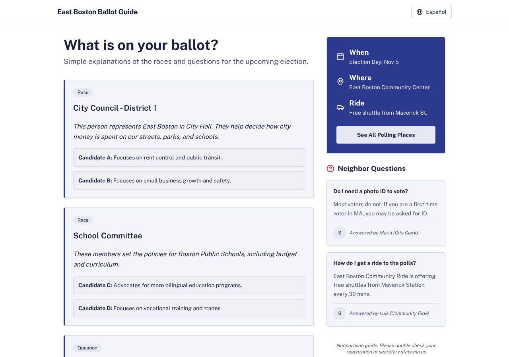

### remix-street-stories — gemma-4-31b (trial 1)

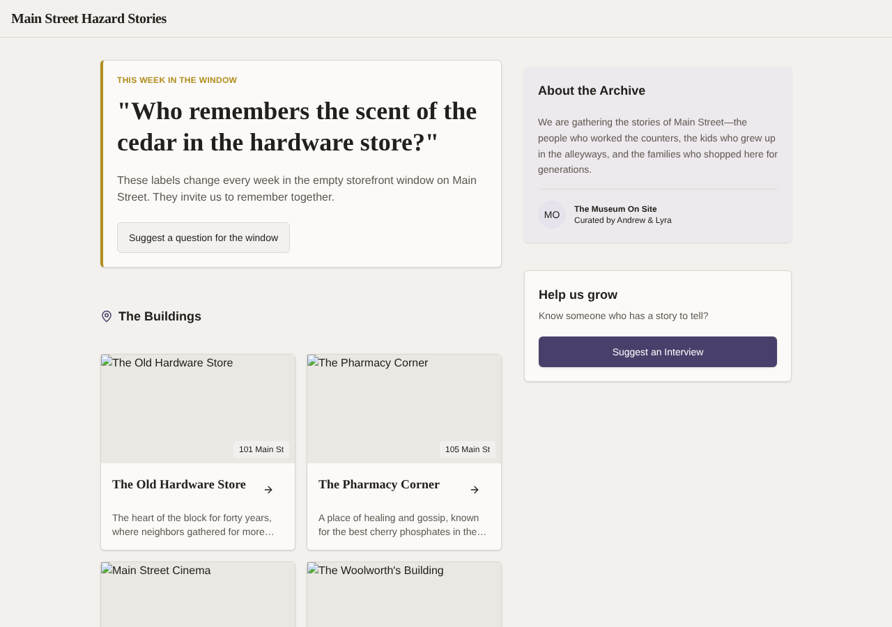

### remix-street-stories — gemma-4-31b (trial 2)

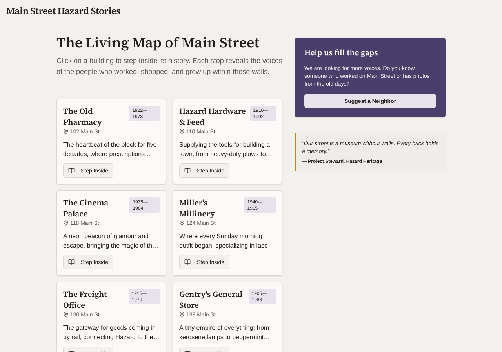

### hs-skill-swap — gemma-4-31b (trial 1)

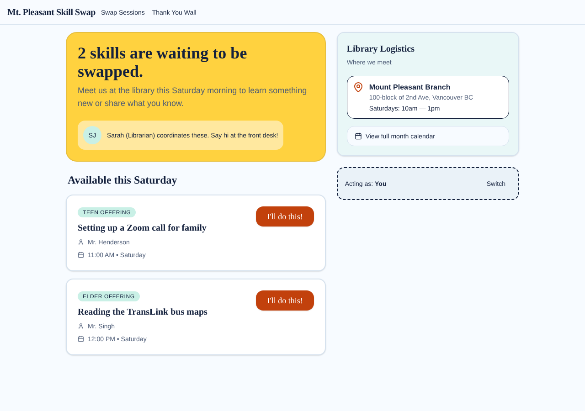

### hs-skill-swap — gemma-4-31b (trial 2)

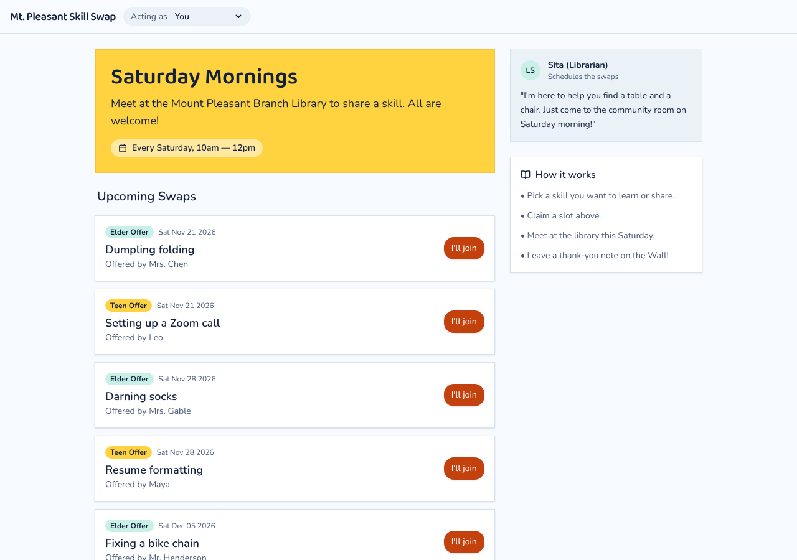
