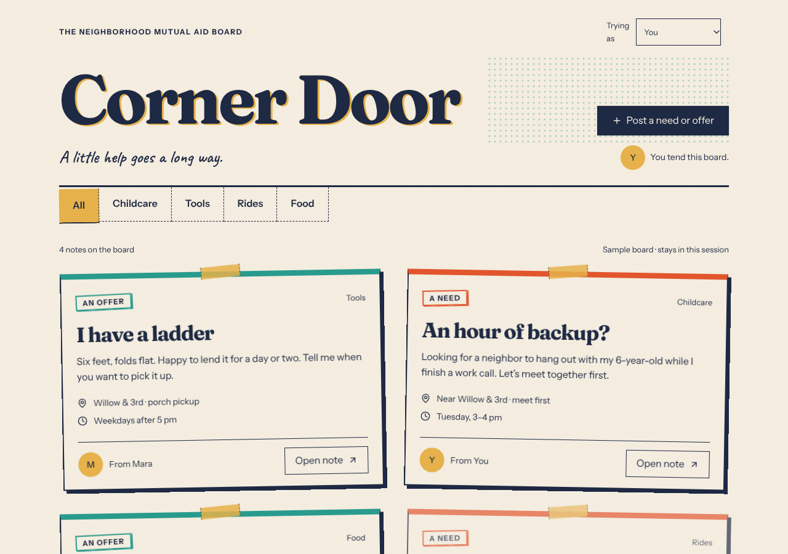
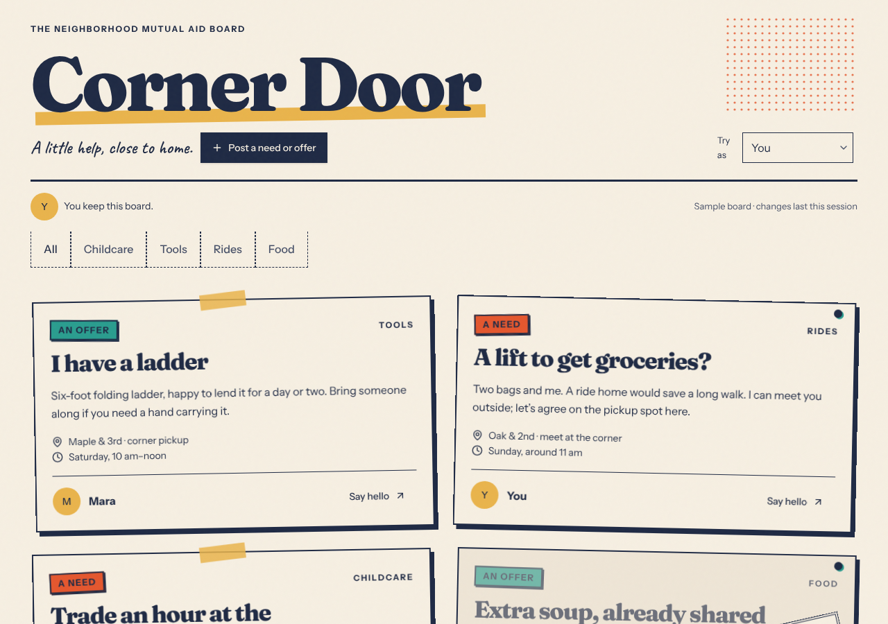
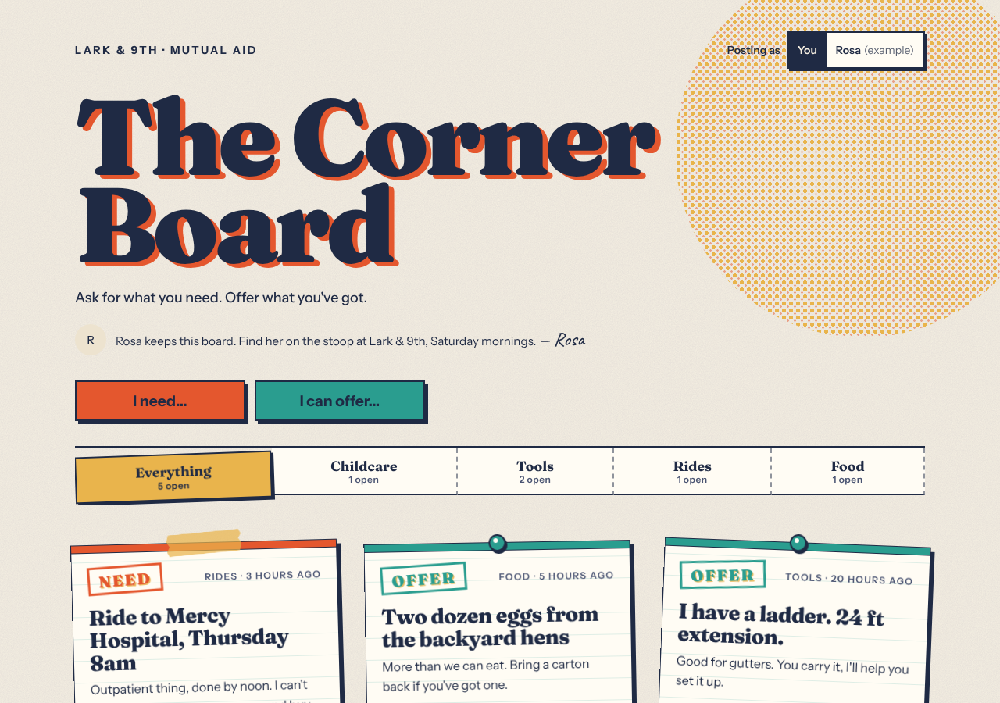
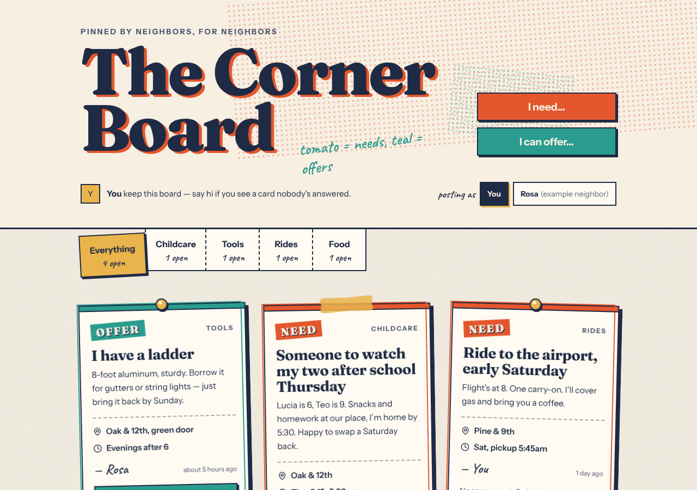

# Model bench — 2026-11-15T23-07-544b571

- **Tasks:** mutual-aid-board-directed (harness 1.2.0, commit `544b571`)
- **Date:** 2026-11-15T23:20:40.472Z
- **Trials per model per task:** 2
- **Human review:** scored by first

> Cost and token figures are **estimates** (chars ÷ 4 × list prices) — directional, not billing-grade.
> Mechanical columns are medians across trials. Total = plan + build wall time.
> **Bundle** = final compile success; **First try** = compiled without the auto-fix; **Fix** = of the builds that first failed, how many the single auto-fix pass solved. **~$** includes the fix pass when one ran.

### Task: mutual-aid-board-directed (exp-v1)

| Model | Bundle | First try | Fix | Files | Failed edits | Truncated | Checks | Sec flags | TTFT | Build time | Total | ~$ | |
|---|---|---|---|---|---|---|---|---|---|---|---|---|---|
| pareto | 2/2 ✓ | 2/2 | — | 8 | 0 | no | 4.5/5 | 0 | 143s | 143s | 143s | 0.03 |
| claude-opus-5-5 | 2/2 ✓ | 2/2 | — | 10 | 0 | no | 5/5 | 0 | 227s | 382s | 382s | 0.32 |

## Human review

| Model | Design | RTP fit | Complete | Rank |
|---|---|---|---|---|
| pareto | 4 | 4 | 4 | #1 |
| claude-opus-5-5 | 4 | 4 | 5 | #2 |

## Which model for what

_Maintainer's call, informed by the tables above — the report feeds the decision, it doesn't make it._

## Previews

### mutual-aid-board-directed — pareto (trial 1)

### mutual-aid-board-directed — pareto (trial 2)

### mutual-aid-board-directed — claude-opus-5-5 (trial 1)

### mutual-aid-board-directed — claude-opus-5-5 (trial 2)

