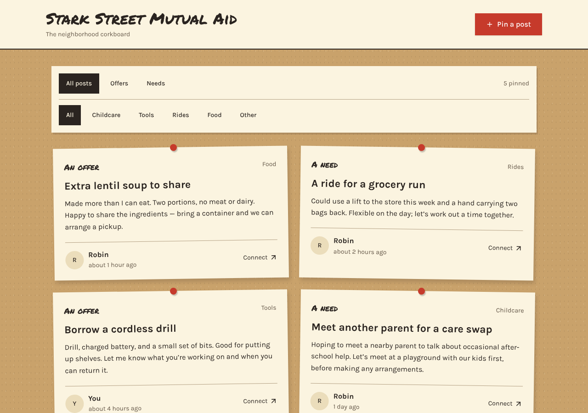
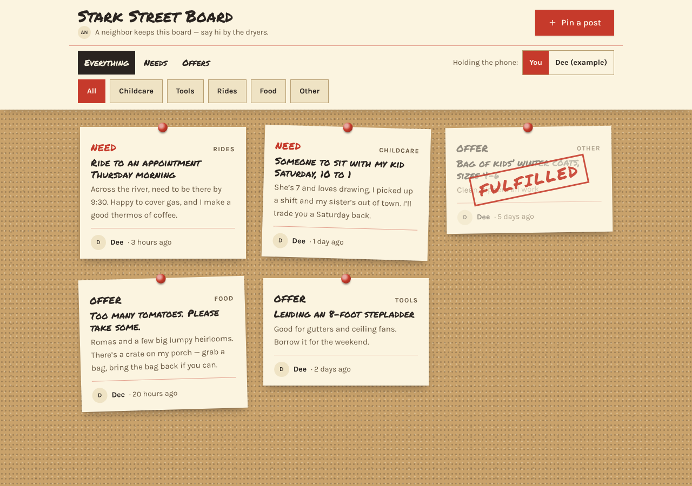
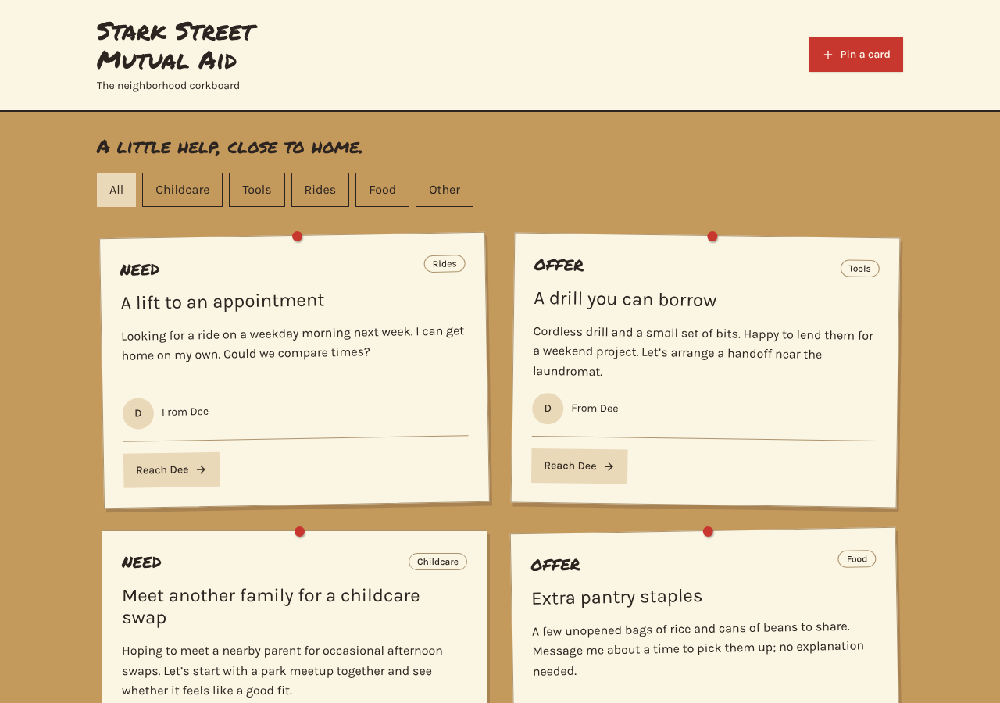
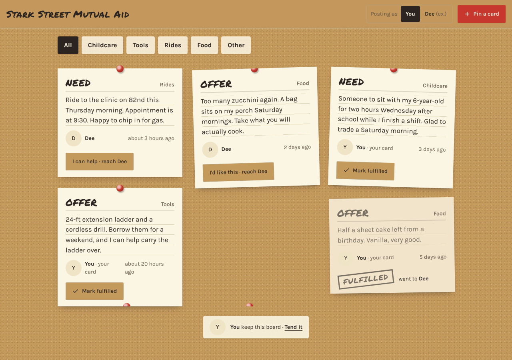

# Model bench — 2026-11-15T23-21-dd53095

- **Tasks:** mutual-aid-board-planned (harness 1.2.0, commit `dd53095`)
- **Date:** 2026-11-15T23:29:34.239Z
- **Trials per model per task:** 2 · **plan-first flow** (plan-mode reply precedes each build, drafted by **claude-fable-5-2** at high effort, one shared plan per trial; ~$ includes it)
- **Human review:** _pending_

> Cost and token figures are **estimates** (chars ÷ 4 × list prices) — directional, not billing-grade.
> Mechanical columns are medians across trials. Total = plan + build wall time.
> **Bundle** = final compile success; **First try** = compiled without the auto-fix; **Fix** = of the builds that first failed, how many the single auto-fix pass solved. **~$** includes the fix pass when one ran.

### Task: mutual-aid-board-planned (exp-v1)

| Model | Bundle | First try | Fix | Files | Failed edits | Truncated | Checks | Sec flags | TTFT | Plan time | Build time | Total | ~$ | |
|---|---|---|---|---|---|---|---|---|---|---|---|---|---|---|
| pareto | 2/2 ✓ | 2/2 | — | 8 | 0 | no | 4/5 | 0 | 136s | 51s | 137s | 188s | 0.13 |
| claude-opus-5-5 | 2/2 ✓ | 2/2 | — | 9.5 | 0 | no | 5/5 | 0 | 94s | 51s | 212s | 263s | 0.40 |

## Human review

_Not scored yet — open review/index.html, score, export, save as review/scores.json, re-run report._

## Which model for what

_Maintainer's call, informed by the tables above — the report feeds the decision, it doesn't make it._

## Previews

### mutual-aid-board-planned — pareto (trial 1)

### mutual-aid-board-planned — claude-opus-5-5 (trial 1)

### mutual-aid-board-planned — pareto (trial 2)

### mutual-aid-board-planned — claude-opus-5-5 (trial 2)

