# Model bench — 2026-11-16T11-44-59-82c45f1-12q7

- **Tasks:** remix-income-sharing, remix-gathering-fund, remix-street-stories, remix-tool-lending-seed, hs-story-circle, hs-ballot-guide, hs-skill-swap, hs-bulletin-boards (harness 1.2.0, commit `82c45f1`)
- **Date:** 2026-11-16T12:04:10.915Z
- **Trials per model per task:** 2
- **Import guard:** on (static import check feeds the fix pass)
- **Human review:** _pending_

> Cost and token figures are **estimates** (chars ÷ 4 × list prices) — directional, not billing-grade.
> Mechanical columns are medians across trials. Total = plan + build wall time.
> **Bundle** = final compile success; **First try** = compiled without the auto-fix; **Renders** = opened in a browser after bundling, visible page and no uncaught errors (n/a before Oct 30, 2026); **Fail kind** = what the first-try bundle error was (missing-file, bad-import, unknown-package, syntax); **Lint/100** = eslint findings per 100 lines with the app's own config; **tsc errors** = type errors in the model's files with the kit merged and uninstalled packages untyped, counted only on builds that bundled, syntax errors kept apart (n/a before Nov 1, 2026); **Largest file**, **any**, **Kit files** (files importing the RB kit over code files) and **tok/s** come from the files the model wrote (n/a before Oct 31, 2026); **Fix time** = the auto-fix pass's own wall time; **Fix** = of the builds that first failed, how many the single auto-fix pass solved. **~$** includes the fix pass when one ran.

### Task: remix-income-sharing (exp-v1)

| Model | Bundle | First try | Renders | Fix | Fail kind | Files | Failed edits | Truncated | Checks | Sec flags | Lint/100 | tsc errors | Largest file | any | Kit files | tok/s | TTFT | Build time | Fix time | Total | ~$ | |
|---|---|---|---|---|---|---|---|---|---|---|---|---|---|---|---|---|---|---|---|---|---|---|
| gemma-4-26b | 2/2 ✓ | 2/2 | 2/2 clean | — | — | 6 | 0 | no | 4.5/5 | 0 | 0.8500000000000001 | 0.5 | 192 lines | 0 | 2.5/4 | 107.6 | 3s | 39s | — | 39s | 0.00 |

### Task: remix-gathering-fund (exp-v1)

| Model | Bundle | First try | Renders | Fix | Fail kind | Files | Failed edits | Truncated | Checks | Sec flags | Lint/100 | tsc errors | Largest file | any | Kit files | tok/s | TTFT | Build time | Fix time | Total | ~$ | |
|---|---|---|---|---|---|---|---|---|---|---|---|---|---|---|---|---|---|---|---|---|---|---|
| gemma-4-26b | 2/2 ✓ | 2/2 | 2/2 clean | — | — | 5.5 | 0 | no | 5/5 | 0 | 0.3 | 0 | 247.5 lines | 0 | 1.5/3.5 | 124.55 | 2s | 34s | — | 34s | 0.00 |

### Task: remix-street-stories (exp-v1)

| Model | Bundle | First try | Renders | Fix | Fail kind | Files | Failed edits | Truncated | Checks | Sec flags | Lint/100 | tsc errors | Largest file | any | Kit files | tok/s | TTFT | Build time | Fix time | Total | ~$ | |
|---|---|---|---|---|---|---|---|---|---|---|---|---|---|---|---|---|---|---|---|---|---|---|
| gemma-4-26b | 2/2 ✓ | 2/2 | 2/2 clean | — | — | 8 | 0 | no | 4.5/5 | 0 | 0 | 0.5 | 106.5 lines | 0 | 4/6 | 49.55 | 5s | 107s | — | 107s | 0.00 |

### Task: remix-tool-lending-seed (exp-v1)

| Model | Bundle | First try | Renders | Fix | Fail kind | Files | Failed edits | Truncated | Checks | Sec flags | Lint/100 | tsc errors | Largest file | any | Kit files | tok/s | TTFT | Build time | Fix time | Total | ~$ | |
|---|---|---|---|---|---|---|---|---|---|---|---|---|---|---|---|---|---|---|---|---|---|---|
| gemma-4-26b | 2/2 ✓ | 1/2 | 2/2 clean | 1/1 solved | bad-import | 8 | 0 | no | 4.5/5 | 0 | 0.35 | 0 | 172 lines | 0 | 1.5/4.5 | 81.55 | 3s | 77s | 40s | 77s | 0.00 |

### Task: hs-story-circle (exp-v1)

| Model | Bundle | First try | Renders | Fix | Fail kind | Files | Failed edits | Truncated | Checks | Sec flags | Lint/100 | tsc errors | Largest file | any | Kit files | tok/s | TTFT | Build time | Fix time | Total | ~$ | |
|---|---|---|---|---|---|---|---|---|---|---|---|---|---|---|---|---|---|---|---|---|---|---|
| gemma-4-26b | 2/2 ✓ | 2/2 | 2/2 clean | — | — | 5 | 0 | no | 4.5/5 | 0 | 1.25 | 0.5 | 280 lines | 1.5 | 1/3 | 61.5 | 4s | 66s | — | 66s | 0.00 |

### Task: hs-ballot-guide (exp-v1)

| Model | Bundle | First try | Renders | Fix | Fail kind | Files | Failed edits | Truncated | Checks | Sec flags | Lint/100 | tsc errors | Largest file | any | Kit files | tok/s | TTFT | Build time | Fix time | Total | ~$ | |
|---|---|---|---|---|---|---|---|---|---|---|---|---|---|---|---|---|---|---|---|---|---|---|
| gemma-4-26b | 1/2 ✓ | 1/2 | 1/1 clean | 0/1 solved | syntax | 6 | 0 | no | 5/5 | 0 | 0.5 | 0 | 211 lines | 0 | 1/3 | 106.65 | 2s | 48s | 101s | 48s | 0.01 |

### Task: hs-skill-swap (exp-v1)

| Model | Bundle | First try | Renders | Fix | Fail kind | Files | Failed edits | Truncated | Checks | Sec flags | Lint/100 | tsc errors | Largest file | any | Kit files | tok/s | TTFT | Build time | Fix time | Total | ~$ | |
|---|---|---|---|---|---|---|---|---|---|---|---|---|---|---|---|---|---|---|---|---|---|---|
| gemma-4-26b | 2/2 ✓ | 2/2 | 2/2 clean | — | — | 6.5 | 0 | no | 4/5 | 0 | 0.35 | 1.5 | 155.5 lines | 0 | 2.5/4.5 | 95.35 | 2s | 48s | — | 48s | 0.00 |

### Task: hs-bulletin-boards (exp-v1)

| Model | Bundle | First try | Renders | Fix | Fail kind | Files | Failed edits | Truncated | Checks | Sec flags | Lint/100 | tsc errors | Largest file | any | Kit files | tok/s | TTFT | Build time | Fix time | Total | ~$ | |
|---|---|---|---|---|---|---|---|---|---|---|---|---|---|---|---|---|---|---|---|---|---|---|
| gemma-4-26b | 1/2 ✓ | 1/2 | 1/1 clean | 0/1 solved | missing-file | 7 | 0 | no | 4/5 | 0 | 0 | 0 | 128.5 lines | 0 | 2/4 | 119.7 | 2s | 31s | 29s | 31s | 0.01 |

## Human review

_Not scored yet — open review/index.html, score, export, save as review/scores.json, re-run report._

## Which model for what

_Maintainer's call, informed by the tables above — the report feeds the decision, it doesn't make it._

## Served as (provider-reported)

- **gemma-4-26b**: google/gemma-4-26b-a4b-it, via Parasail / google/gemma-4-26b-a4b-it, via DekaLLM / google/gemma-4-26b-a4b-it, via NextBit

## Fix passes (how solves went)

- **gemma-4-26b** · remix-tool-lending-seed t1: build failed to bundle → auto-fix solved in one pass (40s, ~$0.00)
  - triggered by: `vfs:/src/data/seed.ts: No matching export in "vfs:/src/App.tsx" for import "Tool"`
- **gemma-4-26b** · hs-ballot-guide t1: build failed to bundle → auto-fix not solved after 2 passes — still: vfs:/src/App.tsx:165: Expected "}" but found ")"
  - triggered by: `vfs:/src/App.tsx:165: Expected "}" but found ")"`
- **gemma-4-26b** · hs-bulletin-boards t1: build failed to bundle → auto-fix not solved after 2 passes — still: vfs:/src/main.tsx:2: Could not find "./src/App" in the project (imported from /src/main.tsx)
  - triggered by: `vfs:/src/main.tsx:2: Could not find "./src/App" in the project (imported from /src/main.tsx)`

## Previews

### remix-income-sharing — gemma-4-26b (trial 1)

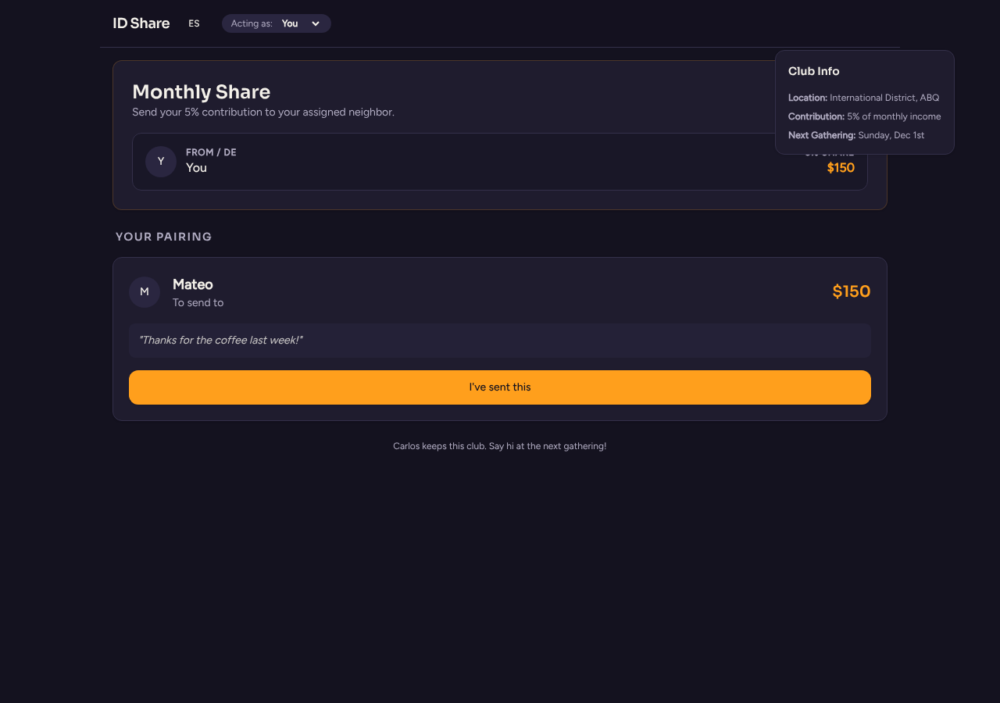

### remix-income-sharing — gemma-4-26b (trial 2)

### remix-gathering-fund — gemma-4-26b (trial 1)

### remix-gathering-fund — gemma-4-26b (trial 2)

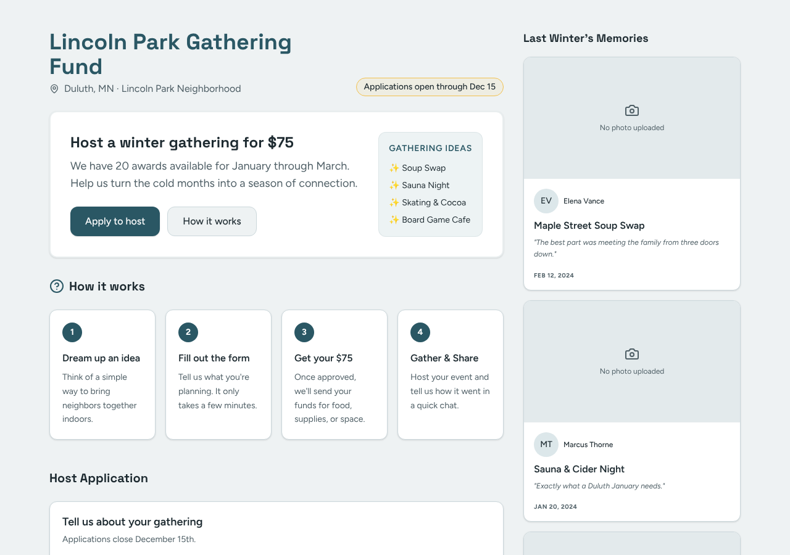

### remix-street-stories — gemma-4-26b (trial 1)

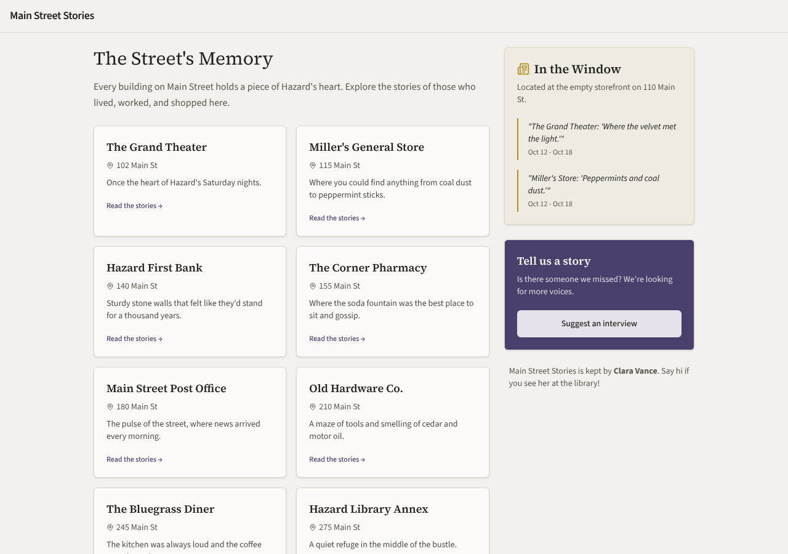

### remix-street-stories — gemma-4-26b (trial 2)

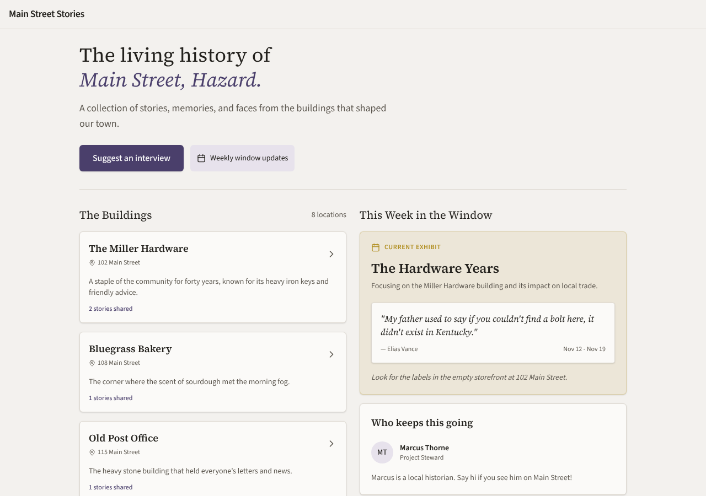

### remix-tool-lending-seed — gemma-4-26b (trial 1)

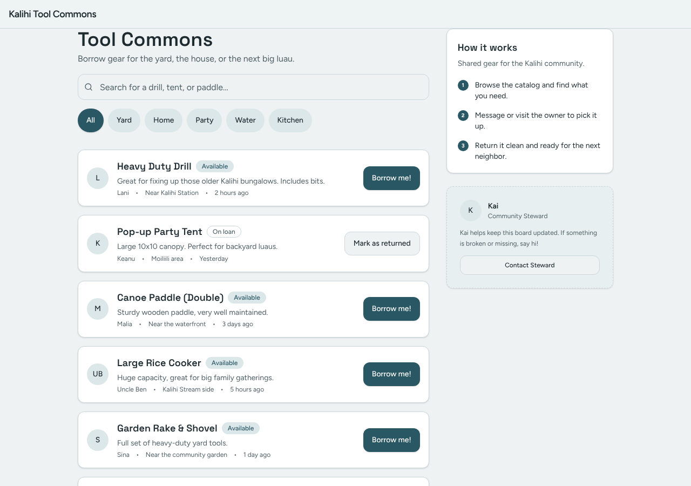

### remix-tool-lending-seed — gemma-4-26b (trial 2)

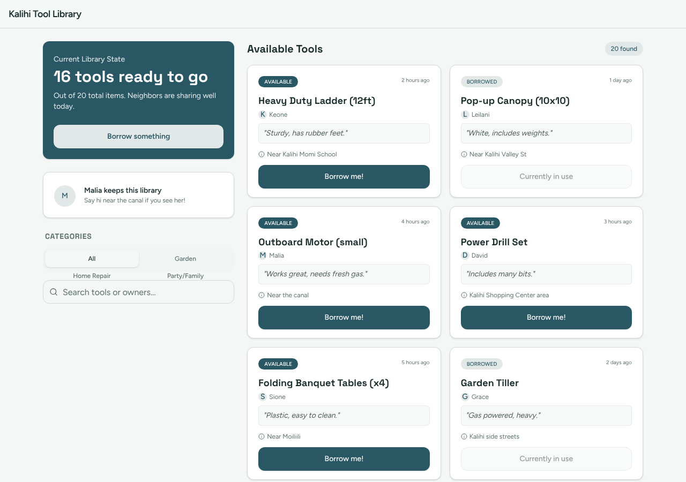

### hs-story-circle — gemma-4-26b (trial 1)

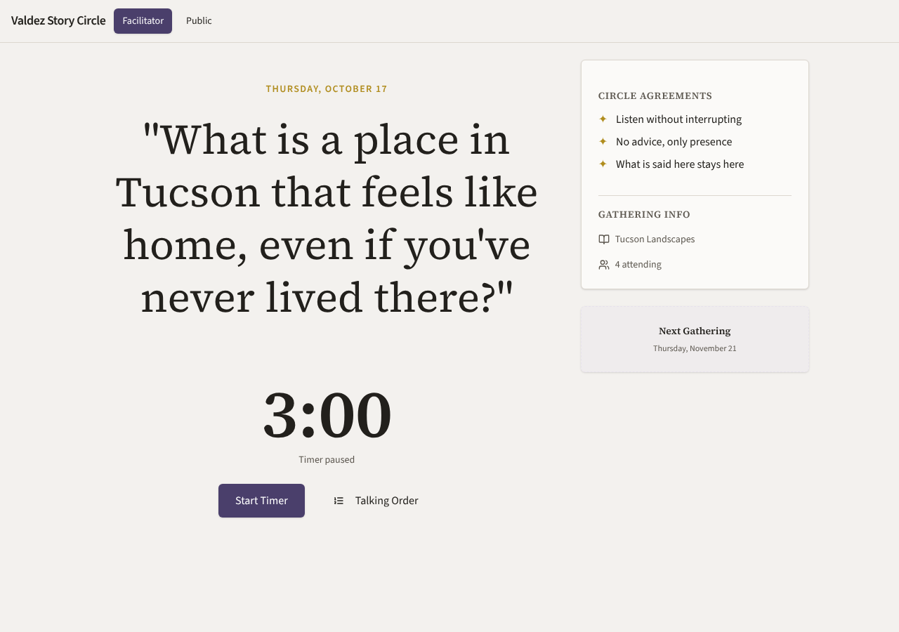

### hs-story-circle — gemma-4-26b (trial 2)

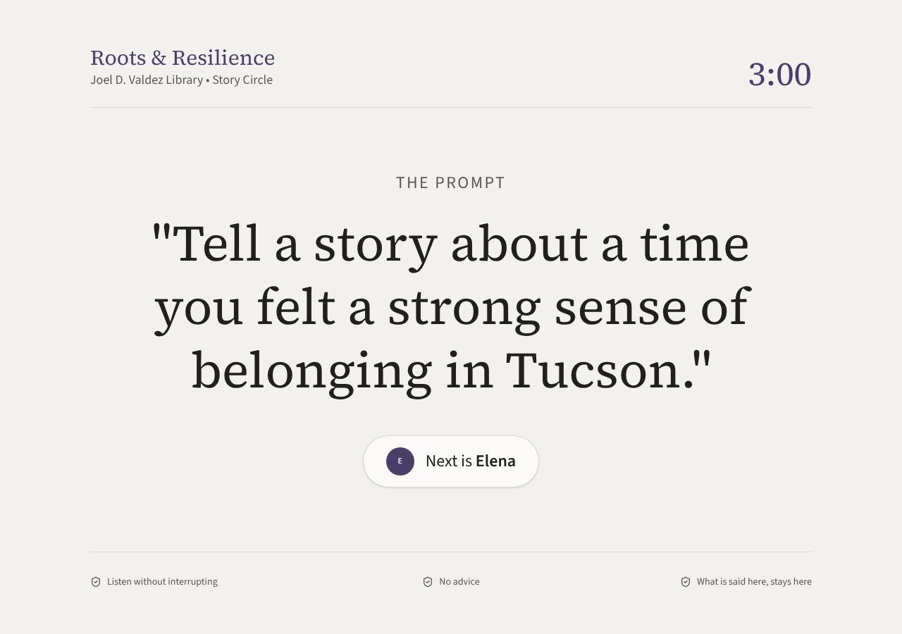

### hs-ballot-guide — gemma-4-26b (trial 2)

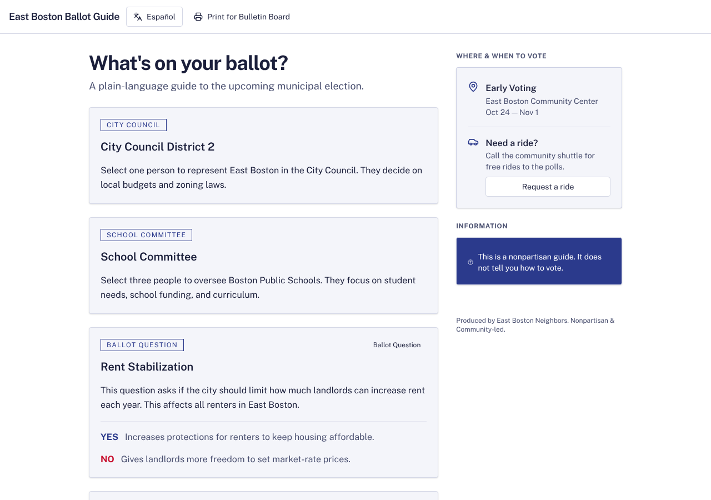

### hs-skill-swap — gemma-4-26b (trial 1)

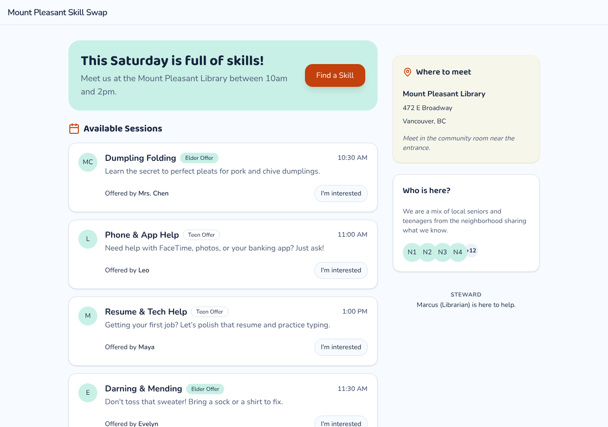

### hs-skill-swap — gemma-4-26b (trial 2)

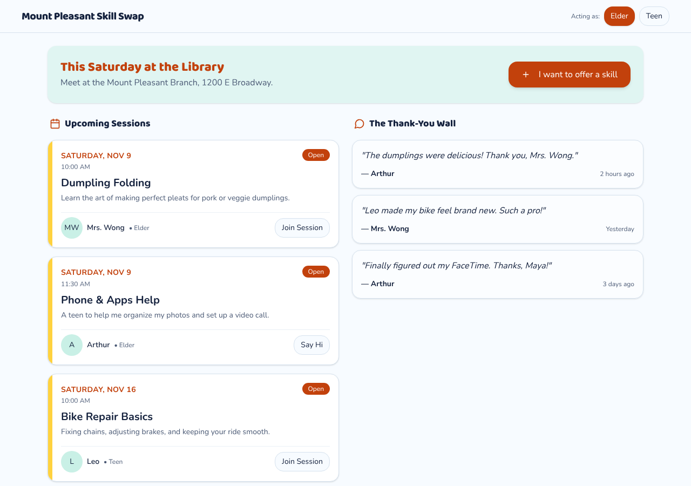

### hs-bulletin-boards — gemma-4-26b (trial 2)

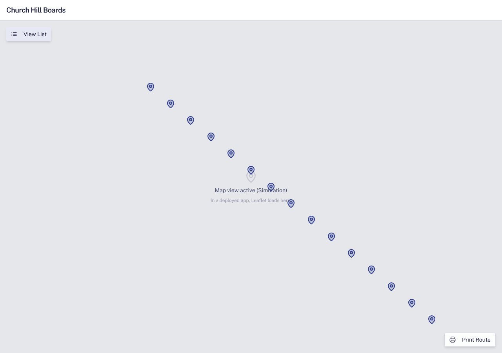
