# Bench board

Every model bench run in this repo, over time, on one page: what each model
built (screenshots), how it went (bundled, first try, time, cost, checks), and
the human scores where someone has given them. Generated by
`npm run bench:board` from `bench/results/`; do not edit by hand.

Last generated 2026-10-30 23:11 UTC from 16 runs, 68 builds, 38 screenshots.

**To score** (whenever there is time): open [SCORES.md](SCORES.md) on GitHub,
add a row per build (run, task, model, design 1 to 5, RTP fit 1 to 5,
completeness 1 to 5, a note), save; the next run regenerates this page. The
blinded review page (`bench/results/<run>/review/index.html`, built with
`npm run bench -- review <run>`) still works and its export is read too.

**Comparison prompts:** `hs-community-fridge` and `hs-listening-wall`. Models are compared on these two;
other tasks appear below as they were run. Scores: D design, R RTP fit, C completeness, each 1 to 5.

## Models tested

| Model | Provider id | Builds | Bundled | First try | Median build time | Median est. cost | Median design score (n) | Last run |
|---|---|---|---|---|---|---|---|---|
| gemma-4-26b | `google/gemma-4-26b-a4b-it` | 1 | 100% | 0% | 45s | <$0.01 |  | 2026-10-30 |
| gpt-oss-120b | `openai/gpt-oss-120b` | 1 | 100% | 100% | 109s | <$0.01 |  | 2026-10-30 |
| qwen3-coder-30b | `qwen/qwen3-coder-30b-a3b-instruct` | 2 | 100% | 0% | 300s | <$0.01 |  | 2026-10-30 |
| claude-fable-5-1 | `claude-fable-5-1` | 3 | 100% | 100% | 507s | $0.74 |  | 2026-09-23 |
| claude-opus-5-5 | `claude-opus-5-5` | 5 | 100% | 100% | 426s | $0.31 |  | 2026-09-23 |
| kimi-k3-direct | `kimi-k3` | 5 | 60% | 60% | 1020s |  |  | 2026-07-31 |
| kimi-k3 | `moonshotai/kimi-k3` | 3 | 0% | 0% |  |  |  | 2026-07-30 |
| opus-5 | `anthropic/claude-opus-5` | 2 | 50% | 50% | 326s | $0.51 |  | 2026-07-27 |
| fable-5 | `anthropic/claude-fable-5` | 5 | 100% | 100% | 243s | $0.60 | 7 (1) | 2026-07-22 |
| gemini-3.1-pro | `google/gemini-3.1-pro-preview` | 1 | 100% | 100% | 55s | $0.08 | 3 (1) | 2026-07-17 |
| gpt-5.6-sol | `openai/gpt-5.6-sol` | 1 | 100% | 100% | 97s | $0.34 | 6 (1) | 2026-07-17 |
| opus-4.8 | `anthropic/claude-opus-4.8` | 3 | 100% | 100% | 154s | $0.27 | 5 (1) | 2026-07-17 |

## hs-community-fridge (comparison prompt)

gemma-4-26b (2026-10-30) · gpt-oss-120b (2026-10-30) · qwen3-coder-30b (2026-10-30)

| Date | Model | Result | Checks | Build time | Est. cost | Scores | Notes | Shot | Report |
|---|---|---|---|---|---|---|---|---|---|
| 2026-10-30 | gemma-4-26b | bundled after one auto-fix | 5/5 | 45s | <$0.01 |  |  | [png](../../bench/results/2026-10-30T11-26-714a4ad/shots/hs-community-fridge--gemma-4-26b-t1.png) | [report](../../bench/results/2026-10-30T11-26-714a4ad/report.md) |
| 2026-10-30 | gpt-oss-120b | bundled, first try | 5/5 | 109s | <$0.01 |  |  | [png](../../bench/results/2026-10-30T11-34-6adf156/shots/hs-community-fridge--gpt-oss-120b-t1.png) | [report](../../bench/results/2026-10-30T11-34-6adf156/report.md) |
| 2026-10-30 | qwen3-coder-30b | bundled after one auto-fix | 3/5 | 177s | <$0.01 |  |  | [png](../../bench/results/2026-10-30T11-00-31a1e31/shots/hs-community-fridge--qwen3-coder-30b-t1.png) | [report](../../bench/results/2026-10-30T11-00-31a1e31/report.md) |

## build

| Date | Model | Result | Checks | Build time | Est. cost | Scores | Notes | Shot | Report |
|---|---|---|---|---|---|---|---|---|---|
| 2026-07-17 | gemini-3.1-pro | bundled, first try | 4/5 | 55s | $0.08 | D 3 · C 4 |  |  | [report](../../bench/results/2026-07-16T23-59-c66f6dd/report.md) |
| 2026-07-17 | gpt-5.6-sol | bundled, first try | 5/5 | 97s | $0.34 | D 6 · C 6 |  |  | [report](../../bench/results/2026-07-16T23-59-c66f6dd/report.md) |
| 2026-07-17 | kimi-k3 | failed: OpenRouter API error (429): {"error":{"message":"Provider re | 0/0 | 0s |  |  |  |  | [report](../../bench/results/2026-07-16T23-59-c66f6dd/report.md) |
| 2026-07-17 | opus-4.8 | bundled, first try | 5/5 | 108s | $0.21 | D 5 · C 6 |  |  | [report](../../bench/results/2026-07-16T23-59-c66f6dd/report.md) |
| 2026-07-16 | fable-5 | bundled, first try | 5/5 | 145s | $0.47 | D 7 · C 7 |  |  | [report](../../bench/results/2026-07-16T23-59-c66f6dd/report.md) |

## edit-copy (edit task)

<a href="../../bench/results/2026-08-02T15-33-48aa455/shots/edit-copy--sonnet-5-t1.png">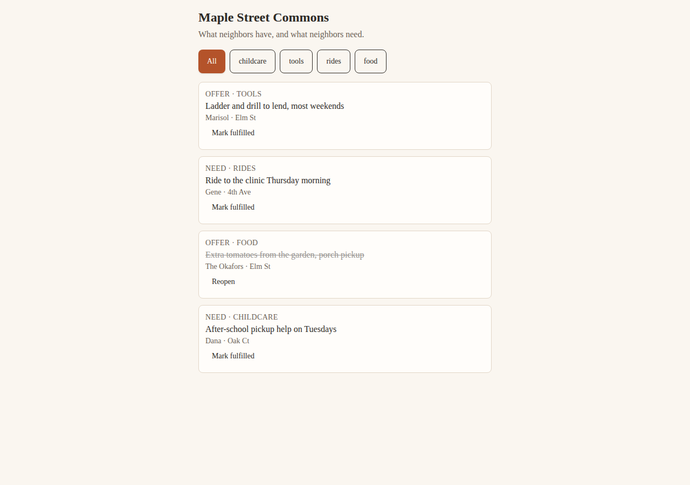</a>

opus-5 (2026-08-02) · opus-5 (2026-08-02) · opus-5 (2026-08-02) · sonnet-5 (2026-08-02) · sonnet-5 (2026-08-02) · sonnet-5 (2026-08-02)

| Date | Model | Result | Checks | Build time | Est. cost | Scores | Notes | Shot | Report |
|---|---|---|---|---|---|---|---|---|---|
| 2026-08-02 | opus-5 | bundled, first try | 3/3 | 7s | $0.07 |  |  | [png](../../bench/results/2026-08-02T15-33-48aa455/shots/edit-copy--opus-5-t1.png) | [report](../../bench/results/2026-08-02T15-33-48aa455/report.md) |
| 2026-08-02 | opus-5 | bundled, first try | 3/3 | 7s | $0.07 |  |  | [png](../../bench/results/2026-08-02T15-33-48aa455/shots/edit-copy--opus-5-t2.png) | [report](../../bench/results/2026-08-02T15-33-48aa455/report.md) |
| 2026-08-02 | opus-5 | bundled, first try | 3/3 | 8s | $0.07 |  |  | [png](../../bench/results/2026-08-02T15-33-48aa455/shots/edit-copy--opus-5-t3.png) | [report](../../bench/results/2026-08-02T15-33-48aa455/report.md) |
| 2026-08-02 | sonnet-5 | bundled, first try | 3/3 | 4s | $0.04 |  |  | [png](../../bench/results/2026-08-02T15-33-48aa455/shots/edit-copy--sonnet-5-t1.png) | [report](../../bench/results/2026-08-02T15-33-48aa455/report.md) |
| 2026-08-02 | sonnet-5 | bundled, first try | 3/3 | 5s | $0.04 |  |  | [png](../../bench/results/2026-08-02T15-33-48aa455/shots/edit-copy--sonnet-5-t2.png) | [report](../../bench/results/2026-08-02T15-33-48aa455/report.md) |
| 2026-08-02 | sonnet-5 | bundled, first try | 3/3 | 5s | $0.04 |  |  | [png](../../bench/results/2026-08-02T15-33-48aa455/shots/edit-copy--sonnet-5-t3.png) | [report](../../bench/results/2026-08-02T15-33-48aa455/report.md) |

## edit-feature (edit task)

<a href="../../bench/results/2026-08-02T15-33-48aa455/shots/edit-feature--opus-5-t1.png">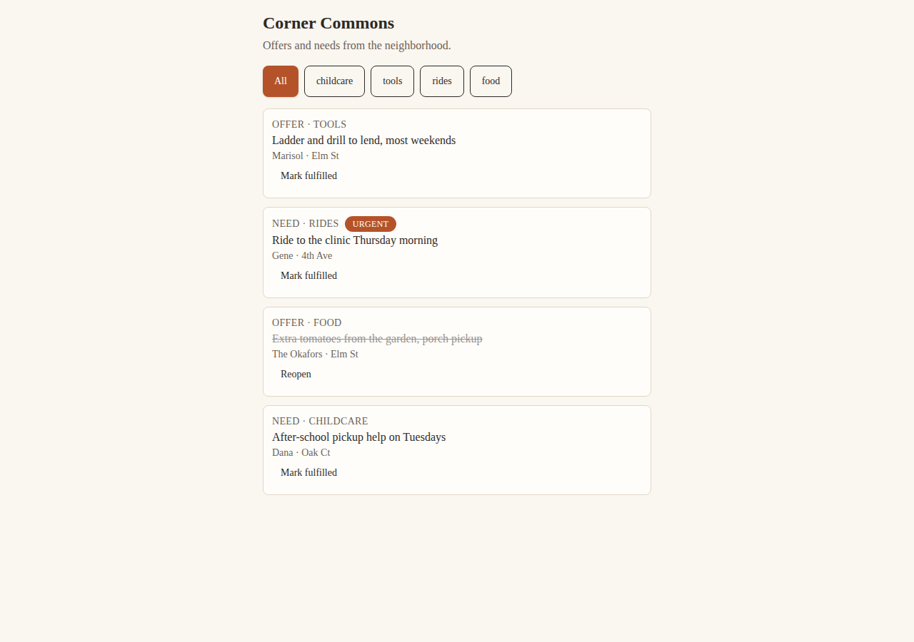</a>
<a href="../../bench/results/2026-08-02T15-33-48aa455/shots/edit-feature--opus-5-t2.png">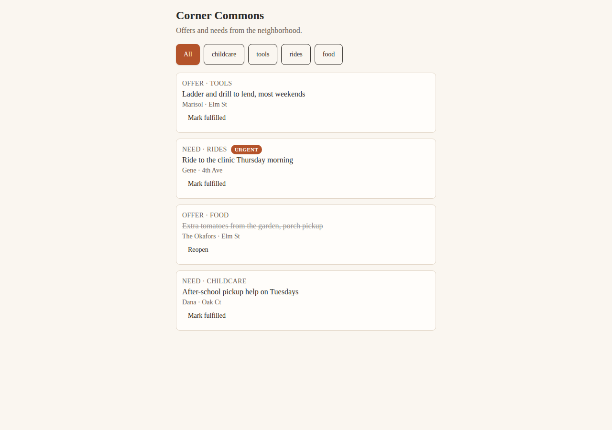</a>

<a href="../../bench/results/2026-08-02T15-33-48aa455/shots/edit-feature--sonnet-5-t2.png">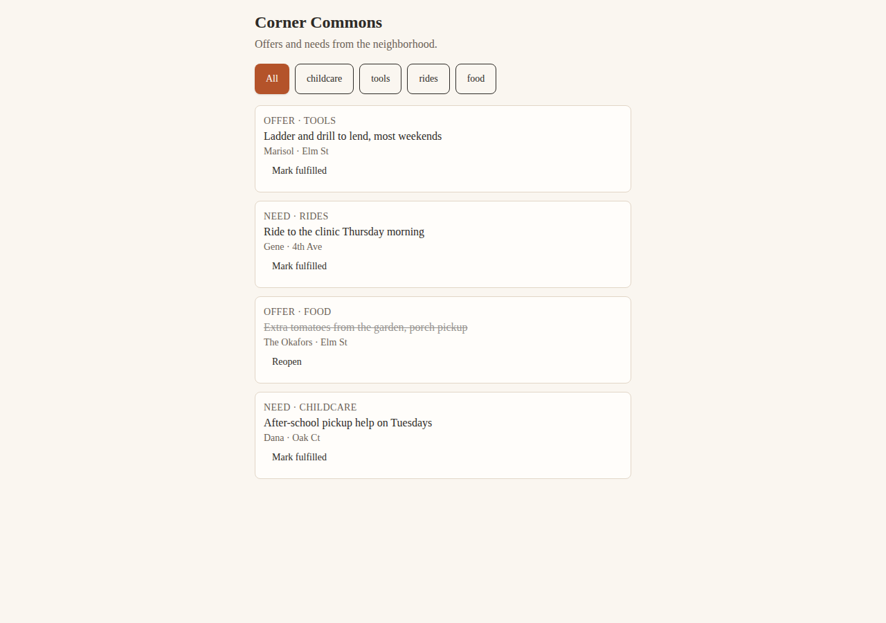</a>
<a href="../../bench/results/2026-08-02T15-33-48aa455/shots/edit-feature--sonnet-5-t3.png">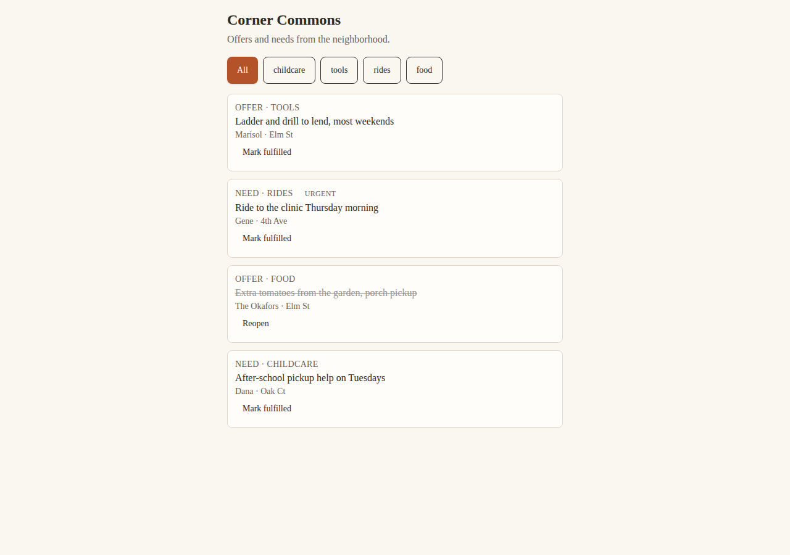</a>

opus-5 (2026-08-02) · opus-5 (2026-08-02) · opus-5 (2026-08-02) · sonnet-5 (2026-08-02) · sonnet-5 (2026-08-02) · sonnet-5 (2026-08-02)

| Date | Model | Result | Checks | Build time | Est. cost | Scores | Notes | Shot | Report |
|---|---|---|---|---|---|---|---|---|---|
| 2026-08-02 | opus-5 | bundled, first try | 3/3 | 20s | $0.07 |  |  | [png](../../bench/results/2026-08-02T15-33-48aa455/shots/edit-feature--opus-5-t1.png) | [report](../../bench/results/2026-08-02T15-33-48aa455/report.md) |
| 2026-08-02 | opus-5 | bundled, first try | 3/3 | 16s | $0.07 |  |  | [png](../../bench/results/2026-08-02T15-33-48aa455/shots/edit-feature--opus-5-t2.png) | [report](../../bench/results/2026-08-02T15-33-48aa455/report.md) |
| 2026-08-02 | opus-5 | bundled, first try | 3/3 | 14s | $0.07 |  |  | [png](../../bench/results/2026-08-02T15-33-48aa455/shots/edit-feature--opus-5-t3.png) | [report](../../bench/results/2026-08-02T15-33-48aa455/report.md) |
| 2026-08-02 | opus-5 | bundled, first try | 3/3 | 17s | $0.07 |  |  |  | [report](../../bench/results/2026-08-02T16-04-e884713/report.md) |
| 2026-08-02 | opus-5 | bundled, first try | 3/3 | 15s | $0.07 |  |  |  | [report](../../bench/results/2026-08-02T16-04-e884713/report.md) |
| 2026-08-02 | opus-5 | bundled, first try | 3/3 | 17s | $0.07 |  |  |  | [report](../../bench/results/2026-08-02T16-04-e884713/report.md) |
| 2026-08-02 | opus-5 | bundled, first try | 3/3 | 15s | $0.07 |  |  |  | [report](../../bench/results/2026-08-02T16-04-e884713/report.md) |
| 2026-08-02 | opus-5 | bundled, first try | 3/3 | 22s | $0.07 |  |  |  | [report](../../bench/results/2026-08-02T16-04-e884713/report.md) |
| 2026-08-02 | opus-5 | bundled, first try | 3/3 | 13s | $0.07 |  |  |  | [report](../../bench/results/2026-08-02T16-04-e884713/report.md) |
| 2026-08-02 | opus-5 | bundled, first try | 3/3 | 21s | $0.07 |  |  |  | [report](../../bench/results/2026-08-02T16-04-e884713/report.md) |
| 2026-08-02 | opus-5 | bundled, first try | 3/3 | 18s | $0.07 |  |  |  | [report](../../bench/results/2026-08-02T16-04-e884713/report.md) |
| 2026-08-02 | opus-5 | bundled, first try | 3/3 | 17s | $0.07 |  |  |  | [report](../../bench/results/2026-08-02T16-04-e884713/report.md) |
| 2026-08-02 | sonnet-5 | bundled, first try | 3/3 | 13s | $0.05 |  |  | [png](../../bench/results/2026-08-02T15-33-48aa455/shots/edit-feature--sonnet-5-t1.png) | [report](../../bench/results/2026-08-02T15-33-48aa455/report.md) |
| 2026-08-02 | sonnet-5 | bundled, first try | 2/3 | 16s | $0.05 |  |  | [png](../../bench/results/2026-08-02T15-33-48aa455/shots/edit-feature--sonnet-5-t2.png) | [report](../../bench/results/2026-08-02T15-33-48aa455/report.md) |
| 2026-08-02 | sonnet-5 | bundled, first try | 3/3 | 15s | $0.05 |  |  | [png](../../bench/results/2026-08-02T15-33-48aa455/shots/edit-feature--sonnet-5-t3.png) | [report](../../bench/results/2026-08-02T15-33-48aa455/report.md) |
| 2026-08-02 | sonnet-5 | bundled, first try | 3/3 | 10s | $0.04 |  |  |  | [report](../../bench/results/2026-08-02T16-04-e884713/report.md) |
| 2026-08-02 | sonnet-5 | bundled, first try | 3/3 | 12s | $0.05 |  |  |  | [report](../../bench/results/2026-08-02T16-04-e884713/report.md) |
| 2026-08-02 | sonnet-5 | bundled, first try | 2/3 | 11s | $0.05 |  |  |  | [report](../../bench/results/2026-08-02T16-04-e884713/report.md) |
| 2026-08-02 | sonnet-5 | bundled, first try | 3/3 | 11s | $0.05 |  |  |  | [report](../../bench/results/2026-08-02T16-04-e884713/report.md) |
| 2026-08-02 | sonnet-5 | bundled, first try | 2/3 | 13s | $0.05 |  |  |  | [report](../../bench/results/2026-08-02T16-04-e884713/report.md) |
| 2026-08-02 | sonnet-5 | bundled, first try | 3/3 | 13s | $0.05 |  |  |  | [report](../../bench/results/2026-08-02T16-04-e884713/report.md) |
| 2026-08-02 | sonnet-5 | bundled, first try | 3/3 | 15s | $0.05 |  |  |  | [report](../../bench/results/2026-08-02T16-04-e884713/report.md) |
| 2026-08-02 | sonnet-5 | bundled after one auto-fix | 3/3 | 13s | $0.05 |  |  |  | [report](../../bench/results/2026-08-02T16-04-e884713/report.md) |
| 2026-08-02 | sonnet-5 | bundled, first try | 3/3 | 19s | $0.05 |  |  |  | [report](../../bench/results/2026-08-02T16-04-e884713/report.md) |

## edit-restyle (edit task)

<a href="../../bench/results/2026-08-02T15-33-48aa455/shots/edit-restyle--opus-5-t1.png">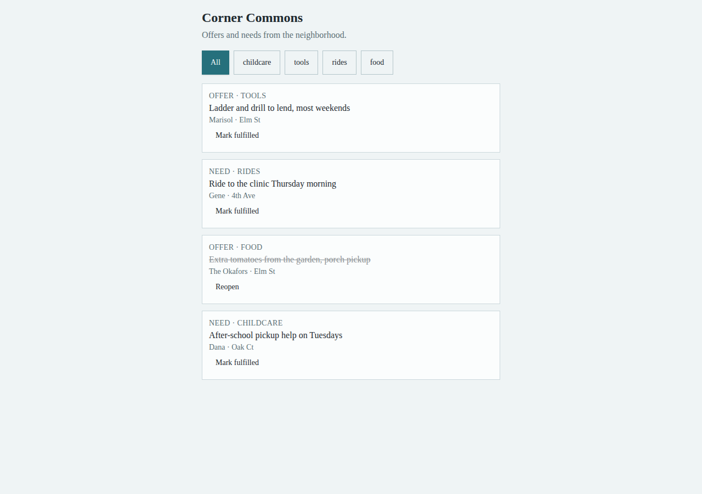</a>
<a href="../../bench/results/2026-08-02T15-33-48aa455/shots/edit-restyle--opus-5-t2.png">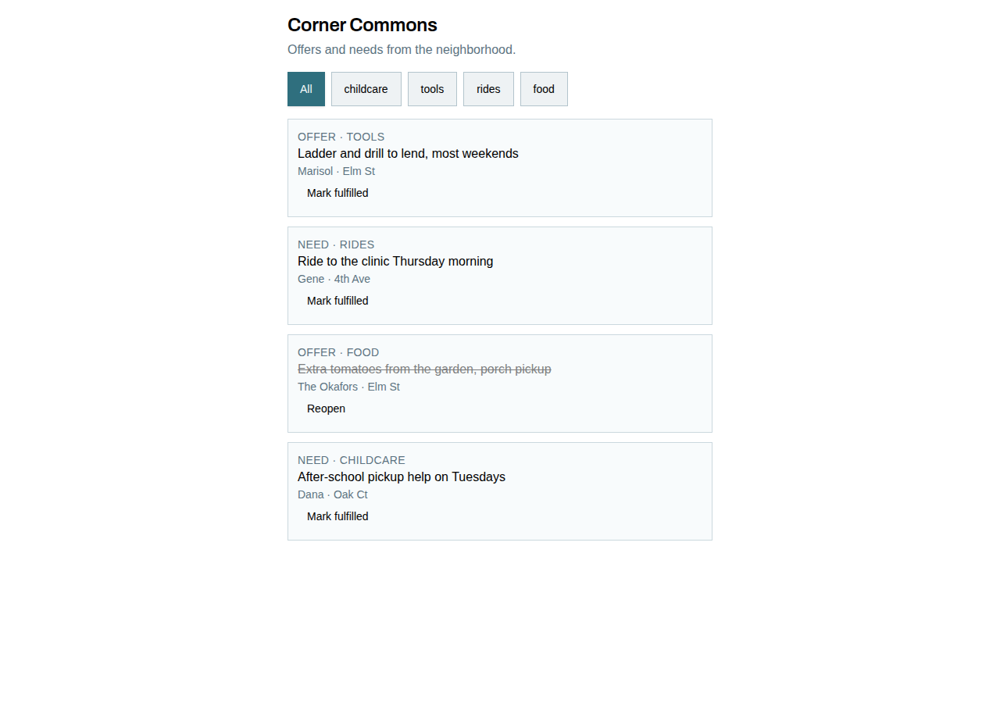</a>
<a href="../../bench/results/2026-08-02T15-33-48aa455/shots/edit-restyle--opus-5-t3.png">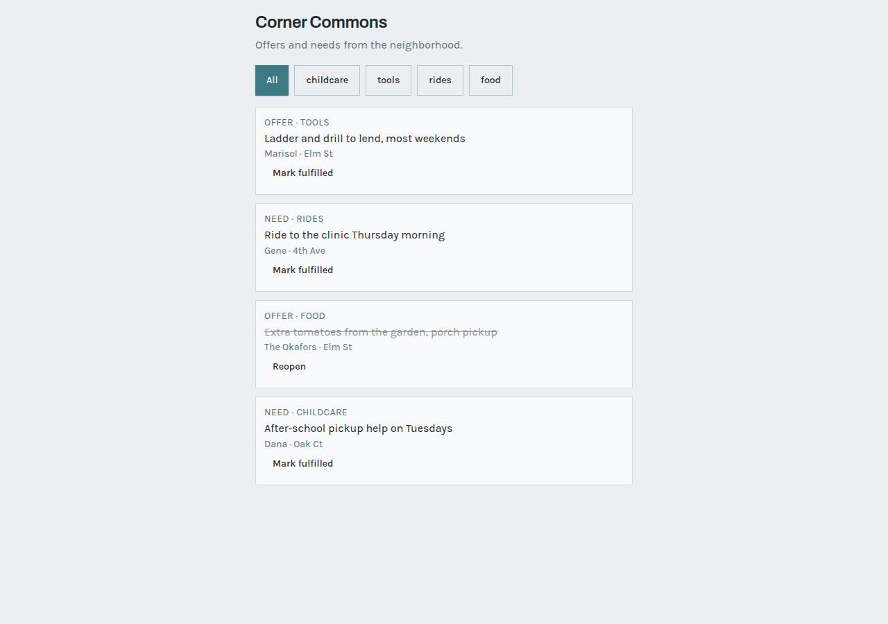</a>
<a href="../../bench/results/2026-08-02T15-33-48aa455/shots/edit-restyle--sonnet-5-t1.png">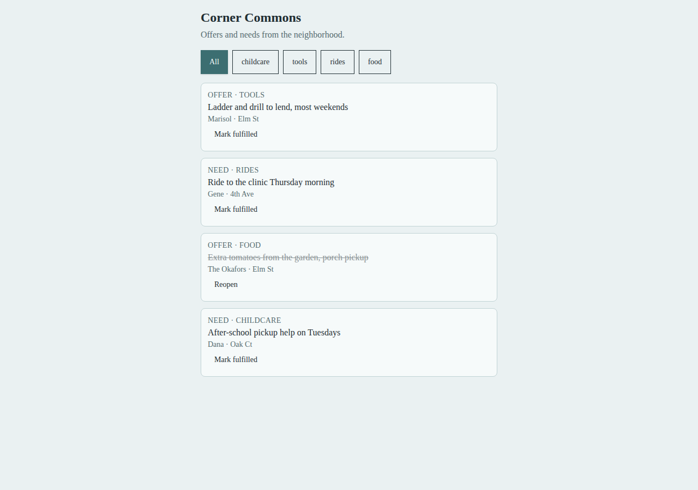</a>
<a href="../../bench/results/2026-08-02T15-33-48aa455/shots/edit-restyle--sonnet-5-t2.png">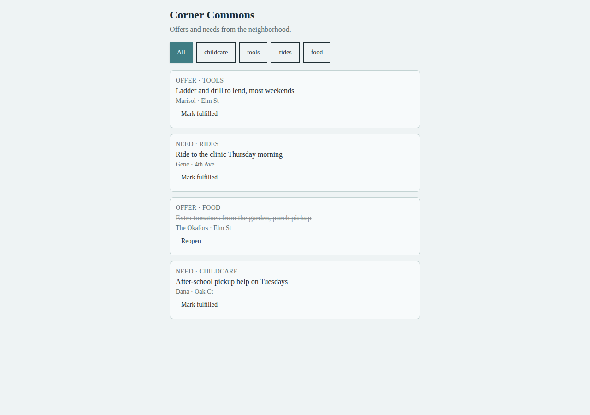</a>
<a href="../../bench/results/2026-08-02T15-33-48aa455/shots/edit-restyle--sonnet-5-t3.png">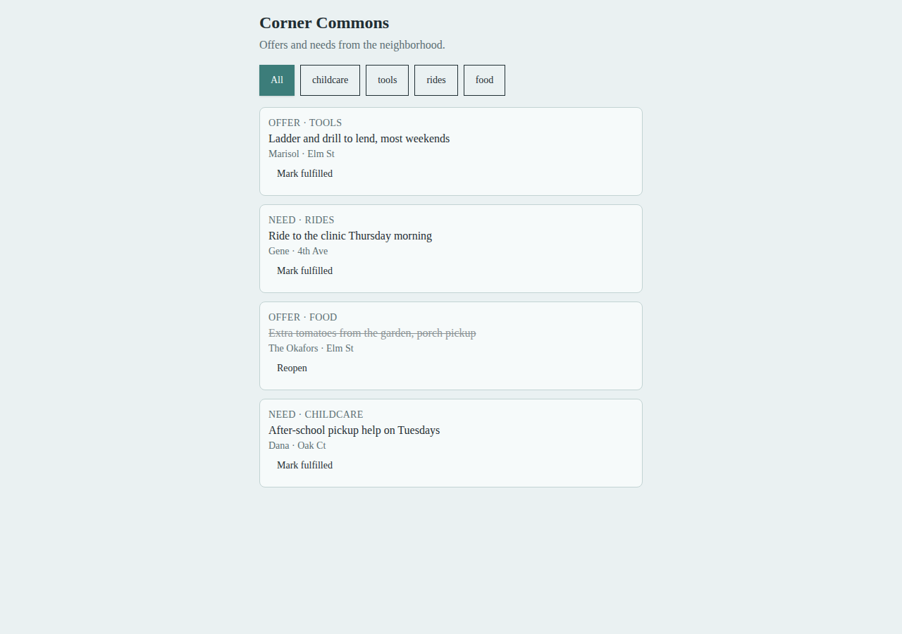</a>

opus-5 (2026-08-02) · opus-5 (2026-08-02) · opus-5 (2026-08-02) · sonnet-5 (2026-08-02) · sonnet-5 (2026-08-02) · sonnet-5 (2026-08-02)

| Date | Model | Result | Checks | Build time | Est. cost | Scores | Notes | Shot | Report |
|---|---|---|---|---|---|---|---|---|---|
| 2026-08-02 | opus-5 | bundled, first try | 3/3 | 31s | $0.08 |  |  | [png](../../bench/results/2026-08-02T15-33-48aa455/shots/edit-restyle--opus-5-t1.png) | [report](../../bench/results/2026-08-02T15-33-48aa455/report.md) |
| 2026-08-02 | opus-5 | bundled, first try | 3/3 | 37s | $0.08 |  |  | [png](../../bench/results/2026-08-02T15-33-48aa455/shots/edit-restyle--opus-5-t2.png) | [report](../../bench/results/2026-08-02T15-33-48aa455/report.md) |
| 2026-08-02 | opus-5 | bundled, first try | 3/3 | 28s | $0.08 |  |  | [png](../../bench/results/2026-08-02T15-33-48aa455/shots/edit-restyle--opus-5-t3.png) | [report](../../bench/results/2026-08-02T15-33-48aa455/report.md) |
| 2026-08-02 | sonnet-5 | bundled, first try | 3/3 | 11s | $0.04 |  |  | [png](../../bench/results/2026-08-02T15-33-48aa455/shots/edit-restyle--sonnet-5-t1.png) | [report](../../bench/results/2026-08-02T15-33-48aa455/report.md) |
| 2026-08-02 | sonnet-5 | bundled, first try | 3/3 | 11s | $0.04 |  |  | [png](../../bench/results/2026-08-02T15-33-48aa455/shots/edit-restyle--sonnet-5-t2.png) | [report](../../bench/results/2026-08-02T15-33-48aa455/report.md) |
| 2026-08-02 | sonnet-5 | bundled, first try | 3/3 | 12s | $0.04 |  |  | [png](../../bench/results/2026-08-02T15-33-48aa455/shots/edit-restyle--sonnet-5-t3.png) | [report](../../bench/results/2026-08-02T15-33-48aa455/report.md) |

## hs-meal-train

qwen3-coder-30b (2026-10-30)

| Date | Model | Result | Checks | Build time | Est. cost | Scores | Notes | Shot | Report |
|---|---|---|---|---|---|---|---|---|---|
| 2026-10-30 | qwen3-coder-30b | bundled after one auto-fix | 3/5 | 424s | <$0.01 |  |  | [png](../../bench/results/2026-10-30T11-00-31a1e31/shots/hs-meal-train--qwen3-coder-30b-t1.png) | [report](../../bench/results/2026-10-30T11-00-31a1e31/report.md) |

## mutual-aid-board

<a href="../../bench/results/2026-09-23T15-34-ef1d7eb/shots/mutual-aid-board--claude-fable-5-1-t1.png">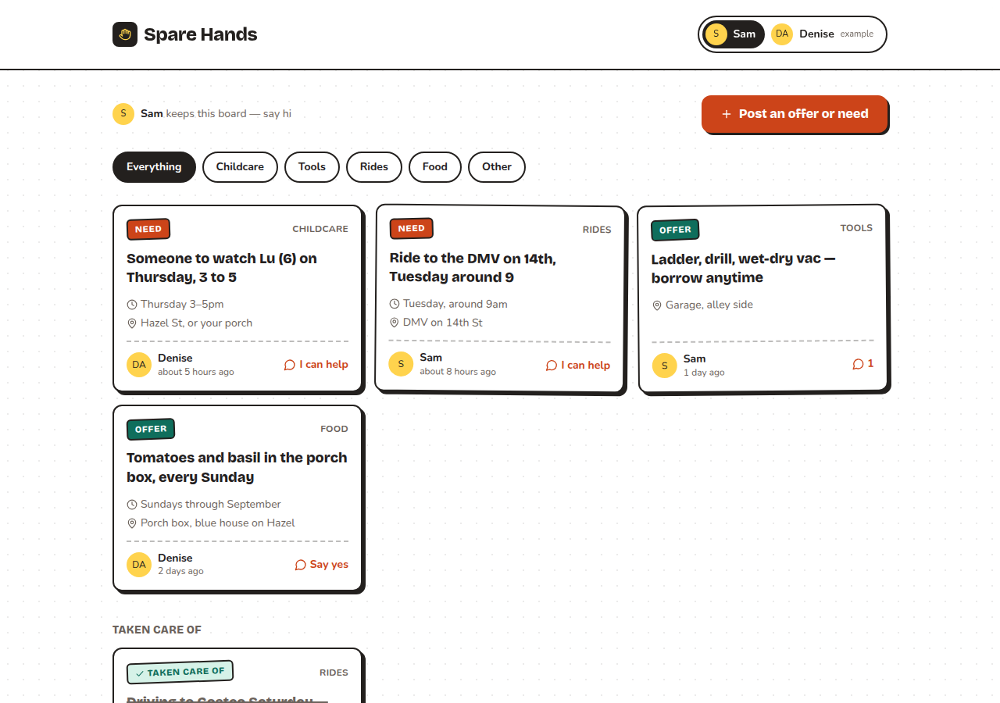</a>
<a href="../../bench/results/2026-09-23T15-34-ef1d7eb/shots/mutual-aid-board--claude-fable-5-1-t2.png">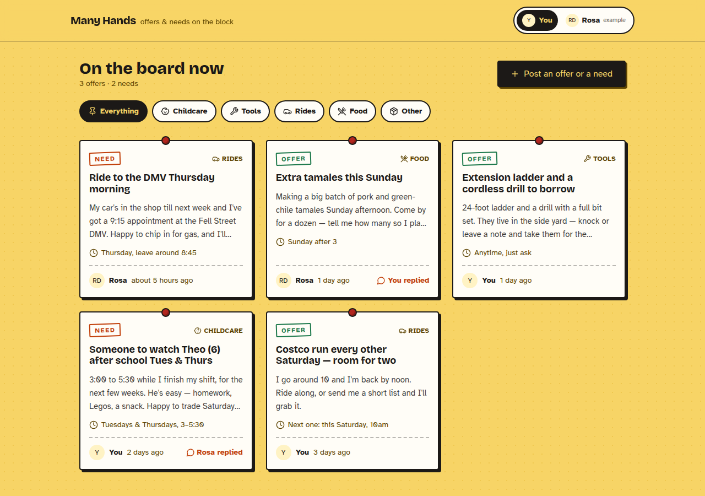</a>

<a href="../../bench/results/2026-07-30T23-54-586cbbb/shots/mutual-aid-board--kimi-k3-direct-t2.png">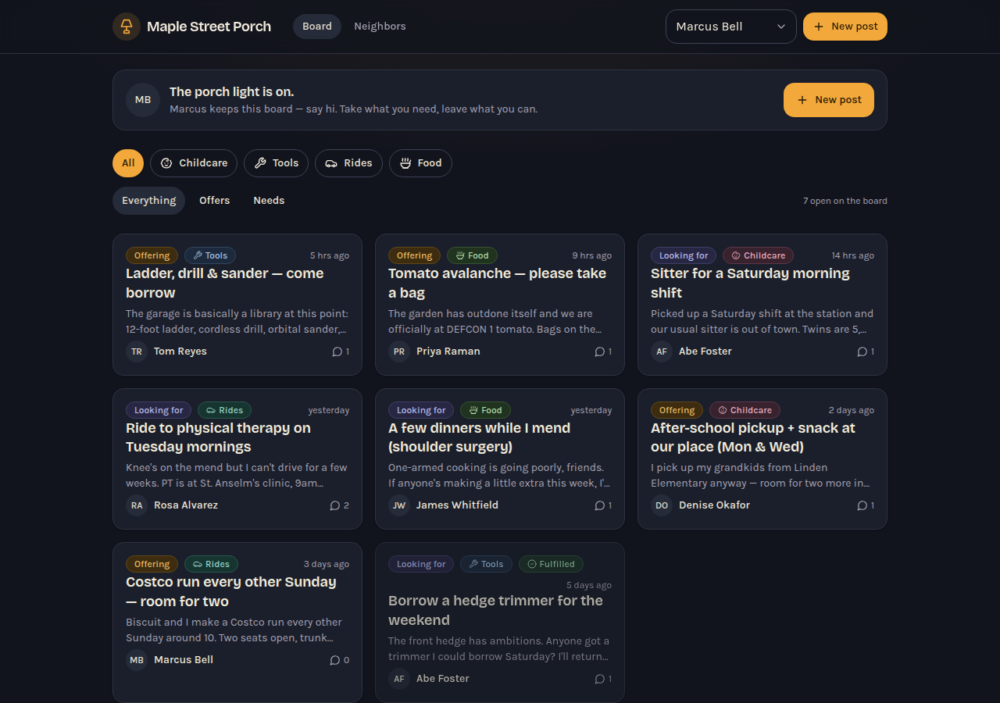</a>
<a href="../../bench/results/2026-07-31T00-27-87f3b11/shots/mutual-aid-board--kimi-k3-direct-t1.png">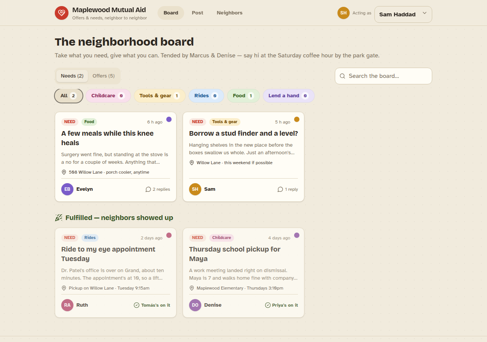</a>

<a href="../../bench/results/2026-07-27T17-23-28db9a8/shots/mutual-aid-board--opus-5-t1.png">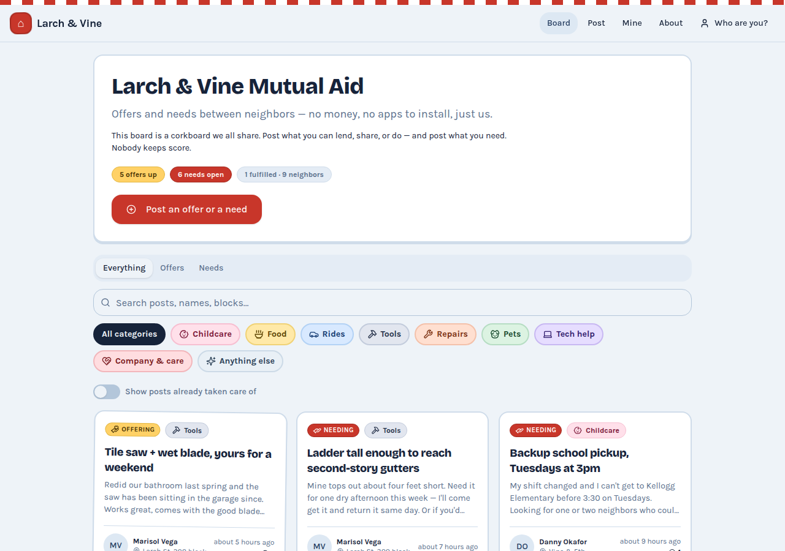</a>

claude-fable-5-1 (2026-09-23) · claude-fable-5-1 (2026-09-23) · claude-fable-5-1 (2026-09-23) · claude-opus-5-5 (2026-09-23) · claude-opus-5-5 (2026-09-23) · claude-opus-5-5 (2026-09-23) · kimi-k3-direct (2026-07-31) · kimi-k3-direct (2026-07-31) · kimi-k3-direct (2026-07-31) · opus-5 (2026-07-27)

| Date | Model | Result | Checks | Build time | Est. cost | Scores | Notes | Shot | Report |
|---|---|---|---|---|---|---|---|---|---|
| 2026-09-23 | claude-fable-5-1 | bundled, first try | 5/5 | 483s | $0.71 |  |  | [png](../../bench/results/2026-09-23T15-34-ef1d7eb/shots/mutual-aid-board--claude-fable-5-1-t1.png) | [report](../../bench/results/2026-09-23T15-34-ef1d7eb/report.md) |
| 2026-09-23 | claude-fable-5-1 | bundled, first try | 5/5 | 591s | $0.75 |  |  | [png](../../bench/results/2026-09-23T15-34-ef1d7eb/shots/mutual-aid-board--claude-fable-5-1-t2.png) | [report](../../bench/results/2026-09-23T15-34-ef1d7eb/report.md) |
| 2026-09-23 | claude-fable-5-1 | bundled, first try | 5/5 | 507s | $0.74 |  |  | [png](../../bench/results/2026-09-23T15-34-ef1d7eb/shots/mutual-aid-board--claude-fable-5-1-t3.png) | [report](../../bench/results/2026-09-23T15-34-ef1d7eb/report.md) |
| 2026-09-23 | claude-opus-5-5 | bundled, first try | 5/5 | 426s | $0.28 |  |  | [png](../../bench/results/2026-09-23T15-34-ef1d7eb/shots/mutual-aid-board--claude-opus-5-5-t1.png) | [report](../../bench/results/2026-09-23T15-34-ef1d7eb/report.md) |
| 2026-09-23 | claude-opus-5-5 | bundled, first try | 5/5 | 511s | $0.32 |  |  | [png](../../bench/results/2026-09-23T15-34-ef1d7eb/shots/mutual-aid-board--claude-opus-5-5-t2.png) | [report](../../bench/results/2026-09-23T15-34-ef1d7eb/report.md) |
| 2026-09-23 | claude-opus-5-5 | bundled, first try | 5/5 | 507s | $0.33 |  |  | [png](../../bench/results/2026-09-23T15-34-ef1d7eb/shots/mutual-aid-board--claude-opus-5-5-t3.png) | [report](../../bench/results/2026-09-23T15-34-ef1d7eb/report.md) |
| 2026-09-23 | claude-opus-5-5 | bundled, first try | 5/5 | 254s | $0.29 |  |  |  | [report](../../bench/results/2026-09-23T22-23-14d773c-effort-high/report.md) |
| 2026-09-23 | claude-opus-5-5 | bundled, first try | 5/5 | 241s | $0.31 |  |  |  | [report](../../bench/results/2026-09-23T22-23-14d773c-effort-medium/report.md) |
| 2026-07-31 | kimi-k3-direct | bundled, first try | 5/5 | 830s |  |  |  | [png](../../bench/results/2026-07-30T23-54-586cbbb/shots/mutual-aid-board--kimi-k3-direct-t2.png) | [report](../../bench/results/2026-07-30T23-54-586cbbb/report.md) |
| 2026-07-31 | kimi-k3-direct | bundled, first try | 4/5 | 1020s |  |  |  | [png](../../bench/results/2026-07-31T00-27-87f3b11/shots/mutual-aid-board--kimi-k3-direct-t1.png) | [report](../../bench/results/2026-07-31T00-27-87f3b11/report.md) |
| 2026-07-31 | kimi-k3-direct | bundled, first try | 5/5 | 1043s |  |  |  | [png](../../bench/results/2026-07-31T00-27-87f3b11/shots/mutual-aid-board--kimi-k3-direct-t2.png) | [report](../../bench/results/2026-07-31T00-27-87f3b11/report.md) |
| 2026-07-30 | kimi-k3 | failed: OpenRouter API error (402): {"error":{"message":"This reques | 0/0 | 0s |  |  |  |  | [report](../../bench/results/2026-07-30T03-32-9cd604b/report.md) |
| 2026-07-30 | kimi-k3 | failed: OpenRouter API error (402): {"error":{"message":"This reques | 0/0 | 0s |  |  |  |  | [report](../../bench/results/2026-07-30T03-32-9cd604b/report.md) |
| 2026-07-30 | kimi-k3-direct | did not bundle | 4/5 | 509s |  |  |  |  | [report](../../bench/results/2026-07-30T05-32-4a50f23/report.md) |
| 2026-07-30 | kimi-k3-direct | did not bundle | 2/5 | 989s |  |  |  |  | [report](../../bench/results/2026-07-30T23-54-586cbbb/report.md) |
| 2026-07-27 | opus-5 | bundled, first try | 5/5 | 326s | $0.51 |  |  | [png](../../bench/results/2026-07-27T17-23-28db9a8/shots/mutual-aid-board--opus-5-t1.png) | [report](../../bench/results/2026-07-27T17-23-28db9a8/report.md) |
| 2026-07-27 | opus-5 | failed: OpenRouter API error (402): {"error":{"message":"This reques | 0/0 | 0s |  |  |  |  | [report](../../bench/results/2026-07-27T17-23-28db9a8/report.md) |

## pdx-block-party

<a href="../../bench/results/2026-07-17T17-08-cf213f0/shots/pdx-block-party--fable-5-t1.png">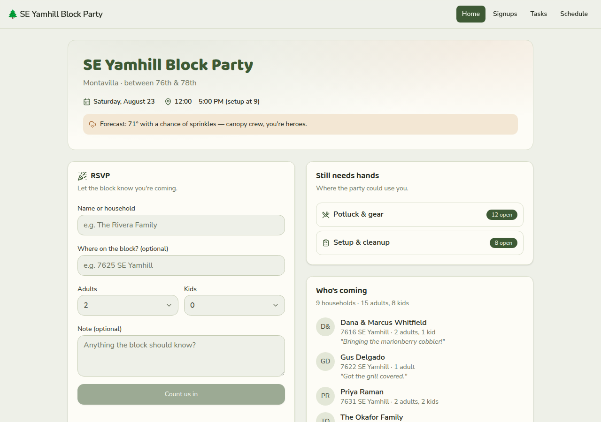</a>
<a href="../../bench/results/2026-07-17T17-08-cf213f0/shots/pdx-block-party--opus-4.8-t1.png">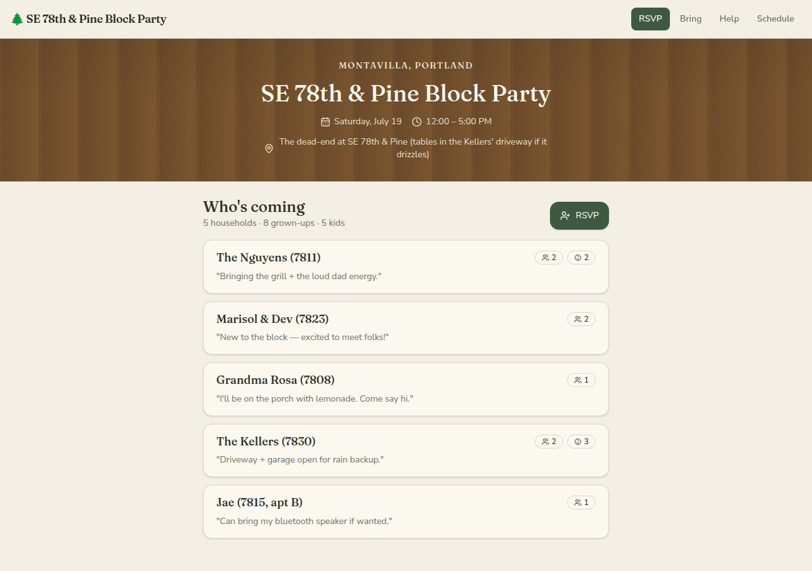</a>

fable-5 (2026-07-17) · opus-4.8 (2026-07-17)

| Date | Model | Result | Checks | Build time | Est. cost | Scores | Notes | Shot | Report |
|---|---|---|---|---|---|---|---|---|---|
| 2026-07-17 | fable-5 | bundled, first try | 5/5 | 243s | $0.60 |  |  | [png](../../bench/results/2026-07-17T17-08-cf213f0/shots/pdx-block-party--fable-5-t1.png) | [report](../../bench/results/2026-07-17T17-08-cf213f0/report.md) |
| 2026-07-17 | opus-4.8 | bundled, first try | 5/5 | 154s | $0.27 |  |  | [png](../../bench/results/2026-07-17T17-08-cf213f0/shots/pdx-block-party--opus-4.8-t1.png) | [report](../../bench/results/2026-07-17T17-08-cf213f0/report.md) |

## pdx-story-porch

<a href="../../bench/results/2026-07-17T17-08-cf213f0/shots/pdx-story-porch--fable-5-t1.png">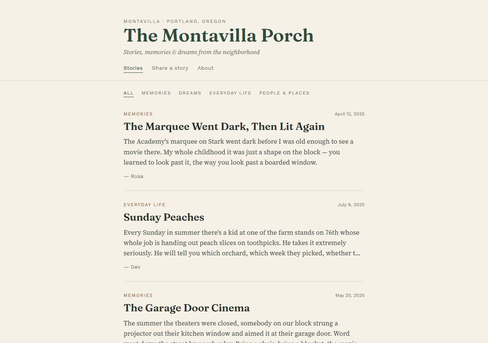</a>
<a href="../../bench/results/2026-07-17T17-08-cf213f0/shots/pdx-story-porch--opus-4.8-t1.png">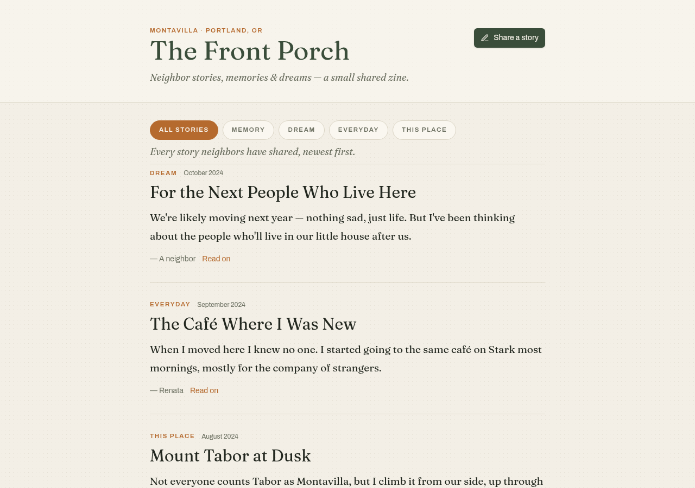</a>

fable-5 (2026-07-17) · opus-4.8 (2026-07-17)

| Date | Model | Result | Checks | Build time | Est. cost | Scores | Notes | Shot | Report |
|---|---|---|---|---|---|---|---|---|---|
| 2026-07-17 | fable-5 | bundled, first try | 4/5 | 222s | $0.51 |  |  | [png](../../bench/results/2026-07-17T17-08-cf213f0/shots/pdx-story-porch--fable-5-t1.png) | [report](../../bench/results/2026-07-17T17-08-cf213f0/report.md) |
| 2026-07-17 | opus-4.8 | bundled, first try | 4/5 | 159s | $0.27 |  |  | [png](../../bench/results/2026-07-17T17-08-cf213f0/shots/pdx-story-porch--opus-4.8-t1.png) | [report](../../bench/results/2026-07-17T17-08-cf213f0/report.md) |

## thread-clubs

<a href="../../bench/results/2026-07-22T03-28-ef0027d/shots/thread-clubs--fable-5-t1.png">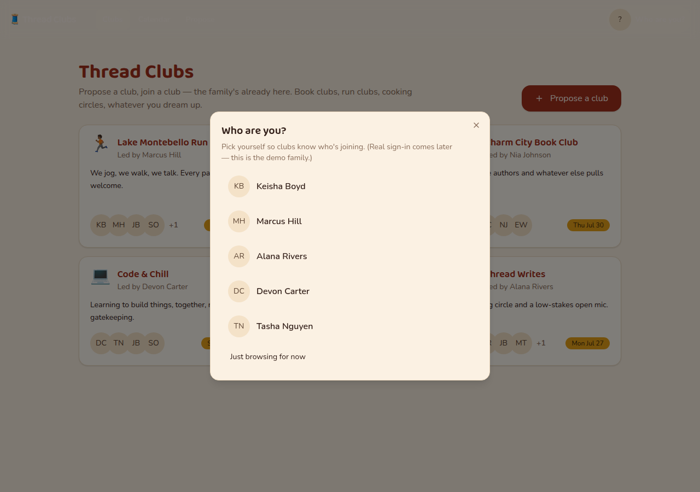</a>

fable-5 (2026-07-22)

| Date | Model | Result | Checks | Build time | Est. cost | Scores | Notes | Shot | Report |
|---|---|---|---|---|---|---|---|---|---|
| 2026-07-22 | fable-5 | bundled, first try | 4/5 | 260s | $0.71 |  |  | [png](../../bench/results/2026-07-22T03-28-ef0027d/shots/thread-clubs--fable-5-t1.png) | [report](../../bench/results/2026-07-22T03-28-ef0027d/report.md) |

## thread-gatherings-remix

<a href="../../bench/results/2026-07-22T03-28-ef0027d/shots/thread-gatherings-remix--fable-5-t1.png">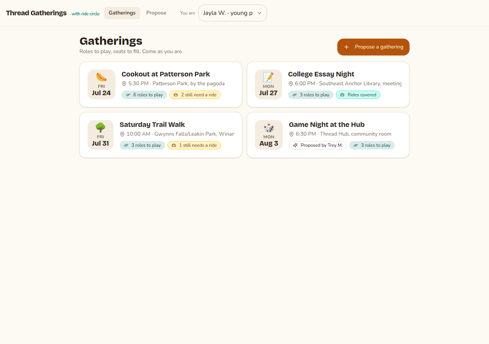</a>

fable-5 (2026-07-22)

| Date | Model | Result | Checks | Build time | Est. cost | Scores | Notes | Shot | Report |
|---|---|---|---|---|---|---|---|---|---|
| 2026-07-22 | fable-5 | bundled, first try | 4/5 | 283s | $0.82 |  |  | [png](../../bench/results/2026-07-22T03-28-ef0027d/shots/thread-gatherings-remix--fable-5-t1.png) | [report](../../bench/results/2026-07-22T03-28-ef0027d/report.md) |

